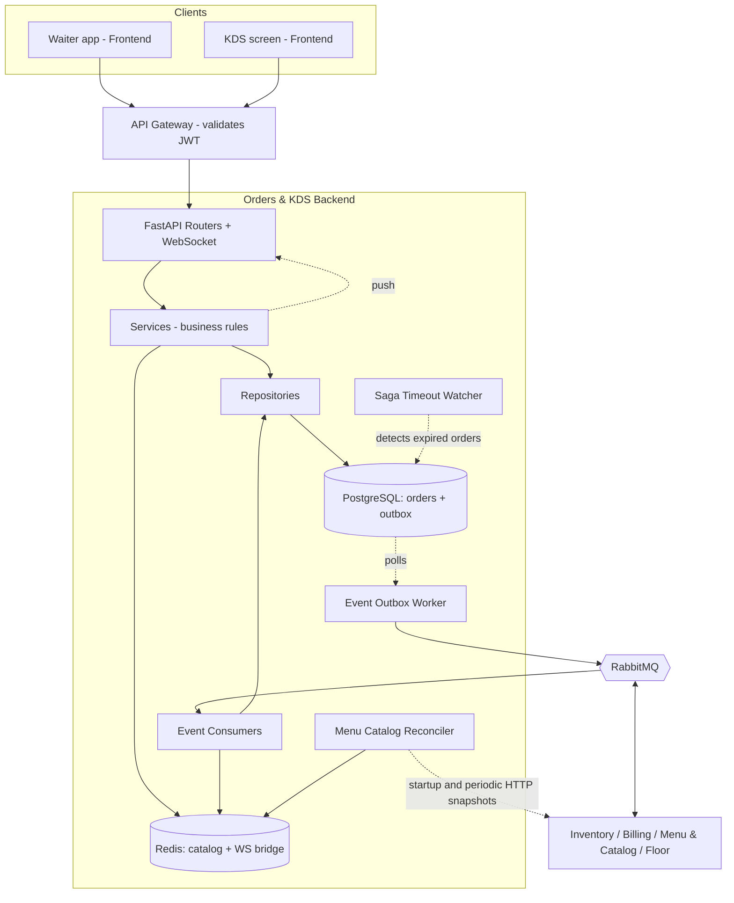
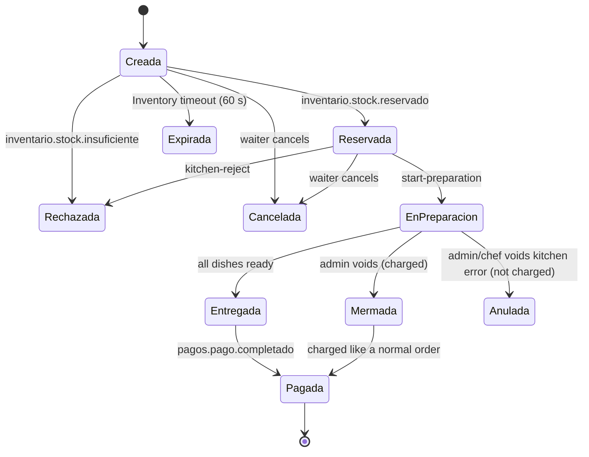
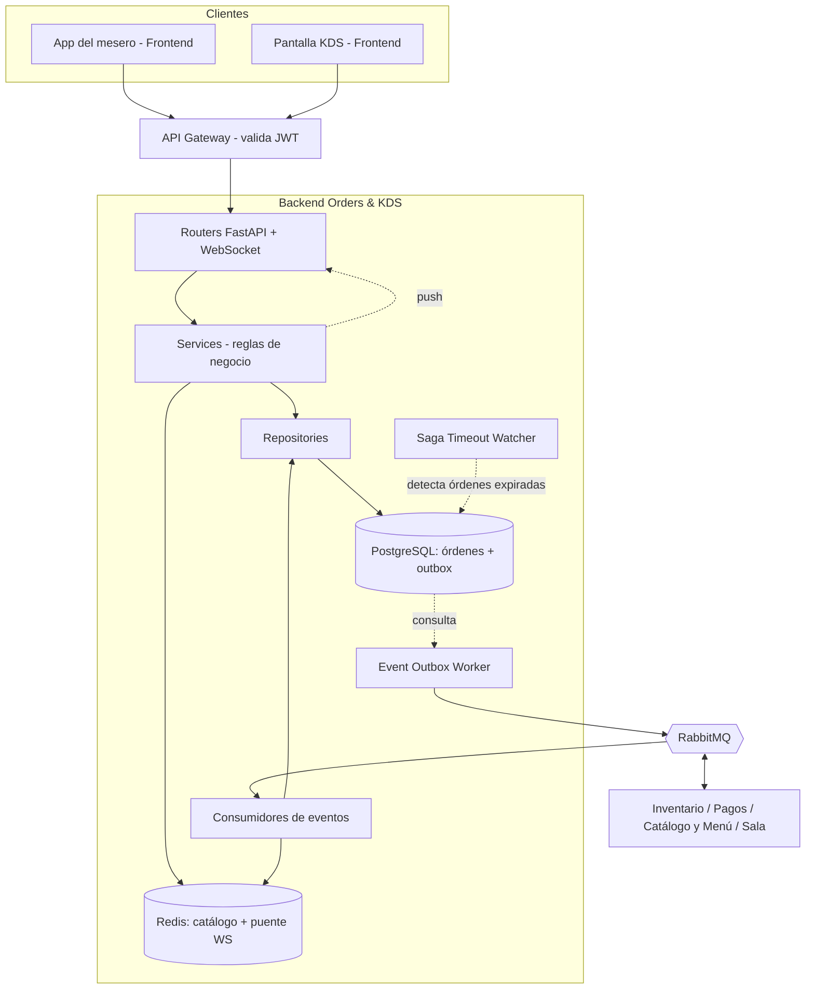
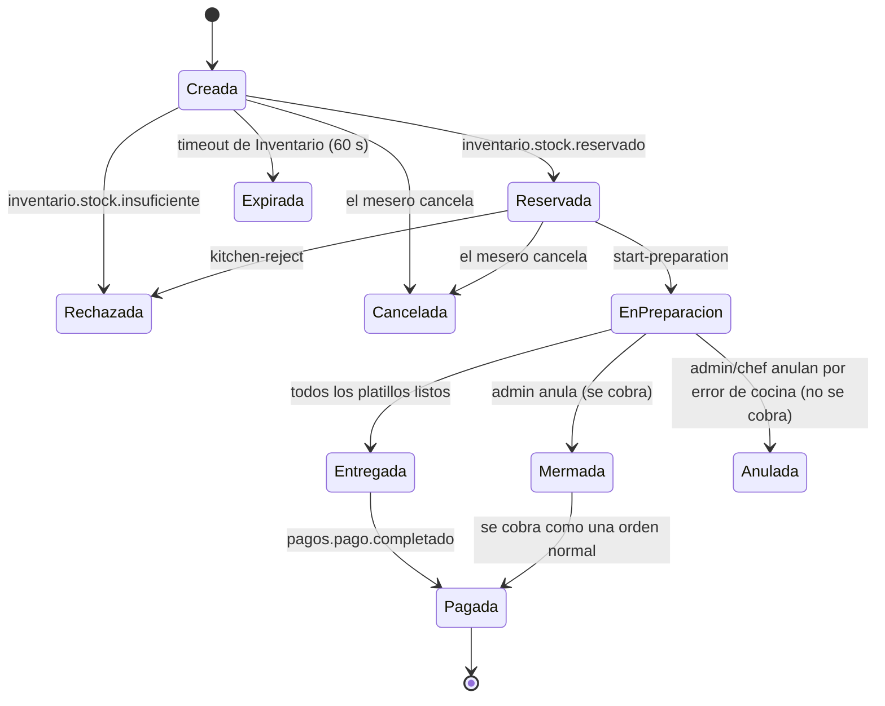

# Orders & KDS — Backend

[](https://www.python.org)
[](https://fastapi.tiangolo.com)
[](https://www.postgresql.org)
[](https://redis.io)
[](https://www.rabbitmq.com)
[](https://www.docker.com)
[](https://github.com/features/actions)
[](https://sonarcloud.io)

---

**Orders & KDS** is the *Orders and Kitchen* microservice (Microservice 4) of a distributed restaurant management system. It owns the full lifecycle of a customer order (*comanda*), feeds the Kitchen Display System (KDS) with the preparation queue, and coordinates with the rest of the system (Auth, Menu & Catalog, Floor, Inventory, Billing) **exclusively through events**.

This repository contains the **backend**: a REST + WebSocket API built with Python and FastAPI, a PostgreSQL database with the Transactional Outbox pattern, a Redis materialized view of external data, and RabbitMQ consumers/publishers. The web client lives in the sibling repository `orders-frontend`.

Key design rules:

- **100% event-driven.** No synchronous calls to other business microservices. The only documented exception is the bootstrap/reconciliation sync with Menu & Catalog, which never runs inside a user request.
- **Transactional Outbox.** A state change and the event it produces are written in the same PostgreSQL transaction; an independent *Event Outbox Worker* publishes them to RabbitMQ (at-least-once delivery, so every consumer is idempotent).
- **Choreographed Saga.** An order reaches the `RESERVED` kitchen queue after Inventory answers `inventario.stock.reservado` (or `inventory.reservation.confirmed`), and moves to `IN_PREPARATION` when kitchen starts preparation.
- **Real-time push.** State changes reach waiters and kitchen screens through WebSockets (`/ws/waiter`, `/ws/kds`), never through polling.

### Table of Contents

- [Team Members](#team-members)
- [Technology Stack](#technology-stack)
- [Architecture Overview](#architecture-overview)
- [Order Lifecycle](#order-lifecycle)
- [Inter-Service Communication & Event Contracts](#inter-service-communication--event-contracts)
- [Quick Start](#quick-start)
- [Project Structure](#project-structure)
- [Running Tests](#running-tests)
- [Documentation](#documentation)
- [Contributing](#contributing)

---

### Team Members

| # | Name | Role | GitHub | Contact |
|---|---|---|---|---|
| 1 | Suarez Balam Brandon Emanuel| Networking, Security & Concurrency Lead | [@BS435](https://github.com/BS435) | |
| 2 | Contreras Gamboa Emiliano | Backend Architect | [@EmiCG](https://github.com/EmiCG) | |
| 3 | Dzib Pech Luis Gilberto| V&V/QA Lead | [@LuisGilDzib](https://github.com/LuisGilDzib) | |
| 4 | Martínez Martínez José Pablo | Scrum Master | [@Jose-Pablo-Martinez](https://github.com/Jose-Pablo-Martinez) | |
| 5 | Matu Aguayo Leonardo Daniel | Frontend Architect | [@leonardodanielmaguayo-hub](https://github.com/leonardodanielmaguayo-hub) | |
| 6 | Vega Nolasco Erick Ricardo| Database Lead | [@eriveingsoft](https://github.com/eriveingsoft) | |

---

### Technology Stack

#### Application
| Technology | Version | Purpose |
|---|---|---|
|  | 3.12 | Main language (fully typed with type hints) |
|  | 0.142+ | Async REST API and native WebSocket support (`websockets` runtime included) for the KDS push channel |
| **Pydantic** | 2.13+ | Request/response validation and typed event schemas |
| **SQLAlchemy** + **Alembic** | 2.1+ / 1.20+ | Async ORM / query builder (parameterized queries only) and schema migrations |
| **aio-pika** | 10.x | Async RabbitMQ client for consumers and the outbox publisher |

#### Data & Messaging
| Technology | Purpose |
|---|---|
|  | ACID transactions, `shifts`, `orders`, `outbox`, `processed_events`, JSON columns, optimistic concurrency (`version` column) |
|  | Materialized view of menu catalog and cross-worker Pub/Sub bridge (`orders:realtime:events`) |
|  | Event broker (durable topic exchanges) for dual-routed events |

#### Infrastructure & DevOps
| Technology | Purpose |
|---|---|
|  | Containerized runtime (`Dockerfile`, `docker-compose.yml`, `docker-compose.ci.yml`, `docker-compose.staging.yml`) |
|  | CI/CD pipeline: lint, tests, coverage, SonarCloud, contract tests, k6 smoke, OWASP ZAP |
|  | Static analysis, Quality Gate, coverage and technical debt tracking |

#### Testing
| Technology | Purpose |
|---|---|
| **pytest** + **pytest-asyncio** + **pytest-cov** | Unit tests (with mocks) and branch coverage reports |
| **Testcontainers** | Ephemeral real PostgreSQL / RabbitMQ containers for integration tests |
| **pytest-bdd** (Gherkin) | Behavior-driven acceptance scenarios for the API (`tests/bdd/`) |
| **Postman + Newman** | Automated API and JSON-schema contract tests (`tests/api/postman/`) |
| **k6** | Modular smoke, load, stress, spike, soak, WebSocket fan-out, and stock-race performance tests (`tests/k6/`) |
| **OWASP ZAP** | Dynamic security scanning (DAST) |

### Shared staging environment

The reproducible shared environment runs on a team-managed Linux VM with
Docker. The API is published on VM port `8000` (and Gateway aliases `8082`/`8086`),
RabbitMQ AMQP on `5672`, and the RabbitMQ management UI is private on `15672`.
PostgreSQL (`ordenes_staging`) and Redis are internal services; team members
use an SSH tunnel to connect with the read-only PostgreSQL role from DBeaver or
pgAdmin. See [docs/STAGING.md](docs/STAGING.md) for deployment, migration
ownership, GitHub Environments, ports, and the smoke test.

---

### Architecture Overview



Every state change follows the same path: **Router → Service → Repository → PostgreSQL (state + outbox in one transaction) → Outbox Worker → RabbitMQ**. Incoming events follow the reverse path through the consumers and end with a WebSocket push via Redis Pub/Sub to the affected screens.

---

### Order Lifecycle

Main flow: `Creada` (`CREATED`) → `Reservada` (`RESERVED`) → `EnPreparacion` (`IN_PREPARATION`) → `Entregada` (`DELIVERED`) → `Pagada` (`PAID`).
Alternative states: `Cancelada` (`CANCELLED`), `Rechazada` (`REJECTED`), `Mermada` (`WASTED`), `Anulada` (`VOIDED`), `Expirada` (`EXPIRED`).



> The English names in parentheses are the identifiers used in the code. The mapping is defined in [`DEVELOPMENT_GUIDELINES.md`](docs/DEVELOPMENT_GUIDELINES.md).

---

### Inter-Service Communication & Event Contracts

Orders & KDS interacts with external microservices exclusively through asynchronous events over RabbitMQ (topic exchanges) backed by the PostgreSQL Transactional Outbox pattern. State changes are pushed to client devices via WebSockets (`/ws/kds` and `/ws/waiter`).

#### Master Event Mapping (Spanish / English / Code)

To preserve consistency between architectural specifications (Spanish), source code (`app/messaging/events.py` in English), and inter-service agreements, the canonical event mapping is established as follows:

| Broker Routing Key (ES) | English Routing Key / Alias | Python Constant (`EventName`) | Direction | Target Microservice | Contract Status |
|---|---|---|---|---|---|
| `ordenes.orden.creada` | `ordenes.order.created` | `ORDER_CREATED` | Publish | Inventory | Confirmed |
| `ordenes.orden.cancelada` | `ordenes.order.cancelled` | `ORDER_CANCELLED` | Publish | Inventory | Confirmed |
| `ordenes.platillo.preparado` | `ordenes.dish.prepared` | `DISH_PREPARED` | Publish | Inventory | Confirmed |
| `ordenes.comanda.mermada` | `ordenes.order.wasted` | `ORDER_WASTED` | Publish | Inventory | Confirmed (`ADMINISTRATIVE` \| `KITCHEN_ERROR`) |
| `ordenes.cuenta.solicitada` | `ordenes.bill.requested` | `BILL_REQUESTED` | Publish | Billing (Pagos) | Confirmed |
| `ordenes.cobro.solicitado` | `ordenes.charge.requested` | `CHARGE_REQUESTED` | Publish | Billing (Pagos) | Confirmed |
| `ordenes.orden.expirada` | `ordenes.order.expired` | `ORDER_EXPIRED` | Publish | Inventory | Confirmed (OP-04) |
| `sala.dining_session.iniciada` | `dining.session.started` | `DINING_SESSION_STARTED` | Consume | Floor (Sala) | Confirmed |
| `inventario.stock.reservado` | `inventory.reservation.confirmed` | `STOCK_RESERVED` | Consume | Inventory | Confirmed |
| `inventario.stock.insuficiente` | `inventory.reservation.rejected` | `STOCK_INSUFFICIENT` | Consume | Inventory | Confirmed |
| `menu.platillo.precio_actualizado` | `menu.dish.price_updated` | `MENU_DISH_PRICE_UPDATED` | Consume | Menu & Catalog | Confirmed |
| `menu.catalogo.actualizado` | `menu.catalog.updated` | `MENU_CATALOG_UPDATED` | Consume | Menu & Catalog | Confirmed |
| `pagos.pago.completado` | `payments.payment.completed` | `PAYMENT_COMPLETED` | Consume | Billing (Pagos) | Confirmed |

#### Key Integration Agreements

1. **Billing & Payments (`docs/API_COMUNICACIONES.md`, `docs/contratos_y_mensajes_integracion_ordenes_kds.md`):**
   - Normal bill requests (`ordenes.cuenta.solicitada`) occur when all items are delivered (`DELIVERED`) via `POST /orders/{orderId}/request-bill`.
   - Wasted orders with cost recovery (`ordenes.cobro.solicitado`) occur on administrative voids during preparation (`WASTED`, RF-26, RF-27).
   - Voided orders due to kitchen errors (`VOIDED`) are absorbed by the restaurant and **never** charged to customers.
   - Dual correlation: Orders provides both `orderId` and `sessionId`; Billing must return `orderId` in `pagos.pago.completado`.
   - Prices are frozen at order confirmation (`unitPrice`); Menu catalog is never queried during payment.
2. **Real-Time WebSockets (ADR-0002 & ADR-0011):**
   - Segregated endpoints: `/ws/kds` (roles `kitchen`, `chef`, `admin`) and `/ws/waiter` (roles `waiter`, `admin`).
   - Channels: `kds:station:{station}`, `kds:all`, `floor`, and `user:{userId}`.
   - Close codes: `4401` (missing/invalid token) and `4403` (forbidden role).
3. **Saga Timeout (ADR-0001):**
   - 60 seconds maximum from `confirmed_at`; watcher checks every 5 seconds.

---

### Quick Start

#### Prerequisites

- **Python** 3.12+ — [python.org](https://www.python.org)
- **Docker Desktop** (includes Docker Compose v2; WSL 2 on Windows) — [docker.com](https://www.docker.com)
- **Git** 2.40+
- *(Recommended)* a PostgreSQL client such as **DBeaver** or **pgAdmin** to browse the database. A local PostgreSQL *server* is **not** needed: the database runs in a container.
- *(Optional, for the full test suite)* **k6**, **Newman** (`npm i -g newman`)

> Exact step-by-step startup (both local `.venv` and full Docker Compose stack), seed data, ports, troubleshooting and visual DB client setup: [QUICKSTART.md §5–§8](QUICKSTART.md).
>
> New to Docker? Read the basic team guide (in Spanish) on how Docker works locally and the cloud scope: [docs/GUIA_DOCKER.md](docs/GUIA_DOCKER.md).

#### Installation

**Option A — automated bootstrap (recommended for a clean machine):**

```bash
# 1. Clone the repository
git clone https://github.com/FMAT-Restaurant/OrdersKDS-Backend.git
cd OrdersKDS-Backend

# 2. Run the bootstrap script — creates .venv, installs deps, generates .env
# Windows PowerShell:
.\scripts\bootstrap.ps1
# macOS / Linux:
bash scripts/bootstrap.sh
```

**Option B — manual steps:**

```bash
# 1. Clone the repository
git clone https://github.com/FMAT-Restaurant/OrdersKDS-Backend.git
cd OrdersKDS-Backend

# 2. Create and activate a virtual environment
python -m venv .venv
source .venv/bin/activate          # Windows: .venv\Scripts\Activate.ps1

# 3. Install dependencies
pip install -r requirements/dev.txt

# 4. Set up environment variables
python scripts/setup_env.py        # generates .env with local defaults (SAGA_TIMEOUT_SECONDS=60)

# 5. Start the infrastructure (PostgreSQL, Redis, RabbitMQ)
docker compose up -d postgres redis rabbitmq

# 6. Apply database migrations and optional demo seed data (generates & prints random UUIDv4 IDs)
alembic upgrade head
python scripts/seed_demo.py --reset

# 7. Start the API (terminal 1)
uvicorn app.main:app --reload --port 8000

# 8. Start the background workers (terminal 2)
python -m app.workers.run_all
```

The API will be available at `http://localhost:8000` and the interactive OpenAPI docs at `http://localhost:8000/docs`. The RabbitMQ management UI is at `http://localhost:15672`.

> **Note:** for local development use `python scripts/dev_token.py --role <waiter|kitchen|chef|admin>` to generate test JWTs and send them as `Authorization: Bearer <token>`.

---

### Project Structure

```
orders-backend/
├── .github/
│   ├── ISSUE_TEMPLATE/
│   ├── PULL_REQUEST_TEMPLATE.md
│   └── workflows/
│       └── ci.yml                    # Lint + tests + coverage + Sonar + contract/k6/ZAP jobs
│
├── app/
│   ├── main.py                       # FastAPI application factory & lifespan
│   ├── alembic/                      # Alembic migration environment and versions
│   ├── api/                          # Controllers: HTTP routers and WebSocket endpoints
│   │   ├── routers/                  # orders.py, kds.py, shifts.py
│   │   ├── websockets/               # routes.py (/ws/kds, /ws/waiter)
│   │   ├── dependencies/             # Auth context & PBAC guards, DB session
│   │   └── schemas/                  # Pydantic request/response models
│   ├── services/                     # Business rules, shift folios, lifecycle transitions
│   ├── domain/                       # OrderStatus, AccessPolicy, state machine, domain errors
│   ├── repositories/                 # SQL access (SQLAlchemy), outbox, shifts
│   ├── db/                           # ORM models, async session factory
│   ├── messaging/
│   │   ├── consumers/                # Handlers for inventario.*, pagos.*, menu.*, sala.* events
│   │   ├── publisher.py              # RabbitMQ publishing used by the outbox worker
│   │   ├── validator.py              # JSON Schema payload validator
│   │   └── events.py                 # Event names and typed payload schemas
│   ├── realtime/                     # WebSocket router & Redis Pub/Sub bridge
│   ├── workers/                      # run_all.py, outbox_worker.py, saga_timeout_watcher.py, inbound_consumer.py, catalog_reconciliation.py
│   ├── cache/                        # Redis materialized view (catalog)
│   └── core/                         # Config, error codes
│
├── contracts/
│   └── events/                       # JSON Schemas of every published/consumed event
│
├── tests/
│   ├── unit/                         # Services and domain logic with mocks
│   ├── integration/                  # Repositories + outbox with Testcontainers
│   ├── contract/                     # Event and REST contract tests
│   ├── bdd/                          # Gherkin .feature files + step definitions
│   ├── api/postman/                  # Postman collection + environments (run with Newman)
│   ├── k6/                           # Modular k6 performance scripts (smoke, load, stress, etc.)
│   └── security/zap/                 # OWASP ZAP configuration and rules
│
├── scripts/                          # dev_token.py, seed_demo.py, setup_env.py, bootstrap
├── docs/                             # Full project documentation
├── docker-compose.yml
├── docker-compose.ci.yml
├── docker-compose.staging.yml
├── Dockerfile
├── alembic.ini
├── pyproject.toml                    # ruff, mypy, pytest and coverage configuration
├── sonar-project.properties
└── .env.example
```

---

### Running Tests

```bash
# Unit tests
pytest tests/unit -v

# Unit tests with coverage report
pytest tests/unit --cov=app --cov-branch --cov-report=term-missing --cov-report=xml

# Integration tests (starts ephemeral PostgreSQL/RabbitMQ containers, Docker required)
pytest tests/integration -v

# Contract and BDD tests
pytest tests/contract tests/bdd -v

# API collection with Newman (API must be running)
newman run tests/api/postman/orders-kds.postman_collection.json \
  -e tests/api/postman/local.postman_environment.json

# Performance smoke / load tests with k6 (API must be running)
k6 run tests/k6/scenarios/smoke.js
k6 run tests/k6/scenarios/load.js

# Static analysis and typing
ruff check . && ruff format --check . && mypy --strict app
```

The complete strategy (levels, tools, thresholds and traceability) is described in [`docs/VyV_OrdenesKDS.md`](docs/VyV_OrdenesKDS.md).

---

### Documentation

Full documentation is in the [`docs/`](docs/) folder:

| Document | Description |
|---|---|
| [`ERS_ordeneskds.md`](docs/ERS_ordeneskds.md) | Software Requirements Specification (v4) |
| [`Arquitectura_ordeneskds.md`](docs/Arquitectura_ordeneskds.md) | Complete architecture: internal API and published events |
| [`API_COMUNICACIONES.md`](docs/API_COMUNICACIONES.md) | Synchronous (REST/WebSocket) and asynchronous (broker) communication |
| [`CONTRATOS_MENSAJERIA_INTER_MICROSERVICIOS.md`](docs/CONTRATOS_MENSAJERIA_INTER_MICROSERVICIOS.md) | Cross-service RabbitMQ contracts and payload mappings |
| [`ordenes-kds-diagramas-secuencia.md`](docs/ordenes-kds-diagramas-secuencia.md) | Sequence diagrams of every event flow |
| [`DEVELOPMENT_GUIDELINES.md`](docs/DEVELOPMENT_GUIDELINES.md) | Coding standards and rules for humans and AI agents |
| [`VyV_OrdenesKDS.md`](docs/VyV_OrdenesKDS.md) | Verification & Validation plan |
| [`STAGING.md`](docs/STAGING.md) | Shared staging deployment and migration runbook |
| [`k6_breakpoint_report.md`](docs/k6_breakpoint_report.md) | k6 capacity and bottleneck analysis report |
| [`CONTRIBUTING.md`](docs/CONTRIBUTING.md) | Contribution guidelines and workflow |
| [`GUIA_DOCKER.md`](docs/GUIA_DOCKER.md) | Local and containerized Docker guide (Spanish) |

---

### Contributing

1. Read [`docs/DEVELOPMENT_GUIDELINES.md`](docs/DEVELOPMENT_GUIDELINES.md) and [`docs/CONTRIBUTING.md`](docs/CONTRIBUTING.md) before contributing.
2. Create a branch from `develop`:
   ```bash
   git checkout -b feat/your-feature-name
   ```
3. Make sure everything passes locally before opening a PR:
   ```bash
   ruff check . && ruff format --check . && mypy --strict app
   pytest tests/unit tests/contract tests/bdd
   ```
4. Open a Pull Request against `develop` using the provided template.
5. The CI pipeline and the SonarCloud Quality Gate must pass before any PR can be merged.

---
---

## Español

**Orders & KDS** es el microservicio de *Órdenes y Cocina* (Microservicio 4) de un sistema distribuido de gestión de restaurantes. Es dueño del ciclo de vida completo de una comanda, alimenta la cola de preparación de la pantalla de cocina (KDS) y se coordina con el resto del sistema (Auth, Catálogo y Menú, Sala, Inventario, Pagos) **exclusivamente mediante eventos**.

Este repositorio contiene el **backend**: una API REST + WebSocket construida con Python y FastAPI, una base de datos PostgreSQL con el patrón Transactional Outbox, una vista materializada de datos externos en Redis, y consumidores/publicadores de RabbitMQ. El cliente web vive en el repositorio hermano `orders-frontend`.

Reglas de diseño clave:

- **100% orientado a eventos.** No hay llamadas síncronas a otros microservicios de negocio. La única excepción documentada es la sincronización de arranque/reconciliación con Catálogo y Menú, que nunca se ejecuta dentro de una petición de usuario.
- **Transactional Outbox.** Un cambio de estado y el evento que produce se escriben en la misma transacción de PostgreSQL; un *Event Outbox Worker* independiente los publica en RabbitMQ (entrega *at-least-once*, por lo que todo consumidor es idempotente).
- **Saga coreografiada.** Una orden pasa a `RESERVED` en cocina cuando Inventario responde `inventario.stock.reservado` (o `inventory.reservation.confirmed`), y transiciona a `IN_PREPARATION` al iniciar preparación.
- **Push en tiempo real.** Los cambios de estado llegan a meseros y pantallas de cocina por WebSocket (`/ws/waiter`, `/ws/kds`), nunca por polling.

### Tabla de Contenidos

- [Miembros del Equipo](#miembros-del-equipo)
- [Stack Tecnológico](#stack-tecnológico-1)
- [Visión General de la Arquitectura](#visión-general-de-la-arquitectura)
- [Ciclo de Vida de la Orden](#ciclo-de-vida-de-la-orden)
- [Instalación Rápida](#instalación-rápida)
- [Estructura del Proyecto](#estructura-del-proyecto-1)
- [Ejecución de Tests](#ejecución-de-tests)
- [Documentación](#documentación-1)
- [Contribución](#contribución-1)

---

### Miembros del Equipo

| # | Nombre | Rol | GitHub | Contacto |
|---|---|---|---|---|
| 1 | Suarez Balam Brandon Emanuel| Líder de redes, seguridad y concurrencia | [@BS435](https://github.com/BS435) | |
| 2 | Contreras Gamboa Emiliano | Arquitecto backend | [@EmiCG](https://github.com/EmiCG) | |
| 3 | Dzib Pech Luis Gilberto| Responsable VyV-QA| [@LuisGilDzib](https://github.com/LuisGilDzib) | |
| 4 | Martínez Martínez José Pablo | Scrum master | [@Jose-Pablo-Martinez](https://github.com/Jose-Pablo-Martinez) | |
| 5 | Matu Aguayo Leonardo Daniel | Arquitecto Frontend | [@leonardodanielmaguayo-hub](https://github.com/leonardodanielmaguayo-hub) | |
| 6 | Vega Nolasco Erick Ricardo| Líder de base de datos | [@eriveingsoft](https://github.com/eriveingsoft) | |

---

### Stack Tecnológico

#### Aplicación
| Tecnología | Versión | Propósito |
|---|---|---|
|  | 3.12 | Lenguaje principal (totalmente tipado con type hints) |
|  | 0.142+ | API REST asíncrona y soporte nativo de WebSockets (`websockets` incluido en runtime) para el canal push |
| **Pydantic** | 2.13+ | Validación de peticiones/respuestas y esquemas tipados de eventos |
| **SQLAlchemy** + **Alembic** | 2.1+ / 1.20+ | ORM asíncrono / query builder (solo consultas parametrizadas) y migraciones de esquema |
| **aio-pika** | 10.x | Cliente asíncrono de RabbitMQ para consumidores y publicador del outbox |

#### Datos y Mensajería
| Tecnología | Propósito |
|---|---|
|  | Transacciones ACID, tablas `shifts`, `orders`, `outbox`, `processed_events`, concurrencia optimista (`version`) |
|  | Vista materializada del catálogo y puente Pub/Sub multi-worker (`orders:realtime:events`) |
|  | Broker de eventos (exchanges tipo topic durables) para eventos con enrutamiento dual |

#### Infraestructura y DevOps
| Tecnología | Propósito |
|---|---|
|  | Runtime contenerizado (`Dockerfile`, `docker-compose.yml`, `docker-compose.ci.yml`, `docker-compose.staging.yml`) |
|  | Pipeline CI/CD: lint, tests, cobertura, SonarCloud, pruebas de contrato, k6 smoke, OWASP ZAP |
|  | Análisis estático, Quality Gate, cobertura y deuda técnica |

#### Testing
| Tecnología | Propósito |
|---|---|
| **pytest** + **pytest-asyncio** + **pytest-cov** | Tests unitarios (con mocks) y reportes de cobertura |
| **Testcontainers** | Contenedores efímeros reales de PostgreSQL / RabbitMQ para pruebas de integración |
| **pytest-bdd** (Gherkin) | Escenarios de aceptación guiados por comportamiento para la API (`tests/bdd/`) |
| **Postman + Newman** | Pruebas automatizadas de API y de contrato (`tests/api/postman/`) |
| **k6** | Pruebas modulares de carga, humo, estrés, spike, soak y fan-out WebSocket (`tests/k6/`) |
| **OWASP ZAP** | Escaneo dinámico de seguridad (DAST) |

---

### Visión General de la Arquitectura



Todo cambio de estado sigue el mismo camino: **Router → Service → Repository → PostgreSQL (estado + outbox en una transacción) → Outbox Worker → RabbitMQ**. Los eventos entrantes siguen el camino inverso por los consumidores y terminan con un push por WebSocket vía Redis Pub/Sub a las pantallas afectadas.

---

### Ciclo de Vida de la Orden

Flujo principal: `Creada` (`CREATED`) → `Reservada` (`RESERVED`) → `EnPreparacion` (`IN_PREPARATION`) → `Entregada` (`DELIVERED`) → `Pagada` (`PAID`).
Estados alternativos: `Cancelada` (`CANCELLED`), `Rechazada` (`REJECTED`), `Mermada` (`WASTED`), `Anulada` (`VOIDED`), `Expirada` (`EXPIRED`).



> Los nombres en inglés entre paréntesis son los identificadores usados en el código. La equivalencia está definida en [`DEVELOPMENT_GUIDELINES.md`](docs/DEVELOPMENT_GUIDELINES.md).

---

### Instalación Rápida

#### Prerrequisitos

- **Python** 3.12+ — [python.org](https://www.python.org)
- **Docker Desktop** (incluye Docker Compose v2; WSL 2 en Windows) — [docker.com](https://www.docker.com)
- **Git** 2.40+
- *(Recomendado)* un cliente de PostgreSQL como **DBeaver** o **pgAdmin** para explorar la base de datos. **No** se necesita un *servidor* PostgreSQL local: la base de datos corre en un contenedor.
- *(Opcional, para la suite completa de pruebas)* **k6**, **Newman** (`npm i -g newman`)

> Arranque exacto paso a paso (tanto en `.venv` local como en contenedores Docker completos), datos demo, puertos, solución de problemas y conexión de cliente visual de BD: [QUICKSTART.md §5–§8](QUICKSTART.md).
>
> ¿Primera vez con Docker? Lee la guía básica del equipo sobre cómo funciona Docker en local y en contenedores: [docs/GUIA_DOCKER.md](docs/GUIA_DOCKER.md).

#### Pasos

**Opción A — bootstrap automatizado (recomendado en máquina limpia):**

```bash
# 1. Clonar el repositorio
git clone https://github.com/FMAT-Restaurant/OrdersKDS-Backend.git
cd OrdersKDS-Backend

# 2. Ejecutar el script de bootstrap — crea .venv, instala dependencias y genera .env
# Windows PowerShell:
.\scripts\bootstrap.ps1
# macOS / Linux:
bash scripts/bootstrap.sh
```

**Opción B — pasos manuales:**

```bash
# 1. Clonar el repositorio
git clone https://github.com/FMAT-Restaurant/OrdersKDS-Backend.git
cd OrdersKDS-Backend

# 2. Crear y activar un entorno virtual
python -m venv .venv
source .venv/bin/activate          # Windows: .venv\Scripts\Activate.ps1

# 3. Instalar dependencias
pip install -r requirements/dev.txt

# 4. Configurar variables de entorno
python scripts/setup_env.py        # genera .env con valores locales por defecto (SAGA_TIMEOUT_SECONDS=60)

# 5. Levantar la infraestructura (PostgreSQL, Redis, RabbitMQ)
docker compose up -d postgres redis rabbitmq

# 6. Aplicar las migraciones de base de datos y cargar datos demo opcionales (genera e imprime UUIDv4 aleatorios)
alembic upgrade head
python scripts/seed_demo.py --reset

# 7. Levantar la API (terminal 1)
uvicorn app.main:app --reload --port 8000

# 8. Levantar los workers en segundo plano (terminal 2)
python -m app.workers.run_all
```

La API estará disponible en `http://localhost:8000` y la documentación OpenAPI interactiva en `http://localhost:8000/docs`. La interfaz de administración de RabbitMQ está en `http://localhost:15672`.

> **Nota:** en desarrollo local usa `python scripts/dev_token.py --role <waiter|kitchen|chef|admin>` para generar JWTs de prueba y envíalos como `Authorization: Bearer <token>`.

---

### Estructura del Proyecto

```
orders-backend/
├── .github/
│   ├── ISSUE_TEMPLATE/
│   ├── PULL_REQUEST_TEMPLATE.md
│   └── workflows/
│       └── ci.yml                    # Lint + tests + cobertura + Sonar + jobs de contrato/k6/ZAP
│
├── app/
│   ├── main.py                       # Fábrica de la aplicación FastAPI y lifespan
│   ├── alembic/                      # Entorno y migraciones de Alembic
│   ├── api/                          # Controladores: routers HTTP y endpoints WebSocket
│   │   ├── routers/                  # orders.py, kds.py, shifts.py
│   │   ├── websockets/               # routes.py (/ws/kds, /ws/waiter)
│   │   ├── dependencies/             # Contexto de auth y guards PBAC, sesión de BD
│   │   └── schemas/                  # Modelos Pydantic de entrada/salida
│   ├── services/                     # Reglas de negocio, folios de turno y transiciones
│   ├── domain/                       # OrderStatus, AccessPolicy, máquina de estados, errores de dominio
│   ├── repositories/                 # Acceso SQL (SQLAlchemy), outbox, turnos
│   ├── db/                           # Modelos ORM, fábrica de sesiones asíncronas
│   ├── messaging/
│   │   ├── consumers/                # Handlers de eventos inventario.*, pagos.*, menu.*, sala.*
│   │   ├── publisher.py              # Publicación a RabbitMQ usada por el outbox worker
│   │   ├── validator.py              # Validador de esquemas JSON Schema
│   │   └── events.py                 # Nombres de eventos y esquemas tipados
│   ├── realtime/                     # Enrutador WebSocket y puente Redis Pub/Sub
│   ├── workers/                      # run_all.py, outbox_worker.py, saga_timeout_watcher.py, inbound_consumer.py, catalog_reconciliation.py
│   ├── cache/                        # Vista materializada en Redis (catálogo)
│   └── core/                         # Configuración y códigos de error
│
├── contracts/
│   └── events/                       # JSON Schemas de cada evento publicado/consumido
│
├── tests/
│   ├── unit/                         # Services y lógica de dominio con mocks
│   ├── integration/                  # Repositories + outbox con Testcontainers
│   ├── contract/                     # Pruebas de contrato de eventos y REST
│   ├── bdd/                          # Archivos .feature Gherkin + step definitions
│   ├── api/postman/                  # Colección Postman + entornos (se ejecuta con Newman)
│   ├── k6/                           # Scripts modulares k6 (smoke, load, stress, etc.)
│   └── security/zap/                 # Configuración y reglas de OWASP ZAP
│
├── scripts/                          # dev_token.py, seed_demo.py, setup_env.py, bootstrap
├── docs/                             # Documentación completa del proyecto
├── docker-compose.yml
├── docker-compose.ci.yml
├── docker-compose.staging.yml
├── Dockerfile
├── alembic.ini
├── pyproject.toml                    # Configuración de ruff, mypy, pytest y cobertura
├── sonar-project.properties
└── .env.example
```

---

### Ejecución de Tests

```bash
# Tests unitarios
pytest tests/unit -v

# Tests unitarios con reporte de cobertura
pytest tests/unit --cov=app --cov-report=term-missing --cov-report=xml

# Tests de integración (levanta contenedores efímeros de PostgreSQL/RabbitMQ, requiere Docker)
pytest tests/integration -v

# Pruebas de contrato y BDD
pytest tests/contract tests/bdd -v

# Colección de API con Newman (la API debe estar corriendo)
newman run tests/api/postman/orders-kds.postman_collection.json \
  -e tests/api/postman/local.postman_environment.json

# Pruebas de humo y carga con k6 (la API debe estar corriendo)
k6 run tests/k6/scenarios/smoke.js
k6 run tests/k6/scenarios/load.js

# Análisis estático y tipado
ruff check . && ruff format --check . && mypy --strict app
```

La estrategia completa (niveles, herramientas, umbrales y trazabilidad) está descrita en [`docs/VyV_OrdenesKDS.md`](docs/VyV_OrdenesKDS.md).

---

### Documentación

La documentación completa se encuentra en la carpeta [`docs/`](docs/):

| Documento | Descripción |
|---|---|
| [`ERS_ordeneskds.md`](docs/ERS_ordeneskds.md) | Especificación de Requisitos de Software (v4) |
| [`Arquitectura_ordeneskds.md`](docs/Arquitectura_ordeneskds.md) | Arquitectura completa: API interna y eventos publicados |
| [`API_COMUNICACIONES.md`](docs/API_COMUNICACIONES.md) | Comunicación síncrona (REST/WebSocket) y asíncrona (broker) |
| [`CONTRATOS_MENSAJERIA_INTER_MICROSERVICIOS.md`](docs/CONTRATOS_MENSAJERIA_INTER_MICROSERVICIOS.md) | Contratos RabbitMQ entre microservicios y mapeos de payloads |
| [`ordenes-kds-diagramas-secuencia.md`](docs/ordenes-kds-diagramas-secuencia.md) | Diagramas de secuencia de cada flujo de eventos |
| [`DEVELOPMENT_GUIDELINES.md`](docs/DEVELOPMENT_GUIDELINES.md) | Estándares de código y reglas para humanos y agentes IA |
| [`VyV_OrdenesKDS.md`](docs/VyV_OrdenesKDS.md) | Plan de Verificación y Validación |
| [`STAGING.md`](docs/STAGING.md) | Runbook de despliegue y migraciones en Staging compartido |
| [`k6_breakpoint_report.md`](docs/k6_breakpoint_report.md) | Reporte de capacidad y cuellos de botella con k6 |
| [`CONTRIBUTING.md`](docs/CONTRIBUTING.md) | Guías de contribución y flujo de trabajo |
| [`GUIA_DOCKER.md`](docs/GUIA_DOCKER.md) | Guía básica de uso de Docker en local y en contenedores |

---

### Contribución

1. Lee [`docs/DEVELOPMENT_GUIDELINES.md`](docs/DEVELOPMENT_GUIDELINES.md) y [`docs/CONTRIBUTING.md`](docs/CONTRIBUTING.md) antes de contribuir.
2. Crea una rama a partir de `develop`:
   ```bash
   git checkout -b feat/nombre-de-la-funcionalidad
   ```
3. Asegúrate de que todo pase localmente antes de abrir un PR:
   ```bash
   ruff check . && ruff format --check . && mypy --strict app
   pytest tests/unit tests/contract tests/bdd
   ```
4. Abre un Pull Request contra `develop` usando el template proporcionado.
5. El pipeline de CI y el Quality Gate de SonarCloud deben pasar antes de que cualquier PR pueda ser mergeado.
