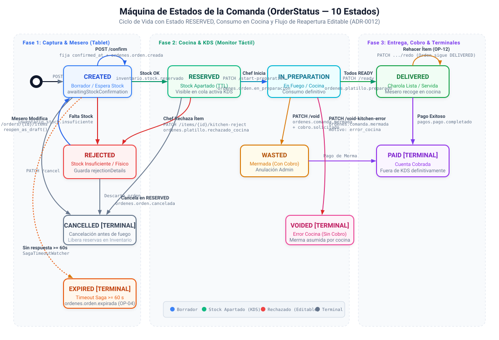
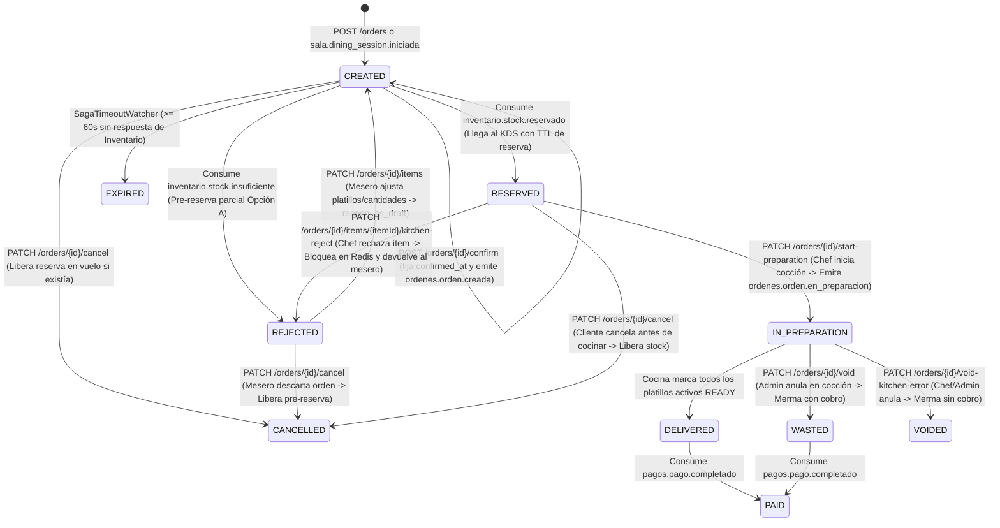
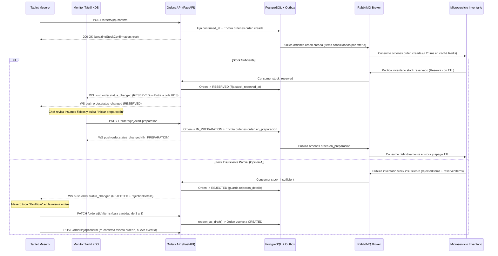
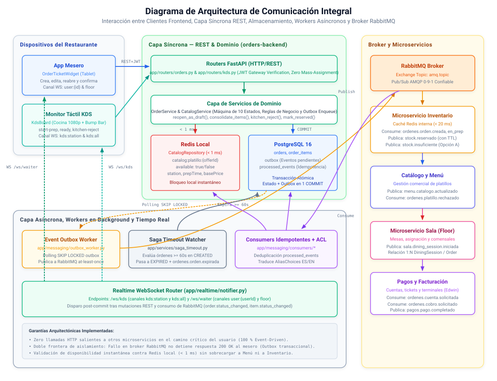
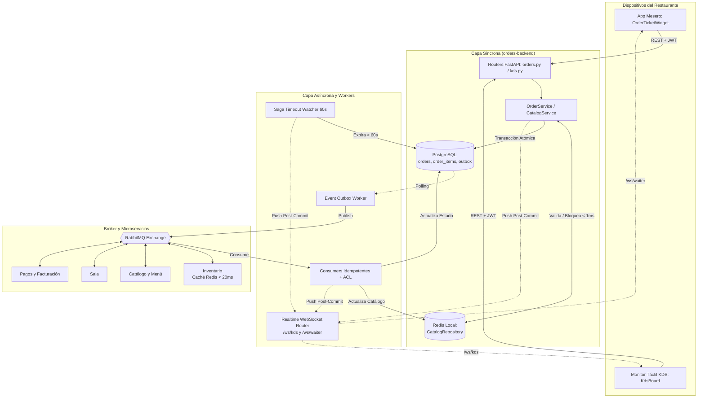

# Arquitectura de Comunicación — Microservicio de Órdenes y Cocina (Orders & KDS)

> Este documento complementa `ordenes-kds-diagramas-secuencia.md` y `CONTRATOS_MENSAJERIA_INTER_MICROSERVICIOS.md`. Mientras los diagramas de secuencia cubren **qué** eventos se intercambian con otros microservicios, este documento especifica **cómo** funciona internamente la API de Órdenes y Cocina (`orders-backend`) para producir y consumir esos mensajes — tanto en la capa síncrona (REST y WebSocket hacia los clientes de este microservicio) como en la capa asíncrona (broker RabbitMQ hacia/desde Inventario, Pagos, Catálogo/Menú y Sala), incluyendo los **ejemplos exactos de todos los contratos JSON vigentes tras la refactorización de Sprint 4 (ADR-0012)**.

---

## 0. Aclaración previa: no hay llamadas síncronas hacia otros microservicios de negocio

Antes de listar cualquier llamada síncrona, se deja constancia de una restricción de diseño fijada en los documentos base del proyecto:

- La arquitectura del proyecto es **100 % orientada a eventos**, **sin llamadas síncronas entre microservicios de negocio** durante la atención de peticiones de usuario.
- Ningún endpoint de `orders-backend` invoca de forma síncrona por HTTP a Inventario, Pagos, Sala o Menú; toda coordinación inter-dominio ocurre publicando o consumiendo eventos en RabbitMQ.
- La aparición de una comanda en la pantalla del KDS **no ocurre de forma directa** al confirmar el pedido, sino **tras consumir** el evento `inventario.stock.reservado`, momento en el que la orden transita al estado `RESERVED` (`stock_reserved_at`) y se notifica por WebSocket al KDS y al mesero.
- Del mismo modo, el descuento definitivo de insumos en Inventario ocurre de forma asíncrona cuando el Chef inicia la preparación física en cocina (`PATCH /orders/{orderId}/start-preparation`), lo que emite el evento `ordenes.orden.en_preparacion`.

**Conclusión arquitectónica:** En el camino crítico de cada request de usuario (crear comanda, agregar platillos, confirmar, iniciar preparación, rechazar insumo en cocina, marcar platillo listo, cancelar o solicitar cuenta), la lista de llamadas HTTP síncronas salientes hacia otros microservicios es vacía. Existe **una única excepción legítima y acotada a procesos de sistema**: una llamada síncrona saliente hacia Catálogo y Menú exclusivamente para **arranque inicial (bootstrap) y reconciliación periódica** de la vista materializada en Redis (ver sección 1.4).

Las tres superficies de comunicación del microservicio son:

| Capa | Dirección | Protocolo | Hacia / Desde quién |
|---|---|---|---|
| **API REST síncrona** | Entrante | HTTP/REST (FastAPI) | Clientes frontend: App móvil/tablet del mesero (`OrderTicketWidget`), Monitor de Sala, Pantalla táctil KDS (`KdsBoard`) |
| **Notificación en tiempo real** | Saliente (push) | WebSocket (`/ws/kds`, `/ws/waiter`) | Pantallas KDS por estación y dispositivos de meseros / piso |
| **Sincronización de arranque (excepción)** | Saliente, fuera del request de usuario | HTTP/REST síncrono | Catálogo y Menú — exclusivamente para bootstrap y reconciliación periódica (ver 1.4) |
| **Mensajería asíncrona de dominio** | Saliente (Outbox) y Entrante (Consumers) | AMQP 0-9-1 vía RabbitMQ | Microservicios de Inventario, Pagos, Catálogo/Menú y Sala |

---

## 1. Capa síncrona: API REST expuesta por Órdenes y Cocina

Esta superficie comunica a los **dispositivos físicos del restaurante** (tablets/handhelds del mesero y monitores táctiles 1920×1080 con Bump Bar secundario en cocina) con `orders-backend`.

### 1.1 Principios de diseño de esta capa

- **Autenticación por token JWT verificada en el API Gateway (ADR-0011):** El identificador del usuario autenticado (`user_id`) y su rol (`waiter`, `kitchen`, `chef`, `admin`) se extraen de las claims del JWT en cada petición mediante la dependencia `get_auth_context` / `require_roles`. Ningún cuerpo JSON acepta `userId`, `status`, `confirmedAt` ni `confirmedBy` para prevenir vulnerabilidades de *mass assignment*.
- **Transaccionalidad atómica con Outbox:** Cada endpoint que muta estado persiste en **una sola transacción de PostgreSQL** tanto el cambio en las tablas `orders` / `order_items` como el registro del evento en la tabla `outbox`. El controlador responde al cliente inmediatamente después del `COMMIT`, sin esperar respuestas remotas de otros microservicios.
- **Validación en tiempo real contra caché Redis (`< 1 ms`):** Al crear o editar ítems de una comanda, `orders-backend` consulta su proyección local en Redis (`CatalogRepository`) para verificar que el platillo exista y esté disponible (`available: true`), congelando su nombre y precio unitario. Si el platillo no está disponible (por agotamiento en Inventario o por un rechazo previo en cocina), responde inmediatamente con `422 Unprocessable Entity` (`DISH_UNAVAILABLE`).
- **Ciclo de vida de 10 estados (`OrderStatus`) y 4 estados de ítem (`ItemStatus`):**
  - `OrderStatus`: `CREATED`, `RESERVED`, `IN_PREPARATION`, `DELIVERED`, `PAID`, `CANCELLED`, `REJECTED`, `WASTED`, `VOIDED`, `EXPIRED`.
  - `ItemStatus`: `PENDING`, `READY`, `DELIVERED`, `CANCELLED`.



<details>
<summary>Ver especificación en código Mermaid</summary>



</details>

---

### 1.2 Catálogo completo de endpoints REST implementados

#### Vista 1 — Monitor de Mesas y Listado de Comandas (Sala / Mesero)
| Método | Ruta | Roles permitidos | Requisitos | Comportamiento y Contrato |
|---|---|---|---|---|
| `GET` | `/orders?status=&diningSessionId=` | `waiter`, `kitchen`, `chef`, `admin` | RF-16, RF-18 | Lista comandas filtrando opcionalmente por `status` (validado contra los 10 estados de `OrderStatus`) y/o por `diningSessionId` (UUID) para obtener las **múltiples órdenes asociadas a una misma sesión de mesa (`1:N`)**. |
| `GET` | `/orders/{orderId}` | `waiter`, `kitchen`, `chef`, `admin` | RF-16, RF-18 | Obtiene el detalle completo de una comanda (`OrderResponse`), incluyendo `diningSessionId`, `awaitingStockConfirmation`, `stockReservedAt`, `inPreparationAt`, `rejectionDetails` e `items`. |
| `POST` | `/orders` | `waiter`, `admin` | RF-12, RF-14, RF-15, RF-17 | Crea una comanda en borrador (`CREATED`). Soporta comandas de mesa (`tableId`), para llevar (`orderType: "takeaway"`) y vinculación `1:N` mediante `diningSessionId`. Valida disponibilidad en Redis y congela precios. |

#### Vista 2 — Gestor de Comanda (`OrderTicketWidget` — Mesero)
| Método | Ruta | Roles permitidos | Requisitos | Comportamiento y Contrato |
|---|---|---|---|---|
| `PATCH` | `/orders/{orderId}/items` | `waiter`, `admin` | RF-13, RF-14, RF-17, OP-05, ADR-0012 | Reemplaza/actualiza la lista de platillos, cantidades, modificadores y notas.<br>• **En `CREATED` sin `confirmed_at`:** actualiza el borrador.<br>• **En `CREATED` con `confirmed_at`:** rechaza con `409 INVALID_STATE_TRANSITION` (edición congelada mientras espera respuesta de Inventario).<br>• **En `REJECTED` (Reapertura Editable Opción A):** ejecuta automáticamente `order.reopen_as_draft()`, regresando la orden a `CREATED` y limpiando `confirmed_at` y `rejection_details` para que el mesero ajuste cantidades o cambie el platillo agotado sobre el **mismo `orderId`**. |
| `PATCH` | `/orders/{orderId}/transfer` | `waiter`, `admin` | RF-16, RNF-09 | Transfiere la comanda a otra mesa (`newTableId`) verificando concurrencia optimista (`version`). |
| `POST` | `/orders/{orderId}/confirm` | `waiter`, `admin` | RF-32, RF-33, OP-05, ADR-0012 | **Idempotente.** Fija `confirmed_at` y `confirmed_by`, consolida renglones repetidos por `offerId` sumando sus cantidades (`_consolidate_order_items`) y encola `ordenes.orden.creada` en el Outbox con un `eventId` determinista por intento (`attempt_key=order.version`).<br>• Si ya está confirmada o en `RESERVED`, `IN_PREPARATION`, `DELIVERED`, `WASTED`, `PAID`: retorna `200 OK` sin duplicar evento.<br>• Si está en `CANCELLED`, `REJECTED`, `EXPIRED`, `VOIDED`: retorna `409 INVALID_STATE_TRANSITION` (en `REJECTED` debe editarse primero con `PATCH …/items`). |
| `PATCH` (y `POST`) | `/orders/{orderId}/cancel` | `waiter`, `admin` | RF-24, RF-25, OP-05, ADR-0012 | Cancela la comanda completa pasando a `CANCELLED`.<br>• **Permitido en `CREATED`, `RESERVED` y `REJECTED`.**<br>• Si la orden ya había sido confirmada (`confirmed_at != null`) o estaba en `RESERVED` o `REJECTED`, encola `ordenes.orden.cancelada` con `itemsCancelados` consolidados para que Inventario libere las reservas.<br>• **Bloqueado en `IN_PREPARATION`** con `409 INVALID_STATE_TRANSITION`. |
| `PATCH` | `/orders/{orderId}/items/{itemId}/redo` | `waiter`, `admin` | RF-22, OP-12 | Solicita rehacer un platillo ya entregado (`DELIVERED -> PENDING`) exigiendo `{ "note": "..." }`. La orden matriz conserva el estado `DELIVERED`. |
| `POST` | `/orders/{orderId}/request-bill` | `waiter`, `admin` | RF-20, RF-21 | Solicita el cierre de cuenta para una orden en `DELIVERED`, encolando `ordenes.cuenta.solicitada` hacia Pagos. |

#### Vista 3 — Pantalla KDS (Cocina: Monitor Táctil Principal y Bump Bar Secundario)
| Método | Ruta | Roles permitidos | Requisitos | Comportamiento y Contrato |
|---|---|---|---|---|
| `GET` | `/kds/queue?station=&view=` | `kitchen`, `chef`, `admin` | RF-01..04, RF-08, OP-09, OP-11 | Devuelve la cola del KDS.<br>• `view=active` (por defecto): incluye órdenes en **`RESERVED`**, **`IN_PREPARATION`** y aquellas **`DELIVERED` con al menos un ítem `PENDING`**. Ordenadas por antigüedad real en cocina: `COALESCE(in_preparation_at, stock_reserved_at, created_at) ASC`, desempatando por `created_at ASC` y `public_id ASC` (**OP-11 cerrado**).<br>• `view=delivered`: órdenes entregadas pendientes de pago.<br>• Resuelve `station` y `preparationTime` desde `CatalogRepository` en Redis. |
| `PATCH` (y `POST`) | `/orders/{orderId}/start-preparation` | `kitchen`, `chef`, `admin` | RF-09, RF-10, RF-18, OP-11, ADR-0012 | **Inicio manual de cocción por el Chef.** Transiciona la orden de `RESERVED` a `IN_PREPARATION`, fija `in_preparation_at` y encola en el Outbox el evento **`ordenes.orden.en_preparacion`** con los ítems activos consolidados por `offerId`. Al consumirlo, **Inventario apaga el TTL de reserva y consume definitivamente los insumos**. Es idempotente si la orden ya está en `IN_PREPARATION`. |
| `PATCH` (y `POST`) | `/orders/{orderId}/items/{itemId}/kitchen-reject` | `kitchen`, `chef`, `admin` | RF-09, RF-17, RF-18, ADR-0012 | **Rechazo físico de platillo en cocina.** Disponible cuando la orden está en `RESERVED` y el Chef detecta que falta físicamente un insumo en cocina. Recibe `{ "reason": "..." }`.<br>1. **Bloqueo inmediato en Redis local:** invoca `CatalogRepository.set_availability(dish_id, False)` para impedir nuevas ventas al instante (`422 DISH_UNAVAILABLE`).<br>2. **Evento a Inventario y Menú:** encola **`ordenes.platillo.rechazado_cocina`** en el Outbox.<br>3. **Devolución al mesero:** pasa la orden de `RESERVED` a `REJECTED` (conservando `stock_reserved_at` para no perder su turno en cocina cuando regrese), guarda el detalle en `rejection_details` con `"source": "kitchen"` y notifica por WebSocket al mesero. |
| `PATCH` | `/orders/{orderId}/items/{itemId}/cancel` | `kitchen`, `chef`, `admin` | RF-09, RF-18, ADR-0012 | Cancela individualmente un renglón (`PENDING -> CANCELLED`) en una orden en `RESERVED` o `IN_PREPARATION`, excluyéndolo del `total_amount` y notificando por WebSocket. Si el resto de los ítems ya estaban listos en `IN_PREPARATION`, sincroniza la entrega (`DELIVERED`). |
| `PATCH` (y `POST`) | `/orders/{orderId}/items/{itemId}/ready` | `kitchen`, `chef`, `admin` | RF-09, RF-10, RF-11, OP-08 | Marca un platillo como `READY` y encola `ordenes.platillo.preparado` incluyendo `offerId` y `quantity`. Si era el último ítem pendiente de la orden en `IN_PREPARATION`, transiciona atómicamente la orden y todos sus ítems activos a `DELIVERED`. |
| `PATCH` (y `POST`) | `/orders/{orderId}/ready` | `kitchen`, `chef`, `admin` | RF-09, RF-10, RF-11, OP-08 | Marca todos los ítems pendientes como `READY`, emite un `ordenes.platillo.preparado` (con su `quantity`) por cada uno y pasa la orden a `DELIVERED`. |

#### Acciones Administrativas y de Merma (Solo sobre órdenes en `IN_PREPARATION`)
| Método | Ruta | Roles permitidos | Requisitos | Comportamiento y Contrato |
|---|---|---|---|---|
| `PATCH` | `/orders/{orderId}/void` | `admin` | RF-26, RF-27, ADR-0012 | Anulación administrativa con cobro (`IN_PREPARATION -> WASTED`). Si la orden aún estaba en `RESERVED`, no aplica merma sino cancelación sin cobro (`/cancel`). Dispara `ordenes.comanda.mermada` + `ordenes.cobro.solicitado`. |
| `PATCH` | `/orders/{orderId}/void-kitchen-error` | `admin`, `chef` | RF-28..31, OP-07, ADR-0012 | Anulación por accidente de cocción sin cobro (`IN_PREPARATION -> VOIDED`). Requiere `{ "note": "..." }`. Dispara únicamente `ordenes.comanda.mermada` con motivo `KITCHEN_ERROR` y cero cobro. |

---

### 1.3 Notificación en tiempo real hacia el cliente: Canales WebSocket (OP-02 / ADR-0002 / ADR-0012)

Todas las transiciones de estado relevantes (tanto las disparadas por consumidores de RabbitMQ como las ejecutadas en endpoints REST de cocina o mesero) invocan `notify_order_changed` o `notify_item_changed` **después de confirmar el `COMMIT` en PostgreSQL**.

#### Topología de Endpoints y Canales WebSocket

| Canal | Endpoint | Roles autorizados | Modo de suscripción | Contenido recibido |
|---|---|---|---|---|
| `kds:station:{station}` | `/ws/kds` | `kitchen`, `chef`, `admin` | Solicitado por el cliente (`{"type": "subscribe", "channels": [...]}`); cambio de estación sin reconectar | Órdenes que pasan a `RESERVED`, `IN_PREPARATION`, `DELIVERED`, `REJECTED` o `CANCELLED` y cambios de ítems de esa estación |
| `kds:all` | `/ws/kds` | `kitchen`, `chef`, `admin` | Solicitado por el cliente (vista global) | Todas las órdenes y platillos activos en cocina |
| `floor` | `/ws/waiter` | `waiter`, `admin` | Automático al conectar | Cambios de estado de todas las órdenes activas para monitores de Sala y Menú |
| `user:{userId}` | `/ws/waiter` | `waiter`, `admin` | Automático al conectar (`userId` extraído del JWT) | Alertas dirigidas al mesero responsable (`responsible_waiter_id` o `created_by`): `RESERVED`, `REJECTED` (con `rejectionDetails`), `EXPIRED` y `DELIVERED` |

#### Ejemplos de Payloads WebSocket (`app/realtime/schemas.py`)

**1. Cambio de estado de orden (`order.status_changed`) — Caso estándar (`RESERVED` / `IN_PREPARATION` / `DELIVERED`):**
```json
{
  "type": "order.status_changed",
  "eventId": "7c9e6679-7425-40de-944b-e07fc1f90ae7",
  "occurredAt": "2026-10-31T14:22:10Z",
  "orderId": "9c25e121-8623-4084-9c25-52d1906d4dfb",
  "tableId": "MESA-04",
  "status": "RESERVED",
  "version": 3,
  "rejectionDetails": null
}
```

**2. Cambio de estado de orden (`order.status_changed`) — Caso `REJECTED` con Pre-Reserva Parcial (Opción A de Inventario):**
```json
{
  "type": "order.status_changed",
  "eventId": "3f8b12a0-55c1-4890-b123-9876543210fe",
  "occurredAt": "2026-10-31T14:20:05Z",
  "orderId": "9c25e121-8623-4084-9c25-52d1906d4dfb",
  "tableId": "MESA-04",
  "status": "REJECTED",
  "version": 2,
  "rejectionDetails": {
    "missingIngredients": ["carne-res"],
    "rejectedItems": [
      {
        "offerId": "b57f7e2a-02a4-4fb7-bb41-55f2d974b101",
        "requestedQuantity": 3,
        "availableQuantity": 1
      }
    ],
    "reservedItems": [
      {
        "offerId": "b57f7e2a-02a4-4fb7-bb41-55f2d974b101",
        "quantity": 1
      },
      {
        "offerId": "a12b34c5-67d8-49e0-f123-456789abcdef",
        "quantity": 2
      }
    ]
  }
}
```

**3. Cambio de estado de ítem (`item.status_changed`):**
```json
{
  "type": "item.status_changed",
  "eventId": "f1d2c3b4-a596-4877-8123-456789abcdef",
  "occurredAt": "2026-10-31T14:25:30Z",
  "orderId": "9c25e121-8623-4084-9c25-52d1906d4dfb",
  "tableId": "MESA-04",
  "itemId": "11223344-5566-7788-99aa-bbccddeeff00",
  "status": "READY",
  "version": 5
}
```


<details>
<summary>Ver especificación en código Mermaid</summary>



</details>

---

### 1.4 Excepción documentada: llamada síncrona saliente hacia Catálogo y Menú (bootstrap y reconciliación)

Los eventos de catálogo (`menu.catalogo.actualizado`, `menu.oferta.creada`, `menu.oferta.actualizada`, `menu.platillo.disponibilidad_actualizada`) actualizan en tiempo real la proyección local en Redis (`CatalogRepository`). Para cubrir el **arranque en frío (bootstrap)** y la **reconciliación periódica contra drift**, se contempla una única llamada HTTP saliente ejecutada exclusivamente por un proceso de fondo del sistema (`CatalogReconciliationWorker`), nunca dentro de una petición de usuario:

- **Endpoint objetivo en Menú:** `GET /menu/catalogo/completo` (o `/api/v1/menu/entries`).
- **Comparación por timestamp (`updated_at`):** Nunca sobrescribe en Redis un dato más reciente recibido por evento en tiempo real, incluyendo cuando un platillo fue bloqueado localmente (`available: false`) por un `kitchen-reject` en cocina.
- **Tolerancia a fallos:** Si Menú no responde durante el arranque o la reconciliación, `orders-backend` continúa operando con su última copia local en Redis sin degradar la disponibilidad del mesero ni del KDS.

---

## 2. Capa asíncrona: Contratos de Mensajería y Eventos (RabbitMQ)

### 2.0 Matriz Resumen de Comunicaciones (Broker ↔ Código ↔ Estado del Contrato)

| Evento en Broker (Routing Key) | Alias / Contrato EN | Constante en Código (`EventName`) | Dirección | Contraparte | Esquema JSON Schema | Estado del Contrato |
|---|---|---|---|---|---|---|
| `ordenes.orden.creada` | `orders.order.created` | `ORDER_CREATED` | Publica | Inventario | `ordenes.orden.creada.v1.json` | **Confirmado (Sprint 4)** |
| `ordenes.orden.en_preparacion` | `orders.order.in_preparation` | `ORDER_IN_PREPARATION` | Publica | Inventario | `ordenes.orden.en_preparacion.v1.json` | **Confirmado (Sprint 4 · ADR-0012)** |
| `ordenes.platillo.rechazado_cocina` | `orders.dish.kitchen_rejected` | `KITCHEN_DISH_REJECTED` | Publica | Inventario y Menú | `ordenes.platillo.rechazado_cocina.v1.json` | **Confirmado (Sprint 4 · ADR-0012)** |
| `ordenes.orden.cancelada` | `orders.order.cancelled` | `ORDER_CANCELLED` | Publica | Inventario | `ordenes.orden.cancelada.v1.json` | **Confirmado (Sprint 4)** |
| `ordenes.platillo.preparado` | `orders.dish.prepared` | `DISH_PREPARED` | Publica | Inventario | `ordenes.platillo.preparado.v1.json` | **Confirmado (Sprint 4 · incluye `quantity`)** |
| `ordenes.orden.expirada` | `orders.order.expired` | `ORDER_EXPIRED` | Publica | Inventario | `ordenes.orden.expirada.v1.json` | **Confirmado (`OP-04` Cerrado en Sprint 4)** |
| `ordenes.comanda.mermada` | `orders.order.wasted` | `ORDER_WASTED` | Publica | Inventario | `ordenes.comanda.mermada.v1.json` | **Confirmado (`ADMINISTRATIVE` \| `KITCHEN_ERROR`)** |
| `ordenes.cuenta.solicitada` | `orders.bill.requested` | `BILL_REQUESTED` | Publica | Pagos | `ordenes.cuenta.solicitada.v1.json` | **Confirmado (Contrato Edwin)** |
| `ordenes.cobro.solicitado` | `orders.charge.requested` | `CHARGE_REQUESTED` | Publica | Pagos | `ordenes.cobro.solicitado.v1.json` | **Confirmado (Contrato Edwin)** |
| `inventario.stock.reservado` | `inventory.stock.reserved` | `STOCK_RESERVED` | Consume | Inventario | `inventario.stock.reservado.v1.json` | **Confirmado (Pasa a `RESERVED`)** |
| `inventario.stock.insuficiente` | `inventory.stock.insufficient` | `STOCK_INSUFFICIENT` | Consume | Inventario | `inventario.stock.insuficiente.v1.json` | **Confirmado (Opción A: `rejectedItems` + `reservedItems`)** |
| `sala.dining_session.iniciada` | `dining.session.started` | `DINING_SESSION_STARTED` | Consume | Sala | `sala.dining_session.iniciada.v1.json` | **Confirmado (`1:N` sesiones)** |
| `menu.catalogo.actualizado` / `menu.oferta.*` | `menu.catalog.updated` / `menu.offer.*` | `MENU_CATALOG_UPDATED` / `MENU_OFFER_*` | Consume | Catálogo y Menú | `menu.catalogo.actualizado.v1.json` | **Confirmado (`offerId`, `station`, `preparationTime`)** |
| `pagos.pago.completado` | `payments.payment.completed` | `PAYMENT_COMPLETED` | Consume | Pagos | `pagos.pago.completado.v1.json` | **Confirmado (Contrato Edwin)** |

> **Regla de Anti-Corruption Layer (`DEVELOPMENT_GUIDELINES.md` §2.4):** Los nombres de campos en español provenientes de otros equipos (`faltantes`, `reservas`, `itemsCancelados`, `motivo`, `meseroId`, `comensales`, `estacion`, `tiempoPreparacion`) se traducen exclusivamente mediante `AliasChoices` en la frontera Pydantic (`app/messaging/events.py`). Todo el dominio interno opera 100 % en inglés.

---

### 2.1 Especificación Detallada de Eventos Publicados por Órdenes (Transactional Outbox)

Todos los eventos salientes se validan contra su respectivo esquema en `contracts/events/*.v1.json` mediante `validate_event_payload` antes de insertarse en la tabla `outbox`.

#### 1. `ordenes.orden.creada` (`EventName.ORDER_CREATED`)
- **Disparador:** `POST /orders/{orderId}/confirm`.
- **Propósito:** Solicitar a Inventario la reserva atómica temporal (con TTL) de los insumos para los platillos de la orden.
- **Reglas de negocio clave:**
  - Los renglones de la orden con el mismo `dish_id` (por ejemplo, 2 hamburguesas con distintas notas de cocción) se **consolidan sumando sus cantidades por `offerId`** antes de emitir el evento (`_consolidate_order_items`).
  - El `eventId` se genera de forma determinista con `uuid5(NAMESPACE_URL, f"ordenes.orden.creada:{order_id}:{order.version}")`. Si una orden fue rechazada (`REJECTED`), reabierta a `CREATED` y re-confirmada, lleva el **mismo `orderId`** con la lista completa actualizada de `items` y un **nuevo `eventId`** para que Inventario ajuste su pre-reserva y renueve el TTL.
- **Ejemplo actual del contrato (`contracts/events/ordenes.orden.creada.v1.json`):**
```json
{
  "eventId": "6fa459ea-ee8a-3ca4-894e-db77e160355e",
  "orderId": "9c25e121-8623-4084-9c25-52d1906d4dfb",
  "correlationId": null,
  "items": [
    {
      "offerId": "b57f7e2a-02a4-4fb7-bb41-55f2d974b101",
      "quantity": 3
    },
    {
      "offerId": "a12b34c5-67d8-49e0-f123-456789abcdef",
      "quantity": 2
    }
  ]
}
```

#### 2. `ordenes.orden.en_preparacion` (`EventName.ORDER_IN_PREPARATION`)
- **Disparador:** `PATCH /orders/{orderId}/start-preparation` en el KDS cuando el Chef inicia la preparación física de una comanda que estaba en `RESERVED`.
- **Propósito:** Indicar a Inventario que la orden entró a fuego/cocción real, por lo que ya no puede ser editada ni cancelada sin merma; Inventario **detiene el TTL de reserva y consume definitivamente el stock reservado**.
- **Ejemplo actual del contrato (`contracts/events/ordenes.orden.en_preparacion.v1.json`):**
```json
{
  "eventId": "f47ac10b-58cc-5372-a567-0e02b2c3d479",
  "orderId": "9c25e121-8623-4084-9c25-52d1906d4dfb",
  "correlationId": null,
  "items": [
    {
      "offerId": "b57f7e2a-02a4-4fb7-bb41-55f2d974b101",
      "quantity": 1
    },
    {
      "offerId": "a12b34c5-67d8-49e0-f123-456789abcdef",
      "quantity": 2
    }
  ]
}
```

#### 3. `ordenes.platillo.rechazado_cocina` (`EventName.KITCHEN_DISH_REJECTED`)
- **Disparador:** `PATCH /orders/{orderId}/items/{itemId}/kitchen-reject` ejecutado por el Chef desde una tarjeta en estado `RESERVED` en el KDS cuando detecta que físicamente no hay insumo en cocina para preparar ese platillo.
- **Propósito:**
  1. Notificar a **Inventario** para que libere la reserva de ese `offerId` en esa orden (manteniendo apartados con TTL los demás platillos de la orden) y ajuste su existencia física a `0`.
  2. Notificar a **Menú** para que marque la oferta como no disponible (`status: INACTIVE` / `available: false`).
  3. Simultáneamente, `orders-backend` bloquea el platillo en su propio Redis local (`CatalogRepository.set_availability(dish_id, False)`) en ese mismo milisegundo y regresa la orden a `REJECTED` para que el mesero la edite.
- **Ejemplo actual del contrato (`contracts/events/ordenes.platillo.rechazado_cocina.v1.json`):**
```json
{
  "eventId": "a1b2c3d4-5678-4321-8765-1a2b3c4d5e6f",
  "orderId": "9c25e121-8623-4084-9c25-52d1906d4dfb",
  "correlationId": null,
  "itemId": "11223344-5566-7788-99aa-bbccddeeff00",
  "offerId": "b57f7e2a-02a4-4fb7-bb41-55f2d974b101",
  "quantity": 1,
  "reason": "Insumo físico insuficiente en cocina"
}
```

#### 4. `ordenes.platillo.preparado` (`EventName.DISH_PREPARED`)
- **Disparador:** `PATCH /orders/{orderId}/items/{itemId}/ready` o `PATCH /orders/{orderId}/ready` cuando cocina termina de elaborar un platillo.
- **Propósito:** Notificar el avance por platillo terminado incluyendo `offerId` y la cantidad elaborada (`quantity`).
- **Ejemplo actual del contrato (`contracts/events/ordenes.platillo.preparado.v1.json`):**
```json
{
  "eventId": "88b71c22-45e1-49a0-91b2-334455667788",
  "orderId": "9c25e121-8623-4084-9c25-52d1906d4dfb",
  "correlationId": null,
  "itemId": "11223344-5566-7788-99aa-bbccddeeff00",
  "offerId": "b57f7e2a-02a4-4fb7-bb41-55f2d974b101",
  "quantity": 2
}
```

#### 5. `ordenes.orden.cancelada` (`EventName.ORDER_CANCELLED`)
- **Disparador:** `PATCH /orders/{orderId}/cancel` cuando el mesero cancela una orden en `CREATED` (con `confirmed_at` seteado), en `RESERVED` o en `REJECTED`.
- **Propósito:** Indicar a Inventario que libere de inmediato cualquier reserva o pre-reserva parcial asociada al `orderId`.
- **Ejemplo actual del contrato (`contracts/events/ordenes.orden.cancelada.v1.json`):**
```json
{
  "eventId": "22c9a110-7b3d-51e2-99c4-112233445566",
  "orderId": "9c25e121-8623-4084-9c25-52d1906d4dfb",
  "correlationId": null,
  "itemsCancelados": [
    {
      "offerId": "b57f7e2a-02a4-4fb7-bb41-55f2d974b101",
      "quantity": 1
    },
    {
      "offerId": "a12b34c5-67d8-49e0-f123-456789abcdef",
      "quantity": 2
    }
  ]
}
```

#### 6. `ordenes.orden.expirada` (`EventName.ORDER_EXPIRED` — `OP-04` Cerrado)
- **Disparador:** `SagaTimeoutWatcher` cuando transcurren `>= 60 s` (`SAGA_TIMEOUT_SECONDS`) desde `confirmed_at` y la orden sigue en `CREATED` sin respuesta de Inventario.
- **Propósito:** Cerrar la saga como `EXPIRED` y ordenar a Inventario la liberación de cualquier reserva tardía. Incluye soporte bilingüe (`reason: "timeout"` y `motivo: "timeout"`) y la lista consolidada de `items`.
- **Ejemplo actual del contrato (`contracts/events/ordenes.orden.expirada.v1.json`):**
```json
{
  "eventId": "55d8e221-9c4f-52a3-88b5-667788990011",
  "orderId": "9c25e121-8623-4084-9c25-52d1906d4dfb",
  "correlationId": null,
  "elapsedSeconds": 62,
  "reason": "timeout",
  "motivo": "timeout",
  "items": [
    {
      "offerId": "b57f7e2a-02a4-4fb7-bb41-55f2d974b101",
      "quantity": 2
    }
  ]
}
```

---

### 2.2 Especificación Detallada de Eventos Consumidos por Órdenes (Consumers + ACL)

Cada consumer valida idempotencia en la tabla `processed_events` antes de aplicar cambios de dominio.

#### 1. `inventario.stock.reservado` (`EventName.STOCK_RESERVED`)
- **Origen:** Microservicio de Inventario.
- **Efecto en Órdenes (`app/messaging/consumers/stock_reserved.py`):**
  - Si la orden está en `CREATED`, invoca `order.mark_reserved()`, transicionando a **`OrderStatus.RESERVED`** y estampando `stock_reserved_at` (si no tenía uno previo, conservando su prioridad original si venía de un rechazo en cocina).
  - Si la orden ya está en `EXPIRED` o `CANCELLED` (reserva tardía), ignora el mensaje registrando un `WARNING` en logs sin alterar el estado terminal.
  - Dispara `notify_order_changed` por WebSocket, haciendo aparecer la tarjeta en estado `RESERVED` en la pantalla del KDS.
- **Ejemplo actual del contrato (`contracts/events/inventario.stock.reservado.v1.json`):**
```json
{
  "eventId": "e91a23b4-76c5-4d8e-9f01-23456789abcd",
  "orderId": "9c25e121-8623-4084-9c25-52d1906d4dfb",
  "correlationId": null,
  "reservations": [
    {
      "offerId": "b57f7e2a-02a4-4fb7-bb41-55f2d974b101",
      "quantity": 1
    },
    {
      "offerId": "a12b34c5-67d8-49e0-f123-456789abcdef",
      "quantity": 2
    }
  ]
}
```

#### 2. `inventario.stock.insuficiente` (`EventName.STOCK_INSUFFICIENT` — Opción A de Pre-Reserva Parcial)
- **Origen:** Microservicio de Inventario.
- **Efecto en Órdenes (`app/messaging/consumers/stock_insufficient.py`):**
  - Cuando algún platillo solicitado no alcanza (por ejemplo, el cliente pidió 3 hamburguesas pero solo hay stock para 1), Inventario pre-reserva con TTL lo que sí alcanza (`reservedItems`) e informa el detalle exacto de los platillos rechazados (`rejectedItems` con `requestedQuantity` y `availableQuantity`).
  - `orders-backend` transiciona la orden a **`OrderStatus.REJECTED`**, persiste el diccionario estructurado en `order.rejection_details` y envía la alerta instantánea por WebSocket al mesero (`< 500 ms` mientras sigue frente a la mesa).
  - El mesero toca "Modificar" (`PATCH /orders/{orderId}/items`), la orden reabre a `CREATED`, ajusta la cantidad de 3 a 1 sobre el mismo `orderId` y vuelve a confirmar.
- **Ejemplo actual del contrato (`contracts/events/inventario.stock.insuficiente.v1.json`):**
```json
{
  "eventId": "c45d67e8-90f1-4a2b-8c3d-456789abcdef",
  "orderId": "9c25e121-8623-4084-9c25-52d1906d4dfb",
  "correlationId": null,
  "missingIngredients": ["carne-res"],
  "rejectedItems": [
    {
      "offerId": "b57f7e2a-02a4-4fb7-bb41-55f2d974b101",
      "requestedQuantity": 3,
      "availableQuantity": 1
    }
  ],
  "reservedItems": [
    {
      "offerId": "b57f7e2a-02a4-4fb7-bb41-55f2d974b101",
      "quantity": 1
    },
    {
      "offerId": "a12b34c5-67d8-49e0-f123-456789abcdef",
      "quantity": 2
    }
  ]
}
```

#### 3. `sala.dining_session.iniciada` (`EventName.DINING_SESSION_STARTED`)
- **Origen:** Microservicio de Sala.
- **Efecto en Órdenes (`app/messaging/consumers/dining_session.py`):**
  - Crea la orden semilla en estado `CREATED` vinculada a `dining_session_id = sessionId` y asigna `responsible_waiter_id = waiterId` (`meseroId`).
  - Gracias a la relación **`1:N` entre `DiningSession` y `Order`**, el mesero puede crear comandas adicionales para la misma sesión de mesa usando `POST /orders` con `diningSessionId`.
- **Ejemplo actual del contrato (`contracts/events/sala.dining_session.iniciada.v1.json`):**
```json
{
  "eventId": "123e4567-e89b-12d3-a456-426614174000",
  "eventType": "sala.dining_session.iniciada",
  "timestamp": "2026-10-31T14:00:00Z",
  "correlationId": null,
  "data": {
    "sessionId": "a1c2e3f4-5678-90ab-cdef-1234567890ab",
    "tableId": "MESA-04",
    "waiterId": "f8a12345-6789-abcd-ef01-234567890123",
    "dinersCount": 4
  }
}
```

#### 4. `menu.catalogo.actualizado` / `menu.oferta.actualizada` (`EventName.MENU_CATALOG_UPDATED`)
- **Origen:** Microservicio de Catálogo y Menú.
- **Efecto en Órdenes (`app/messaging/consumers/catalog.py`):**
  - Sincroniza en Redis (`CatalogRepository`) cada oferta comercial (`offerId`/`id`), su precio (`basePrice`), disponibilidad (`status: ACTIVE/INACTIVE` o `available: true/false`), estación normalizada (`station` / `estacion`) y tiempo de preparación como texto de referencia (`preparationTime` / `tiempoPreparacion`).
  - Cuando Inventario avisa a Menú que un platillo llegó a stock `0`, Menú publica la actualización de disponibilidad y nuestro Redis bloquea inmediatamente el platillo (`422 DISH_UNAVAILABLE`).
- **Ejemplo actual del contrato (`contracts/events/menu.catalogo.actualizado.v1.json`):**
```json
{
  "eventId": "99a88b77-66c5-44d3-82e1-001122334455",
  "timestamp": "2026-10-31T13:55:00Z",
  "correlationId": null,
  "items": [
    {
      "offerId": "b57f7e2a-02a4-4fb7-bb41-55f2d974b101",
      "name": "Hamburguesa Clásica",
      "status": "ACTIVE",
      "available": true,
      "basePrice": 180.00,
      "station": "parrilla",
      "preparationTime": "15-20 min"
    }
  ]
}
```

---

### 2.3 Especificación del Contrato de Integración con Pagos (Contrato con Edwin)

A partir del acuerdo formal con el equipo de Pagos y Facturación (`contrato_ordenes_pagos_edwin.md`), se mantienen los siguientes flujos operativos y estructuras de datos:

#### A. Flujos hacia Pagos
1. **Solicitud Normal de Cuenta (`orders.bill.requested` / `ordenes.cuenta.solicitada`):**
   - **Disparador:** `POST /orders/{orderId}/request-bill` cuando la orden está en `DELIVERED`.
   - **Nota sobre órdenes re-editadas:** Si la orden pasó previamente por `REJECTED`, fue reabierta y completó su preparación, conserva su `orderId` y `dining_session_id` (`sessionId`) originales y emite `totalAmount` recalculado únicamente sobre los ítems activos no cancelados.
2. **Cobro por Merma Administrativa (`orders.charge.requested` / `ordenes.cobro.solicitado`):**
   - **Disparador:** `PATCH /orders/{orderId}/void` cuando un administrador anula una comanda ya en cocción (`IN_PREPARATION -> WASTED`).
   - **Exclusión por Error de Cocina (`VOIDED`) y por Cancelación Previa (`CANCELLED`):** Si la orden se anula por error de cocina (`VOIDED`) o se cancela antes de iniciar preparación (`CREATED`, `RESERVED` o `REJECTED`), **no se envía ningún evento a Pagos**.

#### B. Estructura del Payload Emitido hacia Pagos (`contracts/events/ordenes.cuenta.solicitada.v1.json`)
```json
{
  "eventId": "b9f2a41d-9e33-4a12-8f2c-123456789abc",
  "eventType": "orders.bill.requested",
  "timestamp": "2026-10-31T15:00:00Z",
  "data": {
    "orderId": "d3b07384-d113-4674-87f5-a7b290eb4e51",
    "sessionId": "a1c2e3f4-5678-90ab-cdef-1234567890ab",
    "tableId": "MESA-04",
    "waiterId": "f8a12345-6789-abcd-ef01-234567890123",
    "status": "DELIVERED",
    "totalAmount": 485.50,
    "items": [
      {
        "itemId": "e1f2a3b4-1111-2222-3333-444455556666",
        "plateId": "b57f7e2a-02a4-4fb7-bb41-55f2d974b101",
        "name": "Hamburguesa Clásica",
        "quantity": 2,
        "unitPrice": 180.00,
        "subtotal": 360.00,
        "modifiers": [
          {
            "modifierId": "MOD-01",
            "name": "Extra Queso",
            "additionalPrice": 25.00
          }
        ],
        "notes": "Término medio, sin cebolla"
      }
    ]
  }
}
```

#### C. Evento de Respuesta Recibido desde Pagos (`payments.payment.completed` / `pagos.pago.completado`)
```json
{
  "eventId": "c7a8b9d0-1234-5678-90ab-cdef12345678",
  "eventType": "payments.payment.completed",
  "timestamp": "2026-10-31T15:05:00Z",
  "data": {
    "orderId": "d3b07384-d113-4674-87f5-a7b290eb4e51",
    "sessionId": "a1c2e3f4-5678-90ab-cdef-1234567890ab",
    "paymentId": "PAY-987654",
    "paymentMethod": "CARD",
    "totalPaid": 485.50,
    "status": "PAID"
  }
}
```

---

### 2.4 Idempotencia, Deduplicación y Concurrencia

- **Eventos salientes (Outbox):**
  - `OrderCreatedEvent` genera un `eventId` determinista por intento de confirmación (`uuid5(NAMESPACE_URL, f"ordenes.orden.creada:{order_id}:{order.version}")`), garantizando que reintentos del mismo intento sean idempotentes pero permitiendo re-confirmar una orden reabierta desde `REJECTED`.
  - `OrderInPreparationEvent`, `OrderExpiredEvent` y `OrderCancelledEvent` generan un `eventId` determinista por orden (`uuid5(NAMESPACE_URL, f"{event_name}:{order_id}")`).
  - `DishPreparedEvent` y `KitchenDishRejectedEvent` son eventos repetibles por ítem (`unique_per_order = False`, `uuid4()`).
- **Eventos entrantes (Consumers):**
  - Deduplicación estricta en PostgreSQL mediante la tabla `processed_events` (`event_id` + `consumer_name`) dentro de la misma transacción que actualiza la orden.

---

### 2.5 Diagrama de Arquitectura de Comunicación Integral



<details>
<summary>Ver especificación en código Mermaid</summary>



</details>

---

## 3. Estado de Puntos Abiertos y Decisiones de Comunicación

1. ~~**Contratos de los endpoints REST (OP-07 / ADR-0006)**~~ — **[RESUELTO]** Rutas y parámetros estandarizados en inglés (`?status=`, `?diningSessionId=`, `?station=`, `?view=`, `/start-preparation`, `/kitchen-reject`, `/void-kitchen-error`).
2. ~~**Timeout de Saga y Contrato de Expiración (OP-01 / OP-04 / ADR-0001 / ADR-0012)**~~ — **[RESUELTO EN SPRINT 4]** Fijado en 60 s desde `confirmed_at`; `ordenes.orden.expirada` emite `elapsedSeconds`, `reason: "timeout"`, `motivo: "timeout"` e `items` consolidados para que Inventario libere cualquier reserva tardía.
3. ~~**Alcance de canales WebSocket (OP-02 / ADR-0002)**~~ — **[RESUELTO]** Segregación en `/ws/kds` y `/ws/waiter` con canales `kds:station:{station}`, `kds:all`, `floor` y `user:{userId}`, incluyendo `rejectionDetails` en `order.status_changed`.
4. ~~**Prioridad de Cola KDS y Nuevo Estado `RESERVED` (OP-11 / ADR-0009 / ADR-0012)**~~ — **[RESUELTO EN SPRINT 4]** `inventario.stock.reservado` ubica la orden en `RESERVED` (`stock_reserved_at`); la cola activa del KDS ordena por `COALESCE(in_preparation_at, stock_reserved_at, created_at) ASC`; el Chef inicia preparación con `PATCH /orders/{id}/start-preparation` emitiendo `ordenes.orden.en_preparacion`.
5. ~~**Manejo de Stock Insuficiente Parcial y Reapertura Editable (Opción A / OP-05 / ADR-0012)**~~ — **[RESUELTO EN SPRINT 4]** `inventario.stock.insuficiente` transporta `rejectedItems` y `reservedItems`; `PATCH /orders/{id}/items` reabre la orden `REJECTED -> CREATED` sobre el mismo `orderId` y permite re-confirmar con nuevo `eventId` (`attempt_key=order.version`).
6. ~~**Rechazo Físico por Ítem desde Cocina (`kitchen-reject` / ADR-0012)**~~ — **[RESUELTO EN SPRINT 4]** Bloquea inmediatamente el platillo en Redis (`available: false`), publica `ordenes.platillo.rechazado_cocina` a Inventario y Menú, y regresa la orden a `REJECTED` para edición del mesero.
7. ~~**Relación `1:N` entre `DiningSession` y `Order` (ADR-0012)**~~ — **[RESUELTO EN SPRINT 4]** Eliminada la restricción `1:1`, permitiendo múltiples órdenes por sesión de mesa y filtrado por `?diningSessionId=`.
8. **OP-12: Descuento de stock en Inventario al rehacer un platillo (`redo`) con orden en `DELIVERED`** — **Pendiente para Sprint 5 (`TASK-32`)**: falta cerrar con Héctor si el descuento extra se notifica con `"isRedo": true` en `ordenes.platillo.preparado` o mediante un evento dedicado `ordenes.platillo.rehecho`.
9. **Suscripción paralela de Inventario a eventos de Menú (Propuesta de Héctor)** — **Pendiente de formalizar en broker (Sprint 5)**: tanto `Inventario` como `OrdersKDS` deben consumir en paralelo (fan-out Pub/Sub en RabbitMQ) los eventos de `Menú`; `OrdersKDS` conserva su proyección en Redis porque requiere `station`, `preparationTime` y bloqueo `< 1 ms` de platillos no disponibles.
10. **OP-10: Topología compartida de RabbitMQ y credenciales de staging** — **En curso para Sprint 5 (`TASK-38`)**.
11. **OP-13: Visualización del aviso `DELIVERED` para meseros (Monitor de Sala vs Widget propio)** — **Pendiente para Sprint 6 (`INT-03`)**.
