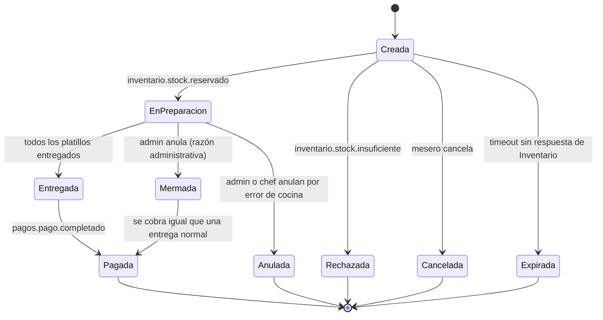
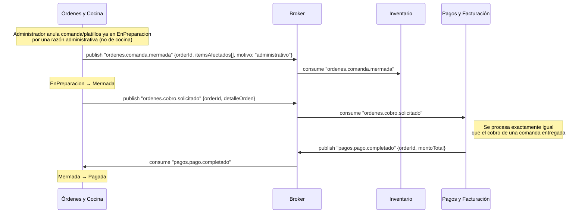
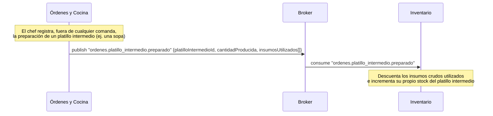
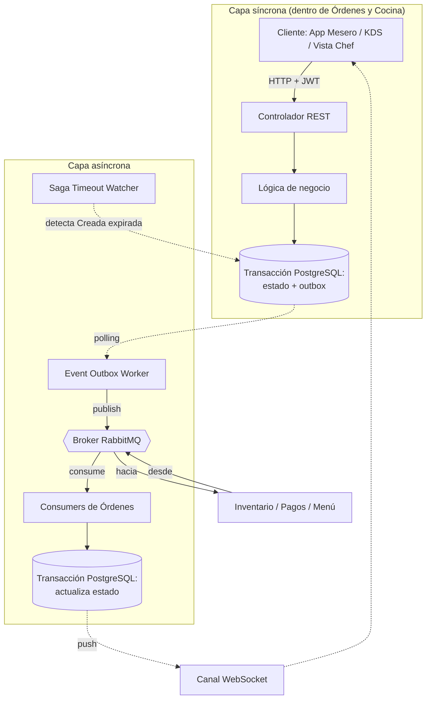

# Arquitectura Completa — Microservicio de Órdenes y Cocina (Orders & KDS)

**Documento base:** consolida y actualiza `Comunicaciones API ordenes y KDS.md` y `ordenes-kds-diagramas-secuencia.md` a la luz de las decisiones tomadas en `ERS_ordeneskds.md` (v4): renombrado de estados, reglas de "Mermada"/"Anulada", rol chef, nuevo estado "Expirada", y propiedad del stock de platillos intermedios.

**Enfoque de este documento:** la comunicación de la API interna (síncrona, hacia los clientes de este microservicio) y, sobre todo, los **eventos asíncronos que este microservicio publica al broker** para que otros microservicios los consuman.

---

## 0. Principios de arquitectura (sin cambios)

- Arquitectura 100% orientada a eventos: ninguna llamada síncrona entre microservicios de negocio, salvo la única excepción documentada en la sección 3.4 (bootstrap/reconciliación con Catálogo y Menú).
- Toda publicación de este microservicio pasa por el patrón **Transactional Outbox**: el cambio de estado y el evento a publicar se escriben en la misma transacción de PostgreSQL; un Event Outbox Worker independiente los publica al broker (RabbitMQ).
- Toda actualización de estado que deba reflejarse en pantalla en tiempo real se empuja por **WebSocket**, sin polling.
- Convención de eventos: `dominio.entidad.accion`. Los eventos que Órdenes consume de otros dominios usan el prefijo de origen (`inventario.*`, `pagos.*`, `menu.*`, `sala.*`).

## 1. Roles y actores

| Rol | Origen | Puede... |
|---|---|---|
| Mesero | Auth | Crear/editar comandas en "Creada", cancelar en "Creada", transferir de mesa, solicitar la cuenta, rehacer un platillo entregado. |
| Personal de cocina | Auth | Marcar platillos/comandas como "Listo". |
| **Chef** | Auth | Además de lo anterior: confirmar la anulación de una comanda por error de cocina (junto con administrador); registrar la preparación de platillos intermedios (vista nueva, sección 3.2). |
| Administrador | Auth | Mermar (anular con cobro) comandas/platillos ya en "EnPreparacion"; confirmar anulaciones por error de cocina (junto con chef). |

> El rol se extrae del token JWT emitido por el microservicio de **Auth** en cada request; no se captura como campo de formulario.

## 2. Ciclo de vida de la orden (referencia rápida)

*(Ver `ERS_ordeneskds.md`, sección 1, para el detalle completo de cada estado.)*



---

## 3. Capa síncrona: API REST interna

Esta API no comunica microservicios entre sí — comunica los dispositivos del restaurante (handheld del mesero, Bump Bar de cocina, vista del chef) con el backend de Órdenes.

### 3.1 Principios
- Autenticación por JWT; `usuarioId` y `rol` se inyectan en el contexto de cada request.
- Cada endpoint que cambia estado escribe en una transacción (estado + outbox); nunca espera una respuesta remota síncrona para responder al cliente.
- Autorización por rol validada en el controlador antes de la lógica de negocio.

### 3.2 Endpoints propuestos

**Endpoints consumidos por el Microfrontend de Sala**
| Método | Ruta | Nota |
|---|---|---|
| `GET` | `/orders?status=` | Estado por color de cada mesa/comanda |
| `POST` | `/orders` | Crea comanda (mesa o para llevar) → estado "Creada" |

**Endpoints consumidos por el Microfrontend de Menú**
| Método | Ruta | Nota |
|---|---|---|
| `PATCH` | `/orders/{orderId}/items` | Agrega platillos — solo si "Creada" y sin `confirmed_at`; valida disponibilidad contra la vista local de Catálogo y Menú |
| `PATCH` | `/orders/{orderId}/transfer` | Cambia la mesa asociada |
| `POST` | `/orders/{orderId}/confirm` | Idempotente: fija `confirmed_at` y publica `ordenes.orden.creada` solo en la primera invocación (OP-05) |
| `PATCH` | `/orders/{orderId}/cancel` | Solo si "Creada" → publica `ordenes.orden.cancelada` → "Cancelada" |
| `PATCH` | `/orders/{orderId}/items/{itemId}/redo` | Regresa un ítem "Entregado" a "Pendiente"; cuerpo `{ "note": "..." }` obligatorio (la orden conserva "Entregada", OP-12) |
| `POST` | `/orders/{orderId}/request-bill` | Publica `ordenes.cuenta.solicitada` |

**Vista 3 — Pantalla KDS (cocina)**
| Método | Ruta | Nota |
|---|---|---|
| `GET` | `/kds/queue?station=&view=` | Comandas por mayor tiempo en cocina primero (OP-11) y filtro por estación; vista principal (`view=active`, por defecto) lista comandas activas en "EnPreparacion" (y "Entregada" con platillos por rehacer); apartado secundario (`view=delivered`) lista comandas entregadas pendientes de cobro; excluye definitivamente comandas en "Pagada" |
| `PATCH` | `/orders/{orderId}/items/{itemId}/ready` | Publica `ordenes.platillo.preparado` |
| `PATCH` | `/orders/{orderId}/ready` | Marca la comanda completa como "Listo" |

**Acciones administrativas**
| Método | Ruta | Rol | Nota |
|---|---|---|---|
| `PATCH` | `/orders/{orderId}/void` | Administrador | Anula comanda completa o platillos individuales ya "EnPreparacion" por razón administrativa → **"Mermada"**. Publica `ordenes.comanda.mermada` + `ordenes.cobro.solicitado` (tratado igual que una comanda entregada). |
| `PATCH` | `/orders/{orderId}/void-kitchen-error` | Administrador **o Chef** | Anula la comanda **completa** ya "EnPreparacion" por error de cocina → **"Anulada"**. Cuerpo `{ "note": "..." }` obligatorio. Publica `ordenes.comanda.mermada`; **no** publica ningún evento de cobro. |

**Vista 4 — Preparación de Platillos Intermedios (chef) — `[NO-GO en fase actual / Abierto a futuro]`**
| Método | Ruta | Rol | Nota |
|---|---|---|---|
| `POST` | `/intermediate-dishes` | **Chef** | **Descartado para el horizonte de 7 sprints (ADR-0011):** Funcionalidad opcional desactivada (`INTERMEDIATE_DISHES_ENABLED=false`). **Queda abierta la posibilidad de implementarse en una fase futura o posterior release**, reactivando el feature flag y publicando el evento asíncrono `ordenes.platillo_intermedio.preparado` sin alterar la arquitectura base. |

> Estos endpoints son una propuesta a validar con el equipo de frontend, igual que en la versión anterior de este documento.

### 3.3 Notificación al cliente: WebSocket (OP-02 / ADR-0002)
Una conexión persistente por sesión de cliente, autenticada por JWT (con validación de firma delegada al API Gateway según ADR-0011), distribuida en dos endpoints según el rol:

| Canal | Endpoint | Roles permitidos | Modo de suscripción | Contenido recibido |
|---|---|---|---|---|
| `kds:station:{station}` | `/ws/kds` | `kitchen`, `chef`, `admin` | Solicitado por el cliente vía mensaje de suscripción; cambio de estación sin reconectar | Cambios de estado de órdenes con ítems de esa estación y de sus platillos |
| `kds:all` | `/ws/kds` | `kitchen`, `chef`, `admin` | Solicitado por el cliente (vista global de cocina) | Todas las órdenes activas en cocina |
| `floor` | `/ws/waiter` | `waiter`, `admin` | Automático al conectar | Cambios de estado de todas las órdenes activas (para monitor de Sala y Menú) |
| `user:{userId}` | `/ws/waiter` | `waiter`, `admin` | Automático al conectar (`userId` extraído del JWT) | Alertas de órdenes del usuario: `REJECTED`, `EXPIRED` y `DELIVERED` ("lista para recoger") |

- Tipos de mensaje empujados: `order.status_changed` e `item.status_changed` en formato camelCase con `version` monótona para descarte de mensajes fuera de orden.
- El cliente no hace polling.
- El token no viaja en la URL; token inválido o vencido cierra con código `4401`; rol no permitido en endpoint cierra con `4403`; solicitud de canal no autorizado responde con error `FORBIDDEN_CHANNEL`.

### 3.4 Excepción documentada: sincronización con Catálogo y Menú (sin cambios)
Única llamada síncrona saliente permitida en todo el microservicio, acotada a la rutina de arranque y a un job de reconciliación periódico contra `GET /menu/catalogo/completo` — nunca en el camino de una request de usuario. El detalle de tolerancia a fallos y comparación por `updated_at` se mantiene igual que en la versión anterior de este documento.

---

## 4. Capa asíncrona: eventos

### 4.1 Publicación — Transactional Outbox (sin cambios)
Ningún endpoint publica directamente al broker: escribe en la tabla `outbox` dentro de la misma transacción del cambio de estado; el Event Outbox Worker la publica de forma independiente y la marca como publicada.

### 4.2 Eventos que este microservicio PUBLICA

Para la tabla de equivalencias en inglés y constantes en código, consultar la matriz canónica en [`API_COMUNICACIONES.md` §2.0](API_COMUNICACIONES.md).

| Evento | Disparado por | Payload (aprox.) | Consumidor | Estado del contrato |
|---|---|---|---|---|
| `ordenes.orden.creada` | `POST /orders/{id}/confirm` (en "Creada") | `{orderId, items[]}` | Inventario | Confirmado |
| `ordenes.orden.cancelada` | `PATCH /orders/{id}/cancel` ("Creada" → "Cancelada") | `{orderId, itemsCancelados[]}` | Inventario | Confirmado |
| `ordenes.platillo.preparado` | `PATCH /orders/{id}/items/{itemId}/ready` | `{orderId, itemId}` | Inventario | Confirmado |
| `ordenes.comanda.mermada` | `PATCH /orders/{id}/void` **o** `/void-kitchen-error` ("EnPreparacion" → "Mermada" **o** "Anulada") | `{orderId, itemsAfectados[], reason}` | Inventario | Confirmado (`ADMINISTRATIVE` \| `KITCHEN_ERROR`) |
| `ordenes.cobro.solicitado` (`orders.charge.requested`) | `PATCH /orders/{id}/void` (**solo** para "Mermada") | `{orderId, sessionId, tableId, waiterId, totalAmount, items[]}` — cobro por merma administrativa (RF-26, RF-27) | Pagos | **Confirmado (Contrato Edwin)** — **no** se publica para "Anulada" |
| `ordenes.cuenta.solicitada` (`orders.bill.requested`) | `POST /orders/{id}/request-bill` (en "Entregada") | `{orderId, sessionId, tableId, waiterId, totalAmount, items[]}` con precios congelados | Pagos | **Confirmado (Contrato Edwin)** |
| `ordenes.orden.expirada` | Vencimiento del temporizador de Saga (comanda en "Creada" sin respuesta de Inventario) | `{orderId, elapsedSeconds}` | Inventario | Propuesto (OP-04) |
| `ordenes.platillo_intermedio.preparado` | `POST /intermediate-dishes` | — | Inventario | **Descartado / NO-GO (ADR-0011)** |

> **Por qué `ordenes.comanda.mermada` es un solo evento con un campo `reason`, y no dos eventos distintos:** tanto "Mermada" como "Anulada" significan lo mismo para Inventario — insumos que ya se consumieron y no se recuperan —, así que reutilizan el mismo evento. Lo único que cambia según el motivo es si además se dispara un cobro (`orders.charge.requested`) o no.
>
> **Por qué "Anulada" siempre implica la comanda completa:** al no admitir anulación parcial, el evento de merma publicado para "Anulada" siempre cubre la totalidad de los `itemsAfectados` de la comanda — nunca un subconjunto. Esto es justamente lo que evita el caso borde de una comanda con una mezcla de platillos "Mermados" (con cobro) y "Anulados" (sin cobro) dentro de la misma comanda.

### 4.3 Eventos que este microservicio CONSUME

| Evento consumido | Origen | Efecto en Órdenes | Estado del contrato |
|---|---|---|---|
| `sala.dining_session.iniciada` (`dining.session.started`) | Sala | Crea el registro base de la orden ("Creada"), usando `sessionId` como correlación | Confirmado |
| `inventario.stock.reservado` | Inventario | "Creada" → **"EnPreparacion"**; estampa `in_preparation_at` y envía la comanda a la cola del KDS | Confirmado |
| `inventario.stock.insuficiente` | Inventario | "Creada" → **"Rechazada"**; alerta visual al mesero | Confirmado |
| `menu.platillo.precio_actualizado` | Catálogo y Menú | Actualiza el precio en la vista local materializada | Confirmado |
| `menu.catalogo.actualizado` | Catálogo y Menú | Actualiza disponibilidad/categoría/estación en la vista local — es lo que impide que el mesero pueda seleccionar un platillo no disponible | Confirmado |
| `pagos.pago.completado` (`payments.payment.completed`) | Pagos y Facturación | "Entregada" **o** "Mermada" → **"Pagada"** (estado final); la comanda deja de listarse en el KDS | **Confirmado (Contrato Edwin)** |

### 4.4 Idempotencia
- `orderId + eventId`: creación, reserva, consumo, cancelación, merma/anulación, expiración.
- `sessionId + eventId`: únicamente para `sala.dining_session.iniciada` (todavía no existe `orderId`).
- `loteId + eventId` **(nuevo)**: para `ordenes.platillo_intermedio.preparado`, ya que este flujo no tiene `orderId`.

---

## 5. Mecanismo del estado "Expirada" (Saga Timeout Watcher — OP-01 / ADR-0001)

*(Detalle de implementación — el ERS solo exige el comportamiento resultante, no cómo se logra.)*

- Un proceso en segundo plano (Saga Timeout Watcher) revisa periódicamente cada 5 s (`SAGA_WATCHER_INTERVAL_SECONDS=5`) las comandas en "Creada" que cuenten con confirmación (`confirmed_at` no nulo).
- Al transcurrir ≥ 60 s (`SAGA_TIMEOUT_SECONDS=60`) contados desde `confirmed_at` sin haber recibido `inventario.stock.reservado` ni `inventario.stock.insuficiente`, transiciona la comanda a **"Expirada"** y publica `ordenes.orden.expirada` (OP-04, propuesto).
- Si Inventario responde **después** del timeout (una reserva tardía/huérfana), Inventario consume `ordenes.orden.expirada` y libera cualquier reserva realizada tardíamente, evitando stock fantasma bloqueado.

---

## 6. Diagramas de secuencia actualizados

Los flujos 1, 3, 4, 7 y 8 de `ordenes-kds-diagramas-secuencia.md` no cambian en su mecánica (solo en el nombre de los estados) y no se repiten aquí. A continuación, únicamente los flujos que sí cambian.

### 6.1 Creación y reserva — con "Rechazada" y "Expirada"

```mermaid
sequenceDiagram
    participant OC as Órdenes y Cocina
    participant B as Broker
    participant INV as Inventario

    Note over OC: Mesero confirma la orden (Creada)
    OC->>B: publish "ordenes.orden.creada" {orderId, items[]}
    B->>INV: consume "ordenes.orden.creada"

    alt Stock suficiente
        B->>OC: consume "inventario.stock.reservado"
        Note over OC: Creada → EnPreparacion; comanda a cola del KDS
    else Stock insuficiente
        B->>OC: consume "inventario.stock.insuficiente"
        Note over OC: Creada → Rechazada; alerta al mesero
    else Inventario no responde dentro del tiempo límite
        Note over OC: Vence el Saga Timeout Watcher (sección 5)
        OC->>B: publish "ordenes.orden.expirada" {orderId}
        Note over OC: Creada → Expirada
    end
```

### 6.2 Anulación administrativa ("Mermada") — se cobra igual que una entrega normal



### 6.3 Anulación por error de cocina ("Anulada") — sin cobro, cancela la comanda completa

```mermaid
sequenceDiagram
    participant OC as Órdenes y Cocina
    participant B as Broker
    participant INV as Inventario

    Note over OC: Administrador o Chef confirman la anulación<br/>de un platillo por error de cocina (nota obligatoria)
    Note over OC: La comanda COMPLETA se cancela de inmediato,<br/>no solo el platillo con el error
    OC->>B: publish "ordenes.comanda.mermada" {orderId, itemsAfectados[]: todos, motivo: "error_cocina"}
    B->>INV: consume "ordenes.comanda.mermada"
    Note over INV: Registra la pérdida; NO libera insumos ya consumidos
    Note over OC: EnPreparacion → Anulada (estado final)
    Note over OC: No se publica ningún evento de cobro
```

### 6.4 [Opcional] Preparación de un platillo intermedio



---

## 7. Diagrama combinado (síncrono → asíncrono)



---

## 8. Puntos abiertos relevantes a esta arquitectura

1. Validar con Inventario que su reserva de stock sea atómica (condición de carrera detrás de "Rechazada").
2. ~~Definir el umbral exacto de tiempo para "Expirada" (sección 5).~~ — **[RESUELTO]** Acordado en 60 s como máximo desde `confirmed_at` con watcher cada 5 s (OP-01 / ADR-0001).
3. Validar con Inventario el nombre y payload exactos de `ordenes.orden.expirada` (OP-04, propuesto) y de `ordenes.platillo_intermedio.preparado`.
4. ~~Confirmar con el equipo de frontend los endpoints de la sección 3.2, en especial los dos nuevos (`/void-kitchen-error` y `/intermediate-dishes`).~~ — **[RESUELTO]** Rutas REST y parámetros en inglés (`/void-kitchen-error`, `/intermediate-dishes`, `?status=`, `?station=`, OP-07 / ADR-0006).
5. Confirmar con Inventario si prefiere el campo `motivo` explícito en `ordenes.comanda.mermada` (propuesto aquí) o inferirlo de otra forma.
