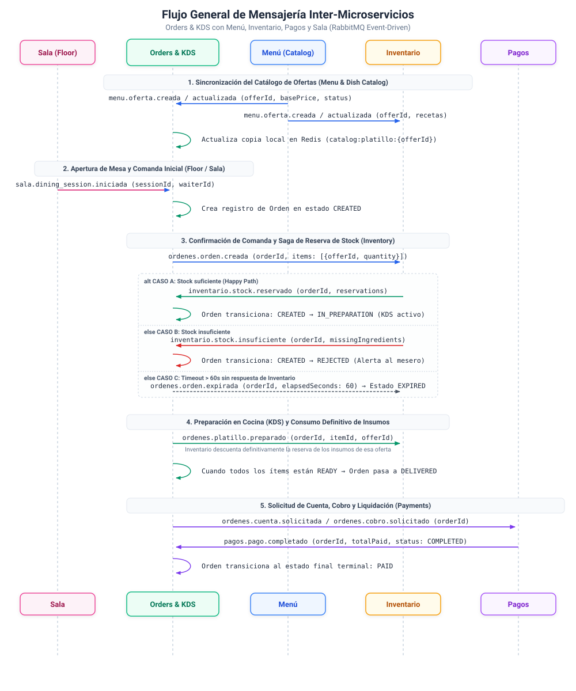
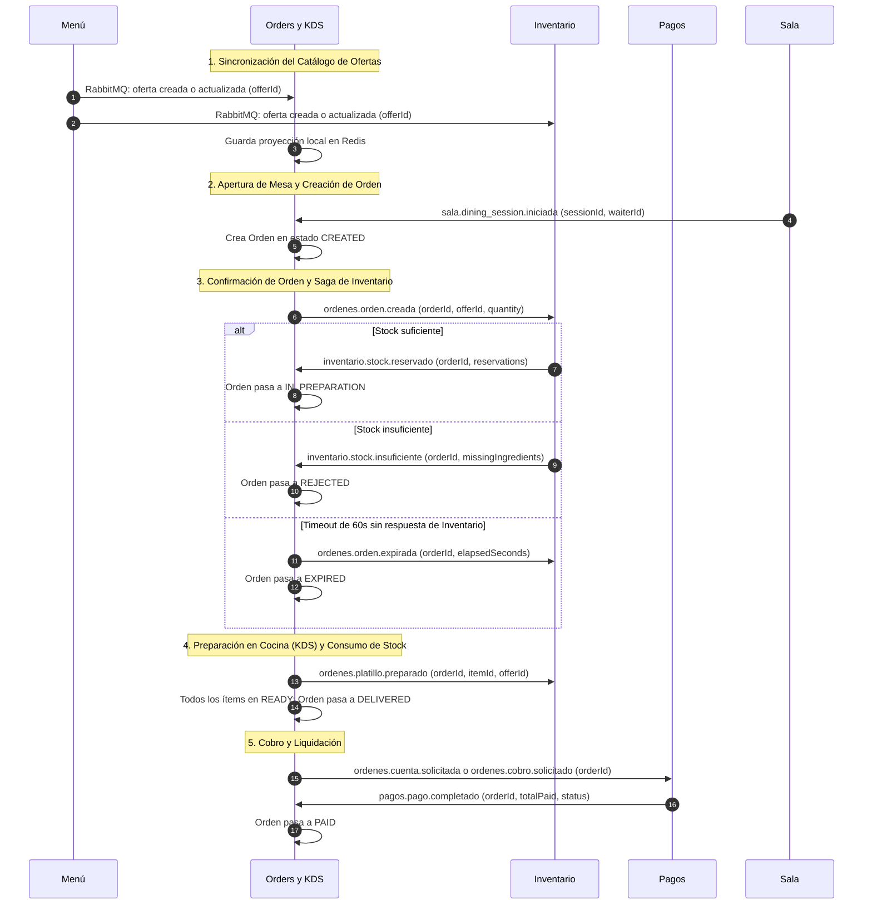

# Guía Centralizada de Mensajería Inter-Microservicios (Orders & KDS)

> **Propósito de este documento:**  
> Centralizar en un único archivo de referencia todos los contratos de eventos RabbitMQ que el microservicio **Orders & KDS (`orders-backend`)** envía y recibe en su comunicación con **Menú**, **Inventario**, **Pagos** y **Sala (Floor)**.  
> Incluye ejemplos reales de payloads JSON de entrada y salida, así como **tablas de mapeo (Anti-Corruption Layer)** que explican cómo se llaman los campos en los mensajes externos frente a cómo se almacenan y nombran internamente en nuestro microservicio.

---

## 1. Convenciones Generales y Capa Anticorrupción (ACL)

1. **Idioma y Formato en Mensajes RabbitMQ (`camelCase` en inglés):**  
   Por convención de arquitectura (`ADR-0006` y `DEVELOPMENT_GUIDELINES.md`), todos los eventos publicados por **Orders & KDS** utilizan llaves en **inglés (`camelCase`)** (por ejemplo: `eventId`, `orderId`, `offerId`, `correlationId`).
2. **Tolerancia en Recepción (Lectura Híbrida / ACL):**  
   Al consumir mensajes de otros microservicios, **Orders & KDS** aplica el patrón **Anti-Corruption Layer (ACL)**: acepta tanto los nombres canónicos en inglés (`offerId`, `reservations`, `missingIngredients`, `waiterId`) como alias en español (`ofertaId`, `platilloId`, `reservas`, `faltantes`, `montoTotal`, `meseroId`) o estructuras anidadas dentro de `"data"`, traduciéndolos inmediatamente a nuestros modelos internos en Python (`snake_case`).
3. **Aislamiento del Frontend y Base de Datos Propia:**  
   - **En RabbitMQ (Menú ↔ OrdersKDS ↔ Inventario):** Los productos vendibles (platillos preparados, bebidas, postres, paquetes) se identifican de forma unificada mediante **`offerId`** (ID de la oferta emitida por Menú).
   - **En la API REST / WebSockets hacia nuestro Frontend y en PostgreSQL/Redis:** Internamente nuestro microservicio conserva el nombre **`dishId`** (JSON hacia Frontend) y **`dish_id`** (columna en PostgreSQL y llave en Redis) para no romper la comunicación ni el contrato con el Frontend de Meseros y KDS. **El valor almacenado en `dish_id` es exactamente el UUID/identificador de la oferta (`offerId`) proveniente de Menú.**

### Tabla Maestra de Equivalencias de Conceptos

| Concepto de Negocio | En Microservicio de Menú | En Mensajes RabbitMQ (OrdersKDS ↔ Inventario) | En API REST / WS de OrdersKDS (Frontend) | En Base de Datos / Código Interno de OrdersKDS |
| :--- | :--- | :--- | :--- | :--- |
| **Identificador de Oferta / Platillo** | `data.id` / `offerId` | **`offerId`** | `dishId` | `OrderItem.dish_id` (PostgreSQL) / `catalog:platillo:{id}` (Redis) |
| **Precio Base de la Oferta** | `data.basePrice` | *(No se envía a Inventario)* | `unitPrice` / `price` | `CatalogItemView.price` (Redis) |
| **Estado / Disponibilidad** | `data.status` (`"ACTIVE"`, `"INACTIVE"`) | *(Solo en eventos de Menú)* | `available` (`true` / `false`) | `CatalogItemView.available` (Redis) |
| **Categoría / Tiempo** | `data.composition.slots[0].course` o `presentationTag` | *(Solo en eventos de Menú)* | `category` | `CatalogItemView.category` (Redis) |
| **ID Público de la Orden** | *(No aplica)* | **`orderId`** | `orderId` / `id` | `Order.public_id` (UUID) |
| **ID Público de Renglón (Ítem)** | *(No aplica)* | **`itemId`** | `itemId` / `id` | `OrderItem.public_id` (UUID) |
| **ID de Sesión de Mesa** | *(No aplica)* | **`sessionId`** | `diningSessionId` | `Order.dining_session_id` (UUID) |

---

## 2. Flujo General de Mensajes entre Microservicios



<details>
<summary><b>Ver especificación en código Mermaid</b></summary>



</details>

---

## 3. Integración con el Microservicio de Menú (`Menu`)

### Flujo de Negocio
1. **Menú** es el dueño de las ofertas comerciales (platillos, bebidas, paquetes).
2. **Orders & KDS** mantiene una copia local en Redis (`CatalogRepository`) para validar disponibilidad en tiempo real cuando el mesero agrega productos a una comanda (`RF-17`) y para asignar la estación del KDS (`RF-08`).
3. Cada vez que **Menú** crea o modifica una oferta, publica un mensaje en RabbitMQ. **Orders & KDS** lo consume mediante `CatalogConsumer` (`app/messaging/consumers/catalog.py`) y actualiza su copia local en Redis.

### 3.1. Mensajes que RECIBE Orders & KDS desde Menú

- **Routing Keys escuchadas:**
  - `menu.oferta.creada` / `menu.offer.created`
  - `menu.oferta.actualizada` / `menu.offer.updated`
  - `menu.catalogo.actualizado` / `menu.catalog.updated`
  - `menu.platillo.precio_actualizado`
  - `menu.platillo.disponibilidad_actualizada`
  - `menu.platillo.estado_actualizado`

#### Ejemplo A: Payload de Oferta Individual enviado por Menú
```json
{
  "data": {
    "id": "b57f7e2a-02a4-4fb7-bb41-55f2d974b101",
    "entryId": "7d19a8ce-402c-4bab-b383-9969b69fe101",
    "presentationTag": "Individual",
    "basePrice": 180,
    "status": "ACTIVE",
    "image": {
      "id": "8c3f4365-1d1d-4a85-969a-c6c80757b201",
      "url": "https://cdn.example.com/menu/hamburguesa-individual.jpg",
      "thumbnailUrl": "https://cdn.example.com/menu/hamburguesa-individual-thumb.jpg"
    },
    "composition": {
      "slots": [
        {
          "slotId": "b37c1bd7-17b2-47a2-a3a4-802559445301",
          "name": "Plato principal",
          "quantity": 1,
          "course": "plato fuerte",
          "options": [
            {
              "optionId": "89cce4da-2f19-4d27-942d-b2ee82fb5401",
              "sourceType": "RECIPE",
              "recipeId": "c4813f65-00b4-4921-874e-03c555796401",
              "displayName": "Hamburguesa Hawaiana"
            }
          ]
        }
      ]
    }
  }
}
```

#### Ejemplo B: Payload de Actualización de Catálogo por Lote (`menu.catalogo.actualizado`)
```json
{
  "eventId": "4f8b92f0-3c4a-4b5e-9d1a-7c8e9f0a1b2c",
  "timestamp": "2026-10-29T14:30:00Z",
  "correlationId": "a1b2c3d4-e5f6-7890-abcd-ef1234567890",
  "items": [
    {
      "id": "b57f7e2a-02a4-4fb7-bb41-55f2d974b101",
      "offerId": "b57f7e2a-02a4-4fb7-bb41-55f2d974b101",
      "name": "Hamburguesa Hawaiana",
      "status": "ACTIVE",
      "available": true,
      "station": "PARRILLA",
      "preparationTime": "15 min",
      "basePrice": 180.00
    }
  ]
}
```

#### Anotaciones de Mapeo Interno (Menú → Orders & KDS)

| Campo en Mensaje de Menú | Alias Soportados por OrdersKDS | Campo Interno en OrdersKDS (`CatalogRepository`) | Transformación Aplicada |
| :--- | :--- | :--- | :--- |
| `data.id` | `offerId`, `ofertaId`, `platilloId`, `dishId`, `plateId`, `itemId`, `id` | `dish_id` (llave Redis `catalog:platillo:{dish_id}`) | Se almacena como string identificador de la oferta. |
| `data.basePrice` | `basePrice`, `price`, `precioActualizado`, `precio_actualizado` | `price` | Se convierte a string decimal (ej. `"180"`). |
| `data.status` | `available`, `disponibilidad`, `disponible`, `status`, `estado`, `state` | `available` | `"ACTIVE"`, `"activo"`, `"true"`, `"disponible"` → `True`. `"INACTIVE"`, `"inactivo"`, `"false"`, `"no_disponible"` → `False`. |
| `data.composition.slots[0].course` | `category`, `categoria`, `presentationTag` | `category` | Si no viene `category` directo, toma `slots[0].course` (ej. `"plato fuerte"`) y como segundo fallback `presentationTag`. |
| `data.station` | `station`, `estacion` | `station` | Normalizado a minúsculas sin acentos (ej. `"parrilla"`, `"frios"`). Si es `null`, en KDS usa fallback `"general"`. |
| `data.preparationTime` | `preparationTime`, `tiempoPreparacion`, `preparation_time_text` | `preparation_time_text` | Texto informativo para el KDS (ej. `"15 min"`). |

---

## 4. Integración con el Microservicio de Inventario (`Inventory`)

### Flujo de Negocio
1. **Inventario** también escucha los mensajes de **Menú** para conocer las ofertas (`offerId`) y sus recetas/insumos.
2. Cuando el mesero confirma una comanda en **Orders & KDS**, nuestro microservicio emite `ordenes.orden.creada` enviando la lista de `items` con su **`offerId`** y **`quantity`**.
3. **Inventario** verifica si hay stock suficiente para esas ofertas y responde con `inventario.stock.reservado` (sí hay stock) o `inventario.stock.insuficiente` (no hay stock).
4. Conforme los cocineros marcan cada ítem como preparado en el KDS, **Orders & KDS** emite `ordenes.platillo.preparado` incluyendo el **`offerId`** para que **Inventario** consuma/descuente efectivamente la reserva.
5. Si la orden se cancela antes de entrar a cocina (`ordenes.orden.cancelada`), expira por falta de respuesta (`ordenes.orden.expirada`) o se anula en cocina por merma (`ordenes.comanda.mermada`), **Orders & KDS** notifica a **Inventario** para liberar o registrar la merma del stock.

---

### 4.1. Mensajes que ENVÍA Orders & KDS hacia Inventario

#### A) `ordenes.orden.creada` (Solicitud de Reserva de Stock)
- **Cuándo se emite:** Cuando el mesero confirma la orden (`POST /orders/{orderId}/confirm`).
- **Contrato JSON Schema:** `contracts/events/ordenes.orden.creada.v1.json`
- **Modelo Interno Python:** `OrderCreatedEvent` / `OrderCreatedItem` (`app/messaging/events.py`)

```json
{
  "eventId": "f47ac10b-58cc-5372-a567-0e02b2c3d479",
  "orderId": "9c25e121-8623-4084-9c25-52d1906d4dfb",
  "correlationId": "3f9a1b2c-4d5e-6f7a-8b9c-0d1e2f3a4b5c",
  "items": [
    {
      "offerId": "b57f7e2a-02a4-4fb7-bb41-55f2d974b101",
      "quantity": 2
    },
    {
      "offerId": "a12b34c5-67d8-49e0-f123-456789abcdef",
      "quantity": 1
    }
  ]
}
```

> **Nota de Mapeo Interno (`OrdersKDS` → `Inventario`):**
> - `orderId` corresponde internamente a `Order.public_id`.
> - `items[].offerId` se obtiene internamente de `OrderItem.dish_id` (que a su vez llegó desde el Frontend del mesero en el campo `dishId` al agregar el producto del catálogo de Menú).
> - `eventId` se genera de forma determinista con `uuid5(NAMESPACE_URL, f"ordenes.orden.creada:{order.public_id}")` para garantizar idempotencia si el mensaje se reintenta.

---

#### B) `ordenes.platillo.preparado` (Notificación de Platillo/Oferta Preparada en Cocina)
- **Cuándo se emite:** Cada vez que un cocinero marca un ítem como listo (`PATCH /orders/{orderId}/items/{itemId}/ready`) o marca toda la orden como lista (`POST /orders/{orderId}/ready`).
- **Contrato JSON Schema:** `contracts/events/ordenes.platillo.preparado.v1.json`
- **Modelo Interno Python:** `DishPreparedEvent` (`app/messaging/events.py`)

```json
{
  "eventId": "8f14e45f-ceea-467a-9a38-1b2c3d4e5f6a",
  "orderId": "9c25e121-8623-4084-9c25-52d1906d4dfb",
  "itemId": "11223344-5566-7788-99aa-bbccddeeff00",
  "offerId": "b57f7e2a-02a4-4fb7-bb41-55f2d974b101",
  "correlationId": null
}
```

> **Nota de Mapeo Interno (`OrdersKDS` → `Inventario`):**
> - `itemId` corresponde a `OrderItem.public_id` (el UUID único de ese renglón dentro de la comanda).
> - `offerId` corresponde a `OrderItem.dish_id` (el ID de la oferta en el catálogo de Menú e Inventario).

---

#### C) `ordenes.orden.cancelada` (Cancelación antes de Cocina — Liberar Reserva)
- **Cuándo se emite:** Cuando una orden en estado `CREATED` se cancela (`PATCH /orders/{orderId}/cancel` o alias `POST /orders/{orderId}/cancel`) antes de entrar a preparación en cocina (`RF-24`, `RF-25`, `OP-05`). Aplica tanto a borradores como a órdenes ya confirmadas que esperan reserva de stock de Inventario.
- **Contrato JSON Schema:** `contracts/events/ordenes.orden.cancelada.v1.json`
- **Modelo Interno Python:** `OrderCancelledEvent` (`app/messaging/events.py`)

```json
{
  "eventId": "2c5ea4c0-4067-5019-8a3b-9b1e2f3c4d5e",
  "orderId": "9c25e121-8623-4084-9c25-52d1906d4dfb",
  "correlationId": null,
  "itemsCancelados": [
    {
      "offerId": "b57f7e2a-02a4-4fb7-bb41-55f2d974b101",
      "quantity": 2
    },
    {
      "offerId": "a12b34c5-67d8-49e0-f123-456789abcdef",
      "quantity": 1
    }
  ]
}
```

> **Nota de Mapeo Interno (`OrdersKDS` → `Inventario`):**
> - `itemsCancelados[].offerId` se extrae de `OrderItem.dish_id` (el ID de la oferta proveniente de Menú).
> - `itemsCancelados[].quantity` corresponde a `OrderItem.quantity` de los renglones asociados a la comanda.
> - Al consumir este evento con `itemsCancelados`, el microservicio de **Inventario** libera de inmediato los insumos reservados si la orden estaba confirmada esperando stock, o descarta la solicitud si aún no se había reservado.
> - `eventId` se genera de forma determinista con `uuid5(NAMESPACE_URL, "ordenes.orden.cancelada:{order.public_id}")`.

---

#### D) `ordenes.orden.expirada` (Expiración por Timeout de Saga > 60s)
- **Cuándo se emite:** Cuando el worker de expiración detecta que una orden confirmada lleva más de 60 segundos esperando respuesta de Inventario.
- **Contrato JSON Schema:** `contracts/events/ordenes.orden.expirada.v1.json`
- **Modelo Interno Python:** `OrderExpiredEvent` (`app/messaging/events.py`)

```json
{
  "eventId": "7d8e9f0a-1b2c-5d4e-9f0a-1b2c3d4e5f6a",
  "orderId": "9c25e121-8623-4084-9c25-52d1906d4dfb",
  "correlationId": null,
  "elapsedSeconds": 65
}
```

---

#### E) `ordenes.comanda.mermada` (Anulación en Cocina por Merma)
- **Cuándo se emite:** Cuando una orden que ya estaba en `IN_PREPARATION` se cancela/anula por incidente en cocina, pasando al estado `WASTED`.
- **Contrato JSON Schema:** `contracts/events/ordenes.comanda.mermada.v1.json`

```json
{
  "eventId": "6a7b8c9d-0e1f-5a2b-8c3d-4e5f6a7b8c9d",
  "orderId": "9c25e121-8623-4084-9c25-52d1906d4dfb",
  "correlationId": null
}
```

---

### 4.2. Mensajes que RECIBE Orders & KDS desde Inventario

#### A) `inventario.stock.reservado` (Confirmación de Reserva Exitosa)
- **Efecto en Orders & KDS:** Transiciona la orden de `CREATED` a `IN_PREPARATION`, registra `in_preparation_at` y notifica por WebSocket al KDS (`order.created`) y a los meseros. Si la orden ya estaba `CANCELLED` o `EXPIRED`, el mensaje tardío se ignora de forma segura.
- **Contrato JSON Schema:** `contracts/events/inventario.stock.reservado.v1.json`
- **Consumidor Interno:** `handle_stock_reserved` (`app/messaging/consumers/stock_reserved.py`)

```json
{
  "eventId": "c9a8b7d6-e5f4-4321-8765-1a2b3c4d5e6f",
  "orderId": "9c25e121-8623-4084-9c25-52d1906d4dfb",
  "correlationId": "3f9a1b2c-4d5e-6f7a-8b9c-0d1e2f3a4b5c",
  "reservations": [
    {
      "offerId": "b57f7e2a-02a4-4fb7-bb41-55f2d974b101",
      "quantity": 2
    }
  ]
}
```

#### Anotaciones de Mapeo Interno (`inventario.stock.reservado`)

| Campo en Mensaje de Inventario | Alias Soportados en Recepción | Atributo Interno en `StockReservedMessage` | Uso Interno en OrdersKDS |
| :--- | :--- | :--- | :--- |
| `eventId` | `event_id` | `event_id: UUID` | Se guarda en la tabla `processed_events` para garantizar idempotencia. |
| `orderId` | `order_id` | `order_id: UUID` | Se busca contra `Order.public_id` para pasar la orden a `IN_PREPARATION`. |
| `correlationId` | `correlation_id` | `correlation_id: UUID \| None` | Trazabilidad entre microservicios. |
| `reservations` | `reservas` | `reservations: list[dict \| str]` | Lista informativa de ofertas/insumos reservados (acepta objetos o strings). |

---

#### B) `inventario.stock.insuficiente` (Rechazo de Orden por Falta de Stock)
- **Efecto en Orders & KDS:** Transiciona la orden de `CREATED` al estado terminal `REJECTED` y notifica al mesero vía WebSocket.
- **Contrato JSON Schema:** `contracts/events/inventario.stock.insuficiente.v1.json`
- **Consumidor Interno:** `handle_stock_insufficient` (`app/messaging/consumers/stock_insufficient.py`)

```json
{
  "eventId": "d1e2f3a4-b5c6-4789-9012-3456789abcde",
  "orderId": "9c25e121-8623-4084-9c25-52d1906d4dfb",
  "correlationId": "3f9a1b2c-4d5e-6f7a-8b9c-0d1e2f3a4b5c",
  "missingIngredients": [
    "pan_brioche",
    "carne_res_180g"
  ]
}
```

#### Anotaciones de Mapeo Interno (`inventario.stock.insuficiente`)

| Campo en Mensaje de Inventario | Alias Soportados en Recepción | Atributo Interno en `StockInsufficientMessage` | Uso Interno en OrdersKDS |
| :--- | :--- | :--- | :--- |
| `eventId` | `event_id` | `event_id: UUID` | Deduplicación en `processed_events`. |
| `orderId` | `order_id` | `order_id: UUID` | Identifica la orden (`Order.public_id`) para marcarla como `REJECTED`. |
| `missingIngredients` | `faltantes`, `missing_ingredients` | `missing_ingredients: list[str]` | Lista de ingredientes o productos agotados reportados por Inventario. |

---

## 5. Integración con el Microservicio de Pagos (`Payments`)

### Flujo de Negocio
1. Cuando una orden ha sido entregada (`DELIVERED`) o anulada con cargo/merma (`WASTED`), desde **Orders & KDS** se solicita la cuenta o el cobro emitiendo `ordenes.cuenta.solicitada` o `ordenes.cobro.solicitado`.
2. Cuando el cliente liquida el pago en **Pagos**, dicho microservicio emite `pagos.pago.completado`.
3. **Orders & KDS** consume `pagos.pago.completado` y transiciona la orden al estado terminal **`PAID`**.

### 5.1. Mensajes que ENVÍA Orders & KDS hacia Pagos

#### A) `ordenes.cuenta.solicitada` y `ordenes.cobro.solicitado`
- **Contratos JSON Schema:** `contracts/events/ordenes.cuenta.solicitada.v1.json` y `contracts/events/ordenes.cobro.solicitado.v1.json`

```json
{
  "eventId": "5a6b7c8d-9e0f-5123-a456-789abcdef012",
  "orderId": "9c25e121-8623-4084-9c25-52d1906d4dfb",
  "correlationId": null
}
```

### 5.2. Mensajes que RECIBE Orders & KDS desde Pagos

#### A) `pagos.pago.completado` (Confirmación de Pago Liquidado)
- **Efecto en Orders & KDS:** Transiciona la orden desde `DELIVERED` o `WASTED` hacia el estado terminal `PAID`.
- **Contrato JSON Schema:** `contracts/events/pagos.pago.completado.v1.json`
- **Consumidor Interno:** `handle_payment_completed` (`app/messaging/consumers/payment_completed.py`)

> **Soporte de estructura plana o anidada:** `PaymentCompletedMessage` acepta los campos tanto en la raíz del JSON como anidados dentro de un objeto `"data"`.

#### Ejemplo 1: Estructura Plana
```json
{
  "eventId": "e1f2a3b4-c5d6-4e7f-8a9b-0c1d2e3f4a5b",
  "orderId": "9c25e121-8623-4084-9c25-52d1906d4dfb",
  "correlationId": "3f9a1b2c-4d5e-6f7a-8b9c-0d1e2f3a4b5c",
  "sessionId": "77889900-aabb-ccdd-eeff-112233445566",
  "paymentId": "PAY-2026-0091",
  "paymentMethod": "CARD",
  "totalPaid": 360.00,
  "status": "COMPLETED"
}
```

#### Ejemplo 2: Estructura con Sobre `"data"` (También soportada automáticamente)
```json
{
  "eventId": "e1f2a3b4-c5d6-4e7f-8a9b-0c1d2e3f4a5b",
  "data": {
    "orderId": "9c25e121-8623-4084-9c25-52d1906d4dfb",
    "sessionId": "77889900-aabb-ccdd-eeff-112233445566",
    "montoTotal": 360.00,
    "status": "COMPLETED"
  }
}
```

#### Anotaciones de Mapeo Interno (`pagos.pago.completado`)

| Campo en Mensaje de Pagos | Alias Soportados en Recepción | Atributo Interno en `PaymentCompletedMessage` | Uso Interno en OrdersKDS |
| :--- | :--- | :--- | :--- |
| `eventId` | `event_id` | `event_id: UUID` | Deduplicación en `processed_events`. |
| `orderId` | `order_id`, `data.orderId` | `order_id: UUID` | Se busca contra `Order.public_id` para transicionar la orden a `PAID`. |
| `sessionId` | `session_id`, `data.sessionId` | `session_id: UUID \| None` | Corresponde a `Order.dining_session_id`. |
| `paymentId` | `payment_id`, `data.paymentId` | `payment_id: str \| None` | Identificador externo de la transacción en Pagos. |
| `paymentMethod` | `payment_method`, `data.paymentMethod` | `payment_method: str \| None` | Método de pago utilizado (`CASH`, `CARD`, etc.). |
| `totalPaid` | `total_paid`, `data.totalPaid` | `total_paid: Decimal \| None` | Monto total liquidado. |
| `montoTotal` | `total_amount`, `data.montoTotal` | `total_amount: Decimal \| None` | Monto total facturado (alias en español soportado en ACL). |
| `status` | `data.status` | `status: str \| None` | Estado del pago reportado por el microservicio de Pagos. |

---

## 6. Integración con el Microservicio de Sala / Mesas (`Floor`)

### 6.1. Mensaje que RECIBE Orders & KDS desde Sala

#### A) `sala.dining_session.iniciada` (Inicio de Sesión en Mesa)
- **Efecto en Orders & KDS:** Crea de manera idempotente una orden inicial en estado `CREATED` asociada a la sesión de mesa (`sessionId`).
- **Contratos JSON Schema:** `contracts/events/sala.dining_session.iniciada.v1.json` y `contracts/events/dining.session.started.v1.json`
- **Consumidor Interno:** `handle_dining_session_created` (`app/messaging/consumers/dining_session.py`)

```json
{
  "eventId": "1a2b3c4d-5e6f-4a8b-9c0d-1e2f3a4b5c6d",
  "sessionId": "77889900-aabb-ccdd-eeff-112233445566",
  "waiterId": "55443322-1100-9988-7766-554433221100",
  "dinersCount": 4
}
```

#### Anotaciones de Mapeo Interno (`sala.dining_session.iniciada`)

| Campo en Mensaje de Sala | Alias Soportados en Recepción | Atributo Interno en `DiningSessionCreatedMessage` | Columna en Base de Datos (`Order`) |
| :--- | :--- | :--- | :--- |
| `eventId` | `event_id` | `event_id: UUID` | Tabla `processed_events.event_id` |
| `sessionId` | `session_id`, `data.sessionId` | `session_id: UUID` | `Order.dining_session_id` |
| `waiterId` | `waiter_id`, `meseroId`, `data.waiterId`, `data.meseroId` | `waiter_id: UUID \| None` | `Order.responsible_waiter_id` |
| `dinersCount` | `diners`, `comensales`, `numComensales`, `data.dinersCount` | `diners: int \| None` | Metadato de comensales de la sesión. |

---

## 7. Resumen Rápido de Archivos de Código y Contratos en este Repositorio

- **Definición de Modelos y Eventos (ACL):** [`app/messaging/events.py`](../app/messaging/events.py)
- **Consumidor de Catálogo (Menú):** [`app/messaging/consumers/catalog.py`](../app/messaging/consumers/catalog.py)
- **Consumidores de Inventario:**
  - [`app/messaging/consumers/stock_reserved.py`](../app/messaging/consumers/stock_reserved.py)
  - [`app/messaging/consumers/stock_insufficient.py`](../app/messaging/consumers/stock_insufficient.py)
- **Consumidor de Pagos:** [`app/messaging/consumers/payment_completed.py`](../app/messaging/consumers/payment_completed.py)
- **Consumidor de Sala:** [`app/messaging/consumers/dining_session.py`](../app/messaging/consumers/dining_session.py)
- **Emisión de Eventos de Ciclo de Vida de Orden:** [`app/services/orders.py`](../app/services/orders.py)
- **Esquemas JSON Schema formales:** [`contracts/events/`](../contracts/events/)

