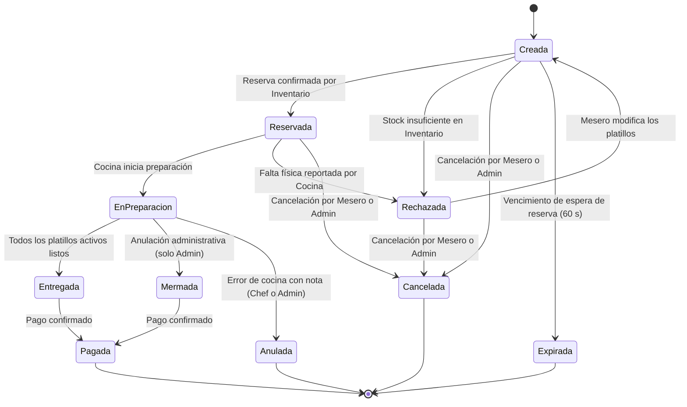

# Especificación de Requisitos de Software (ERS)
## Sistema de Órdenes y Pantalla de Cocina (Orders & KDS)

| Campo del Documento | Valor |
|---|---|
| **Estándar de Referencia** | IEEE Std 830-1998 / ISO/IEC/IEEE 29148:2018 |
| **Sistema** | Módulo de Gestión de Órdenes y Pantalla de Cocina (Orders & KDS) |
| **Versión** | 5.0 (Línea base verificada de integración) |
| **Fecha** | 18 de noviembre de 2026 |
| **Ámbito** | Operación integral de comandas de salón/para llevar, coordinación con cocina, saga de reservas y ciclo de liquidación |

---

## 1. Introducción

### 1.1 Propósito
El presente documento establece de manera formal, completa, inequívoca y verificable los requisitos funcionales, no funcionales y atributos de calidad del **Sistema de Órdenes y Pantalla de Cocina (Orders & KDS)**. Sirve como contrato técnico y funcional único entre los equipos de ingeniería, aseguramiento de la calidad (QA) y partes interesadas del restaurante para validar el comportamiento esperado del sistema sin prescribir decisiones internas de implementación.

### 1.2 Alcance del Producto
El Sistema de Órdenes y Pantalla de Cocina gobierna el ciclo completo de las comandas de un restaurante desde su apertura por el personal de atención hasta su preparación en cocina y liquidación final, abarcando:
1. Apertura, captura, edición, transferencia y cancelación de comandas vinculadas a mesas, sesiones de comensales o modalidad para llevar.
2. Coordinación asíncrona de disponibilidad y reserva de ingredientes con el sistema externo de Inventario.
3. Gestión en tiempo real de la cola de preparación en cocina, despacho por platillo o por comanda completa, filtrado por estación culinaria, rechazo físico de platillos y rehechura de entregas.
4. Control de anulaciones administrativas (con cobro configurable) y anulaciones por error atribuible a cocina (sin cobro al comensal).
5. Emisión de solicitudes de cobro/cuenta con precios congelados y cierre definitivo tras la confirmación del sistema de Pagos.

Quedan fuera del alcance del producto la gestión directa de existencias de almacén, la administración de recetas y precios maestros del menú, el procesamiento de pasarelas bancarias, el control físico de ocupación de mesas y la autenticación primaria de credenciales de usuarios.

### 1.3 Definiciones, Acrónimos y Glosario del Dominio

| Término / Acrónimo | Definición en el Dominio |
|---|---|
| **Comanda / Orden** | Registro único de pedido solicitado por uno o más comensales, compuesto por uno o varios renglones de platillos, vinculado a una mesa física, a una sesión de comensales o marcado para llevar. |
| **Platillo / Renglón de Comanda** | Unidad individual de producto solicitado dentro de una comanda, con cantidad, precio congelado, modificadores e instrucciones especiales. |
| **KDS** (*Kitchen Display System*) | Pantalla operativa destinada al personal de cocina para visualizar, priorizar, iniciar y despachar comandas y platillos en tiempo real. |
| **Saga de Reserva** | Flujo distribuido de coordinación entre la confirmación de una comanda y la respuesta de reserva o rechazo emitida por el sistema de Inventario. |
| **TTL de Reserva en Cocina** | Tiempo máximo estándar de vigencia operativa (15 minutos) durante el cual una comanda reservada permanece vigente para iniciar preparación antes de considerarse caducada en cocina. |
| **Rehechura** (*Redo*) | Devolución formal a cocina de un platillo ya entregado al comensal para que vuelva a elaborarse debido a una inconformidad o incidente posterior a la entrega. |
| **Merma Administrativa** | Anulación de una comanda en preparación ordenada por un administrador debido a causas ajenas a la responsabilidad de cocina. |
| **Anulación por Error de Cocina** | Cancelación total e inmediata de una comanda en preparación ocasionada por un fallo imputable a cocina, sin cargo al comensal. |
| **Folio Legible** | Número corto asignado a la comanda para facilitar su identificación visual por meseros y cocineros en la operación diaria. |
| **RF / RNF / RC** | Requisito Funcional / Requisito No Funcional / Requisito de Atributo de Calidad. |

### 1.4 Referencias Normativas
* IEEE Std 830-1998 — *IEEE Recommended Practice for Software Requirements Specifications*.
* ISO/IEC/IEEE 29148:2018 — *Systems and software engineering — Life cycle processes — Requirements engineering*.
* ISO/IEC 25010:2011 — *Systems and software Quality Requirements and Evaluation (SQuaRE)*.
* W3C WCAG 2.1 — *Web Content Accessibility Guidelines* (Nivel AA).

### 1.5 Visión General del Documento
La **Sección 2** describe la perspectiva del sistema en el ecosistema del restaurante, las clases de actores, el modelo de estados del dominio y las restricciones generales. Las **Secciones 3, 4 y 5** especifican de forma atómica y estandarizada los Requisitos Funcionales (`RF`), Requisitos No Funcionales (`RNF`) y Requisitos de Calidad (`RC`), respectivamente. La **Sección 6** presenta la matriz de trazabilidad por módulo y método de verificación.

---

## 2. Descripción General

### 2.1 Perspectiva del Sistema dentro del Restaurante
El Sistema de Órdenes y Pantalla de Cocina opera como un componente autónomo dentro de una arquitectura distribuida compuesta por seis módulos de negocio coordinados mediante un perímetro centralizado de acceso y eventos de dominio:
* **Sistema de Autenticación y Acceso:** Provee identidad verificada, roles y permisos granulares de los operadores.
* **Sistema de Sala y Mesas:** Informa la apertura de sesiones de consumo en mesa y el mesero responsable asignado.
* **Sistema de Menú y Catálogo:** Provee los platillos comerciales, recetas vinculadas, precios vigentes, estaciones culinarias, tiempos estimados de preparación y estado de disponibilidad comercial.
* **Sistema de Inventario:** Recibe solicitudes de reserva de insumos, confirma o rechaza suficiencia de stock, ejecuta descuentos definitivos al iniciar preparación o despachar platillos, libera reservas canceladas/expiradas y registra pérdidas por mermas.
* **Sistema de Pagos y Caja:** Recibe solicitudes de cuenta o cobros administrativos y notifica la liquidación financiera completada.

### 2.2 Resumen de Capacidades del Sistema
1. Apertura y gestión integral de comandas de salón y para llevar.
2. Validación preventiva de disponibilidad y congelamiento de precios.
3. Confirmación atómica y seguimiento de la saga de reserva de insumos.
4. Gestión priorizada de cola de cocina, filtrado por estación, inicio de cocción, despacho parcial o total, rechazo por falta física de insumos y cancelación individual de platillos.
5. Rehechura de platillos entregados con trazabilidad de instrucciones.
6. Anulaciones controladas por privilegios (libre en etapas previas a cocina, merma administrativa y error de cocina).
7. Solicitud de cuenta y cierre automático al completarse el pago.

### 2.3 Clases y Características de Usuarios

| Clase de Usuario | Descripción Operativa | Capacidades Autorizadas en el Sistema |
|---|---|---|
| **Mesero** | Personal de atención a comensales en salón y barra. | Crear, consultar, modificar, transferir, confirmar y cancelar comandas en etapas permitidas; solicitar rehechuras de platillos entregados y solicitar la cuenta. |
| **Cocinero** | Operador de línea o estación culinaria. | Visualizar la cola de cocina, filtrar por estación, iniciar preparación de comandas reservadas, rechazar o cancelar platillos previos a su elaboración y marcar platillos u órdenes como listos. |
| **Jefe de Cocina** (*Chef Master*) | Responsable operativo de la cocina. | Todas las capacidades de Cocinero, consulta en solo lectura del listado y detalle de comandas, y anulación total de comandas en preparación por error atribuible a cocina con nota justificativa. |
| **Administrador** | Gerente o propietario del establecimiento. | Acceso irrestricto a todas las capacidades operativas y administrativas, incluyendo la anulación administrativa en preparación (con o sin cargo al comensal). |

### 2.4 Modelo Conceptual del Ciclo de Vida

#### 2.4.1 Estados de la Comanda

| Estado | Naturaleza | Significado en el Dominio |
|---|---|---|
| **Creada** | Activo / Borrador o Esperando Stock | Comanda recién abierta en edición o confirmada mientras aguarda respuesta de reserva de inventario. |
| **Reservada** | Activo en Espera de Cocina | Comanda cuyos insumos han sido pre-reservados por inventario y que aguarda inicio de elaboración en cocina. |
| **En Preparación** | Activo en Cocina | Comanda cuya elaboración física ha sido iniciada en cocina y cuyos insumos reservados han pasado a consumo definitivo. |
| **Entregada** | Activo Pendiente de Pago | Comanda con todos sus platillos activos terminados por cocina y lista para consumo o cobro (admite rehechura de platillos). |
| **Rechazada** | Recuperable | Comanda devuelta al mesero por insuficiencia de insumos en inventario o falta física reportada por cocina; admite ajuste y reconfirmación o cancelación. |
| **Mermada** | En Espera de Liquidación | Comanda en preparación anulada por decisión administrativa (permanece cobrable hasta liquidación cuando procede cargo). |
| **Pagada** | Terminal | Comanda liquidada financieramente tras confirmación del sistema de pagos; desaparece de las colas activas. |
| **Cancelada** | Terminal | Comanda anulada antes de iniciar preparación sin cargo alguno al comensal. |
| **Anulada** | Terminal | Comanda en preparación cancelada integralmente por error imputable a cocina, exenta de cobro al comensal. |
| **Expirada** | Terminal | Comanda confirmada que superó el tiempo límite máximo esperando respuesta de reserva del sistema de inventario. |

#### 2.4.2 Estados de cada Platillo dentro de la Comanda
* **Pendiente:** Platillo aún no elaborado por cocina (estado inicial o asignado al solicitar rehechura).
* **Listo:** Platillo marcado como terminado individualmente en cocina mientras la comanda continúa en preparación.
* **Entregado:** Platillo completado cuyo estado acompaña a la entrega total de la comanda.
* **Cancelado:** Platillo suprimido antes de iniciar cocción y excluido del monto total y de la preparación.

#### 2.4.3 Diagrama Conceptual de Transiciones de la Comanda

### 2.5 Restricciones de Negocio y Operación
1. Ningún operador puede asignar manualmente desde la entrada de solicitud su propia identidad o rol de autorización; toda autoría proviene exclusivamente de las credenciales autenticadas.
2. Ninguna comanda puede pasar a estado **Pagada** por acción directa de un mesero o cocinero sin la confirmación del sistema de Pagos.
3. Toda modificación libre de platillos, cantidades o instrucciones está prohibida una vez que la comanda fue confirmada o ingresó a elaboración, salvo reapertura explícita tras un rechazo.
4. La verificación de disponibilidad previa en comanda no sustituye la validación atómica de existencias en Inventario ante solicitudes concurrentes sobre un mismo platillo.

### 2.6 Suposiciones y Dependencias Externas
* El sistema de Autenticación emite identidades válidas y asigna permisos conformes al catálogo de roles del restaurante.
* El sistema de Menú mantiene actualizados los platillos, precios unitarios, asignaciones de estación culinaria e indicadores de disponibilidad comercial.
* El sistema de Inventario procesa de forma atómica las solicitudes de reserva de insumos y responde dentro del umbral operativo configurado.
* El sistema de Pagos procesa las cuentas solicitadas y notifica la liquidación exitosa de cada comanda.

---

## 3. Requisitos Funcionales (RF)

Todos los requisitos funcionales del presente documento utilizan una plantilla estandarizada orientada al comportamiento observable, atómico y verificable del sistema, sin especificar mecanismos de implementación.

### 3.1 Apertura y Captura de Comandas en Salón y Para Llevar

#### `RF-01` — Creación de comanda vinculada a mesa de salón
| Atributo | Especificación |
|---|---|
| **ID** | `RF-01` |
| **Nombre** | Creación de comanda vinculada a mesa de salón |
| **Categoría** | Apertura y Captura de Comandas |
| **Prioridad** | Esencial |
| **Actor / Fuente** | Mesero / Administrador |
| **Especificación** | El sistema deberá permitir la apertura de una nueva comanda en estado Creada asociada a un número entero positivo de mesa física en el salón. |
| **Precondiciones** | El usuario cuenta con identidad autenticada y permiso para crear comandas; la comanda no está marcada para llevar y se proporciona un número de mesa mayor o igual a uno. |
| **Postcondiciones** | Existe una nueva comanda en estado Creada asociada al número de mesa indicado, con identificador único de comanda, folio legible asignado y monto total inicial de cero. |
| **Criterio de Verificación** | Solicitar la apertura de una comanda para una mesa válida y comprobar que se registra en estado Creada vinculada a dicha mesa y con total cero. |

#### `RF-02` — Creación de comanda para consumo fuera del salón
| Atributo | Especificación |
|---|---|
| **ID** | `RF-02` |
| **Nombre** | Creación de comanda para consumo fuera del salón (Para Llevar) |
| **Categoría** | Apertura y Captura de Comandas |
| **Prioridad** | Esencial |
| **Actor / Fuente** | Mesero / Administrador |
| **Especificación** | El sistema deberá permitir la apertura de una nueva comanda en estado Creada designada explícitamente para llevar sin requerir la asignación de una mesa física. |
| **Precondiciones** | El usuario cuenta con identidad autenticada y permiso para crear comandas; se indica explícitamente la modalidad para llevar. |
| **Postcondiciones** | Existe una nueva comanda en estado Creada marcada como pedido para llevar, sin mesa asignada obligatoria y disponible para captura de platillos. |
| **Criterio de Verificación** | Solicitar la apertura de una comanda marcada para llevar sin indicar mesa y verificar que el registro se completa en estado Creada con dicha modalidad activa. |

#### `RF-03` — Vinculación múltiple de comandas a una sesión de comensales
| Atributo | Especificación |
|---|---|
| **ID** | `RF-03` |
| **Nombre** | Vinculación múltiple de comandas a una sesión de comensales |
| **Categoría** | Apertura y Captura de Comandas |
| **Prioridad** | Esencial |
| **Actor / Fuente** | Mesero / Sistema de Sala |
| **Especificación** | El sistema deberá permitir asociar una o varias comandas independientes a un mismo identificador de sesión de comensales y registrar la comanda inicial al recibir la notificación de apertura de mesa del sistema de Sala. |
| **Precondiciones** | Se proporciona un identificador único válido de sesión de comensales o se recibe una notificación de sesión iniciada con mesero responsable asignado. |
| **Postcondiciones** | Cada comanda queda vinculada a la sesión de comensales indicada junto con el mesero responsable correspondiente; las notificaciones repetidas de una misma sesión no generan comandas duplicadas. |
| **Criterio de Verificación** | Crear más de una comanda con el mismo identificador de sesión y consultar las comandas filtradas por dicha sesión verificando que todas se listen sin error de unicidad. |

#### `RF-04` — Captura y reemplazo de platillos en comanda borrador
| Atributo | Especificación |
|---|---|
| **ID** | `RF-04` |
| **Nombre** | Captura y reemplazo de platillos en comanda borrador |
| **Categoría** | Apertura y Captura de Comandas |
| **Prioridad** | Esencial |
| **Actor / Fuente** | Mesero / Administrador |
| **Especificación** | El sistema deberá permitir agregar o reemplazar la lista de platillos de una comanda mientras esta permanezca en estado Creada sin haber sido confirmada previamente. |
| **Precondiciones** | La comanda existe en estado Creada sin confirmación pendiente; el usuario posee permiso de actualización de comandas y envía al menos un platillo con cantidad entera positiva. |
| **Postcondiciones** | Los renglones de la comanda quedan actualizados con todos los platillos enviados, cada uno con identificador único y estado inicial Pendiente. |
| **Criterio de Verificación** | Enviar una lista de platillos a una comanda en borrador y verificar que sus renglones y cantidades reflejen exactamente la lista capturada. |

#### `RF-05` — Registro de modificadores e instrucciones de preparación por platillo
| Atributo | Especificación |
|---|---|
| **ID** | `RF-05` |
| **Nombre** | Registro de modificadores e instrucciones de preparación por platillo |
| **Categoría** | Apertura y Captura de Comandas |
| **Prioridad** | Esencial |
| **Actor / Fuente** | Mesero / Administrador |
| **Especificación** | El sistema deberá registrar y conservar para cada platillo de una comanda la cantidad solicitada, la lista de modificadores seleccionados y las notas o instrucciones especiales dirigidas a cocina. |
| **Precondiciones** | La comanda se encuentra habilitada para captura o edición de platillos; las notas opcionales cumplen la longitud máxima permitida. |
| **Postcondiciones** | Cada platillo conserva sus modificadores y nota especial asociados para consulta de mesero, cocina y facturación. |
| **Criterio de Verificación** | Agregar un platillo con dos modificadores y una nota especial y comprobar que ambos atributos se preservan al consultar la comanda y en la vista de cocina. |

#### `RF-06` — Bloqueo preventivo de platillos no disponibles
| Atributo | Especificación |
|---|---|
| **ID** | `RF-06` |
| **Nombre** | Bloqueo preventivo de platillos no disponibles |
| **Categoría** | Apertura y Captura de Comandas |
| **Prioridad** | Esencial |
| **Actor / Fuente** | Mesero / Administrador |
| **Especificación** | El sistema deberá rechazar la incorporación o actualización de cualquier platillo que se encuentre marcado como no disponible o agotado en la vista local del catálogo gastronómico. |
| **Precondiciones** | El platillo solicitado figura con disponibilidad inactiva en la vista local sincronizada del catálogo; el usuario intenta incluirlo en una comanda. |
| **Postcondiciones** | La operación es rechazada con un error de dominio indicando el platillo no disponible y los renglones previos de la comanda permanecen sin alteración. |
| **Criterio de Verificación** | Intentar agregar un platillo marcado como no disponible y verificar que el sistema impide guardar la modificación y reporta el error específico de disponibilidad. |

#### `RF-07` — Congelamiento de precio unitario y cálculo de monto total
| Atributo | Especificación |
|---|---|
| **ID** | `RF-07` |
| **Nombre** | Congelamiento de precio unitario y cálculo de monto total |
| **Categoría** | Apertura y Captura de Comandas |
| **Prioridad** | Esencial |
| **Actor / Fuente** | Sistema |
| **Especificación** | El sistema deberá fijar el precio unitario de cada platillo al incorporarlo en la comanda y calcular el monto total sumando únicamente los subtotales de los platillos no cancelados. |
| **Precondiciones** | Cada platillo agregado cuenta con precio unitario no negativo o conserva el precio original registrado al editar una comanda existente. |
| **Postcondiciones** | El monto total de la comanda equivale exactamente a la suma de precio unitario por cantidad de los platillos activos y no se altera ante cambios futuros en el precio de catálogo. |
| **Criterio de Verificación** | Modificar posteriormente el precio del platillo en el catálogo y verificar que la comanda previamente capturada mantiene intacto su precio unitario y total original. |

#### `RF-08` — Consulta de listado y detalle de comandas
| Atributo | Especificación |
|---|---|
| **ID** | `RF-08` |
| **Nombre** | Consulta de listado y detalle de comandas |
| **Categoría** | Apertura y Captura de Comandas |
| **Prioridad** | Esencial |
| **Actor / Fuente** | Mesero / Jefe de Cocina / Administrador |
| **Especificación** | El sistema deberá permitir consultar tanto el detalle individual de una comanda como el listado de comandas, admitiendo filtros opcionales por estado y por sesión de comensales. |
| **Precondiciones** | El usuario autenticado posee permiso de consulta de órdenes o permiso de consulta de cola de cocina para ver el detalle individual. |
| **Postcondiciones** | Se devuelve la representación completa de la comanda o comandas solicitadas incluyendo estado actual, folio, mesa o indicador para llevar, platillos y detalles de rechazo si existen. |
| **Criterio de Verificación** | Filtrar comandas por estado específico y por identificador de sesión verificando que únicamente retornan las coincidencias exactas. |

---

### 3.2 Confirmación de Comandas y Reserva de Insumos

#### `RF-09` — Confirmación atómica e idempotente de la comanda
| Atributo | Especificación |
|---|---|
| **ID** | `RF-09` |
| **Nombre** | Confirmación atómica e idempotente de la comanda |
| **Categoría** | Confirmación y Saga de Reservas |
| **Prioridad** | Esencial |
| **Actor / Fuente** | Mesero / Administrador |
| **Especificación** | El sistema deberá permitir confirmar una comanda en estado Creada que posea al menos un platillo válido, registrando la marca temporal y el autor de la confirmación y emitiendo exactamente una solicitud de reserva de insumos hacia el sistema de Inventario, incluso ante confirmaciones concurrentes repetidas. |
| **Precondiciones** | La comanda está en estado Creada, contiene al menos un platillo activo con identificador y cantidad mayor o igual a uno, y el usuario tiene permiso de confirmación. |
| **Postcondiciones** | La comanda queda marcada como confirmada esperando reserva de stock y se registra de manera única el evento de solicitud de reserva con los platillos activos consolidados por cantidad. Si la comanda ya fue confirmada o avanzó a Reservada/En Preparación/Entregada/Mermada/Pagada, la repetición resulta idempotente sin duplicar solicitudes. |
| **Criterio de Verificación** | Ejecutar dos confirmaciones simultáneas sobre una misma comanda y verificar que ambas responden con éxito pero solo se emite una solicitud de reserva al sistema de Inventario. |

#### `RF-10` — Transición a estado Reservada ante confirmación de inventario
| Atributo | Especificación |
|---|---|
| **ID** | `RF-10` |
| **Nombre** | Transición a estado Reservada ante confirmación de inventario |
| **Categoría** | Confirmación y Saga de Reservas |
| **Prioridad** | Esencial |
| **Actor / Fuente** | Sistema de Inventario |
| **Especificación** | El sistema deberá transicionar la comanda desde Creada a Reservada y registrar la marca temporal única de reserva en cuanto reciba la confirmación de apartado de stock emitida por el sistema de Inventario. |
| **Precondiciones** | Se recibe una notificación válida de reserva confirmada correspondiente a una comanda existente en estado Creada. |
| **Postcondiciones** | La comanda adopta el estado Reservada con su hora de reserva registrada, limpia cualquier detalle de rechazo previo, notifica en tiempo real a las vistas conectadas y habilita su ingreso en la cola activa de cocina. |
| **Criterio de Verificación** | Simular la recepción de la notificación de reserva confirmada para una orden Creada y verificar que transiciona a Reservada y aparece en la cola activa de cocina. |

#### `RF-11` — Transición a estado Rechazada por insuficiencia de inventario
| Atributo | Especificación |
|---|---|
| **ID** | `RF-11` |
| **Nombre** | Transición a estado Rechazada por insuficiencia de inventario |
| **Categoría** | Confirmación y Saga de Reservas |
| **Prioridad** | Esencial |
| **Actor / Fuente** | Sistema de Inventario |
| **Especificación** | El sistema deberá transicionar la comanda a estado Rechazada y conservar el desglose de platillos rechazados, platillos reservados y motivos reportados cuando el sistema de Inventario notifique insuficiencia de insumos, alertando de inmediato al mesero. |
| **Precondiciones** | Se recibe una notificación válida de stock insuficiente para una comanda que no ha sido cancelada ni expirada. |
| **Postcondiciones** | La comanda transiciona a Rechazada con el detalle estructurado del rechazo almacenado y se emite una notificación en tiempo real al mesero responsable y al salón. |
| **Criterio de Verificación** | Entregar una notificación de stock insuficiente y comprobar que la comanda cambia a Rechazada conservando los detalles de platillos faltantes y disparando la alerta visual al mesero. |

#### `RF-12` — Expiración automática de reserva pendiente por tiempo límite
| Atributo | Especificación |
|---|---|
| **ID** | `RF-12` |
| **Nombre** | Expiración automática de reserva pendiente por tiempo límite (Saga Timeout) |
| **Categoría** | Confirmación y Saga de Reservas |
| **Prioridad** | Esencial |
| **Actor / Fuente** | Sistema |
| **Especificación** | El sistema deberá transicionar automáticamente a estado Expirada y emitir un evento de expiración para toda comanda confirmada que permanezca en estado Creada superando el umbral máximo de 60 segundos sin recibir respuesta del sistema de Inventario, sin afectar borradores aún no confirmados. |
| **Precondiciones** | Una comanda posee estado Creada, cuenta con marca temporal de confirmación y han transcurrido al menos 60 segundos desde dicha confirmación sin transición a Reservada, Rechazada ni Cancelada. |
| **Postcondiciones** | La comanda transiciona al estado terminal Expirada, se registra una notificación única de expiración para compensación de Inventario y se notifica a los usuarios conectados. |
| **Criterio de Verificación** | Mantener una comanda confirmada sin respuesta de inventario más allá de 60 segundos y verificar que pasa a Expirada, mientras un borrador no confirmado creado en el mismo periodo permanece intacto en Creada. |

#### `RF-13` — Descarte de respuestas tardías de reserva sobre comandas cerradas
| Atributo | Especificación |
|---|---|
| **ID** | `RF-13` |
| **Nombre** | Descarte de respuestas tardías de reserva sobre comandas canceladas o expiradas |
| **Categoría** | Confirmación y Saga de Reservas |
| **Prioridad** | Esencial |
| **Actor / Fuente** | Sistema de Inventario |
| **Especificación** | El sistema deberá ignorar cualquier notificación tardía de confirmación o rechazo de stock que arribe cuando la comanda ya haya transitado previamente a estado Cancelada o Expirada, preservando intacto dicho estado terminal. |
| **Precondiciones** | Llega una respuesta tardía del sistema de Inventario asociada a una comanda cuyo estado vigente es Cancelada o Expirada. |
| **Postcondiciones** | La comanda conserva su estado Cancelada o Expirada sin modificarse ni ingresar a cocina y el evento tardío no provoca error crítico. |
| **Criterio de Verificación** | Cancelar o dejar expirar una comanda, enviar posteriormente una confirmación de reserva para ella y verificar que permanece Cancelada o Expirada fuera de cocina. |

---

### 3.3 Gestión de Cola y Visualización en Cocina

#### `RF-14` — Agrupación visual de comandas en la pantalla de cocina
| Atributo | Especificación |
|---|---|
| **ID** | `RF-14` |
| **Nombre** | Agrupación visual de comandas en la pantalla de cocina por estado y vigencia |
| **Categoría** | Gestión de Cola y Visualización KDS |
| **Prioridad** | Esencial |
| **Actor / Fuente** | Cocinero / Jefe de Cocina / Administrador |
| **Especificación** | El sistema deberá organizar la pantalla de cocina agrupando las comandas en vistas diferenciadas para órdenes reservadas vigentes (Pendientes), órdenes en elaboración (En Preparación), vista combinada activa (Activas), órdenes entregadas con platillos pendientes de rehacer (Para Rehacer), órdenes entregadas completas (Entregadas) y órdenes expiradas o vencidas (Caducados). |
| **Precondiciones** | Existen comandas registradas en los distintos estados operativos dentro del establecimiento, excluyendo aquellas ya pagadas. |
| **Postcondiciones** | Cada vista muestra exclusivamente las comandas que satisfacen su criterio de estado y vigencia, con contadores visibles acordes a las órdenes presentes. |
| **Criterio de Verificación** | Cargar órdenes en los estados Reservada, En Preparación, Entregada, Entregada con ítem Pendiente y Expirada, y comprobar que cada una aparece únicamente en las vistas correspondientes. |

#### `RF-15` — Ordenamiento prioritario cronológico en cola de cocina
| Atributo | Especificación |
|---|---|
| **ID** | `RF-15` |
| **Nombre** | Ordenamiento prioritario cronológico en cola de cocina |
| **Categoría** | Gestión de Cola y Visualización KDS |
| **Prioridad** | Esencial |
| **Actor / Fuente** | Sistema |
| **Especificación** | El sistema deberá ordenar la cola de cocina colocando primero las comandas con mayor antigüedad medida según su marca temporal operativa prioritaria (inicio de preparación o, en su defecto, reserva confirmada o creación) y desempatar deterministamente por instante de creación e identificador único ascendentes. |
| **Precondiciones** | Existen al menos dos comandas activas o entregadas recuperadas para la cola de cocina. |
| **Postcondiciones** | Las comandas se presentan en orden ascendente estricto y reproducible sin reordenamientos arbitrarios entre actualizaciones. |
| **Criterio de Verificación** | Consultar la cola de cocina con múltiples comandas de distinta antigüedad y comprobar que la comanda más antigua aparece en primer lugar y los empates se resuelven deterministamente. |

#### `RF-16` — Visualización integral de tarjeta de comanda en cocina
| Atributo | Especificación |
|---|---|
| **ID** | `RF-16` |
| **Nombre** | Visualización integral de tarjeta de comanda en cocina |
| **Categoría** | Gestión de Cola y Visualización KDS |
| **Prioridad** | Esencial |
| **Actor / Fuente** | Cocinero / Jefe de Cocina / Administrador |
| **Especificación** | El sistema deberá mostrar en cada tarjeta de la pantalla de cocina el folio legible o código abreviado de la comanda, la identificación visible de mesa física o etiqueta Para Llevar, la lista de platillos con cantidad, modificadores, notas especiales y, cuando existan, la estación culinaria y el tiempo de preparación de referencia. |
| **Precondiciones** | Una comanda forma parte de la cola de cocina visible para el operador autenticado. |
| **Postcondiciones** | Toda la información necesaria para preparar y emplatar cada renglón es legible directamente desde la tarjeta de cocina. |
| **Criterio de Verificación** | Inspeccionar una tarjeta con pedido de mesa y una tarjeta para llevar con modificadores y notas verificando la presencia completa y clara de cada dato. |

#### `RF-17` — Filtrado de cola de cocina por estación culinaria
| Atributo | Especificación |
|---|---|
| **ID** | `RF-17` |
| **Nombre** | Filtrado de cola de cocina por estación culinaria |
| **Categoría** | Gestión de Cola y Visualización KDS |
| **Prioridad** | Esencial |
| **Actor / Fuente** | Cocinero / Jefe de Cocina / Administrador |
| **Especificación** | El sistema deberá permitir filtrar la cola de cocina por estación culinaria ignorando diferencias de mayúsculas, espacios o acentos, mostrando por cada comanda únicamente los platillos correspondientes a la estación seleccionada y omitiendo las comandas sin renglones coincidentes. |
| **Precondiciones** | El operador selecciona una estación culinaria específica o solicita la vista general. |
| **Postcondiciones** | Cada tarjeta visible contiene solo platillos asignados a la estación solicitada (o todos si se elige la vista general) y las actualizaciones en tiempo real respetan el canal de estación elegido. |
| **Criterio de Verificación** | Filtrar una comanda multi-estación por una estación determinada y comprobar que únicamente aparecen los platillos de esa estación, normalizando acentos y mayúsculas. |

#### `RF-18` — Cronómetro y semáforo visual de atraso en preparación
| Atributo | Especificación |
|---|---|
| **ID** | `RF-18` |
| **Nombre** | Cronómetro y semáforo visual de atraso en preparación |
| **Categoría** | Gestión de Cola y Visualización KDS |
| **Prioridad** | Esencial |
| **Actor / Fuente** | Cocinero / Jefe de Cocina / Administrador |
| **Especificación** | El sistema deberá mostrar el tiempo transcurrido de preparación para cada comanda en cocina y reflejar niveles de urgencia mediante estados diferenciados de tiempo regular, advertencia y retraso crítico cuando se superen los umbrales operativos configurados. |
| **Precondiciones** | La comanda está activa en la pantalla de cocina con una marca temporal de referencia válida. |
| **Postcondiciones** | El operador distingue visual y textualmente qué comandas se encuentran en tiempo normal, próximas a retraso o en retraso crítico. |
| **Criterio de Verificación** | Evaluar tarjetas con distintos tiempos transcurridos frente a los umbrales configurados y confirmar la transición visual y textual entre los niveles normal, advertencia y crítico. |

#### `RF-19` — Control de vigencia y ventana de gracia de órdenes reservadas en cocina
| Atributo | Especificación |
|---|---|
| **ID** | `RF-19` |
| **Nombre** | Control de vigencia y ventana de gracia de órdenes reservadas en cocina |
| **Categoría** | Gestión de Cola y Visualización KDS |
| **Prioridad** | Esencial |
| **Actor / Fuente** | Cocinero / Jefe de Cocina / Mesero |
| **Especificación** | El sistema deberá considerar vencido el tiempo de espera de inicio de preparación tras 15 minutos desde la confirmación de reserva, bloqueando el inicio de cocción en cocina y manteniendo visible la alerta con cuenta regresiva de gracia durante 10 minutos adicionales antes de trasladar la comanda exclusivamente a la vista de Caducados. |
| **Precondiciones** | Una comanda permanece en estado Reservada y han transcurrido 15 minutos o más desde su marca temporal de reserva. |
| **Postcondiciones** | Entre los minutos 15 y 25 la comanda impide iniciar preparación desde la vista de Pendientes mostrando el tiempo restante de gracia; a partir del minuto 25 desaparece de Pendientes y se ubica únicamente en Caducados. |
| **Criterio de Verificación** | Simular órdenes reservadas con 14, 16 y 26 minutos de antigüedad y verificar su estado habilitado, alerta en ventana de gracia y traslado definitivo a Caducados, respectivamente. |

#### `RF-20` — Reaparición automática de comanda entregada ante solicitud de rehechura
| Atributo | Especificación |
|---|---|
| **ID** | `RF-20` |
| **Nombre** | Reaparición automática de comanda entregada ante solicitud de rehechura |
| **Categoría** | Gestión de Cola y Visualización KDS |
| **Prioridad** | Esencial |
| **Actor / Fuente** | Mesero / Cocinero / Jefe de Cocina |
| **Especificación** | El sistema deberá reincorporar automáticamente a la cola activa de cocina y destacar con prioridad toda comanda en estado Entregada que posea al menos un platillo devuelto a estado Pendiente para rehechura. |
| **Precondiciones** | Una comanda previamente marcada como Entregada recibe una solicitud válida de rehechura sobre uno o más de sus platillos. |
| **Postcondiciones** | La comanda vuelve a mostrarse en las vistas activas y de rehechura prioritaria de cocina hasta que todos sus platillos pendientes vuelvan a completarse. |
| **Criterio de Verificación** | Solicitar la rehechura de un platillo de una comanda entregada y verificar que la comanda reaparece de inmediato en la cola activa y en la vista de rehechura de cocina. |

#### `RF-21` — Retiro definitivo de comanda de cocina al confirmarse su pago
| Atributo | Especificación |
|---|---|
| **ID** | `RF-21` |
| **Nombre** | Retiro definitivo de comanda de cocina al confirmarse su pago |
| **Categoría** | Gestión de Cola y Visualización KDS |
| **Prioridad** | Esencial |
| **Actor / Fuente** | Sistema de Pagos |
| **Especificación** | El sistema deberá retirar de inmediato y de forma definitiva una comanda de todas las vistas activas e históricas de la pantalla de cocina en cuanto su estado transicione a Pagada. |
| **Precondiciones** | La comanda estaba visible en la cola de cocina (vista activa o entregadas) y transiciona al estado terminal Pagada. |
| **Postcondiciones** | La comanda deja de formar parte de cualquier consulta de cola de cocina y se elimina en tiempo real de las pantallas de cocina conectadas. |
| **Criterio de Verificación** | Liquidar una comanda entregada mediante la notificación de pago completado y verificar que desaparece inmediatamente de las vistas de cocina. |

---

### 3.4 Control de Preparación, Despacho y Rechazo en Cocina

#### `RF-22` — Inicio explícito de preparación en cocina
| Atributo | Especificación |
|---|---|
| **ID** | `RF-22` |
| **Nombre** | Inicio explícito de preparación en cocina |
| **Categoría** | Control de Preparación y Despacho en Cocina |
| **Prioridad** | Esencial |
| **Actor / Fuente** | Cocinero / Jefe de Cocina / Administrador |
| **Especificación** | El sistema deberá permitir al personal de cocina iniciar la preparación de una comanda en estado Reservada, transicionándola a En Preparación, registrando la marca temporal única de inicio y notificando al sistema de Inventario los platillos activos para el consumo definitivo de los insumos apartados. |
| **Precondiciones** | El usuario cuenta con permiso de inicio de preparación; la comanda existe en estado Reservada (si ya se encuentra en En Preparación, la operación responde de forma idempotente). |
| **Postcondiciones** | La comanda adopta estado En Preparación con marca de inicio fijada, se emite el evento de inicio de preparación hacia Inventario y se actualiza la interfaz en tiempo real. |
| **Criterio de Verificación** | Ejecutar el inicio de preparación sobre una comanda Reservada y confirmar la transición a En Preparación, el registro de su hora de inicio y la generación de la notificación para Inventario. |

#### `RF-23` — Marcado individual de platillo como Listo
| Atributo | Especificación |
|---|---|
| **ID** | `RF-23` |
| **Nombre** | Marcado individual de platillo como Listo |
| **Categoría** | Control de Preparación y Despacho en Cocina |
| **Prioridad** | Esencial |
| **Actor / Fuente** | Cocinero / Jefe de Cocina / Administrador |
| **Especificación** | El sistema deberá permitir al personal de cocina marcar individualmente un platillo en estado Pendiente como Listo mientras su comanda se encuentre en En Preparación o en Entregada (cuando corresponda a una rehechura). |
| **Precondiciones** | El usuario cuenta con permiso para marcar platillos listos; la comanda está en En Preparación o Entregada y el platillo objetivo pertenece a la comanda en estado Pendiente. |
| **Postcondiciones** | El platillo cambia de estado a Listo (o directamente a Entregado si corresponde a una rehechura dentro de una orden Entregada) y los operadores conectados reciben la actualización en tiempo real. |
| **Criterio de Verificación** | Marcar un único platillo de una comanda con dos renglones y confirmar que solo ese platillo cambia a Listo mientras el otro permanece Pendiente. |

#### `RF-24` — Notificación de consumo de insumos por platillo completado
| Atributo | Especificación |
|---|---|
| **ID** | `RF-24` |
| **Nombre** | Notificación de consumo de insumos por platillo completado |
| **Categoría** | Control de Preparación y Despacho en Cocina |
| **Prioridad** | Esencial |
| **Actor / Fuente** | Sistema |
| **Especificación** | El sistema deberá generar una notificación hacia el sistema de Inventario cada vez que un platillo Pendiente sea completado en cocina, indicando el platillo, la cantidad y si se trata o no de una rehechura, sin duplicar notificaciones si la operación se repite sobre un platillo ya completado. |
| **Precondiciones** | Un platillo transiciona desde Pendiente tras ser marcado como Listo (individualmente o por despacho total de comanda). |
| **Postcondiciones** | Se registra atómicamente una notificación de platillo preparado con identificador único por emisión, cantidad correspondiente e indicador booleano de rehechura. |
| **Criterio de Verificación** | Marcar dos veces seguidas un mismo platillo como Listo y comprobar que se genera exactamente una notificación de consumo. |

#### `RF-25` — Entrega automática de comanda al completar todos los platillos activos
| Atributo | Especificación |
|---|---|
| **ID** | `RF-25` |
| **Nombre** | Entrega automática de comanda al completar todos los platillos activos |
| **Categoría** | Control de Preparación y Despacho en Cocina |
| **Prioridad** | Esencial |
| **Actor / Fuente** | Sistema |
| **Especificación** | El sistema deberá transicionar automáticamente una comanda de En Preparación a Entregada, y sus platillos en estado Listo a Entregado, en la misma transacción en que todos sus platillos no cancelados alcancen estado Listo o Entregado. |
| **Precondiciones** | La comanda se encuentra en En Preparación y cuenta con al menos un platillo; al completarse el último platillo pendiente, todos los platillos activos están terminados. |
| **Postcondiciones** | La comanda adopta el estado Entregada, sus platillos quedan en estado Entregado y tanto cocina como mesero reciben la notificación inmediata del cambio. |
| **Criterio de Verificación** | Completar secuencialmente uno a uno todos los platillos de una comanda y comprobar que al completar el último toda la comanda pasa automáticamente a Entregada. |

#### `RF-26` — Despacho completo de comanda como Lista
| Atributo | Especificación |
|---|---|
| **ID** | `RF-26` |
| **Nombre** | Despacho completo de comanda como Lista ("Orden Lista") |
| **Categoría** | Control de Preparación y Despacho en Cocina |
| **Prioridad** | Esencial |
| **Actor / Fuente** | Cocinero / Jefe de Cocina / Administrador |
| **Especificación** | El sistema deberá permitir marcar como completada en una sola acción una comanda completa en estado En Preparación, completando simultáneamente todos sus platillos aún pendientes, emitiendo sus respectivas notificaciones de preparación y transicionando la comanda a Entregada. |
| **Precondiciones** | El usuario posee permiso de despacho completo de orden y la comanda se encuentra en En Preparación (si ya está Entregada, resulta idempotente). |
| **Postcondiciones** | Todos los platillos no cancelados de la comanda pasan a Entregado, se emiten las notificaciones únicamente por los platillos que permanecían Pendientes, y la comanda adopta estado Entregada. |
| **Criterio de Verificación** | Ejecutar el despacho completo sobre una comanda con un platillo Listo y dos Pendientes y verificar que pasa a Entregada emitiendo notificaciones solo por los dos platillos pendientes. |

#### `RF-27` — Rechazo físico de platillo por falta de insumos en cocina
| Atributo | Especificación |
|---|---|
| **ID** | `RF-27` |
| **Nombre** | Rechazo físico de platillo por falta de insumos en cocina |
| **Categoría** | Control de Preparación y Despacho en Cocina |
| **Prioridad** | Esencial |
| **Actor / Fuente** | Cocinero / Jefe de Cocina / Administrador |
| **Especificación** | El sistema deberá permitir a cocina rechazar un platillo de una comanda en estado Reservada (o un platillo pendiente de rehechura en estado Entregada) cuando exista falta física de insumos, indicando un motivo y opcionalmente la cantidad física aún disponible, notificando al mesero e inventarios y actualizando la disponibilidad local en caso de agotamiento total. |
| **Precondiciones** | El usuario posee permiso de rechazo de platillo en cocina; la comanda está en Reservada o el platillo está Pendiente dentro de una comanda Entregada; la cantidad disponible reportada es no negativa. |
| **Postcondiciones** | Si la comanda estaba Reservada, transiciona a Rechazada almacenando el desglose de ítem rechazado, cantidad disponible y restantes reservados; si estaba Entregada, el platillo pendiente se marca Cancelado. Cuando la disponibilidad reportada es cero, el platillo queda bloqueado como no disponible en la vista local del catálogo y se emite notificación de rechazo de platillo. |
| **Criterio de Verificación** | Rechazar un platillo con cantidad disponible cero en una comanda Reservada y confirmar que la comanda cambia a Rechazada, el mesero es notificado y el platillo queda bloqueado en catálogo local. |

#### `RF-28` — Cancelación individual de platillo antes de su cocción
| Atributo | Especificación |
|---|---|
| **ID** | `RF-28` |
| **Nombre** | Cancelación individual de platillo antes de su cocción |
| **Categoría** | Control de Preparación y Despacho en Cocina |
| **Prioridad** | Condicional |
| **Actor / Fuente** | Cocinero / Jefe de Cocina / Administrador |
| **Especificación** | El sistema deberá permitir cancelar un platillo individual marcándolo en estado Cancelado cuando su comanda se encuentre en Creada o Reservada, o cuando sea un platillo pendiente de rehechura dentro de una comanda Entregada, recalculando el monto total de la comanda. |
| **Precondiciones** | El usuario cuenta con permiso de cancelación de platillo; el platillo pertenece a la comanda en estado elegible antes del inicio de preparación o durante una rehechura pendiente. |
| **Postcondiciones** | El platillo adopta el estado terminal Cancelado, deja de contarse en el monto total y en futuras preparaciones, y la actualización se refleja en tiempo real. |
| **Criterio de Verificación** | Cancelar un platillo individual en una comanda con dos renglones en estado Reservada y verificar que su estado cambia a Cancelado y el monto total de la orden disminuye en su subtotal. |

---

### 3.5 Rehechura de Platillos Entregados

#### `RF-29` — Devolución de platillo entregado a cocina con motivo obligatorio
| Atributo | Especificación |
|---|---|
| **ID** | `RF-29` |
| **Nombre** | Devolución de platillo entregado a cocina para rehechura con nota obligatoria |
| **Categoría** | Rehechura de Platillos Entregados |
| **Prioridad** | Esencial |
| **Actor / Fuente** | Mesero / Administrador |
| **Especificación** | El sistema deberá permitir retornar un platillo ya entregado al estado Pendiente exigiendo obligatoriamente una nota de texto no vacía con la explicación de la rehechura, manteniendo la comanda en estado Entregada. |
| **Precondiciones** | El usuario posee permiso para solicitar rehechura; la comanda está en estado Entregada; el platillo está en estado Entregado y se proporciona una justificación textual distinta de blanco. |
| **Postcondiciones** | El platillo transiciona a Pendiente con la nota justificativa visible para cocina, la comanda conserva estado Entregada y reaparece en la cola activa de cocina en tiempo real. |
| **Criterio de Verificación** | Solicitar rehechura sin nota verificando rechazo de validación; repetir con nota válida verificando que solo el platillo vuelve a Pendiente y la orden conserva Entregada. |

#### `RF-30` — Preservación de instrucciones previas tras completar rehechura
| Atributo | Especificación |
|---|---|
| **ID** | `RF-30` |
| **Nombre** | Preservación y restauración de instrucciones previas tras completar rehechura |
| **Categoría** | Rehechura de Platillos Entregados |
| **Prioridad** | Esencial |
| **Actor / Fuente** | Sistema |
| **Especificación** | El sistema deberá resguardar las instrucciones originales de preparación del platillo al momento de enviarse a rehechura y restaurarlas automáticamente cuando cocina marque dicho platillo como completado. |
| **Precondiciones** | Un platillo con o sin nota previa fue devuelto a Pendiente mediante una solicitud de rehechura y posteriormente cocina lo marca listo o completo. |
| **Postcondiciones** | Al finalizar la rehechura, el platillo regresa a estado Entregado recuperando su nota original previa y eliminando los datos internos de respaldo. |
| **Criterio de Verificación** | Rehacer un platillo que tenía la nota "término medio" usando la nota de rehechura "salió frío" y verificar que al marcarlo listo el platillo vuelve a mostrar "término medio". |

#### `RF-31` — Emisión diferenciada de consumo por platillo rehecho
| Atributo | Especificación |
|---|---|
| **ID** | `RF-31` |
| **Nombre** | Emisión diferenciada de consumo extraordinario por platillo rehecho |
| **Categoría** | Rehechura de Platillos Entregados |
| **Prioridad** | Esencial |
| **Actor / Fuente** | Sistema |
| **Especificación** | El sistema deberá emitir hacia el sistema de Inventario la notificación de platillo preparado con el indicador booleano de rehechura activado cada vez que cocina complete un platillo retornado de una comanda Entregada. |
| **Precondiciones** | Cocina marca como completado un platillo Pendiente perteneciente a una comanda cuyo estado es Entregada. |
| **Postcondiciones** | Se genera una notificación de consumo hacia Inventario con el indicador de rehechura en verdadero, permitiendo descontar el consumo adicional sin alterar el cobro al cliente. |
| **Criterio de Verificación** | Completar un platillo en rehechura y comprobar que el evento emitido hacia inventario incluye el indicador de rehechura activado. |

---

### 3.6 Modificación, Transferencia y Cancelación de Comandas

#### `RF-32` — Restricción de edición libre tras confirmación o inicio de preparación
| Atributo | Especificación |
|---|---|
| **ID** | `RF-32` |
| **Nombre** | Restricción de edición libre tras confirmación o inicio de preparación |
| **Categoría** | Modificación, Transferencia y Cancelación |
| **Prioridad** | Esencial |
| **Actor / Fuente** | Sistema |
| **Especificación** | El sistema deberá prohibir cualquier modificación o reemplazo de platillos sobre comandas confirmadas en espera de inventario o en cualquier estado posterior a Creada distinto de Rechazada. |
| **Precondiciones** | Una comanda posee marca temporal de confirmación o su estado es Reservada, En Preparación, Entregada, Pagada, Cancelada, Mermada, Anulada o Expirada. |
| **Postcondiciones** | La solicitud de edición es rechazada con error de transición de estado inválida y la comanda permanece inalterada. |
| **Criterio de Verificación** | Intentar modificar los ítems de una comanda confirmada o en estado Reservada/En Preparación verificando el rechazo por transición inválida. |

#### `RF-33` — Reapertura automática a borrador al editar comanda Rechazada
| Atributo | Especificación |
|---|---|
| **ID** | `RF-33` |
| **Nombre** | Reapertura automática a borrador al editar comanda Rechazada |
| **Categoría** | Modificación, Transferencia y Cancelación |
| **Prioridad** | Esencial |
| **Actor / Fuente** | Mesero / Administrador |
| **Especificación** | El sistema deberá reabrir automáticamente una comanda en estado Rechazada devolviéndola al estado Creada, limpiando su confirmación y detalle de rechazo previos, cuando el usuario modifique sus platillos para ajustarla y reenviarla. |
| **Precondiciones** | La comanda se encuentra en estado Rechazada y el usuario con permiso de actualización envía un reemplazo válido de platillos disponibles. |
| **Postcondiciones** | La comanda retorna a estado Creada con los nuevos platillos y monto recalculado, lista para ser confirmada nuevamente hacia Inventario. |
| **Criterio de Verificación** | Editar los platillos de una comanda en estado Rechazada y comprobar que vuelve a estado Creada sin marca de confirmación y acepta una nueva confirmación. |

#### `RF-34` — Transferencia de comanda activa entre mesas
| Atributo | Especificación |
|---|---|
| **ID** | `RF-34` |
| **Nombre** | Transferencia de comanda activa entre mesas |
| **Categoría** | Modificación, Transferencia y Cancelación |
| **Prioridad** | Esencial |
| **Actor / Fuente** | Mesero / Administrador |
| **Especificación** | El sistema deberá permitir reasignar una comanda activa no terminal (Creada, Reservada, En Preparación o Entregada) a otra mesa física del salón, actualizando su modalidad a consumo en mesa y manteniendo todos sus platillos, estados y montos intactos. |
| **Precondiciones** | El usuario cuenta con permiso de transferencia; la comanda no está en estado Pagada, Cancelada, Rechazada, Expirada ni Anulada; se indica un número de mesa destino positivo y la versión coincide cuando se especifica. |
| **Postcondiciones** | La comanda queda asignada a la nueva mesa con modalidad en salón, incrementa su versión y notifica el cambio en tiempo real a mesero y cocina. |
| **Criterio de Verificación** | Transferir una comanda para llevar o de la mesa 3 hacia la mesa 8 verificando la actualización inmediata en la tarjeta de cocina y el rechazo si se intenta con una versión obsoleta o sobre una orden Pagada. |

#### `RF-35` — Cancelación libre de comanda previa al inicio de preparación
| Atributo | Especificación |
|---|---|
| **ID** | `RF-35` |
| **Nombre** | Cancelación libre de comanda completa previa al inicio de preparación |
| **Categoría** | Modificación, Transferencia y Cancelación |
| **Prioridad** | Esencial |
| **Actor / Fuente** | Mesero / Administrador |
| **Especificación** | El sistema deberá permitir cancelar una comanda completa transicionándola al estado terminal Cancelada únicamente cuando se encuentre en estado Creada, Reservada o Rechazada, y rechazar cualquier cancelación libre si ya ingresó a En Preparación o estados posteriores. |
| **Precondiciones** | El usuario posee permiso de cancelación de órdenes y la comanda existe en estado Creada, Reservada o Rechazada. |
| **Postcondiciones** | La comanda transiciona al estado terminal Cancelada y se difunde la actualización en tiempo real. |
| **Criterio de Verificación** | Cancelar órdenes en Creada, Reservada y Rechazada verificando éxito, y comprobar el rechazo cuando la comanda se encuentra En Preparación o Entregada. |

#### `RF-36` — Emisión de compensación y liberación de insumos al cancelar
| Atributo | Especificación |
|---|---|
| **ID** | `RF-36` |
| **Nombre** | Emisión de compensación de inventario y exención de cobro al cancelar |
| **Categoría** | Modificación, Transferencia y Cancelación |
| **Prioridad** | Esencial |
| **Actor / Fuente** | Sistema |
| **Especificación** | El sistema deberá emitir una notificación de orden cancelada con los platillos activos consolidados hacia el sistema de Inventario para liberar cualquier pre-reserva asociada cuando una comanda transicione a Cancelada, sin emitir evento alguno de cobro. |
| **Precondiciones** | Una comanda transiciona válidamente a estado Cancelada. |
| **Postcondiciones** | Se registra en la misma transacción el evento de cancelación para Inventario y no se genera solicitud de cobro ni factura hacia Pagos. |
| **Criterio de Verificación** | Cancelar una comanda con platillos y validar que se genera el evento de orden cancelada con sus ítems consolidados y cero eventos de cobro. |

---

### 3.7 Anulación Administrativa y Anulación por Error de Cocina

#### `RF-37` — Anulación administrativa exclusiva sobre comandas en preparación
| Atributo | Especificación |
|---|---|
| **ID** | `RF-37` |
| **Nombre** | Anulación administrativa exclusiva sobre comandas en preparación (Mermada) |
| **Categoría** | Anulaciones y Mermas |
| **Prioridad** | Esencial |
| **Actor / Fuente** | Administrador |
| **Especificación** | El sistema deberá permitir únicamente al rol o permiso administrativo anular una comanda que se encuentre en estado En Preparación por causas administrativas o de negocio ajenas a cocina, transicionándola al estado Mermada. |
| **Precondiciones** | El usuario autenticado cuenta con rol Administrador o permiso explícito de anulación administrativa; la comanda se encuentra en estado En Preparación. |
| **Postcondiciones** | La comanda transiciona a Mermada, deja de mostrarse en preparación activa en cocina y notifica en tiempo real. |
| **Criterio de Verificación** | Intentar la anulación administrativa como mesero o chef verificando rechazo de autorización; ejecutarla como administrador en En Preparación comprobando transición a Mermada. |

#### `RF-38` — Emisión configurable de cobro o merma sin cargo en anulación administrativa
| Atributo | Especificación |
|---|---|
| **ID** | `RF-38` |
| **Nombre** | Emisión configurable de cobro o registro de merma en anulación administrativa |
| **Categoría** | Anulaciones y Mermas |
| **Prioridad** | Esencial |
| **Actor / Fuente** | Administrador |
| **Especificación** | El sistema deberá emitir una solicitud de cobro al sistema de Pagos con los precios congelados cuando la anulación administrativa incluya cargo al cliente (comportamiento predeterminado), o emitir únicamente una notificación de merma administrativa hacia Inventario sin generar cobro cuando se indique expresamente exención de cargo. |
| **Precondiciones** | Una comanda En Preparación transiciona válidamente a Mermada tras invocación de un Administrador. |
| **Postcondiciones** | Si procede cobro al comensal, se registra la solicitud de cobro con el total e ítems congelados en estado Mermada; si no procede cobro, se registra únicamente el evento de merma administrativa. |
| **Criterio de Verificación** | Ejecutar una anulación administrativa con cobro activado y otra con cobro desactivado verificando la emisión exclusiva de solicitud de cobro en el primer caso y solo merma en el segundo. |

#### `RF-39` — Anulación total inmediata por error atribuible a cocina
| Atributo | Especificación |
|---|---|
| **ID** | `RF-39` |
| **Nombre** | Anulación total inmediata por error atribuible a cocina (Anulada) |
| **Categoría** | Anulaciones y Mermas |
| **Prioridad** | Esencial |
| **Actor / Fuente** | Jefe de Cocina / Administrador |
| **Especificación** | El sistema deberá permitir únicamente al Administrador o al Jefe de Cocina anular de manera completa e inmediata una comanda en estado En Preparación por un fallo imputable a cocina, exigiendo obligatoriamente una nota textual no vacía con la causa del incidente y transicionando toda la comanda al estado terminal Anulada. |
| **Precondiciones** | El usuario cuenta con permiso de anulación por error de cocina (Jefe de Cocina o Administrador); la comanda está en estado En Preparación y se provee una nota explicativa distinta de blanco. |
| **Postcondiciones** | La comanda completa transiciona al estado terminal Anulada con trazabilidad del incidente y desaparece de la cola activa de cocina. |
| **Criterio de Verificación** | Rechazar la acción para mesero, cocinero base o sin nota explicativa; aprobar para Jefe de Cocina con nota válida comprobando el paso completo de la orden a Anulada. |

#### `RF-40` — Registro de pérdida de insumos y exención de cobro por error de cocina
| Atributo | Especificación |
|---|---|
| **ID** | `RF-40` |
| **Nombre** | Registro de pérdida de insumos y exención total de cobro en error de cocina |
| **Categoría** | Anulaciones y Mermas |
| **Prioridad** | Esencial |
| **Actor / Fuente** | Sistema |
| **Especificación** | El sistema deberá emitir hacia Inventario el evento de comanda mermada indicando causa atribuible a cocina y su nota explicativa cuando una orden transicione a Anulada, absteniéndose estrictamente de emitir cualquier evento de solicitud de cobro al cliente. |
| **Precondiciones** | Una comanda transiciona válidamente al estado Anulada. |
| **Postcondiciones** | Se registra el evento de merma con motivo de error de cocina y los ítems afectados para contabilidad de inventario; no se genera solicitud de cuenta ni de cobro hacia Pagos. |
| **Criterio de Verificación** | Anular por error de cocina y verificar que únicamente existe el evento de merma con motivo de error de cocina y ningún evento dirigido a cobro o facturación. |

---

### 3.8 Solicitud de Cuenta, Liquidación y Sincronización con Servicios del Restaurante

#### `RF-41` — Solicitud de cuenta con precios congelados
| Atributo | Especificación |
|---|---|
| **ID** | `RF-41` |
| **Nombre** | Emisión de solicitud de cuenta con precios congelados |
| **Categoría** | Liquidación y Sincronización Externa |
| **Prioridad** | Esencial |
| **Actor / Fuente** | Mesero / Administrador |
| **Especificación** | El sistema deberá permitir solicitar la cuenta de una comanda en estado Entregada, emitiendo hacia el sistema de Pagos el detalle completo con los precios unitarios congelados, subtotales, modificadores, identificador de mesa o pedido para llevar, identificador de mesero e identificadores de orden y sesión, manteniendo la comanda en estado Entregada hasta confirmarse su pago. |
| **Precondiciones** | El usuario cuenta con permiso de solicitud de cuenta y la comanda se encuentra en estado Entregada. |
| **Postcondiciones** | Se registra la solicitud de cuenta hacia el sistema de Pagos, la comanda conserva estado Entregada y las vistas conectadas son notificadas. |
| **Criterio de Verificación** | Solicitar la cuenta de una comanda Entregada y comprobar la emisión de la solicitud de cuenta con monto, ítems y sesión correctos manteniendo el estado Entregada. |

#### `RF-42` — Cierre exclusivo a estado Pagada por confirmación externa
| Atributo | Especificación |
|---|---|
| **ID** | `RF-42` |
| **Nombre** | Cierre terminal exclusivo a estado Pagada tras confirmación financiera |
| **Categoría** | Liquidación y Sincronización Externa |
| **Prioridad** | Esencial |
| **Actor / Fuente** | Sistema de Pagos |
| **Especificación** | El sistema deberá transicionar una comanda al estado terminal Pagada únicamente al recibir una notificación válida de pago completado proveniente del sistema de Pagos sobre una comanda elegible en estado Entregada o Mermada. |
| **Precondiciones** | Llega una notificación de pago completado válida para una comanda existente en estado Entregada o Mermada. |
| **Postcondiciones** | La comanda adopta el estado terminal Pagada, queda inmutable ante nuevas transiciones y se notifica en tiempo real para su retiro de las vistas activas. |
| **Criterio de Verificación** | Procesar la notificación de pago completado sobre una comanda Entregada o Mermada verificando paso a Pagada, e ignorar la notificación cuando la comanda se encuentre en otro estado. |

#### `RF-43` — Sincronización y reconciliación del catálogo local de platillos
| Atributo | Especificación |
|---|---|
| **ID** | `RF-43` |
| **Nombre** | Sincronización continua y reconciliación del catálogo local de platillos |
| **Categoría** | Liquidación y Sincronización Externa |
| **Prioridad** | Esencial |
| **Actor / Fuente** | Sistema de Menú / Sistema de Inventario |
| **Especificación** | El sistema deberá mantener actualizada su vista local de catálogo (disponibilidad, precio, categoría, estación culinaria y tiempo estimado) a partir de las notificaciones de Menú e Inventario descartando actualizaciones obsoletas de menor versión o fecha, y ejecutar reconciliación al arranque y opcionalmente de forma periódica cuando se configure una fuente de sincronización. |
| **Precondiciones** | Se recibe un evento de catálogo/disponibilidad de receta o se configura una ruta de sincronización de arranque. |
| **Postcondiciones** | La vista local refleja el estado más reciente de disponibilidad y metadatos de cada platillo/oferta sin sobrescribir cambios más recientes por entregas fuera de orden. |
| **Criterio de Verificación** | Enviar un evento actualizado y posteriormente uno de marca temporal anterior y comprobar que la vista local conserva los atributos de la versión más reciente. |

#### `RF-44` — Registro de platillos intermedios pre-elaborados (Opcional / Fase Futura)
| Atributo | Especificación |
|---|---|
| **ID** | `RF-44` |
| **Nombre** | Registro de preparación de lotes de platillos intermedios pre-elaborados |
| **Categoría** | Liquidación y Sincronización Externa |
| **Prioridad** | Opcional - Fase Futura |
| **Actor / Fuente** | Jefe de Cocina |
| **Especificación** | Cuando la funcionalidad esté habilitada por configuración, el sistema deberá permitir al Jefe de Cocina registrar lotes de platillos pre-elaborados fuera del flujo de comandas de comensales y emitir la notificación correspondiente hacia Inventario para ajustar existencias de insumos y producto intermedio. |
| **Precondiciones** | El indicador de activación de la funcionalidad se encuentra habilitado y el usuario cuenta con rol autorizado de cocina. |
| **Postcondiciones** | Queda emitido el evento asíncrono de preparación de lote intermedio hacia Inventario manteniendo la funcionalidad completamente desactivada mientras el indicador permanezca deshabilitado. |
| **Criterio de Verificación** | Verificar que con la bandera desactivada la capacidad no interfiere ni se expone en los flujos operativos principales, reservando su prueba integral para la fase de activación. |

---

## 4. Requisitos No Funcionales (RNF)

#### `RNF-01` — Desempeño y tiempo de respuesta de operaciones síncronas
| Atributo | Especificación |
|---|---|
| **ID** | `RNF-01` |
| **Nombre** | Tiempo de respuesta de operaciones síncronas |
| **Categoría** | Eficiencia de Desempeño |
| **Prioridad** | Esencial |
| **Actor / Fuente** | Operadores del Restaurante |
| **Especificación** | El sistema deberá responder las operaciones síncronas de consulta, creación, actualización y transición de comandas con un percentil 95 (`p95`) menor a 500 milisegundos en condiciones normales de carga operativa. |
| **Precondiciones** | Servicios dependientes locales disponibles dentro de la red interna bajo operación nominal. |
| **Postcondiciones** | El operador recibe confirmación visual o respuesta de estado en menos de medio segundo para el 95 % de las solicitudes. |
| **Criterio de Verificación** | Prueba de carga automatizada verificando `p95 < 500 ms` en las operaciones críticas de pedidos y cola de cocina. |

#### `RNF-02` — Estabilidad bajo concurrencia operativa sostenida
| Atributo | Especificación |
|---|---|
| **ID** | `RNF-02` |
| **Nombre** | Estabilidad bajo concurrencia operativa sostenida |
| **Categoría** | Eficiencia de Desempeño |
| **Prioridad** | Esencial |
| **Actor / Fuente** | Operadores Concurrentes |
| **Especificación** | El sistema deberá soportar al menos 50 usuarios concurrentes sostenidos ejecutando operaciones mixtas de salón y cocina manteniendo una tasa de error de sistema inferior al 1 %. |
| **Precondiciones** | Entorno de pruebas de rendimiento con recursos asignados equivalentes a producción. |
| **Postcondiciones** | Sin degradación progresiva ni caídas de servicio durante toda la ventana de carga sostenida. |
| **Criterio de Verificación** | Prueba de estrés/carga simulando 50 usuarios virtuales concurrentes comprobando tasa de error `< 1 %`. |

#### `RNF-03` — Latencia de propagación de notificaciones en tiempo real
| Atributo | Especificación |
|---|---|
| **ID** | `RNF-03` |
| **Nombre** | Latencia de propagación de notificaciones en tiempo real |
| **Categoría** | Eficiencia de Desempeño y Comunicación |
| **Prioridad** | Esencial |
| **Actor / Fuente** | Cocineros / Meseros |
| **Especificación** | El sistema deberá propagar cualquier transición relevante de comanda o platillo hacia las pantallas conectadas en tiempo real con una latencia en el percentil 95 inferior a 1 segundo, segmentando el tráfico por canales de cocina, estación, salón y mesero específico, con reconexión automática ante desconexiones transitorias. |
| **Precondiciones** | El cliente mantiene una sesión activa autorizada en tiempo real y suscrita a los canales permitidos para su rol. |
| **Postcondiciones** | Las pantallas reflejan actualizaciones sin recarga manual ni consulta periódica continua, descartando mensajes atrasados de versiones inferiores a la ya procesada. |
| **Criterio de Verificación** | Prueba de abanico de difusión (*fanout*) verificando latencia `p95 < 1 s`, ordenamiento monotónico por versión y reconexión automática tras cortes breves. |

#### `RNF-04` — Atomicidad entre persistencia de estado y publicación de eventos
| Atributo | Especificación |
|---|---|
| **ID** | `RNF-04` |
| **Nombre** | Atomicidad entre persistencia de estado y emisión de eventos |
| **Categoría** | Fiabilidad y Transaccionalidad |
| **Prioridad** | Esencial |
| **Actor / Fuente** | Sistema |
| **Especificación** | El sistema deberá garantizar de manera atómica que ningún evento de integración externa sea emitido si la transacción de negocio correspondiente falla o revierte, y que toda transacción confirmada persista sus eventos pendientes hasta asegurar su entrega confirmada al bus de mensajes. |
| **Precondiciones** | Ocurre una transición de estado con efecto de integración bajo disponibilidad o indisponibilidad temporal del bus de mensajes. |
| **Postcondiciones** | Ante fallos del bus de mensajes, los cambios locales y eventos pendientes permanecen íntegros y se publican automáticamente en orden al restablecerse la conectividad. |
| **Criterio de Verificación** | Simular interrupción temporal del bus de mensajería durante confirmaciones o anulaciones y comprobar que la emisión se completa automáticamente al reconectar sin pérdida de eventos. |

#### `RNF-05` — Idempotencia en recepción y emisión de eventos
| Atributo | Especificación |
|---|---|
| **ID** | `RNF-05` |
| **Nombre** | Procesamiento idempotente y prevención de efectos duplicados |
| **Categoría** | Fiabilidad |
| **Prioridad** | Esencial |
| **Actor / Fuente** | Sistema |
| **Especificación** | El sistema deberá procesar de forma idempotente cualquier evento entrante repetido asegurando que la entrega múltiple de un mismo identificador de evento no produzca transiciones duplicadas ni alteraciones repetidas de estado, y deberá asignar identificadores deterministas a los eventos únicos por recurso y tipo. |
| **Precondiciones** | El bus de mensajería reintenta o entrega más de una vez un mismo mensaje previamente procesado. |
| **Postcondiciones** | Los mensajes repetidos se descartan limpiamente tras detectar su registro previo y el estado de la comanda permanece inalterado. |
| **Criterio de Verificación** | Inyectar por duplicado eventos de reserva, pago y sesión sobre una misma orden y verificar un único cambio de estado y ausencia de filas duplicadas. |

#### `RNF-06` — Control de concurrencia optimista
| Atributo | Especificación |
|---|---|
| **ID** | `RNF-06` |
| **Nombre** | Control de concurrencia optimista ante ediciones simultáneas |
| **Categoría** | Fiabilidad e Integridad de Datos |
| **Prioridad** | Esencial |
| **Actor / Fuente** | Sistema |
| **Especificación** | El sistema deberá detectar y rechazar actualizaciones concurrentes realizadas con una versión desactualizada de la comanda o de sus platillos, evitando la sobrescritura silenciosa de cambios recientes. |
| **Precondiciones** | Dos solicitudes intentan modificar una misma comanda o transferencia partiendo de un número de versión previo que ya fue superado en persistencia. |
| **Postcondiciones** | La operación con versión obsoleta es rechazada explícitamente por conflicto de versión manteniendo íntegros los datos de la operación ganadora. |
| **Criterio de Verificación** | Ejecutar dos actualizaciones concurrentes con la misma versión inicial y comprobar que la segunda resulta rechazada por conflicto de versión sin sobrescribir el cambio previo. |

#### `RNF-07` — Continuidad operativa ante indisponibilidad del catálogo externo
| Atributo | Especificación |
|---|---|
| **ID** | `RNF-07` |
| **Nombre** | Continuidad operativa ante indisponibilidad del servicio de Menú |
| **Categoría** | Fiabilidad y Tolerancia a Fallos |
| **Prioridad** | Esencial |
| **Actor / Fuente** | Sistema |
| **Especificación** | El sistema deberá validar la disponibilidad y atributos de referencia de los platillos utilizando su vista local materializada, garantizando que la toma y despacho de comandas no se interrumpa si el servicio externo de Menú deja de responder temporalmente. |
| **Precondiciones** | La vista local cuenta con la proyección previa de platillos y el servicio de Menú se encuentra fuera de línea. |
| **Postcondiciones** | Meseros y cocina continúan creando, editando y despachando comandas normalmente sin errores por caída del servicio de Menú. |
| **Criterio de Verificación** | Desconectar el servicio externo de Menú y ejecutar el flujo completo de creación, confirmación y despacho de una comanda utilizando la información proyectada localmente. |

#### `RNF-08` — Seguridad, autenticación y control de acceso granular (PBAC y RBAC)
| Atributo | Especificación |
|---|---|
| **ID** | `RNF-08` |
| **Nombre** | Autenticación obligatoria y autorización granular por permisos y roles |
| **Categoría** | Seguridad |
| **Prioridad** | Esencial |
| **Actor / Fuente** | Todos los Usuarios |
| **Especificación** | El sistema deberá exigir una identidad autenticada válida en toda operación protegida (rechazando credenciales ausentes, expiradas, malformadas o sin algoritmo criptográfico), aplicar autorización granular por permisos específicos de órdenes y cocina con respaldo de roles únicamente cuando no se emitan permisos explícitos, y cerrar sesiones en tiempo real con códigos diferenciados para falta de autenticación o permisos insuficientes. |
| **Precondiciones** | Toda petición protegida o conexión en tiempo real presenta credenciales de identidad del perímetro o credencial de sesión autenticada. |
| **Postcondiciones** | Se deniega toda acción fuera del alcance de permisos o canales permitidos para el usuario, protegiendo las operaciones administrativas contra escalación de privilegios mediante cabeceras no autorizadas. |
| **Criterio de Verificación** | Ejecutar la matriz completa de roles y permisos contra cada operación y canal en tiempo real verificando rechazos explícitos de autenticación o acceso denegado según corresponda. |

#### `RNF-09` — Confidencialidad en errores y saneamiento de registros
| Atributo | Especificación |
|---|---|
| **ID** | `RNF-09` |
| **Nombre** | Confidencialidad de errores, saneamiento de entradas y registro seguro |
| **Categoría** | Seguridad |
| **Prioridad** | Esencial |
| **Actor / Fuente** | Sistema |
| **Especificación** | El sistema deberá rechazar campos no declarados o entradas inválidas mediante respuestas uniformes de error sin exponer trazas de ejecución ni detalles internos de almacenamiento, y deberá garantizar que ninguna credencial de sesión ni dato sensible aparezca en mensajes de error ni en bitácoras de registro. |
| **Precondiciones** | Ocurre una falla de validación, una excepción inesperada o un intento de inyección con campos adicionales no permitidos. |
| **Postcondiciones** | El cliente recibe únicamente un código y mensaje estable del dominio; las credenciales jamás se escriben en bitácoras. |
| **Criterio de Verificación** | Enviar peticiones con campos prohibidos o credenciales vencidas e inspeccionar las respuestas y registros del sistema comprobando ausencia total de trazas internas y credenciales sensibles. |

#### `RNF-10` — Cumplimiento estricto de contratos e intercambios externos
| Atributo | Especificación |
|---|---|
| **ID** | `RNF-10` |
| **Nombre** | Cumplimiento de esquemas contractuales y aislamiento de mensajes inválidos |
| **Categoría** | Interoperabilidad y Compatibilidad |
| **Prioridad** | Esencial |
| **Actor / Fuente** | Sistemas Integrados |
| **Especificación** | El sistema deberá validar cada mensaje saliente y entrante contra sus contratos formales de intercambio de datos, rechazando sin afectar el estado de las comandas ni detener el procesamiento continuo cualquier mensaje externo malformado o incompatible y aislándolo para inspección posterior. |
| **Precondiciones** | Un mensaje entrante o saliente incumple la estructura o tipos definidos en el contrato de intercambio vigente. |
| **Postcondiciones** | Los mensajes entrantes inválidos se desvían a cuarentena sin corromper la cola principal y las comandas existentes permanecen íntegras. |
| **Criterio de Verificación** | Publicar mensajes con formato corrupto o campos requeridos faltantes y verificar su aislamiento en cuarentena sin pérdida del servicio consumidor. |

---

## 5. Requisitos de Atributos de Calidad (RC — ISO/IEC 25010)

#### `RC-01` — Operabilidad táctil en entorno industrial de cocina
| Atributo | Especificación |
|---|---|
| **ID** | `RC-01` |
| **Nombre** | Operabilidad táctil y prevención de activación accidental en cocina |
| **Categoría** | Usabilidad / Ergonomía Industrial (ISO 25010) |
| **Prioridad** | Esencial |
| **Actor / Fuente** | Cocinero / Jefe de Cocina |
| **Especificación** | La interfaz de cocina deberá diseñarse para pantallas panorámicas de cocina (1920x1080 píxeles) con controles de acción primarios de al menos 64 píxeles de área táctil, diálogos de confirmación con controles mínimos de 48 píxeles y supresión automática de activaciones repetidas involuntarias dentro de una ventana de 400 milisegundos. |
| **Precondiciones** | El operador interactúa con la pantalla de cocina mediante tacto directo en condiciones reales de trabajo (manos húmedas o con guantes). |
| **Postcondiciones** | Cada toque intencional ejecuta una sola acción sin activaciones fantasma y con objetivos cómodos y precisos. |
| **Criterio de Verificación** | Inspección automatizada de dimensiones de controles interactivos (`>= 64 px` / `>= 48 px`), pruebas en resolución 1920x1080 y verificación de supresión de doble pulsación en `< 400 ms`. |

#### `RC-02` — Operabilidad total mediante teclado industrial dedicado
| Atributo | Especificación |
|---|---|
| **ID** | `RC-02` |
| **Nombre** | Operabilidad por teclado físico dedicado (*Bump Bar*) |
| **Categoría** | Usabilidad / Operabilidad (ISO 25010) |
| **Prioridad** | Esencial |
| **Actor / Fuente** | Cocinero / Jefe de Cocina |
| **Especificación** | La interfaz de cocina deberá ofrecer paridad operativa mediante teclado físico dedicado permitiendo navegar entre tarjetas, iniciar preparación, despachar platillos o comandas completas y revertir la última acción pendiente sin requerir el uso de ratón ni pantalla táctil. |
| **Precondiciones** | La pantalla de cocina tiene el foco activo y el operador utiliza atajos de teclado configurados. |
| **Postcondiciones** | Todas las acciones principales de cocina responden a pulsaciones de teclado con indicador visual claro de la tarjeta enfocada. |
| **Criterio de Verificación** | Completar un flujo íntegro de inicio de preparación, despacho y deshacer empleando exclusivamente eventos de teclado. |

#### `RC-03` — Prevención de errores mediante ventana de cancelación rápida
| Atributo | Especificación |
|---|---|
| **ID** | `RC-03` |
| **Nombre** | Ventana temporal para deshacer despachos en cocina |
| **Categoría** | Usabilidad / Protección contra Errores de Usuario (ISO 25010) |
| **Prioridad** | Esencial |
| **Actor / Fuente** | Cocinero / Jefe de Cocina |
| **Especificación** | Al ejecutar el marcado como listo de un platillo o de una comanda completa en la interfaz de cocina, el sistema deberá brindar una ventana de gracia visible con conteo regresivo de 15 segundos durante la cual el operador pueda cancelar y revertir la acción antes de comprometerla definitivamente hacia el servidor. |
| **Precondiciones** | El operador activa la acción de marcar platillo listo o comanda lista desde la pantalla de cocina. |
| **Postcondiciones** | Si el usuario cancela dentro de los 15 segundos, el estado permanece intacto y no se emite transición ni descuento de insumos; al agotarse el conteo, la transición se ejecuta normalmente. |
| **Criterio de Verificación** | Activar el despacho de un platillo, presionar deshacer antes de los 15 segundos y confirmar que no se ejecutó ninguna transición remota; repetir dejando vencer los 15 segundos y confirmar la ejecución. |

#### `RC-04` — Accesibilidad visual y perceptibilidad multimodal
| Atributo | Especificación |
|---|---|
| **ID** | `RC-04` |
| **Nombre** | Accesibilidad WCAG 2.1 AA y codificación multimodal de estados |
| **Categoría** | Usabilidad / Accesibilidad (ISO 25010) |
| **Prioridad** | Esencial |
| **Actor / Fuente** | Todos los Usuarios |
| **Especificación** | Las interfaces de usuario deberán cumplir el estándar WCAG 2.1 Nivel AA garantizando relación de contraste mínima de 4.5:1, foco visible en navegación por teclado, anuncios accesibles de cambios dinámicos y comunicación de todo estado o alerta mediante texto e icono además de color, ofreciendo además soporte coherente de tema claro y tema oscuro heredado de la aplicación anfitriona. |
| **Precondiciones** | Renderizado de vistas de atención y cocina bajo tema claro u oscuro. |
| **Postcondiciones** | Ninguna información crítica depende exclusivamente de la percepción del color y la auditoría automatizada de accesibilidad resulta sin violaciones críticas ni serias. |
| **Criterio de Verificación** | Ejecutar auditoría automatizada de accesibilidad y comprobar contraste y ausencia de indicadores puramente cromáticos. |

#### `RC-05` — Aislamiento visual e integración modular en contenedor anfitrión
| Atributo | Especificación |
|---|---|
| **ID** | `RC-05` |
| **Nombre** | Aislamiento estilístico y encapsulamiento modular |
| **Categoría** | Portabilidad / Coexistencia (ISO 25010) |
| **Prioridad** | Esencial |
| **Actor / Fuente** | Sistema Anfitrión (*Shell*) |
| **Especificación** | Las interfaces exportadas como módulos remotos independientes para atención al comensal y para cocina deberán operar integradas dentro del contenedor anfitrión sin alterar estilos globales externos ni provocar colisiones con otros módulos coexistentes. |
| **Precondiciones** | El módulo de Órdenes o de Cocina es montado dinámicamente dentro de una aplicación anfitriona con otros módulos activos. |
| **Postcondiciones** | Los estilos de la aplicación anfitriona y los del módulo integrado permanecen aislados visualmente bajo cualquier transición de tema o resolución. |
| **Criterio de Verificación** | Pruebas automatizadas de aislamiento de hojas de estilo y montaje dual verificado dentro de la aplicación anfitriona. |

#### `RC-06` — Trazabilidad y correlación de auditoría entre servicios
| Atributo | Especificación |
|---|---|
| **ID** | `RC-06` |
| **Nombre** | Trazabilidad distribuida y auditoría de autoría |
| **Categoría** | Mantenibilidad / Analizabilidad (ISO 25010) |
| **Prioridad** | Esencial |
| **Actor / Fuente** | Equipo de Operación y Auditoría |
| **Especificación** | El sistema deberá registrar de manera estructurada la autoría de las acciones críticas de comandas y propagar identificadores de correlación a lo largo de solicitudes, eventos salientes e internos para reconstruir de principio a fin el ciclo de vida de cada pedido. |
| **Precondiciones** | Se ejecuta cualquier acción de ciclo de vida o intercambio de eventos de integración. |
| **Postcondiciones** | Los registros permiten rastrear una orden desde su creación hasta su pago o anulación junto con su identificador de correlación. |
| **Criterio de Verificación** | Inspeccionar registros estructurados de una secuencia completa de orden comprobando presencia de identificador de orden, actor e identificador de correlación. |

#### `RC-07` — Verificabilidad y cobertura de pruebas automatizadas
| Atributo | Especificación |
|---|---|
| **ID** | `RC-07` |
| **Nombre** | Verificabilidad y cobertura mínima de código automatizada |
| **Categoría** | Mantenibilidad / Capacidad de Prueba (ISO 25010) |
| **Prioridad** | Esencial |
| **Actor / Fuente** | Equipo de Ingeniería y QA |
| **Especificación** | La base de código del servicio deberá mantener una suite de pruebas automatizadas que cubra la lógica de dominio, contratos de eventos, casos límite y matrices de permisos alcanzando una cobertura mínima obligatoria del 85 % en el backend. |
| **Precondiciones** | Ejecución completa de la suite de pruebas unitarias y de contrato del proyecto. |
| **Postcondiciones** | Todas las pruebas ejecutadas aprueban sin regresiones y la cobertura medida cumple el umbral establecido. |
| **Criterio de Verificación** | Ejecutar el reporte automatizado de pruebas y cobertura confirmando cumplimiento del umbral mínimo del 85 % y cero fallos. |

#### `RC-08` — Mantenibilidad y calidad estática continua
| Atributo | Especificación |
|---|---|
| **ID** | `RC-08` |
| **Nombre** | Mantenibilidad, tipado estricto y ausencia de vulnerabilidades estáticas |
| **Categoría** | Mantenibilidad / Seguridad Estática (ISO 25010) |
| **Prioridad** | Esencial |
| **Actor / Fuente** | Equipo de Ingeniería |
| **Especificación** | Todo el código fuente deberá cumplir verificación estática de tipos estricta, reglas estandarizadas de estilo y complejidad acotada, manteniendo cero vulnerabilidades de seguridad críticas abiertas y un mínimo de 80 % de cobertura en la puerta de calidad continua. |
| **Precondiciones** | Análisis estático ejecutado previo a integración en rama principal. |
| **Postcondiciones** | El análisis estático aprueba sin errores de tipado, estilo ni vulnerabilidades abiertas. |
| **Criterio de Verificación** | Ejecutar las herramientas de análisis estático y revisión continua obteniendo aprobación íntegra. |

---

## 6. Matriz de Trazabilidad de Requisitos

| Módulo / Categoría | Identificadores Cubiertos | Nivel de Verificación Principal |
|---|---|---|
| **3.1 Apertura y Captura de Comandas** | `RF-01` a `RF-08` | Pruebas unitarias, de integración de servicios y componente de terminal de mesero |
| **3.2 Confirmación y Saga de Reservas** | `RF-09` a `RF-13` | Pruebas de integración concurrente, saga de inventario y expiración automática |
| **3.3 Cola y Visualización en Cocina** | `RF-14` a `RF-21` | Pruebas de consulta ordenada, filtrado por estación y vistas de tablero KDS |
| **3.4 Control de Preparación y Despacho** | `RF-22` a `RF-28` | Pruebas de flujo de cocina, rechazo físico, cancelación de ítem y eventos salientes |
| **3.5 Rehechura de Platillos Entregados** | `RF-29` a `RF-31` | Pruebas de retorno a cocina, preservación de notas e indicador de rehechura |
| **3.6 Modificación, Transferencia y Cancelación** | `RF-32` a `RF-36` | Pruebas de máquina de estados, control de versión optimista y compensación |
| **3.7 Anulaciones (Mermas y Error Cocina)** | `RF-37` a `RF-40` | Pruebas de matriz de permisos, cargo configurable y exención en error de cocina |
| **3.8 Liquidación y Sincronización Externa** | `RF-41` a `RF-44` | Pruebas de facturación congelada, cierre por pago y reconciliación de catálogo |
| **4. Requisitos No Funcionales** | `RNF-01` a `RNF-10` | Pruebas de rendimiento bajo carga, seguridad por matriz de permisos y roles y validación formal de contratos de intercambio |
| **5. Requisitos de Atributos de Calidad** | `RC-01` a `RC-08` | Pruebas de extremo a extremo táctiles/teclado, auditoría de conformidad WCAG 2.1 AA y análisis estático |
