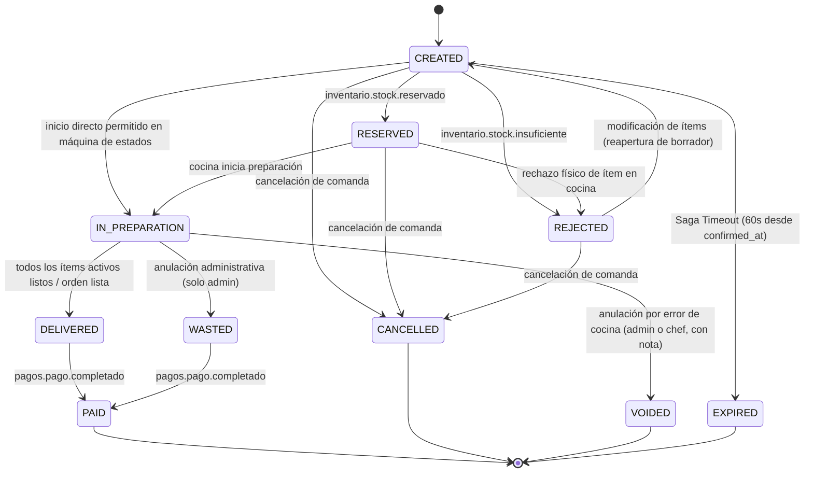

# Especificación de Requisitos de Software (ERS)
## Microservicio de Órdenes y Cocina (Orders & KDS Service)

**Versión:** v5 — alineada al estado actual del código fuente (`orders-backend` y `orders-frontend`)
**Alcance de esta versión:** (1) máquina de estados completa de 10 estados de orden (`CREATED`, `RESERVED`, `IN_PREPARATION`, `DELIVERED`, `PAID`, `CANCELLED`, `REJECTED`, `WASTED`, `VOIDED`, `EXPIRED`) y 4 estados por ítem (`PENDING`, `READY`, `DELIVERED`, `CANCELLED`), (2) flujo explícito de inicio de preparación en cocina (`RESERVED → IN_PREPARATION`), (3) rechazo físico en cocina (`kitchen-reject`) y cancelación por ítem, (4) reapertura automática de órdenes rechazadas y cancelación en `CREATED`/`RESERVED`/`REJECTED`, (5) anulación administrativa con parámetro `chargeCustomer`, (6) TTL de pre-reserva en KDS (15 min + 10 min de gracia) y ventana táctil de deshacer (15 s), (7) control de acceso híbrido PBAC (`AccessPolicy` con 16 permisos) y respaldo RBAC, y (8) microfrontends duales federados (`ordenesApp:5177` y `cocinaApp:5179`).

---

## 0. Historial de cambios respecto a v4

| # | Cambio | Tipo |
|---|---|---|
| 1 | Se incorpora el estado **`RESERVED`** entre `CREATED` e `IN_PREPARATION`: Inventario confirma reserva (`CREATED → RESERVED`) y Cocina inicia explícitamente la preparación (`RESERVED → IN_PREPARATION` mediante `PATCH /orders/{orderId}/start-preparation`) emitiendo `ordenes.orden.en_preparacion`. | Actualizado al código |
| 2 | Se formalizan los 4 estados de ítem (`PENDING`, `READY`, `DELIVERED`, **`CANCELLED`**), incluyendo cancelación individual de ítems en `CREATED`, `RESERVED` o ítem pendiente por rehacer en `DELIVERED`. | Actualizado al código |
| 3 | Se documenta el **rechazo físico por cocina** (`PATCH /orders/{orderId}/items/{itemId}/kitchen-reject`), que publica `ordenes.platillo.rechazado_cocina`, deshabilita el platillo en caché Redis si `availableQuantity == 0` y transiciona la orden `RESERVED` a `REJECTED` (o cancela el ítem pendiente si está en `DELIVERED`). | Nuevo en código |
| 4 | Se documenta la **reapertura automática** `REJECTED → CREATED` al modificar ítems y la regla de cancelación libre (`CANCELLED`, evento `ordenes.orden.cancelada`) aplicable en **`CREATED`, `RESERVED` y `REJECTED`**. | Actualizado al código |
| 5 | En anulación administrativa (`WASTED`, evento/endpoint `void`), se documenta la opción `chargeCustomer` (por defecto `true`: emite `ordenes.cobro.solicitado`; si `false`: emite `ordenes.comanda.mermada` sin cobro). | Actualizado al código |
| 6 | Se incorporan reglas KDS implementadas: ordenamiento por `COALESCE(in_preparation_at, stock_reserved_at, created_at)`, TTL de 15 min desde `stock_reserved_at` + 10 min de ventana de gracia en pestaña **Caducados**, y ventana táctil de **Deshacer** de 15 s (400 ms anti-ghost click). | Actualizado al código |
| 7 | Se actualiza autorización a **PBAC (`AccessPolicy`, 16 permisos `orders:*` / `kitchen:*`) + respaldo RBAC** (`MESERO`, `COCINERO`, `CHEF_MASTER`, `ADMINISTRADOR`) y doble remoto federado (`ordenesApp:5177`, `cocinaApp:5179`). | Actualizado al código |

---

## 1. Ciclo de vida y estados de la orden (referencia normativa del código)

> **Convención de identificadores:** el código implementa los códigos normativos en inglés (`CREATED`, `RESERVED`, `IN_PREPARATION`, `DELIVERED`, `PAID`, `CANCELLED`, `REJECTED`, `WASTED`, `VOIDED`, `EXPIRED`) para `OrderStatus`, y (`PENDING`, `READY`, `DELIVERED`, `CANCELLED`) para `ItemStatus`.

### 1.1 Estados principales (flujo operativo regular)

| Estado (`OrderStatus`) | Se alcanza cuando... | Evento asociado (Outbox / Broker) |
|---|---|---|
| **CREATED** | El mesero crea la comanda (vinculada a mesa, sesión o para llevar) y edita platillos. También se alcanza al reabrir una comanda `REJECTED` modificando sus ítems. Al confirmar se fija `confirmed_at`. | Al confirmar: publica `ordenes.orden.creada` (`ordenes.order.created`) |
| **RESERVED** | Inventario confirma la reserva de ingredientes; la comanda entra en la cola activa del KDS (pestaña Pendientes) y se registra `stock_reserved_at`. | Consume `inventario.stock.reservado` (`inventory.reservation.confirmed`); publica `ordenes.order.confirmed` |
| **IN_PREPARATION** | Personal de cocina (o chef/admin) inicia explícitamente la preparación en cocina; se registra `in_preparation_at`. | Publica `ordenes.orden.en_preparacion` (`ordenes.order.served` / `ordenes.order.in_preparation`) para consumo FEFO en Inventario |
| **DELIVERED** | Cocina marca todos los ítems activos como listos (`READY`), o ejecuta el despacho completo de la orden. El mesero puede solicitar cuenta o pedir rehechura (`redo`). | Por cada ítem completado: publica `ordenes.platillo.preparado` (`ordenes.dish.prepared`). Al pedir cuenta: publica `ordenes.cuenta.solicitada` |
| **PAID** *(terminal)* | El microservicio de Pagos confirma la liquidación financiera de una orden en `DELIVERED` o `WASTED`. | Consume `pagos.pago.completado` |

### 1.2 Estados alternativos

| Estado (`OrderStatus`) | Se alcanza cuando... | Evento asociado | ¿Se cobra al cliente? |
|---|---|---|---|
| **CANCELLED** *(terminal)* | El mesero (o admin) cancela la comanda en estado `CREATED`, `RESERVED` o `REJECTED`. | Publica `ordenes.orden.cancelada` (`ordenes.order.cancelled`) | **No** — compensa y libera pre-reservas |
| **REJECTED** | Inventario rechaza la reserva por stock insuficiente tras confirmación, **o** Cocina rechaza un platillo de una orden `RESERVED` por falta física de ingrediente. Puede reabrirse a `CREATED` editando ítems o cancelarse a `CANCELLED`. | Consume `inventario.stock.insuficiente` (`inventory.reservation.rejected`) / Publica `ordenes.platillo.rechazado_cocina` (`ordenes.dish.rejected`) | **No** |
| **WASTED** | Un **administrador** anula administrativamente una comanda en `IN_PREPARATION`. Transiciona luego a `PAID` si recibe confirmación de pago. | Si `chargeCustomer=true`: publica `ordenes.cobro.solicitado` (con precios congelados). Si `chargeCustomer=false`: publica `ordenes.comanda.mermada` (`reason="ADMINISTRATIVE"`) | **Configurable** (`true` por defecto: sí cobra; `false`: solo registra merma) |
| **VOIDED** *(terminal)* | Un **administrador o chef** anula una comanda completa en `IN_PREPARATION` por error atribuible a cocina con nota obligatoria (`note`). | Publica `ordenes.comanda.mermada` (`reason="KITCHEN_ERROR"`, `motivo="error_cocina"`, `note`) — **no** publica cobro | **No** — responsabilidad del restaurante |
| **EXPIRED** *(terminal)* | Una comanda confirmada permanece en `CREATED` con `confirmed_at` vencido (por defecto 60 s de Saga Timeout) sin respuesta de Inventario. | Publica `ordenes.orden.expirada` (`ordenes.order.expired` / `ordenes.order.cancelled`) | **No** |

> **Nota de estados por ítem (`ItemStatus`):** el ciclo de vida por ítem es `PENDING → READY → DELIVERED` (transición automática de ítems `READY` a `DELIVERED` al entregar la comanda), `DELIVERED → PENDING` (al solicitar rehechura con nota obligatoria, conservando la orden en `DELIVERED` y enviando `isRedo: true` al volver a preparar) y `PENDING → CANCELLED` (cancelación individual mientras la orden esté en `CREATED`, `RESERVED` o ítem pendiente en `DELIVERED`).

### 1.3 Diagrama de estados (implementación real)

---

## 2. Visualización y cola de cocina (KDS)

- El sistema agrupa las comandas en el KDS en vistas por estado y flujo de trabajo: **Pendientes (`RESERVED`)**, **En preparación (`IN_PREPARATION`)**, **Activas**, **Para rehacer (`DELIVERED` con ítems en `PENDING`)**, **Entregadas (`DELIVERED`)** y **Caducados** (órdenes en `EXPIRED` o `RESERVED` cuyo tiempo desde `stock_reserved_at` superó el TTL de 15 minutos más 10 minutos de gracia).
- La cola `GET /kds/queue` excluye órdenes en `PAID` y ordena por `COALESCE(in_preparation_at, stock_reserved_at, created_at)` ascendente, desempatando por `created_at` y `public_id`.
- Cuando una orden en `DELIVERED` recibe una solicitud de rehechura de ítem (`PENDING`), vuelve a aparecer automáticamente en la cola activa del KDS (`view=active`) y la pestaña **Para rehacer** muestra la alerta prioritaria.
- Cuando una orden pasa a `PAID` al consumir `pagos.pago.completado`, se retira definitivamente del KDS en tiempo real.

## 3. Detalle de tarjetas y filtrado por estación KDS

- Cada tarjeta en KDS muestra folio legible (`orderNumber` secuencial o últimos 4 caracteres de `publicId`), mesa asignada o etiqueta **Para llevar**, listado de platillos con cantidades, modificadores, notas, estación y tiempo de preparación de referencia (provenientes del catálogo sincronizado).
- El KDS incluye cronómetro y semáforo de atraso configurable (`KDS_WARNING_AFTER_SECONDS`, `KDS_LATE_AFTER_SECONDS`), además de contador regresivo de 10 minutos cuando una orden `RESERVED` excede el TTL de 15 minutos antes de pasar definitivamente a **Caducados**.
- El sistema permite filtrar ítems por estación culinaria normalizada (`GET /kds/queue?station=...`) y segmentar las actualizaciones en tiempo real por canales WebSocket `kds:station:{station}` y `kds:all`.

## 4. Control de preparación, despacho y rechazo en cocina

- **Inicio de preparación (`RESERVED → IN_PREPARATION`):** `PATCH/POST /orders/{orderId}/start-preparation` registra `in_preparation_at` y publica `ordenes.orden.en_preparacion` con los ítems activos consolidados.
- **Marcado de ítem listo (`PATCH /orders/{orderId}/items/{itemId}/ready`):** transiciona el ítem de `PENDING` a `READY` (o `DELIVERED` si es rehechura restaurando notas previas), emite `ordenes.platillo.preparado` (`isRedo`), y si todos los ítems activos están listos transiciona la orden a `DELIVERED`.
- **Marcado de orden completa lista (`PATCH /orders/{orderId}/ready`):** marca todos los ítems pendientes y lleva la orden a `DELIVERED`.
- **Ventana táctil de deshacer:** en la interfaz KDS, antes de confirmar hacia el backend el marcado de ítem/orden lista, existe una ventana de gracia de **15 segundos** (`Deshacer`), además de debouncing anti-doble clic de 400 ms y soporte completo de Bump Bar (teclado).
- **Rechazo físico en cocina (`PATCH /orders/{orderId}/items/{itemId}/kitchen-reject`):** permite rechazar un ítem en `RESERVED` (o pendiente de rehechura en `DELIVERED`) indicando `reason` y `availableQuantity`; si `availableQuantity == 0` marca el platillo no disponible en caché Redis, publica `ordenes.platillo.rechazado_cocina`, y regresa la orden `RESERVED` a `REJECTED` (con desglose `rejectedItems` / `reservedItems`) para que el mesero la ajuste.
- **Cancelación de ítem (`PATCH /orders/{orderId}/items/{itemId}/cancel`):** cancela un ítem individual (`ItemStatus.CANCELLED`) mientras la orden está en `CREATED`, `RESERVED` o en rehechura pendiente dentro de `DELIVERED`.

## 5. Gestión de comandas en terminal de mesero

- Creación de comandas para mesa o para llevar (`POST /orders`), opcionalmente vinculadas a `diningSessionId` (relación 1:N sesiones→órdenes).
- Edición de ítems, cantidades, modificadores y notas (`PATCH /orders/{orderId}/items`) únicamente cuando la orden está en `CREATED` (sin confirmar) o en `REJECTED` (reabriéndola a `CREATED`), validando disponibilidad en Redis y congelando precios unitarios.
- Trazabilidad mediante identidad extraída del API Gateway (`x-user-id`, `x-staff-id`, `x-user-roles`, `x-user-role`, `x-user-permissions`, `x-user-type`) o claims JWT sin verificación local de firma (ADR-0011), aplicando políticas PBAC (`AccessPolicy`, 16 permisos) y respaldo RBAC (`MESERO`, `COCINERO`, `CHEF_MASTER`, `ADMINISTRADOR` / `ADMIN`).
- Transferencia de orden entre mesas (`PATCH /orders/{orderId}/transfer`) con bloqueo optimista por columna `version` y encabezado `If-Match` (`409 VERSION_CONFLICT` ante concurrencia).

## 6. Sincronización en tiempo real, cobros y rehechuras

- WebSockets segregados (`/ws/waiter` para canales `floor` y `user:{userId}`, y `/ws/kds` para `kds:all` y `kds:station:{station}`), puente Redis Pub/Sub (`orders:realtime:events`) entre workers y proceso API, y cierre estandarizado `4401`/`4403`.
- Solicitud de cuenta (`POST/PATCH /orders/{orderId}/request-bill`) para órdenes en `DELIVERED`, emitiendo `ordenes.cuenta.solicitada` con precios congelados e identificadores `orderId` y `sessionId`.
- Transición a `PAID` al consumir `pagos.pago.completado` sobre órdenes en `DELIVERED` o `WASTED`.
- Rehechura de platillo (`PATCH /orders/{orderId}/items/{itemId}/redo`) sobre órdenes en `DELIVERED` con nota obligatoria (`note`), preservando temporalmente notas previas de preparación y restaurándolas tras completar la rehechura.

## 7. Cancelación y anulaciones (Mermas)

- **Cancelación libre (`PATCH/POST /orders/{orderId}/cancel`):** permitida mientras la orden esté en `CREATED`, `RESERVED` o `REJECTED`; transiciona a `CANCELLED` y publica `ordenes.orden.cancelada`.
- **Anulación administrativa (`PATCH/POST /orders/{orderId}/void`):** restringida a `ADMIN` (`orders:orders:void_admin`) sobre órdenes en `IN_PREPARATION`; transiciona a `WASTED`. Si `chargeCustomer` es `true` (default), publica `ordenes.cobro.solicitado`; si es `false`, publica `ordenes.comanda.mermada` (`reason="ADMINISTRATIVE"`).
- **Anulación por error de cocina (`PATCH/POST /orders/{orderId}/void-kitchen-error`):** restringida a `ADMIN` o `CHEF` (`kitchen:orders:void_error`) sobre órdenes en `IN_PREPARATION` con `note` obligatoria; transiciona toda la orden a `VOIDED` y publica `ordenes.comanda.mermada` (`reason="KITCHEN_ERROR"`, `motivo="error_cocina"`) sin emitir evento de cobro.

## 8. Saga de Inventario, Catálogo y Sala

- Al confirmar (`POST /orders/{orderId}/confirm`), valida ítems y registra `confirmed_at`, almacenando `ordenes.orden.creada` en el **Transactional Outbox** para su publicación al broker con confirmaciones (`publisher_confirms`) y enrutamiento dual opcional (`RABBITMQ_DUAL_ROUTING`).
- Consumidores idempotentes (`processed_events`) procesan `inventario.stock.reservado`/`inventory.reservation.confirmed`, `inventario.stock.insuficiente`/`inventory.reservation.rejected`, `pagos.pago.completado`, `sala.dining_session.iniciada`, y eventos de catálogo de Menú/Inventario (`menu.*`, `inventory.recipe.*`), enviando mensajes malformados a DLQ.
- El `SagaTimeoutWatcher` marca como `EXPIRED` y emite `ordenes.orden.expirada` tras `SAGA_TIMEOUT_SECONDS` (60 s por defecto operativo) desde `confirmed_at` sin confirmación ni rechazo de Inventario.

## 9. [Opcional / Fase Futura] Preparación de platillos intermedios

> **Estado actual:** Excluido del entregable principal (`INTERMEDIATE_DISHES_ENABLED=false` y `VITE_FEATURE_INTERMEDIATE_DISHES=false`), mantenido únicamente como punto de extensión futura en documentación y shell experimental sin acoplamiento al flujo de comandas activas.
