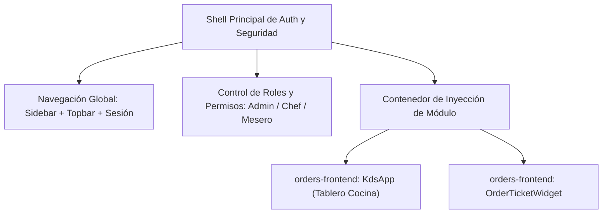

# FMAT-RESTAURANT — Guía Visual de Componentes y Diseño de Sistemas

**Versión 2.1 — Homologada con el Sistema Visual Central y Microfrontends**  
*Minimalista · Claro · Consistente · Accesible · Preparado para Pantalla de Cocina (KDS) y Shell de Auth*

Este documento representa la especificación visual y técnica de diseño para **todos** los componentes del frontend de órdenes, comandas y KDS en el ecosistema **FMAT-RESTAURANT**. Describe las directrices de interfaz aprobadas para el restaurante, los tokens de diseño, la integración como microfrontend dentro del shell principal de autenticación, y los requisitos ergonómicos específicos para pantallas de cocina empotradas y controladores *Bump Bar*.

---

### Tabla de contenidos

1. [Aclaración de antecedentes: Mockup inicial vs. Guía visual oficial](#1-aclaración-de-antecedentes-mockup-inicial-vs-guía-visual-oficial)
2. [Paleta de color y tokens](#2-paleta-de-color-y-tokens)
3. [Tipografía, espacio y forma](#3-tipografía-espacio-y-forma)
4. [Botones y controles táctiles](#4-botones-y-controles-táctiles)
5. [Inputs y formularios](#5-inputs-y-formularios)
6. [Cards y contenedores](#6-cards-y-contenedores)
7. [Menús, navegación y complementos](#7-menús-navegación-y-complementos)
8. [Tablas y listas](#8-tablas-y-listas)
9. [Estados, mensajes, toasts y modales](#9-estados-mensajes-toasts-y-modales)
10. [Patrones del restaurante: Mesa, Comanda y Cuenta](#10-patrones-del-restaurante-mesa-comanda-y-cuenta)
11. [Especificación KDS: Pantalla empotrada de cocina y Bump Bar](#11-especificación-kds-pantalla-empotrada-de-cocina-y-bump-bar)
12. [Arquitectura de Microfrontends e Integración con el Shell de Auth](#12-arquitectura-de-microfrontends-e-integración-con-el-shell-de-auth)
13. [Responsive layout](#13-responsive-layout)
14. [Guía rápida para los equipos y checklist de entrega](#14-guía-rápida-para-los-equipos-y-checklist-de-entrega)
15. [Tokens CSS y configuración recomendada](#15-tokens-css-y-configuración-recomendada)

---

## 1. Aclaración de antecedentes: Mockup inicial vs. Guía visual oficial

> [!IMPORTANT]
> **Antecedente del Mockup Inicial:**
> Al comienzo del proyecto se concibió un mockup preliminar para el KDS caracterizado por un fondo oscuro completo (`#0f172a` / `#1e293b`), franjas y cabeceras de columnas en colores saturados (amarillo para pendientes, naranja para preparación, verde para listos, rojo para rechazadas) y una barra lateral negra de Bump Bar.
> 
> **Transición a la Guía Visual Oficial:**
> Todos los demás equipos de microservicios (Auth, Menú, Sala, Inventario, Meseros) adoptaron la **Guía Visual Oficial FMAT-RESTAURANT** (versión clara, limpia y basada en el 70/20/10). Para evitar que el KDS y el módulo de órdenes luzcan como un sistema aislado o desconectado, **nuestro frontend debe converger hacia la misma guía visual institucional**, adaptando sus componentes para que sigan siendo 100% legibles y operativos en la pantalla empotrada de cocina.

### Principios de la Homologación:
- **Fondo limpio y neutro:** Se utiliza el fondo `Canvas` (`#F8FAFC`) y cards en blanco puro `Surface` (`#FFFFFF`), reduciendo la saturación innecesaria y el cansancio visual.
- **Sin franjas de color laterales:** Queda estrictamente prohibido colocar barras laterales de color en las tarjetas. La jerarquía y el estado se comunican mediante la cabecera, la tipografía y los badges semánticos.
- **Color con propósito:** El naranja institucional (`#C2410C`) queda reservado para la identidad, acciones primarias y cabeceras de comandas activas.

---

## 2. Paleta de color y tokens

Pocos colores, mucho espacio en blanco y un naranja cálido reservado para acciones y énfasis.

### Paleta Base

| Muestra | Nombre | Hex | Propósito en el Sistema |
|:---:|---|---|---|
|  | **Primary** | `#C2410C` | Botones principales, selección destacada, cabeceras de comanda |
|  | **Hover** | `#9A3412` | Estado hover y active (presionado) de elementos primarios |
|  | **Accent** | `#F97316` | Iconos de detalle, acentos visuales secundarios |
|  | **Soft** | `#FFF7ED` | Fondo suave para selección de cards, filas activas y badges |
|  | **Ink** | `#111827` | Títulos de alto contraste, texto prioritario |
|  | **Text** | `#374151` | Contenido de lectura, descripciones y cuerpo de texto |
|  | **Muted** | `#6B7280` | Texto secundario, notas de cocina, modificadores y fechas |
|  | **Border** | `#E5E7EB` | Líneas divisorias, bordes sutiles de cards y controles |
|  | **Canvas** | `#F8FAFC` | Fondo de la aplicación, tablero y vistas completas |
|  | **Surface** | `#FFFFFF` | Fondo de tarjetas (cards), paneles y ventanas modales |

### Estados del Sistema (Feedback Visual)

La comunicación de estados siempre combina **un punto indicador (dot) de color + texto explícito**, garantizando contraste mínimo WCAG AA (≥ 4.5:1).

| Muestra | Estado | Dot / Texto | Fondo Suave | Significado en Cocina y Órdenes |
|:---:|---|---|---|---|
|  | **Éxito** | `#16A34A` | `#ECFDF5` | "Orden lista", "Entregada", "Pagada", "En tiempo" |
|  | **Advertencia** | `#D97706` | `#FFFBEB` | "Por atrasarse" (umbral de tiempo), "Pendiente", insumo bajo |
|  | **Error** | `#DC2626` | `#FEF2F2` | "Atrasada", "Rechazada", "Anulación cocina/admin", insumo agotado |
|  | **Información** | `#2563EB` | `#EFF6FF` | "Reservada / Por iniciar", "Sincronizando...", avisos del mesero |
|  | **Seleccionado** | `#C2410C` | `#FFF7ED` | Comanda o platillo con foco activo en Bump Bar o selección táctil |

### Regla del 70 / 20 / 10
- **70 % Blanco y fondos neutros:** Fondos Canvas (`#F8FAFC`) y superficies Surface (`#FFFFFF`).
- **20 % Texto, bordes y estructura:** Bordes finos (`#E5E7EB`) y tipografía Ink/Text/Muted.
- **10 % Naranja y estados:** Exclusivamente para acciones prioritarias, selección activa y badges de estatus.

---

## 3. Tipografía, espacio y forma

Una sola familia tipográfica, espaciados consistentes basados en múltiplos de 4 px y bordes suaves.

### Tipografía
- **Familia principal:** `Inter`
- **Fallback estándar:** `system-ui, Segoe UI, Roboto, Arial, sans-serif`

| Nivel | Tamaño / Interlineado | Peso | Aplicación |
|---|---|---|---|
| **H1** | 28 / 36 px | 700 (Bold) | Título de pantalla principal ("Tablero de Cocina KDS") |
| **H2** | 22 / 30 px | 700 (Bold) | Título de sección o número de mesa destacado ("MESA 04") |
| **H3** | 18 / 26 px | 600 (SemiBold) | Título de componente, modal o platillo en tarjeta |
| **Body** | 16 / 24 px | 400 (Regular) | Texto de interfaz claro, fácil de escanear en pantalla |
| **Small** | 14 / 20 px | 400 / 600 | Modificadores, notas de cocina, estaciones y tiempos |
| **Caption** | 12 / 16 px | 400 (Regular) | Tiempos transcurridos secundarios, metadatos y IDs |

### Escala de Espaciado Modular
Basada en múltiplos de 4 px:
`4px` · `8px` · `12px` · `16px` · `24px` · `32px` · `48px`

### Radios de Borde (Border Radius)
- **Pequeño (4 px):** Badges pequeños, tags de insumos, indicadores.
- **Medio (8 px):** Botones, campos de entrada (inputs), controles de acción.
- **Grande (12 px):** Tarjetas de comanda (cards), contenedores y ventanas modales.

### Sombras
Sombras muy sutiles (`shadow-sm` o `0 1px 3px rgba(0,0,0,0.05)`). Solo se utilizan para separar capas flotantes (modales o tarjetas elevadas), evitando estilos visuales recargados.

---

## 4. Botones y controles táctiles

Misma altura por nivel, mismo radio y una sola acción principal por bloque.

### Variantes de Botón

| Variante | Estilo Visual | Uso y Semántica |
|---|---|---|
| **Primario** | Fondo sólido `#C2410C`, texto blanco | Acción principal del bloque (ej. "Iniciar preparación", "Orden lista", "Cobrar cuenta") |
| **Secundario** | Fondo blanco, borde fino `#C2410C`, texto `#C2410C` | Alternativa visible o acción de navegación (ej. "Ver mesa", "Vista previa") |
| **Terciario** | Fondo transparente, sin borde, texto `#C2410C` o `#374151` | Acciones de baja prioridad (ej. "Cancelar", "Cerrar") |
| **Destructivo** | Fondo sólido `#DC2626`, texto blanco | Acciones irreversibles o críticas (ej. "Anular orden", "Eliminar") |
| **Deshabilitado**| Fondo `#F3F4F6`, texto `#9CA3AF`, sin cursor | Bloqueado por falta de insumos, estado o permisos insuficientes |

### Tamaños y Alturas

| Tamaño | Altura Mínima | Contexto |
|---|:---:|---|
| **SM** | 32 px | Filtros compactos, acciones secundarias de escritorio |
| **MD** | 40 px | Botones estándar en modales y formularios de gestión |
| **LG / Touch** | 48 px | **Estándar general para interacción táctil (Touch)** |
| **KDS Hero** | 64 px | **Botón de acción principal en la tarjeta de comanda en cocina** |

> [!TIP]
> **Regla de redacción:** Usar siempre la fórmula **Verbo + Objeto**.
> *Ejemplo:* "Iniciar preparación" o "Marcar como lista" en lugar de solo "Aceptar" u "Ok".

---

## 5. Inputs y formularios

- **Etiqueta visible obligatoria:** La etiqueta va siempre arriba del campo; nunca usar el placeholder en reemplazo del label.
- **Foco visible:** Borde naranja `#C2410C` con anillo suave al recibir foco (`focus:ring-2 focus:ring-primary/20`).
- **Manejo de errores:** Borde rojo `#DC2626` y mensaje explicativo en texto Small debajo del campo (*"Ingresa un valor mayor que 0."*).
- **Controles nativos:**
  - Checkboxes y Radios en naranja institucional cuando están marcados.
  - Switches / Toggles con fondo naranja activo y gris inactivo.

---

## 6. Cards y contenedores

Borde fino, sombra casi imperceptible y jerarquía clara definida por el contenido.

> [!WARNING]
> **PROHIBIDO:** Colocar barras o franjas de color al costado izquierdo o derecho de las tarjetas. Toda diferenciación se hace con el encabezado estructurado o mediante badges.

### Tipos de Cards
1. **Product Card (Menú / Catálogo):** Imagen o icono identificador, badge de estado superior ("Disponible"), nombre, descripción, precio destacado y botón "Agregar".
2. **Orden Seleccionable (Lista de Pedidos):**
   - *Estado normal:* Fondo blanco `#FFFFFF`, borde `#E5E7EB`.
   - *Estado seleccionado:* Fondo suave `Soft` (`#FFF7ED`) con borde `Primary` (`#C2410C`).
3. **Card de Comanda (KDS):** Ver especificación detallada en la [Sección 10](#10-patrones-del-restaurante-mesa-comanda-y-cuenta).

---

## 7. Menús, navegación y complementos

El Shell principal de autenticación provee la navegación global (sidebar con Inicio, Catálogo, Pedidos, Usuarios). Los microfrontends entregan exclusivamente el contenido de su módulo:
- **Pestañas / Filtros de Módulo:** Pestañas superiores (ej. Estaciones: "General", "Parrilla", "Cocina caliente", "Bebidas") o vistas ("Activas", "Entregadas").
- **Paginación táctil:** Controles grandes numerados (`1`, `2`, `3...`) o botones `Anterior` / `Siguiente` de al menos 48 px de altura.

---

## 8. Tablas y listas

- Columnas limpias con cabecera en gris claro neutro (`#F8FAFC`).
- Importes y cantidades alineados a la derecha.
- Estados de inventario o platillos comunicados mediante dot de color + texto ("En stock", "Bajo stock", "Agotado").
- En pantallas móviles o compactas, las tablas se transforman automáticamente en tarjetas o listas compactas.

---

## 9. Estados, mensajes, toasts y modales

El usuario siempre debe saber con certeza qué ocurrió y qué opciones tiene para continuar.

### Mensajes y Banners de Alerta
Contenedores con fondo suave temático, borde izquierdo sutil y dot de color:
- **Éxito:** Fondo `#ECFDF5`, borde y texto `#16A34A` (*"Orden marcada como lista correctamente."*).
- **Advertencia:** Fondo `#FFFBEB`, borde y texto `#D97706` (*"Comanda próxima a exceder el tiempo límite."*).
- **Error:** Fondo `#FEF2F2`, borde y texto `#DC2626` (*"No se pudo conectar con el servidor de órdenes."*).
- **Información:** Fondo `#EFF6FF`, borde y texto `#2563EB` (*"Sincronizando comandas en tiempo real..."*).

### Modales y Diálogos de Confirmación
- Fondo de desenfoque/oscurecimiento (Backdrop) en negro semitransparente (`bg-black/60`).
- Card central en blanco `Surface` (`#FFFFFF`), radio de 12 px, sombra profunda `shadow-2xl`.
- Encabezado con título H2 en `Ink` (`#111827`) y botón de cerrar.
- Mensaje explicativo claro de consecuencias.
- Footer con botón terciario "Cancelar" a la izquierda y botón destructivo o primario a la derecha.

---

## 10. Patrones del restaurante: Mesa, Comanda y Cuenta

### Patrón 1: Mesa
Card limpia con badge de estado ("Ocupada" / "Disponible"), número de mesa en H2 bold, metadatos secundarios ("4 personas · 32 min") y botón secundario "Ver mesa".

---

### Patrón 2: Comanda Oficial de Cocina (KDS Ticket)

Este es el patrón central para las órdenes de cocina, homologado con la Guía Visual (Página 10 del sistema visual oficial):

```text
┌────────────────────────────────────────────────────────┐
│ MESA 04 · #184                                   12:41 │  ← Cabecera Naranja Sólido (#C2410C)
├────────────────────────────────────────────────────────┤
│  2  Hamburguesa clásica                                │  ← Cantidad Bold + Nombre en Ink (#111827)
│     Sin cebolla · término 3/4                          │  ← Modificadores en Muted (#6B7280)
├────────────────────────────────────────────────────────┤
│  1  Ensalada de la casa                                │
│     Aderezo aparte                                     │
├────────────────────────────────────────────────────────┤
│  3  Agua mineral                                       │
├────────────────────────────────────────────────────────┤
│                                                        │
│  [               Marcar como lista                  ]  │  ← Botón Primario Touch (#C2410C, ≥48px)
│                                                        │
└────────────────────────────────────────────────────────┘
```

#### Estructura y Estilos de la Comanda:
1. **Cabecera destacada (Header):**
   - **Fondo:** Naranja sólido institucional (`#C2410C`).
   - **Texto a la izquierda:** Mesa y número de orden en blanco puro (`#FFFFFF`, H2 / font-black tracking-wide), ej.: `MESA 04 · #184` o `Takeaway · #184`.
   - **Texto a la derecha:** Cronómetro o tiempo transcurrido en tipografía monospace / bold en blanco (`12:41`).
2. **Cuerpo de la tarjeta (Body):**
   - **Fondo:** Blanco puro (`#FFFFFF`).
   - **Borde:** Fino perimetral `#E5E7EB` con radio de 12 px (`rounded-xl`).
   - **Líneas divisorias:** Entre platillos con borde fino gris `#E5E7EB`.
3. **Detalle de cada platillo (Items):**
   - **Cantidad:** Número en negrita destacado (`font-black`, tamaño 18 px) junto al nombre del platillo.
   - **Notas y modificadores:** Texto auxiliar en color `Muted` (`#6B7280`), con estilo claro y legible. Si un ítem fue reenviado o requiere atención prioritaria, se acompaña de un badge de advertencia suave (`#FFFBEB`).
4. **Área de acciones (Footer):**
   - Botón de acción principal ("Marcar como lista" o "Iniciar preparación") en naranja primario `#C2410C`, texto en blanco, con altura mínima de **48 px a 64 px** para facilitar el toque rápido.
   - Acciones secundarias (Rechazar insumo, Anular) situadas en la parte inferior con altura touch adecuada y colores semánticos correspondientes.

---

### Patrón 3: Cuenta / Recibo
Título `Cuenta #1234`, fecha y mesa, tabla desglosada de cantidades e importes, total general en tipografía H2 bold y botón primario ancho "Cobrar cuenta".

---

## 11. Especificación KDS: Pantalla empotrada de cocina y Bump Bar

A diferencia de un punto de venta convencional o panel de administración en escritorio, el frontend del KDS opera en condiciones de alta exigencia física dentro de la cocina del restaurante:

### Entorno y Ergonomía de Cocina
1. **Montaje en pantalla empotrada:** Monitor touch de 1920×1080 (o similar) fijado en pared o soporte articulado sobre la barra de pase.
2. **Distancia de visualización:** El chef y cocineros leen la pantalla a una distancia de **1.5 a 2.5 metros**. Por ello, el número de mesa y el tiempo en la cabecera naranja deben utilizar tipografías grandes (≥ 22 px) y de máximo contraste.
3. **Operación con "manos de cocina":** Los operadores tocan la pantalla con guantes, manos húmedas o apuro extremo. Todas las áreas interactivas deben respetar un tamaño táctil mínimo de **≥ 48 px**, con espacio suficiente entre botones adyacentes (mínimo 12 px) para evitar toques accidentales.

### Paridad con Bump Bar y Teclado Físico
Muchos operadores de cocina prefieren no tocar la pantalla para evitar ensuciarla o quemarse, empleando un controlador físico de cocina (*Bump Bar*) o teclado numérico industrial empotrado:

| Tecla / Mapeo | Acción KDS | Comportamiento |
|---|---|---|
| **`1` / `Enter`** | **Iniciar / Preparar** | Inicia la preparación de la comanda en foco (`RESERVED` → `IN_PREPARATION`) |
| **`2` / `Espacio`** | **Orden Lista** | Marca la orden completa o platillos como listos para entrega |
| **`3`** | **Rechazar insumo** | Dispara el rechazo de insumo físico insuficiente |
| **`4`** | **Ver detalle / Toggle** | Alterna entre vista compacta y detalles expandidos de la orden |
| **`ArrowLeft` / `ArrowRight`** | **Navegación comanda** | Mueve el foco activo a la tarjeta anterior o siguiente en el tablero |
| **`ArrowUp` / `ArrowDown`** | **Desplazamiento interno** | Desplaza el contenido de listas largas dentro de la tarjeta enfocada |
| **`PageUp` / `PageDown`** | **Selector de estación** | Conmuta entre las estaciones activas ("General", "Parrilla", "Fría", etc.) |

---

## 12. Arquitectura de Microfrontends e Integración con el Shell de Auth

### Principio de Inyección Federada (Module Federation)
Tanto el tablero KDS (`KdsApp`) como los componentes de detalle de comandas (`OrderTicketWidget`) y alertas son **microfrontends federados** que se inyectan dinámicamente dentro de un contenedor anfitrión (el **Shell Principal**, desarrollado por el equipo de Auth, Autenticación y Seguridad).



### Reglas Críticas de Convivencia e Integración:

1. **Aislamiento Estricto de CSS (CSS Scoping):**
   - El microfrontend **nunca** debe declarar estilos globales que afecten al Shell:
     - ❌ Prohibido aplicar reglas sobre `html`, `body`, `:root` o selectores universales `*` sin prefijo.
     - ❌ Prohibido incluir CSS resets globales tipo `normalize` o Tailwind Preflight habilitado globalmente (`corePlugins.preflight: false`).
   - ✅ Todos los estilos, variables y reglas de Tailwind deben encapsularse bajo la clase raíz del módulo: `.orders-kds-root`.

2. **No Duplicar Navegación del Shell:**
   - El microfrontend no debe renderizar encabezados globales de sitio, barras laterales de navegación principal (Sidebar FMAT) ni pies de página que compitan con el Shell anfitrión.
   - Solo se renderizan controles internos propios del módulo (selector de estaciones de cocina, pestañas Activas/Entregadas, botones de paginación).

3. **Adaptación según Roles y Permisos (RBAC):**
   - El Shell provee el contexto de autenticación y el rol del usuario conectado (`admin`, `chef`, `waiter`).
   - La interfaz del microfrontend debe adaptar condicionalmente sus acciones según dicho rol:
     - **Rol `admin`:** Acceso a anulación administrativa (`AdminVoidDialog`), rechazo y cambio de estado.
     - **Rol `chef`:** Acceso a anulación por error de cocina (`ChefVoidDialog`), inicio de preparación y marcado de orden lista.
     - **Rol `waiter`:** Visualización de alertas de órdenes listas (`ReadyOrdersAlert`) y reenvío de ítems entregados (`RedoItemDialog`).
     - Botones no autorizados para el rol en sesión deben ocultarse completamente para mantener la interfaz despejada y segura.

---

## 13. Responsive layout

Los componentes se reacomodan según el ancho disponible en el contenedor asignado por el Shell:

| Formato | Rango de Ancho | Distribución en Rejilla | Uso Habitual |
|---|:---:|:---:|---|
| **Desktop / Pantalla Cocina** | ≥ 1200 px | 3 a 4 columnas de comandas | Pantalla empotrada en cocina (KDS 1920×1080) |
| **Tablet** | 768 – 1199 px | 2 columnas de comandas | Tablets de chef de partida o pase de sala |
| **Mobile** | < 768 px | 1 columna por comanda | Dispositivos móviles de mesero o auditoría rápida |

---

## 14. Guía rápida para los equipos y checklist de entrega

Lo mínimo indispensable que debe mantenerse idéntico en cualquier pantalla o microfrontend del proyecto:

| ✅ Prácticas Obligatorias (SÍ) | ❌ Prácticas Prohibidas (EVITAR) |
|---|---|
| Usar exclusivamente la paleta y tokens compartidos. | Inventar otro tono de naranja, gris o radio de borde. |
| Cabecera de comanda naranja `#C2410C` con texto blanco. | Poner franjas de colores al costado de las tarjetas. |
| Una sola acción primaria clara por bloque. | Llenar la pantalla de cajas y banners decorativos sin función. |
| Estados con punto (dot) de color + texto explicativo. | Usar solo color para comunicar un estado crítico. |
| Objetivos táctiles mínimos de 48 px (64 px en cocina). | Botones pequeños menores a 40 px en pantallas de trabajo. |
| Paridad completa táctil y con teclado / Bump Bar. | Controles que solo admitan clics con ratón. |
| Aislamiento CSS estricto bajo `.orders-kds-root`. | Declarar resets globales que colisionen con el Shell de Auth. |

### Checklist antes de entregar cambios visuales:
- [ ] Colores validados contra la paleta oficial (70% neutrales, 20% texto/borde, 10% naranja/estados).
- [ ] Comanda de cocina con cabecera naranja institucional `#C2410C` y cuerpo blanco `#FFFFFF`.
- [ ] Sin franjas de color laterales en tarjetas.
- [ ] Pruebas en viewport de cocina (1920×1080) y responsivo en tablet y móvil.
- [ ] Navegación funcional vía Bump Bar y teclado (teclas 1-4, flechas, Enter, Espacio).
- [ ] Foco visual visible y de alto contraste en cada elemento interactivo.
- [ ] Acciones filtradas correctamente según el rol del usuario (`admin`, `chef`, `waiter`).
- [ ] Cero estilos globales contaminando el Shell.

---

## 15. Tokens CSS y configuración recomendada

### Definición de Tokens en el Contenedor Raíz (`.orders-kds-root`)

```css
.orders-kds-root {
  /* Identidad y Énfasis */
  --color-primary: #C2410C;
  --color-primary-hover: #9A3412;
  --color-primary-accent: #F97316;
  --color-primary-soft: #FFF7ED;

  /* Texto y Neutros */
  --color-ink: #111827;
  --color-text: #374151;
  --color-muted: #6B7280;
  --color-border: #E5E7EB;
  --color-canvas: #F8FAFC;
  --color-surface: #FFFFFF;

  /* Estados Semánticos (Feedback) */
  --color-success: #16A34A;
  --color-success-bg: #ECFDF5;
  --color-warning: #D97706;
  --color-warning-bg: #FFFBEB;
  --color-error: #DC2626;
  --color-error-bg: #FEF2F2;
  --color-info: #2563EB;
  --color-info-bg: #EFF6FF;

  /* Geometría y Espaciado */
  --radius-sm: 4px;
  --radius-control: 8px;
  --radius-card: 12px;
  --space-unit: 4px;

  /* Tipografía */
  font-family: 'Inter', system-ui, -apple-system, BlinkMacSystemFont, 'Segoe UI', Roboto, Arial, sans-serif;
  color: var(--color-text);
  background-color: var(--color-canvas);
}
```

### Configuración de Tailwind (`tailwind.config.ts`)
Con `preflight: false` para respetar la integración de Module Federation:

```ts
import type { Config } from 'tailwindcss';

export default {
  content: ['./src/**/*.{ts,tsx}'],
  corePlugins: {
    // Esencial: no introducir resets globales que sobreescriban el Shell de Auth
    preflight: false,
  },
  theme: {
    extend: {
      colors: {
        fmat: {
          primary: '#C2410C',
          hover: '#9A3412',
          accent: '#F97316',
          soft: '#FFF7ED',
          ink: '#111827',
          body: '#374151',
          muted: '#6B7280',
          border: '#E5E7EB',
          canvas: '#F8FAFC',
          surface: '#FFFFFF',
        },
        feedback: {
          success: '#16A34A',
          'success-bg': '#ECFDF5',
          warning: '#D97706',
          'warning-bg': '#FFFBEB',
          error: '#DC2626',
          'error-bg': '#FEF2F2',
          info: '#2563EB',
          'info-bg': '#EFF6FF',
        },
      },
      borderRadius: {
        sm: '4px',
        control: '8px',
        card: '12px',
      },
      fontFamily: {
        sans: ['Inter', 'system-ui', 'Segoe UI', 'Roboto', 'Arial', 'sans-serif'],
      },
    },
  },
} satisfies Config;
```

---

*FMAT-RESTAURANT · Guía Visual de Componentes y Diseño de Sistemas · Versión 2.1*
