# Contratos y Mensajes de Integración: Órdenes & KDS con Inventario y Menú

> **Versión:** 1.3.0  
> **Fecha:** 20 de Noviembre de 2026  
> **Estado:** Actualizado y Contrastado contra Implementación Real (`Inventory-Backend`, `Menu-Backend`, `orders-backend`, `orders-frontend`)  
> **Microservicios involucrados:**
> - **Órdenes & KDS** (`orders-backend`, `orders-frontend`)
> - **Inventario** (`Inventory-Backend`, `inventory-frontend`)
> - **Menú** (`Menu-Backend`, `Menu-Frontend`)

---

## 1. Resumen Ejecutivo y Resoluciones de la Reunión

Tras la reunión sostenida entre los líderes de equipo de **Menú (Tony)**, **Inventario (Hector)** y **Órdenes & KDS** (y su posterior verificación contra `Menu-Backend` `6ce537b` e `Inventory-Backend` `4c61072`), se formalizaron las siguientes directrices arquitectónicas obligatorias:

1. **Resolución, Cardinalidad (`1 offerId : N sourceId`), Longitud y Persistencia de Identificadores:**
   - **Menú** emite y administra dos niveles de identificadores:
     - `offerId`: Identificador comercial de la oferta/combo (`CatalogOffer.id` UUID) en el catálogo de menú (precio `basePrice`, presentación y composición en `composition.slots[].options[]`).
     - `sourceId`: Identificador de cada receta base (`sourceType = "RECIPE"` → `recipeId`) o artículo directo de inventario (`sourceType = "INVENTORY_ITEM"` → `optionId`), emitido por Menú en `menu.source.created` / `menu.source.updated` / `menu.source.deleted` sobre `menu.topic`. **Una sola oferta (`offerId`, ej. un combo *"Hamburguesa con Papas"*) contiene uno o múltiples `sourceId`.**
   - **Inventario** indexa sus recetas internamente en MongoDB bajo `recipeModel.findOne({ plateId })`, donde `plateId` (`@MaxLength(100)`, cadena no vacía sin obligación estricta de UUID) corresponde exactamente a cada **`sourceId` individual** recibido desde Menú en `menu.source.created` / `menu.source.updated` (Inventario no almacena `offerId`; reserva exclusivamente con `raw.plateId ?? raw.sourceId` y usa `itemId` como `ObjectId` de materia prima).
   - **Órdenes & KDS** separa explícitamente la creación de la orden del envío a Inventario y garantiza paridad en ambos sentidos:
     - `POST /orders` (`CreateOrderRequest`) crea únicamente la cabecera de la orden (`tableNumber`, `isTakeaway`, `diningSessionId`) en estado `CREATED` **sin ítems ni eventos RabbitMQ**.
     - `PATCH /orders/{orderId}/items` (`OrderItemInput`) recibe las líneas planas desde `Menu-Frontend` (`OrderTicketWidget`). Si una oferta compuesta incluye `N` recetas/componentes, **`Menu-Frontend` envía una línea por cada `sourceId` seleccionado** compartiendo el mismo `offerId` (asignando `unitPrice` en una sola línea o prorrateado, y `0.00` en las demás para no duplicar `totalAmount`). Los campos `dishId`, `sourceId` y `offerId` aceptan **hasta `100` caracteres** (`MAX_CATALOG_ID_LENGTH = 100`, alineado con `Inventory-Backend`) y rechazan cadenas en blanco (`422`).
     - `orders-backend` persiste en PostgreSQL (`order_items`) **`dish_id = sourceId`** (`VARCHAR(100)`, migración `20261119_widen_dish_id_100`) y **`offer_id = offerId`** (`VARCHAR(120)`), valida ambos en Redis, consolida por la tupla **`(dish_id, offer_id)`** al confirmar (`POST /orders/{orderId}/confirm`) y **emite siempre `plateId`, `sourceId` y `offerId`** tanto en la routing key primaria (`ordenes.orden.creada`, `ordenes.orden.cancelada`, `ordenes.orden.en_preparacion`, `ordenes.orden.expirada`, `ordenes.comanda.mermada`, `ordenes.platillo.preparado`) como en las routing keys duales en inglés (`ordenes.order.*`, `ordenes.dish.*`), incluso cuando `offerId == sourceId`. Adicionalmente, **`EventPublisher` ya no inyecta `itemId = plateId` artificial** en los ítems consolidados para evitar colisión semántica con el `ObjectId` de insumos de Inventario.
2. **Impacto de Compatibilidad para Otros Equipos (Sin Cambios Rupturistas):**
   - **Para Inventario (`Inventory-Backend`):** Cambio **retrocompatible y correctivo**. Inventario ahora recibe `plateId` y `sourceId` en todas las routing keys (`ordenes.orden.creada` y `ordenes.order.created`, además de cancelación `itemsCancelados`, preparación, merma y expiración), evitando descartes silenciosos cuando `offerId == sourceId`.
   - **Para Menú (`Menu-Backend` / `Menu-Frontend`):** **Sin cambios requeridos.** Se mantiene el contrato v1 existente (`offerId` + `sourceId`) y además Órdenes escucha `inventory.source.availability.updated` en `inventory.topic` (`inventory.source.*`).
   - **Para Pagos (`Payments-BE`):** **Sin cambios requeridos.** Continúa recibiendo `offerId` / `plateId` y precios congelados en `ordenes.cuenta.solicitada` y `ordenes.cobro.solicitado`.
3. **Merma Granular por Platillo (`KitchenDishRejectedEvent`):**
   - El rechazo por falta de insumos físicos en cocina o merma de producción se reporta a nivel de platillo individual.
   - Incluye `itemId` (línea afectada), `plateId` / `sourceId` (receta física a mermar), `offerId` (oferta comercial a deshabilitar en Menú), `quantity` y `reason` / `motivo`.
   - La comanda (`orderId`) se envía como metadato de referencia para trazabilidad.
4. **Manejo de TTL de Comanda y Expiración:**
   - Si una orden en estado `RESERVED` no es iniciada por cocina dentro del tiempo límite (**TTL = 15 minutos**, `ORDER_RESERVATION_TTL_SECONDS = 900`):
     - En **KDS**: La tarjeta pasa a la pestaña **"Caducados"** con el mensaje `"Comanda caducada por tiempo agotado para Inicio de Preparación"`, cuenta regresiva visible y el botón *"Iniciar preparación"* bloqueado durante una ventana de gracia de **10 minutos (`KDS_EXPIRED_GRACE_MS = 600_000`)**, tras lo cual se retira automáticamente de la pantalla.
     - En **Mesero (`OrderTicketWidget`)**: Se notifica al mesero que cocina no confirmó a tiempo, permitiéndole: (a) reintentar confirmación, (b) modificar platillos en el borrador local (pudiendo vaciar/sustituir los platillos en la UI antes de reemplazar la lista vía `PATCH /orders/{orderId}/items`), o (c) cancelar y crear una nueva orden limpiamente.
5. **Nomenclatura Microfrontend:**
   - La vista del mesero integrada en Menú utiliza el término **"Orden"** (`entityLabel="orden"`), mientras KDS mantiene **"Comanda"**, soportando eventos DOM bilingües (`fmat:orden:*` y `fmat:comanda:*`) y propagando `sourceId`, `offerId` y `unitPrice` de extremo a extremo.
6. **Estrategia de Exchanges, Routing Keys Duales y `correlationId` (Alineado a CloudAMQP `tsaxufiv`):**
   - **Órdenes (`ordenes.topic`)** publica con routing keys primarias en español y routing keys duales en inglés para `Inventory-Backend` (`ordenes.order.created`, `ordenes.order.cancelled`, `ordenes.order.expired`, `ordenes.order.served`, `ordenes.order.in_preparation`, `ordenes.dish.rejected`, `ordenes.dish.redo`, `ordenes.order.wasted`, `ordenes.dish.prepared`).
   - **Garantía de `correlationId` no nulo:** Todos los eventos que heredan de `OrderEvent` y toda publicación en `EventPublisher.publish` aseguran `correlationId` no nulo tanto en el cuerpo JSON como en la propiedad AMQP `correlation_id` (tomando `orderId` o `eventId` como fallback cuando no exista otro identificador de correlación explícito).
   - El worker `InboundConsumerWorker` (`orders.inventory.inbound`) declara y escucha los cuatro topic exchanges reales del broker (`tsaxufiv`): `inventory.topic` (`inventory.reservation.*`, `inventory.redo.*`, `inventory.recipe.*`, `inventory.source.*`, `inventario.stock.*`), `menu.topic` (`menu.#`), `sala.events` (`sala.#`, `dining.#`, configurable vía `RABBITMQ_FLOOR_EXCHANGE`) y `ordenes.topic` (`inventory.reservation.*`, `inventory.redo.*`, `inventario.stock.*`, `pagos.#`, `payments.#`, `pago.#`, `sala.#`, `dining.#`, `menu.*`).
7. **Flujo de Rehechuras con Inventario (Opción 1A — Handler Dedicado Corto):**
   - Al solicitar la rehechura de un platillo ya entregado (`PATCH /orders/{orderId}/items/{itemId}/redo`), `orders-backend` valida primero disponibilidad en la proyección caché de Redis (`422 DISH_UNAVAILABLE` si el platillo/oferta está bloqueado), pasa el ítem `DELIVERED -> PENDING` preservando su orden en `DELIVERED`, guarda la nota previa y encola `DishRedoRequestedEvent` (`ordenes.platillo.rehecho` / `ordenes.dish.redo`) con `redoId`, `itemId`, `offerId`, `plateId`, `sourceId`, `quantity` y motivo.
   - `Inventory-Backend` valida existencias reales y descuenta por FEFO usando `orderId` como referencia, respondiendo `inventory.redo.confirmed` (ACK informativo) o `inventory.redo.rejected` (compensación automática en `orders-backend`: regresa el ítem `PENDING -> DELIVERED`, restaura la nota previa, guarda el motivo bajo `rejectionDetails.redoRejection` y notifica por WebSocket a Mesero y KDS).
8. **Seguridad PBAC (`AccessPolicy` con fallback RBAC) y Enrutamiento Kong Dual (6 Módulos Auth):**
   - Todos los endpoints REST de `/orders`, `/kds` y los canales WebSocket `/ws/kds` y `/ws/waiter` están expuestos bajo `/api/v1/orders` (puerto `8082`, consumido por `ordenesApp:5177`) y `/api/v1/kitchen` (puerto `8086`, consumido por `cocinaApp:5179`), manteniendo también `/api/v1` y rutas raíz para compatibilidad interna.
   - `require_access` y `authorize_websocket(..., policy=...)` evalúan políticas PBAC (`orders:*` / `kitchen:*`) leyendo headers inyectados por Kong (`x-user-id`, `x-staff-id`, `x-user-roles`, `x-user-role`, `x-user-permissions`, `x-user-type`) y claims JWT (`user_id`/`sub`, `roles`/`role`, `permissions`, `staffId`, `userType`), incluyendo `CHEF_MASTER` → `chef`, acceso administrativo cuando `userType`/`x-user-type` es `ADMINISTRADOR`/`ADMIN` y fallback por rol para tokens de desarrollo sin lista de `permissions`.
9. **Sincronización WebSocket Cross-Process (Redis Pub/Sub Bridge):**
   - Los eventos asíncronos procesados en el worker (`app/workers/run_all.py`) —como confirmaciones/rechazos de inventario o expiraciones— publican mensajes en el canal Redis Pub/Sub `orders:realtime:events` (`RedisRealtimeBridge`), y el proceso API (`app/main.py`) los reenvía en tiempo real mediante `RealtimeChannelRouter` hacia los clientes WebSocket `/ws/kds` y `/ws/waiter`.

---

## 2. Mapa de Relación de Identificadores

| Concepto | En Microservicio Menú | En Microservicio Inventario | En Microservicio Órdenes & KDS |
| :--- | :--- | :--- | :--- |
| **Plato Físico / Receta** | `sourceId` | `plateId` | `OrderItem.dish_id` / REST `dishId`, `sourceId` / Evento `plateId`, `sourceId` |
| **Oferta Comercial de Menú** | `offerId` | N/A (o metadato informativo) | `OrderItem.offer_id` / REST `offerId` / Evento `offerId` |
| **Línea de Comanda** | N/A | `itemId` | `itemId` / `publicId` |
| **Comanda / Orden** | N/A | `orderId` | `orderId` / `publicId` |

---

## 3. Catálogo de Mensajes Emitidos por Órdenes & KDS (Outbound)

Todos los eventos outbound se publican en el Topic Exchange de Órdenes: **`ordenes.topic`** (configurable vía `RABBITMQ_EXCHANGE`, `durable: true`, compartido/consumido por `Inventory-Backend` mediante la cola `cola_orders_events`). Cuando `RABBITMQ_DUAL_ROUTING` / `dual_routing=True` está activo (`python -m app.workers.run_all`), `EventPublisher` emite la routing key primaria y sus routing keys duales con enriquecimiento de `plateId` / `sourceId` para Inventario.

### 3.1. `OrderCreatedEvent` (Confirmación de Orden para Reserva de Stock)

- **Flujo REST previo y acción desencadenante:**
  1. `POST /orders` (`CreateOrderRequest`) **solo crea la cabecera de la orden** en PostgreSQL (`CREATED`) sin ítems y **no** emite este evento.
  2. `PATCH /orders/{orderId}/items` (`UpdateOrderItemsRequest`) registra los renglones con `sourceId`/`dishId` y `offerId`.
  3. Al presionar **"Confirmar orden"** (o *"Enviar a cocina"*) en `OrderTicketWidget`, se llama `POST /orders/{orderId}/confirm`, lo cual consolida por **`(dish_id, offer_id)`** y encola `OrderCreatedEvent` en Outbox.
- **Routing Keys emitidas:**
  - `ordenes.orden.creada` *(payload base: incluye siempre `offerId`, `plateId` y `sourceId`, incluso cuando `offerId == sourceId`)*
  - `ordenes.order.created` *(emisión dual con `RABBITMQ_DUAL_ROUTING=true`: `_enrich_payload_for_inventory` preserva `plateId`, `sourceId` y `offerId` sin inyectar `itemId` artificial de receta)*
- **Destinatarios principales:** **Inventario** (`Inventory-Backend`).
- **Propósito:** Solicitar el bloqueo/reserva atómica de los ingredientes necesarios para todas las recetas de la orden antes de permitir la cocción.
- **Regla de cardinalidad para combos/ofertas compuestas (`1 offerId : N sourceId`):**
  - Si una misma oferta (`offerId`, ej. *"Combo Hamburguesa con Papas"*) se compone de varias recetas (`sourceId`) en Menú, **`items[]` enviará varios objetos compartiendo el mismo `offerId`, cada uno con su propio `plateId` y `sourceId`**.
  - En `Inventory-Backend`, `OrdersEvents.parseItem` **ignora `offerId`** y lee únicamente `plateId ?? sourceId` (y usa `itemId` solo como fallback si correspondiera a un insumo directo); luego `ReservationService.resolveLinesToItems` expande cada receta desde `recipeModel` (`findOne({ plateId })`) y acumula todos los ingredientes en un solo mapa agregado para reservar atómicamente por `orderId`. *(Nota: si una línea llegara sin `sourceId`, el fallback interno usa `offerId`, por lo que `Menu-Frontend` debe enviar siempre el `sourceId` real de cada receta).*

#### Schema JSON del Payload (`ordenes.orden.creada` / `ordenes.order.created`):
```json
{
  "$schema": "http://json-schema.org/draft-07/schema#",
  "title": "OrderCreatedEvent",
  "type": "object",
  "required": ["eventId", "orderId", "items"],
  "properties": {
    "eventId": { "type": "string", "format": "uuid" },
    "orderId": { "type": "string", "format": "uuid" },
    "correlationId": { "type": ["string", "null"] },
    "items": {
      "type": "array",
      "items": {
        "type": "object",
        "required": ["offerId", "quantity"],
        "properties": {
          "offerId": { "type": "string", "maxLength": 100, "description": "ID comercial de la oferta en Menú (puede repetirse entre componentes de un mismo combo)" },
          "plateId": { "type": "string", "maxLength": 100, "description": "ID de receta en Inventario (= sourceId); siempre emitido" },
          "sourceId": { "type": "string", "maxLength": 100, "description": "ID de receta/fuente en Menú; siempre emitido" },
          "itemId": { "type": "string", "description": "Opcional para insumos directos; no se inyecta sobre ítems de receta" },
          "quantity": { "type": "integer", "minimum": 1 }
        }
      }
    }
  }
}
```

#### Ejemplo de Mensaje Real (`ordenes.orden.creada` / `ordenes.order.created` con oferta simple + combo `1 offerId : 2 sourceId`):
```json
{
  "eventId": "a1b2c3d4-0001-5000-8000-111122223333",
  "orderId": "9b1deb4d-3b7d-4bad-9bdd-2b0d7b3dcb6d",
  "correlationId": "f0e9d8c7-b6a5-4321-fedc-ba9876543210",
  "items": [
    {
      "offerId": "offer-combo-hamburguesa-papas-01",
      "plateId": "source-hamburguesa-receta-01",
      "sourceId": "source-hamburguesa-receta-01",
      "quantity": 1
    },
    {
      "offerId": "offer-combo-hamburguesa-papas-01",
      "plateId": "source-papas-receta-01",
      "sourceId": "source-papas-receta-01",
      "quantity": 1
    },
    {
      "offerId": "offer-limonada-01",
      "plateId": "source-limonada-receta-01",
      "sourceId": "source-limonada-receta-01",
      "quantity": 2
    }
  ]
}
```

---

### 3.2. `OrderConfirmedEvent` (Reserva Confirmada en Cocina)

- **Acción desencadenante en UI / Sistema:** Al recibir `inventory.reservation.confirmed` o `inventario.stock.reservado`, la orden pasa a estado `RESERVED` y se registra `OrderConfirmedEvent` en Outbox.
- **Routing Key emitida:**
  - `ordenes.orden.confirmada` *(Routing key canónica publicada por `EventPublisher`; Nota: `EventName.ORDER_CONFIRMED` define `ordenes.order.confirmed`, sin entrada separada en `_DUAL_ROUTING_KEY_MAP` de `publisher.py`)*
- **Destinatarios:** Menú, KDS Realtime WebSocket, Dashboard.
- **Propósito:** Notificar a la cocina que los insumos están físicamente garantizados y la orden está lista para cocinarse.

#### Ejemplo de Mensaje:
```json
{
  "eventId": "b2c3d4e5-0002-5000-8000-222233334444",
  "orderId": "9b1deb4d-3b7d-4bad-9bdd-2b0d7b3dcb6d",
  "correlationId": "f0e9d8c7-b6a5-4321-fedc-ba9876543210"
}
```

---

### 3.3. `OrderInPreparationEvent` (Inicio de Preparación / Descuento FEFO)

- **Acción desencadenante en UI:** El cocinero presiona el botón **"Iniciar preparación"** en una tarjeta `OrderCard` del tablero KDS.
- **Routing Keys emitidas (con `RABBITMQ_DUAL_ROUTING=true` / `dual_routing=True`):**
  - `ordenes.orden.en_preparacion`
  - `ordenes.order.served` *(Routing key esperada por Inventory-Backend para ejecutar `consumeServedOrder` con descuento FEFO de lotes)*
  - `ordenes.order.in_preparation`
- **Destinatarios:** **Inventario** (`consumeServedOrder`), **Menú/Mesero** (actualización en tiempo real).
- **Propósito:** Deducción definitiva de los insumos en el inventario aplicando consumo FIFO/FEFO sobre los lotes reservados (`plateId` = `sourceId`).

#### Schema JSON del Payload:
```json
{
  "$schema": "http://json-schema.org/draft-07/schema#",
  "title": "OrderInPreparationEvent",
  "type": "object",
  "required": ["eventId", "orderId", "items"],
  "properties": {
    "eventId": { "type": "string", "format": "uuid" },
    "orderId": { "type": "string", "format": "uuid" },
    "correlationId": { "type": ["string", "null"] },
    "items": {
      "type": "array",
      "items": {
        "type": "object",
        "required": ["offerId", "quantity"],
        "properties": {
          "offerId": { "type": "string" },
          "plateId": { "type": "string" },
          "sourceId": { "type": "string" },
          "quantity": { "type": "integer", "minimum": 1 }
        }
      }
    }
  }
}
```

#### Ejemplo de Mensaje Real:
```json
{
  "eventId": "c3d4e5f6-0003-5000-8000-333344445555",
  "orderId": "9b1deb4d-3b7d-4bad-9bdd-2b0d7b3dcb6d",
  "correlationId": "f0e9d8c7-b6a5-4321-fedc-ba9876543210",
  "items": [
    {
      "offerId": "offer-hamburguesa-doble-01",
      "plateId": "source-hamburguesa-receta-01",
      "sourceId": "source-hamburguesa-receta-01",
      "quantity": 2
    }
  ]
}
```

---

### 3.4. `KitchenDishRejectedEvent` (Rechazo Granular por Falta de Insumo / Merma de Platillo)

- **Acción desencadenante en UI:** En el tablero KDS, el cocinero hace clic en **"Rechazar por falta de insumo"** sobre un platillo específico de una orden en estado `RESERVED` y confirma el modal `ConfirmRejectDialog`.
- **Routing Keys emitidas:**
  - `ordenes.platillo.rechazado_cocina`
  - `ordenes.dish.rejected`
- **Destinatarios principales:**
  - **Inventario:** Para registrar merma de insumos o faltante crítico del platillo.
  - **Menú:** Para marcar automáticamente el platillo/receta como no disponible (`available: false`) y evitar que otros meseros sigan pidiéndolo.
  - **Mesero:** Para desplegar el desglose de rechazo en `OrderTicketWidget` y permitir sustituir el platillo.
- **Características clave:** Es un evento granular a nivel platillo (`itemId`, `plateId`, `sourceId`, `offerId`).

#### Schema JSON del Payload:
```json
{
  "$schema": "http://json-schema.org/draft-07/schema#",
  "title": "KitchenDishRejectedEvent",
  "type": "object",
  "required": ["eventId", "orderId", "itemId", "offerId", "quantity", "reason"],
  "properties": {
    "eventId": { "type": "string", "format": "uuid" },
    "orderId": { "type": "string", "format": "uuid" },
    "correlationId": { "type": ["string", "null"] },
    "itemId": { "type": "string", "description": "ID de la línea del platillo afectado" },
    "offerId": { "type": "string", "description": "ID de la oferta comercial en Menú" },
    "plateId": { "type": "string", "description": "ID de la receta en Inventario (sourceId)" },
    "sourceId": { "type": "string", "description": "ID de la receta en Menú" },
    "quantity": { "type": "integer", "minimum": 1 },
    "reason": { "type": "string", "minLength": 1 },
    "motivo": { "type": "string" }
  }
}
```

#### Ejemplo de Mensaje Real:
```json
{
  "eventId": "d4e5f6a7-0004-5000-8000-444455556666",
  "orderId": "9b1deb4d-3b7d-4bad-9bdd-2b0d7b3dcb6d",
  "correlationId": "f0e9d8c7-b6a5-4321-fedc-ba9876543210",
  "itemId": "item-uuid-1111-2222-3333-444455556666",
  "offerId": "offer-corte-ribeye-01",
  "plateId": "source-corte-ribeye-receta",
  "sourceId": "source-corte-ribeye-receta",
  "quantity": 1,
  "reason": "Carne en mal estado / lote agotado en refrigerador",
  "motivo": "Carne en mal estado / lote agotado en refrigerador"
}
```

---

### 3.5. `OrderWastedEvent` (Comanda Mermada por Error de Cocina / Administrativo)

- **Acción desencadenante en UI:** En KDS, el Chef o Administrador selecciona **"Anular comanda"** (`ChefVoidDialog` o `AdminVoidDialog`) para una orden que ya estaba en cocción o servida.
- **Routing Keys emitidas (con `RABBITMQ_DUAL_ROUTING=true`):**
  - `ordenes.comanda.mermada` *(incluye `itemsAfectados` y `items` con `offerId`, `plateId` y `sourceId`)*
  - `ordenes.order.wasted` *(Enriquecido con `items`, `plateId` y `sourceId` prioritarios en `_enrich_payload_for_inventory`)*
  - `ordenes.cobro.solicitado` (`ChargeRequestedEvent`) *(Solo cuando la anulación administrativa indica `chargeCustomer: true`)*
- **Destinatarios:** **Inventario** (asienta merma de producción) y **Pagos** (solicita cobro cuando aplica).

#### Schema JSON del Payload:
```json
{
  "$schema": "http://json-schema.org/draft-07/schema#",
  "title": "OrderWastedEvent",
  "type": "object",
  "required": ["eventId", "orderId", "reason", "motivo", "itemsAfectados"],
  "properties": {
    "eventId": { "type": "string", "format": "uuid" },
    "orderId": { "type": "string", "format": "uuid" },
    "correlationId": { "type": ["string", "null"] },
    "reason": { "type": "string" },
    "motivo": { "type": "string" },
    "note": { "type": ["string", "null"] },
    "itemsAfectados": {
      "type": "array",
      "items": {
        "type": "object",
        "required": ["offerId", "quantity"],
        "properties": {
          "offerId": { "type": "string" },
          "plateId": { "type": "string" },
          "sourceId": { "type": "string" },
          "quantity": { "type": "integer", "minimum": 1 }
        }
      }
    }
  }
}
```

---

### 3.6. `OrderCancelledEvent` (Orden Cancelada)

- **Acción desencadenante en UI:** El mesero o usuario presiona **"Cancelar orden"** en `OrderTicketWidget` para una orden en estado `CREATED` o `RESERVED`.
- **Routing Keys emitidas (con `RABBITMQ_DUAL_ROUTING=true`):**
  - `ordenes.orden.cancelada` *(incluye `itemsCancelados` con `offerId`, `plateId` y `sourceId`)*
  - `ordenes.order.cancelled` *(Enriquecido también en `itemsCancelados` con `plateId` y `sourceId`)*
- **Destinatarios:** **Inventario** (libera inmediatamente la reserva de ingredientes en MongoDB/PostgreSQL).

#### Schema JSON del Payload:
```json
{
  "$schema": "http://json-schema.org/draft-07/schema#",
  "title": "OrderCancelledEvent",
  "type": "object",
  "required": ["eventId", "orderId", "reason", "itemsCancelados"],
  "properties": {
    "eventId": { "type": "string", "format": "uuid" },
    "orderId": { "type": "string", "format": "uuid" },
    "correlationId": { "type": ["string", "null"] },
    "reason": { "type": "string" },
    "itemsCancelados": {
      "type": "array",
      "items": {
        "type": "object",
        "required": ["offerId", "quantity"],
        "properties": {
          "offerId": { "type": "string" },
          "plateId": { "type": "string" },
          "sourceId": { "type": "string" },
          "quantity": { "type": "integer", "minimum": 1 }
        }
      }
    }
  }
}
```

---

### 3.7. `OrderExpiredEvent` (Orden Expirada por Timeout de Saga o TTL en KDS)

- **Acción desencadenante:** El temporizador de saga backend (`SAGA_TIMEOUT_SECONDS`, `120` segundos por defecto en staging/local; `60` si no se sobreescribe en configuración base) detecta que Inventario no respondió mientras la orden sigue en `CREATED`, o en KDS/Reserva transcurre el TTL de 15 minutos (`RESERVED`) sin inicio de preparación.
- **Routing Keys emitidas (con `RABBITMQ_DUAL_ROUTING=true`):**
  - `ordenes.orden.expirada`
  - `ordenes.order.cancelled` *(Para liberación automática de reserva en `Inventory-Backend`)*
  - `ordenes.order.expired`
- **Destinatarios:** **Inventario** (garantiza liberación de reservas huérfanas), **Mesero** (habilita botón *"Crear una nueva orden"*).

#### Ejemplo de Mensaje:
```json
{
  "eventId": "e5f6a7b8-0005-5000-8000-555566667777",
  "orderId": "9b1deb4d-3b7d-4bad-9bdd-2b0d7b3dcb6d",
  "correlationId": "f0e9d8c7-b6a5-4321-fedc-ba9876543210",
  "elapsedSeconds": 900,
  "reason": "timeout",
  "motivo": "timeout",
  "items": [
    {
      "offerId": "offer-hamburguesa-doble-01",
      "plateId": "source-hamburguesa-receta-01",
      "sourceId": "source-hamburguesa-receta-01",
      "quantity": 2
    }
  ]
}
```

---

### 3.8. `DishPreparedEvent` (Platillo Listo en Cocina)

- **Acción desencadenante en UI:** El cocinero marca un ítem o la orden completa como lista en el KDS (`PATCH /orders/{orderId}/items/{itemId}/ready` o `PATCH /orders/{orderId}/ready`).
- **Routing Keys emitidas (con `RABBITMQ_DUAL_ROUTING=true`):**
  - `ordenes.platillo.preparado`
  - `ordenes.dish.prepared`
- **Propósito:** Notificar preparación terminada de un platillo individual conservando `plateId` (`sourceId`), `offerId`, `quantity` y `isRedo`.

#### Ejemplo de Mensaje:
```json
{
  "eventId": "d1a2b3c4-0006-5000-8000-666677778888",
  "orderId": "9b1deb4d-3b7d-4bad-9bdd-2b0d7b3dcb6d",
  "correlationId": "9b1deb4d-3b7d-4bad-9bdd-2b0d7b3dcb6d",
  "itemId": "77aacc11-0001-4000-8000-999900001111",
  "offerId": "offer-hamburguesa-doble-01",
  "plateId": "source-hamburguesa-receta-01",
  "sourceId": "source-hamburguesa-receta-01",
  "quantity": 2,
  "isRedo": false
}
```

---

### 3.9. `DishRedoRequestedEvent` (Solicitud de Rehechura para Validación y Consumo FEFO)

- **Flujo REST y acción desencadenante:**
  1. En `OrderTicketWidget`, el mesero solicita rehacer un platillo de una orden en estado `DELIVERED` enviando `PATCH /orders/{orderId}/items/{itemId}/redo` con `{ "note": "..." }` obligatorio.
  2. `OrderService.redo_order_item` valida primero la disponibilidad del platillo (`dishId`/`offerId`) en Redis (`422 DISH_UNAVAILABLE` si fue dado de baja o agotado).
  3. Si está disponible, guarda la nota original, devuelve el ítem `DELIVERED -> PENDING` manteniendo la orden en `DELIVERED`, y encola `DishRedoRequestedEvent` en Outbox.
- **Routing Keys emitidas (con `RABBITMQ_DUAL_ROUTING=true`):**
  - `ordenes.platillo.rehecho`
  - `ordenes.dish.redo` *(Alias en inglés consumido por el handler dedicado de `Inventory-Backend`)*
- **Destinatarios:** **Inventario** (validación de stock neto real y consumo FEFO directo referenciado por `orderId`) y **KDS** (vía WebSocket mientras se procesa).

#### Schema JSON del Payload (`contracts/events/ordenes.platillo.rehecho.v1.json`):
```json
{
  "$schema": "http://json-schema.org/draft-07/schema#",
  "title": "DishRedoRequestedEvent",
  "type": "object",
  "required": ["eventId", "redoId", "orderId", "itemId", "offerId", "quantity", "reason"],
  "properties": {
    "eventId": { "type": "string", "minLength": 1 },
    "redoId": { "type": "string", "minLength": 1 },
    "orderId": { "type": "string", "minLength": 1 },
    "correlationId": { "type": ["string", "null"] },
    "itemId": { "type": "string", "minLength": 1 },
    "offerId": { "type": "string", "minLength": 1, "maxLength": 100 },
    "plateId": { "type": "string", "maxLength": 100 },
    "sourceId": { "type": "string", "maxLength": 100 },
    "quantity": { "type": "integer", "minimum": 1 },
    "reason": { "type": "string", "minLength": 1 },
    "motivo": { "type": "string" }
  }
}
```

#### Ejemplo de Mensaje Real (`ordenes.platillo.rehecho` / `ordenes.dish.redo`):
```json
{
  "eventId": "d3f18c7b-5b5a-4d1c-9e84-0c1d9e7c1111",
  "redoId": "8f294a10-2e31-4c9a-9c12-1e2f3a4b5555",
  "orderId": "9b1deb4d-3b7d-4bad-9bdd-2b0d7b3dcb6d",
  "correlationId": "9b1deb4d-3b7d-4bad-9bdd-2b0d7b3dcb6d",
  "itemId": "77aacc11-0001-4000-8000-999900001111",
  "offerId": "offer-hamburguesa-doble-01",
  "plateId": "source-hamburguesa-receta-01",
  "sourceId": "source-hamburguesa-receta-01",
  "quantity": 1,
  "reason": "Platillo frío",
  "motivo": "Platillo frío"
}
```

---

## 4. Catálogo de Mensajes Esperados por Órdenes & KDS (Inbound)

### 4.1. `StockReservedMessage` (Reserva Confirmada por Inventario)

- **Emisor:** **Inventario** (`Inventory-Backend`, exchange `inventory.topic`).
- **Routing Keys escuchadas (`InboundConsumerWorker`):**
  - `inventory.reservation.confirmed` *(patrón `inventory.reservation.*` en `inventory.topic`)*
  - `inventario.stock.reservado` *(patrón `inventario.stock.*` en `inventory.topic`)*
  - `inventory.stock.reserved` *(legacy alias)*
- **Efecto en Órdenes:**
  - Transiciona la orden de `CREATED` a `RESERVED`.
  - Registra `stock_reserved_at = now()`.
  - Registra `OrderConfirmedEvent` en Outbox y notifica a KDS para mostrar la comanda en la pestaña de preparación/pendientes.

#### Schema JSON del Mensaje Esperado:
```json
{
  "$schema": "http://json-schema.org/draft-07/schema#",
  "title": "StockReservedMessage",
  "type": "object",
  "required": ["orderId"],
  "properties": {
    "eventId": { "type": "string" },
    "orderId": { "type": "string", "format": "uuid" },
    "correlationId": { "type": ["string", "null"] },
    "reservations": {
      "type": "array",
      "description": "Detalle opcional de lotes o ingredientes reservados",
      "items": { "type": ["object", "string"] }
    }
  }
}
```

#### Ejemplo Real:
```json
{
  "eventId": "inv-res-uuid-99887766-5544",
  "orderId": "9b1deb4d-3b7d-4bad-9bdd-2b0d7b3dcb6d",
  "correlationId": "f0e9d8c7-b6a5-4321-fedc-ba9876543210",
  "reservations": [
    { "ingredientId": "ing-pan-brioche", "reservedQuantity": 2 },
    { "ingredientId": "ing-carne-angus", "reservedQuantity": 4 }
  ]
}
```

---

### 4.2. `StockInsufficientMessage` (Reserva Rechazada por Falta de Stock)

- **Emisor:** **Inventario** (`Inventory-Backend`, exchange `inventory.topic`).
- **Routing Keys escuchadas (`InboundConsumerWorker`):**
  - `inventory.reservation.rejected` *(patrón `inventory.reservation.*` en `inventory.topic`)*
  - `inventario.stock.insuficiente` *(patrón `inventario.stock.*` en `inventory.topic`)*
  - `inventory.stock.insufficient` *(legacy alias)*
- **Efecto en Órdenes:**
  - Si llega un rechazo de protocolo con `errorCode` en `ALREADY_SERVED`, `RESERVATION_NOT_FOUND` o `RESERVATION_NOT_ACTIVE`, se registra en logs y se ignora sin marcar la orden como `REJECTED`.
  - Si llega un evento tardío sobre una orden en estado `EXPIRED`, `CANCELLED`, `IN_PREPARATION`, `DELIVERED`, `PAID`, `VOIDED` o `WASTED`, se ignora de forma segura sin enviarlo al DLQ.
  - Si la orden está en `CREATED` o `RESERVED`, transiciona a `REJECTED`, almacena `rejectionDetails` (aceptando cantidades enteras o fraccionarias en `kg`/`L`) y notifica por WebSocket.
  - Si la orden ya está en `REJECTED` (caso doble emisión: `inventory.reservation.rejected` crudo seguido de `inventario.stock.insuficiente` enriquecido), **enriquece `order.rejection_details`** y re-notifica al frontend en lugar de enviarlo a DLQ.

#### Schema JSON del Mensaje Esperado:
```json
{
  "$schema": "http://json-schema.org/draft-07/schema#",
  "title": "StockInsufficientMessage",
  "type": "object",
  "required": ["orderId"],
  "properties": {
    "eventId": { "type": "string" },
    "orderId": { "type": "string", "format": "uuid" },
    "correlationId": { "type": ["string", "null"] },
    "reason": { "type": "string" },
    "missingIngredients": {
      "type": "array",
      "items": { "type": "string" }
    },
    "rejectedItems": {
      "type": "array",
      "items": {
        "type": "object",
        "required": ["offerId"],
        "properties": {
          "offerId": { "type": "string" },
          "itemName": { "type": "string" },
          "requestedQuantity": { "type": "integer" },
          "availableQuantity": { "type": "integer" }
        }
      }
    },
    "reservedItems": {
      "type": "array",
      "items": {
        "type": "object",
        "properties": {
          "offerId": { "type": "string" },
          "quantity": { "type": "integer" }
        }
      }
    }
  }
}
```

#### Ejemplo Real (formato completo con desglose de platillos y formato actual de `Inventory-Backend` por insumo):
```json
{
  "eventId": "inv-rej-uuid-11223344-5566",
  "orderId": "9b1deb4d-3b7d-4bad-9bdd-2b0d7b3dcb6d",
  "correlationId": "f0e9d8c7-b6a5-4321-fedc-ba9876543210",
  "reason": "Stock insuficiente de carne para hamburguesas",
  "missingIngredients": ["carne_angus", "queso_cheddar"],
  "rejectedItems": [
    {
      "offerId": "offer-hamburguesa-doble-01",
      "itemName": "Hamburguesa Doble Angus",
      "requestedQuantity": 2,
      "availableQuantity": 0
    }
  ],
  "reservedItems": [
    {
      "offerId": "offer-papas-francesas-01",
      "quantity": 1
    }
  ]
}
```

> **Nota sobre la implementación actual de `Inventory-Backend`:** Cuando falta stock, `ReservationService` emite en `items[]` los **insumos crudos faltantes** en MongoDB (`itemId` de materia prima, `itemName`, `requestedQuantity`, `availableStock`) y no el `offerId` del platillo. `StockInsufficientMessage` en `orders-backend` acepta ambos formatos mediante alias ACL (`items` → `rejectedItems`, `availableStock` → `availableQuantity`, `itemId` → `offerId`) y muestra `itemName` al mesero en `OrderTicketWidget`.

---

### 4.3. Sincronización de Catálogo y Disponibilidad (`Menu` e `Inventory`)

- **Emisores y Exchanges vinculados por `InboundConsumerWorker` (`orders.inventory.inbound`):**
  - **Menú (`menu.topic`, patrón `menu.#` + `ordenes.topic`, patrón `menu.*`):**
    - `menu.source.created` / `menu.source.updated` / `menu.source.deleted` *(recetas / fuentes físicas identificadas por `sourceId`)*
    - `menu.offer.created` / `menu.offer.updated` / `menu.oferta.creada` / `menu.oferta.actualizada` *(ofertas comerciales identificadas por `offerId` / `data.id`)*
    - `menu.catalog.updated` / `menu.catalogo.actualizado` / `menu.platillo.disponibilidad_actualizada` / `menu.platillo.precio_actualizado` / `menu.platillo.estado_actualizado`
  - **Inventario (`inventory.topic` y `ordenes.topic`, patrones `inventory.reservation.*`, `inventory.redo.*`, `inventory.recipe.*`, `inventory.source.*`, `inventario.stock.*`):**
    - `inventory.recipe.availability-changed` *(con `plateId`/`sourceId` e `isAvailable`)*
    - `inventory.recipe.not-available` *(marca disponibilidad `false` para el `plateId`/`sourceId` afectado)*
    - `inventory.recipe.incomplete` *(marca disponibilidad `false` para la receta con insumos faltantes/inexistentes sin enviar el evento a DLQ)*
    - `inventory.source.availability.updated` *(contrato AsyncAPI de Inventario hacia Menú/Órdenes con `sourceId` e `isAvailable`)*
  - **Sala (`sala.events` vía `RABBITMQ_FLOOR_EXCHANGE` y `ordenes.topic`, patrones `sala.#`, `dining.#`) y Pagos (`ordenes.topic`, patrones `pagos.#`, `payments.#`, `pago.#`):**
    - Sincronización de sesiones de mesa (`dining.*`, `sala.*`) y confirmación/cierre de pagos (`pagos.*`, `payments.*`).
- **Efecto en Órdenes:**
  - `CatalogConsumer` actualiza en Redis (`catalog:platillo:{id}`) tanto la receta física (`sourceId` / `plateId`) como la oferta comercial (`offerId`) para validar disponibilidad en tiempo real al guardar ítems en `PATCH /orders/{orderId}/items`.
  - **Nota operativa sobre opciones `INVENTORY_ITEM` en Menú ↔ Inventario:** `Inventory-Backend` (`RecipeEvents`) exige `name` no vacío al consumir `menu.source.created|updated`; en combos que usen opciones directas de inventario (`sourceType = "INVENTORY_ITEM"`), Menú debe poblar `name` para que Inventario registre esa fuente (`optionId`) antes de recibir órdenes.

#### Ejemplos de Mensajes Soportados:
```json
{
  "sourceId": "source-hamburguesa-receta-01",
  "name": "Hamburguesa Doble Angus",
  "isAvailable": true
}
```

```json
{
  "plateId": "source-hamburguesa-receta-01",
  "isAvailable": false
}
```

```json
{
  "eventId": "menu-cat-uuid-00112233-4455",
  "version": 12,
  "timestamp": "2026-11-12T14:30:00Z",
  "items": [
    {
      "offerId": "offer-hamburguesa-doble-01",
      "sourceId": "source-hamburguesa-receta-01",
      "name": "Hamburguesa Doble Angus",
      "price": 185.00,
      "isAvailable": true,
      "station": "plancha"
    }
  ]
}
```

---

### 4.4. Eventos de Ciclo de Vida de Reserva (`inventory.reservation.expired`, `consumed`, `released`)

- **Routing Keys escuchadas:**
  - `inventory.reservation.expired` *(transiciona órdenes elegibles `CREATED` / `RESERVED` a `EXPIRED`, deduplicado con UUID5 específico para evitar colisión si Inventario reutiliza `OrderCreatedEvent.eventId`, y notifica vía WebSocket)*.
  - `inventory.reservation.consumed`, `inventory.reservation.released` y `inventory.reservation.cancelled` *(confirmaciones informativas validadas con `ReservationLifecycleAckMessage` y registradas en log sin provocar DLQ)*.

---

### 4.5. Respuestas de Rehechura (`inventory.redo.confirmed` / `inventory.redo.rejected`)

- **Emisor:** **Inventario** (`Inventory-Backend`, exchange `inventory.topic`).
- **Routing Keys escuchadas (`InboundConsumerWorker`):**
  - `inventory.redo.confirmed` *(confirmación informativa tras descuento FEFO exitoso; validada con `RedoConfirmedMessage` y registrada en log sin alterar el flujo de KDS)*.
  - `inventory.redo.rejected` *(compensación asíncrona cuando no hay stock o receta válida; atendida por `handle_redo_rejected`)*.
- **Efecto en Órdenes ante `inventory.redo.rejected`:**
  1. De forma idempotente (`processed_events`), revierte el platillo afectado de `PENDING -> DELIVERED` conservando la orden en `DELIVERED`.
  2. Restaura la nota original previa a la solicitud de rehechura.
  3. Registra `rejectionDetails.redoRejection` (`itemId`, `itemName`, `redoId`, `reason`, `missingIngredients`) para informar en `OrderTicketWidget` (`RedoRejectionBanner`).
  4. Emite `item_status_changed` y `order_status_changed` por WebSocket para retirar el ítem de KDS y alertar al mesero.

#### Ejemplo de `inventory.redo.rejected`:
```json
{
  "eventId": "d3f18c7b-5b5a-4d1c-9e84-0c1d9e7c1111",
  "redoId": "8f294a10-2e31-4c9a-9c12-1e2f3a4b5555",
  "orderId": "9b1deb4d-3b7d-4bad-9bdd-2b0d7b3dcb6d",
  "itemId": "77aacc11-0001-4000-8000-999900001111",
  "correlationId": "9b1deb4d-3b7d-4bad-9bdd-2b0d7b3dcb6d",
  "status": "rejected",
  "errorCode": "INSUFFICIENT_STOCK",
  "reason": "Stock insuficiente para rehechura",
  "missingIngredients": ["Pan brioche"],
  "items": [
    {
      "itemId": "6aff319efe2972550cae2a6a",
      "itemName": "Pan brioche",
      "requestedQuantity": 1,
      "availableStock": 0
    }
  ],
  "timestamp": "2026-11-21T03:25:00.000Z"
}
```

---

## 5. Contratos Frontend Microfrontends (DOM Custom Events)

Para la integración en el frontend dentro del Shell o la pantalla de Menú, el componente `OrderTicketWidget` escucha los siguientes eventos DOM estándar:

### 5.1. Agregar Platillo a la Orden
- **Nombres soportados:**
  - `fmat:orden:add-item` (Recomendado para Menú)
  - `fmat:comanda:add-item` (Legacy / KDS)
- **Firma del `event.detail`:**
```typescript
interface AddItemEventDetail {
  readonly dishId?: string;      // ID base o sourceId
  readonly sourceId?: string;    // ID de receta física (Menú sourceId)
  readonly offerId?: string;     // ID comercial de menú (Menú offerId)
  readonly name: string;         // Nombre legible del platillo
  readonly quantity: number;     // Cantidad a agregar (por defecto 1)
  readonly unitPrice: number;    // Precio unitario
  readonly notes?: string;       // Instrucciones especiales
  readonly modifiers?: string[]; // Modificadores (e.g. ['sin cebolla', 'término medio'])
  readonly station?: string;     // Estación de cocina sugerida (e.g. 'plancha')
}
```

#### Ejemplo de Despacho desde el Frontend de Menú:
```javascript
// Caso 1: Oferta simple (1 offerId -> 1 sourceId)
window.dispatchEvent(
  new CustomEvent('fmat:orden:add-item', {
    detail: {
      offerId: 'offer-tacos-pastor-01',
      sourceId: 'source-tacos-pastor-receta',
      name: 'Orden de Tacos al Pastor',
      quantity: 1,
      unitPrice: 120.00,
      modifiers: ['con piña', 'sin cilantro'],
      station: 'trompo'
    }
  })
);

// Caso 2: Combo u oferta compuesta (1 offerId -> N sourceId)
// Se despacha 1 evento por cada componente seleccionado (conservando el mismo offerId).
// El precio base de la oferta ($180) se asigna en una sola línea (o prorrateado) y 0 en las demás
// para evitar duplicar totalAmount al calcular el cobro.
[
  {
    offerId: 'offer-combo-hamburguesa-papas-01',
    sourceId: 'source-hamburguesa-receta-01',
    name: 'Combo Hamburguesa + Papas — Hamburguesa',
    quantity: 1,
    unitPrice: 180.00,
    station: 'plancha'
  },
  {
    offerId: 'offer-combo-hamburguesa-papas-01',
    sourceId: 'source-papas-receta-01',
    name: 'Combo Hamburguesa + Papas — Papas',
    quantity: 1,
    unitPrice: 0.00,
    station: 'freidora'
  }
].forEach((detail) => {
  window.dispatchEvent(new CustomEvent('fmat:orden:add-item', { detail }));
});
```

> **Comportamiento en `OrderTicketWidget`:** `mergeDraftItem` distingue líneas tanto por `offerId` como por `sourceId`, por lo que los componentes del mismo combo con distinto `sourceId` se mantienen como renglones separados y se envían íntegros en `PATCH /orders/{orderId}/items` y luego hacia Inventario al confirmar.

### 5.2. Apertura del Diálogo de Selección de Platillo
- **Nombres soportados:**
  - `fmat:orden:open-add-dialog`
  - `fmat:comanda:open-add-dialog`
- **Firma del `event.detail`:**
```typescript
interface OpenDialogDetail {
  readonly dishId?: string;
  readonly sourceId?: string;
  readonly offerId?: string;
  readonly name?: string;
  readonly unitPrice?: number;
}
```

---

## 6. Matriz de Estados de la Orden en el Ciclo de Vida

```mermaid
stateDiagram-v2
    [*] --> CREATED: Mesero redacta en OrderTicketWidget
    CREATED --> RESERVED: inventario.stock.reservado (Stock confirmado)
    CREATED --> REJECTED: inventario.stock.insuficiente (Faltan insumos)
    CREATED --> CANCELLED: Mesero cancela orden (ordenes.orden.cancelada)
    CREATED --> EXPIRED: Timeout de saga 60s-120s o inventory.reservation.expired (ordenes.orden.expirada)
    
    REJECTED --> CREATED: Mesero modifica platillos y reenvía
    REJECTED --> CANCELLED: Mesero descarta orden
    
    RESERVED --> IN_PREPARATION: Cocinero inicia preparación en KDS (ordenes.orden.en_preparacion / ordenes.order.served / ordenes.order.in_preparation)
    RESERVED --> REJECTED: Cocinero rechaza por insumos en KDS (ordenes.platillo.rechazado_cocina / ordenes.dish.rejected)
    RESERVED --> EXPIRED: TTL 15 min -> Pestaña Caducados (10 min de gracia visual; ordenes.orden.expirada / ordenes.order.cancelled / ordenes.order.expired / inventory.reservation.expired)
    RESERVED --> CANCELLED: Mesero cancela orden antes de cocción (ordenes.orden.cancelada / ordenes.order.cancelled)
    
    IN_PREPARATION --> DELIVERED: Cocina finaliza y entrega platillos
    IN_PREPARATION --> WASTED: Chef anula comanda por merma (ordenes.comanda.mermada)
    
    DELIVERED --> DELIVERED: Rehechura (ordenes.platillo.rehecho -> inventory.redo.confirmed / inventory.redo.rejected)
    DELIVERED --> PAID: Pagos confirma transacción (pagos.pago.completado)
```



---

## 7. Contratos PBAC (`AccessPolicy`) y Verificación de Cumplimiento Técnico

### 7.1. Matriz de Políticas PBAC Aplicadas en REST y WebSockets

Todos los endpoints HTTP (`/orders`, `/kds`) y WebSockets (`/ws/kds`, `/ws/waiter`) se montan bajo los prefijos `/api/v1/orders` (`ordenesApp:5177`, puerto `8082`), `/api/v1/kitchen` (`cocinaApp:5179`, puerto `8086`), `/api/v1` y raíz, y utilizan `require_access(policy)` / `authorize_websocket(..., policy=...)` más defensa en profundidad en `OrderService._verify_policy`:
- Si el token/gateway incluye el claim `permissions` o el header `x-user-permissions`, se exige coincidencia con al menos uno de los permisos de la política (o rol `admin` / permiso `*` / `userType` = `ADMINISTRADOR`/`ADMIN` vía claim `userType` o header `x-user-type`). Un arreglo vacío `[]` revoca acceso a usuarios no administradores incluso si el rol fallback coincidiera.
- Si `permissions` está ausente (`None`), se aplica `fallback_roles` (y se infieren roles desde `permissions` si el rol no viene explícito en desarrollo/tokens mixtos), mapeando `MESERO` → `waiter`, `COCINERO` → `kitchen`, `CHEF` / `CHEF_MASTER` → `chef` y `ADMINISTRADOR` / `ADMIN` → `admin`.

| Acción / Ruta | Política (`app.domain.access`) | Permisos PBAC Aceptados | Fallback Roles |
| :--- | :--- | :--- | :--- |
| Listar órdenes / WS Mesero | `ORDER_LIST`, `WAITER_WS` | `orders:orders:view` | `waiter`, `admin` |
| Ver detalle de orden | `ORDER_DETAIL` | `orders:orders:view`, `kitchen:queues:view` | `waiter`, `kitchen`, `chef`, `admin` |
| Crear / Editar / Confirmar orden | `ORDER_CREATE`, `ORDER_UPDATE`, `ORDER_CONFIRM` | `orders:orders:create`, `orders:orders:update`, `orders:orders:confirm` | `waiter`, `admin` |
| Cancelar / Transferir / Cuenta / Redo | `ORDER_CANCEL`, `ORDER_TRANSFER`, `REQUEST_BILL`, `ITEM_REDO` | `orders:orders:cancel`, `orders:orders:transfer`, `orders:orders:request_bill`, `orders:items:redo` | `waiter`, `admin` |
| Anulación administrativa | `VOID_ADMIN` | `orders:orders:void_admin` | `admin` |
| Cola KDS / WS Cocina | `KDS_QUEUE_VIEW`, `KDS_WS` | `kitchen:queues:view` | `kitchen`, `chef`, `admin` |
| Iniciar prep. / Platillo y Orden listos | `START_PREPARATION`, `ITEM_READY`, `ORDER_READY` | `kitchen:orders:start_preparation`, `kitchen:items:ready`, `kitchen:orders:ready` | `kitchen`, `chef`, `admin` |
| Rechazar / Cancelar ítem KDS | `ITEM_REJECT`, `ITEM_CANCEL` | `kitchen:items:reject`, `kitchen:items:cancel` | `kitchen`, `chef`, `admin` |
| Anular por error de cocina | `VOID_KITCHEN_ERROR` | `kitchen:orders:void_error` | `chef`, `admin` |
| Consultar turno y folio actual (`GET /shifts/current`) | `SHIFT_VIEW` | `orders:orders:view`, `kitchen:queues:view`, `kitchen:shifts:manage` | `waiter`, `kitchen`, `chef`, `admin` |
| Abrir/cerrar turno manual (`POST /shifts/open`, `/shifts/current/close`) | `SHIFT_MANAGE` | `kitchen:shifts:manage`, `kitchen:orders:void_error` | `chef`, `admin` |

### 7.2. Cumplimiento Técnico

- **Tolerancia a Fallos:** Idempotencia garantizada vía `eventId` determinístico en cada transición de estado; mensajes duplicados son descartados sin efectos colaterales.
- **Edición sin Fricción y Validación de Límites:** En UI (`OrderTicketWidget`) el mesero puede vaciar temporalmente todos los platillos (bajar a 0) en modo modificación para sustituir o cancelar antes de confirmar; la API REST (`PATCH /orders/{orderId}/items`, `UpdateOrderItemsRequest`) requiere `min_length=1` al guardar cambios no vacíos.
- **Tiempo Real Cross-Process:** Los workers (`app/workers/run_all.py`) publican notificaciones vía Redis Pub/Sub (`orders:realtime:events`, `RedisRealtimeBridge`) para que el proceso API (`app/main.py` + `RealtimeChannelRouter`) emita eventos WebSocket inmediatos a `/ws/kds` y `/ws/waiter` sin perder actualizaciones originadas en colas RabbitMQ.
- **Trazabilidad Total:** Todo mensaje conserva `orderId` y `correlationId` para correlación en logs distribuidos (Jaeger / OpenTelemetry / Kibana).
