# Contratos y Mensajes de Integración: Órdenes & KDS con Inventario y Menú

> **Versión:** 1.1.0  
> **Fecha:** 14 de Noviembre de 2026  
> **Estado:** Actualizado y Contrastado contra Implementación Real (`Inventory-Backend`, `Menu-Backend`, `orders-backend`, `orders-frontend`)  
> **Microservicios involucrados:**
> - **Órdenes & KDS** (`orders-backend`, `orders-frontend`)
> - **Inventario** (`Inventory-Backend`, `inventory-frontend`)
> - **Menú** (`Menu-Backend`, `Menu-Frontend`)

---

## 1. Resumen Ejecutivo y Resoluciones de la Reunión

Tras la reunión sostenida entre los líderes de equipo de **Menú (Tony)**, **Inventario (Hector)** y **Órdenes & KDS**, se formalizaron las siguientes directrices arquitectónicas obligatorias:

1. **Resolución y Persistencia de Identificadores (`sourceId` / `plateId` vs `offerId`):**
   - **Menú** emite y administra dos identificadores clave:
     - `offerId`: Identificador comercial de la oferta/platillo en el catálogo de menú (precio, presentación).
     - `sourceId`: Identificador de la receta base o plato físico (`plateId`), emitido por Menú en `menu.source.created` / `menu.source.updated`.
   - **Inventario** indexa sus recetas internamente en MongoDB bajo `recipeModel.findOne({ plateId })`, donde `plateId` corresponde exactamente al `sourceId` recibido desde Menú en `menu.source.created` / `menu.source.updated`.
   - **Órdenes & KDS** recibe ambos (`sourceId` y `offerId`) desde el frontend de Menú y la API (`OrderItemInput` en `PATCH /orders/{orderId}/items`), persiste físicamente **`dish_id = sourceId`** (receta física para Inventario) y **`offer_id = offerId`** (oferta comercial de Menú/Caja) en PostgreSQL (`order_items`), expone ambos (`dishId`, `sourceId`, `offerId`) en `OrderItemResponse`, y garantiza que Inventario reciba `plateId = sourceId` mientras Menú/Pagos reciben `offerId`.
2. **Merma Granular por Platillo (`KitchenDishRejectedEvent`):**
   - El rechazo por falta de insumos físicos en cocina o merma de producción se reporta a nivel de platillo individual.
   - Incluye `itemId` (línea afectada), `plateId` / `sourceId` (receta física a mermar), `offerId` (oferta comercial a deshabilitar en Menú), `quantity` y `reason` / `motivo`.
   - La comanda (`orderId`) se envía como metadato de referencia para trazabilidad.
3. **Manejo de TTL de Comanda y Expiración:**
   - Si una orden en estado `RESERVED` no es iniciada por cocina dentro del tiempo límite (**TTL = 15 minutos**, `ORDER_RESERVATION_TTL_SECONDS = 900`):
     - En **KDS**: La tarjeta pasa a la pestaña **"Caducados"** con el mensaje `"Comanda caducada por tiempo agotado para Inicio de Preparación"`, cuenta regresiva visible y el botón *"Iniciar preparación"* bloqueado durante una ventana de gracia de **10 minutos (`KDS_EXPIRED_GRACE_MS = 600_000`)**, tras lo cual se retira automáticamente de la pantalla.
     - En **Mesero (`OrderTicketWidget`)**: Se notifica al mesero que cocina no confirmó a tiempo, permitiéndole: (a) reintentar confirmación, (b) modificar platillos en el borrador local (pudiendo vaciar/sustituir los platillos en la UI antes de reemplazar la lista vía `PATCH /orders/{orderId}/items`), o (c) cancelar y crear una nueva orden limpiamente.
4. **Nomenclatura Microfrontend:**
   - La vista del mesero integrada en Menú utiliza el término **"Orden"** (`entityLabel="orden"`), mientras KDS mantiene **"Comanda"**, soportando eventos DOM bilingües (`fmat:orden:*` y `fmat:comanda:*`) y propagando `sourceId`, `offerId` y `unitPrice` de extremo a extremo.
5. **Estrategia de Exchanges y Routing Keys Duales:**
   - **Órdenes (`ordenes.topic`)** publica con routing keys primarias en español y routing keys duales en inglés para `Inventory-Backend` (`ordenes.order.created`, `ordenes.order.cancelled`, `ordenes.order.expired`, `ordenes.order.served`, `ordenes.order.in_preparation`, `ordenes.dish.rejected`, `ordenes.order.wasted`, `ordenes.dish.prepared`).
   - El worker `InboundConsumerWorker` (`orders.inventory.inbound`) escucha `inventory.topic` (`inventory.reservation.*`, `inventory.recipe.*`, `inventario.stock.*`), `menu.topic` (`menu.#`) y `ordenes.topic` (`menu.*`).
6. **Seguridad PBAC (`AccessPolicy` con fallback RBAC):**
   - Todos los endpoints REST de `/orders`, `/kds` y los canales WebSocket `/ws/kds` y `/ws/waiter` evalúan políticas PBAC (`orders:*` / `kitchen:*`) mediante `require_access` y `authorize_websocket(..., policy=...)`, conservando fallback por rol para tokens de desarrollo sin lista de `permissions`.

---

## 2. Mapa de Relación de Identificadores

| Concepto | En Microservicio Menú | En Microservicio Inventario | En Microservicio Órdenes & KDS |
| :--- | :--- | :--- | :--- |
| **Plato Físico / Receta** | `sourceId` | `plateId` | `OrderItem.dish_id` / REST `dishId`, `sourceId` / Evento `plateId`, `sourceId` |
| **Oferta Comercial de Menú** | `offerId` | N/A (o metadato informativo) | `OrderItem.offer_id` / REST `offerId` / Evento `offerId` |
| **Línea de Comanda** | N/A | `itemId` | `itemId` / `publicId` |
| **Comanda / Orden** | N/A | `orderId` | `orderId` / `publicId` |

---

## 3. Catálogo de Mensajes Emitidos por Órdenes & KDS (Outbound)

Todos los eventos outbound se publican en el Topic Exchange de Órdenes: **`ordenes.topic`** (configurable vía `RABBITMQ_EXCHANGE`, `durable: true`, compartido/consumido por `Inventory-Backend` mediante la cola `cola_orders_events`). Cuando `RABBITMQ_DUAL_ROUTING` / `dual_routing=True` está activo (`python -m app.workers.run_all`), `EventPublisher` emite la routing key primaria y sus routing keys duales con enriquecimiento de `plateId` / `sourceId` para Inventario.

### 3.1. `OrderCreatedEvent` (Orden Creada para Reserva de Stock)

- **Acción desencadenante en UI:** El mesero presiona el botón **"Confirmar orden"** (o *"Enviar a cocina"*) en `OrderTicketWidget` tras agregar platillos desde el menú.
- **Routing Keys emitidas:**
  - `ordenes.orden.creada`
  - `ordenes.order.created`
- **Destinatarios principales:** **Inventario** (`Inventory-Backend`).
- **Propósito:** Solicitar el bloqueo/reserva atómica de los ingredientes necesarios para cada platillo de la orden antes de permitir la cocción.

#### Schema JSON del Payload:
```json
{
  "$schema": "http://json-schema.org/draft-07/schema#",
  "title": "OrderCreatedEvent",
  "type": "object",
  "required": ["eventId", "orderId", "items"],
  "properties": {
    "eventId": { "type": "string", "format": "uuid" },
    "orderId": { "type": "string", "format": "uuid" },
    "correlationId": { "type": ["string", "null"] },
    "items": {
      "type": "array",
      "items": {
        "type": "object",
        "required": ["offerId", "quantity"],
        "properties": {
          "offerId": { "type": "string", "description": "ID comercial o identificador del platillo" },
          "plateId": { "type": "string", "description": "ID de receta de inventario (sourceId)" },
          "sourceId": { "type": "string", "description": "ID de receta de menú" },
          "itemId": { "type": "string", "description": "ID único de línea de orden" },
          "quantity": { "type": "integer", "minimum": 1 }
        }
      }
    }
  }
}
```

#### Ejemplo de Mensaje Real:
```json
{
  "eventId": "a1b2c3d4-0001-5000-8000-111122223333",
  "orderId": "9b1deb4d-3b7d-4bad-9bdd-2b0d7b3dcb6d",
  "correlationId": "f0e9d8c7-b6a5-4321-fedc-ba9876543210",
  "items": [
    {
      "offerId": "offer-hamburguesa-doble-01",
      "plateId": "source-hamburguesa-receta-01",
      "sourceId": "source-hamburguesa-receta-01",
      "quantity": 2
    },
    {
      "offerId": "offer-papas-francesas-01",
      "plateId": "source-papas-receta-01",
      "sourceId": "source-papas-receta-01",
      "quantity": 1
    }
  ]
}
```

---

### 3.2. `OrderConfirmedEvent` (Reserva Confirmada en Cocina)

- **Acción desencadenante en UI / Sistema:** Al recibir `inventory.reservation.confirmed` o `inventario.stock.reservado`, la orden pasa a estado `RESERVED` y se registra `OrderConfirmedEvent` en Outbox.
- **Routing Key emitida:**
  - `ordenes.orden.confirmada` *(Routing key canónica publicada por `EventPublisher`; Nota: `EventName.ORDER_CONFIRMED` define `ordenes.order.confirmed`, sin entrada separada en `_DUAL_ROUTING_KEY_MAP` de `publisher.py`)*
- **Destinatarios:** Menú, KDS Realtime WebSocket, Dashboard.
- **Propósito:** Notificar a la cocina que los insumos están físicamente garantizados y la orden está lista para cocinarse.

#### Ejemplo de Mensaje:
```json
{
  "eventId": "b2c3d4e5-0002-5000-8000-222233334444",
  "orderId": "9b1deb4d-3b7d-4bad-9bdd-2b0d7b3dcb6d",
  "correlationId": "f0e9d8c7-b6a5-4321-fedc-ba9876543210"
}
```

---

### 3.3. `OrderInPreparationEvent` (Inicio de Preparación / Descuento FEFO)

- **Acción desencadenante en UI:** El cocinero presiona el botón **"Iniciar preparación"** en una tarjeta `OrderCard` del tablero KDS.
- **Routing Keys emitidas (con `RABBITMQ_DUAL_ROUTING=true` / `dual_routing=True`):**
  - `ordenes.orden.en_preparacion`
  - `ordenes.order.served` *(Routing key esperada por Inventory-Backend para ejecutar `consumeServedOrder` con descuento FEFO de lotes)*
  - `ordenes.order.in_preparation`
- **Destinatarios:** **Inventario** (`consumeServedOrder`), **Menú/Mesero** (actualización en tiempo real).
- **Propósito:** Deducción definitiva de los insumos en el inventario aplicando consumo FIFO/FEFO sobre los lotes reservados (`plateId` = `sourceId`).

#### Schema JSON del Payload:
```json
{
  "$schema": "http://json-schema.org/draft-07/schema#",
  "title": "OrderInPreparationEvent",
  "type": "object",
  "required": ["eventId", "orderId", "items"],
  "properties": {
    "eventId": { "type": "string", "format": "uuid" },
    "orderId": { "type": "string", "format": "uuid" },
    "correlationId": { "type": ["string", "null"] },
    "items": {
      "type": "array",
      "items": {
        "type": "object",
        "required": ["offerId", "quantity"],
        "properties": {
          "offerId": { "type": "string" },
          "plateId": { "type": "string" },
          "sourceId": { "type": "string" },
          "quantity": { "type": "integer", "minimum": 1 }
        }
      }
    }
  }
}
```

#### Ejemplo de Mensaje Real:
```json
{
  "eventId": "c3d4e5f6-0003-5000-8000-333344445555",
  "orderId": "9b1deb4d-3b7d-4bad-9bdd-2b0d7b3dcb6d",
  "correlationId": "f0e9d8c7-b6a5-4321-fedc-ba9876543210",
  "items": [
    {
      "offerId": "offer-hamburguesa-doble-01",
      "plateId": "source-hamburguesa-receta-01",
      "sourceId": "source-hamburguesa-receta-01",
      "quantity": 2
    }
  ]
}
```

---

### 3.4. `KitchenDishRejectedEvent` (Rechazo Granular por Falta de Insumo / Merma de Platillo)

- **Acción desencadenante en UI:** En el tablero KDS, el cocinero hace clic en **"Rechazar por falta de insumo"** sobre un platillo específico de una orden en estado `RESERVED` y confirma el modal `ConfirmRejectDialog`.
- **Routing Keys emitidas:**
  - `ordenes.platillo.rechazado_cocina`
  - `ordenes.dish.rejected`
- **Destinatarios principales:**
  - **Inventario:** Para registrar merma de insumos o faltante crítico del platillo.
  - **Menú:** Para marcar automáticamente el platillo/receta como no disponible (`available: false`) y evitar que otros meseros sigan pidiéndolo.
  - **Mesero:** Para desplegar el desglose de rechazo en `OrderTicketWidget` y permitir sustituir el platillo.
- **Características clave:** Es un evento granular a nivel platillo (`itemId`, `plateId`, `sourceId`, `offerId`).

#### Schema JSON del Payload:
```json
{
  "$schema": "http://json-schema.org/draft-07/schema#",
  "title": "KitchenDishRejectedEvent",
  "type": "object",
  "required": ["eventId", "orderId", "itemId", "offerId", "quantity", "reason"],
  "properties": {
    "eventId": { "type": "string", "format": "uuid" },
    "orderId": { "type": "string", "format": "uuid" },
    "correlationId": { "type": ["string", "null"] },
    "itemId": { "type": "string", "description": "ID de la línea del platillo afectado" },
    "offerId": { "type": "string", "description": "ID de la oferta comercial en Menú" },
    "plateId": { "type": "string", "description": "ID de la receta en Inventario (sourceId)" },
    "sourceId": { "type": "string", "description": "ID de la receta en Menú" },
    "quantity": { "type": "integer", "minimum": 1 },
    "reason": { "type": "string", "minLength": 1 },
    "motivo": { "type": "string" }
  }
}
```

#### Ejemplo de Mensaje Real:
```json
{
  "eventId": "d4e5f6a7-0004-5000-8000-444455556666",
  "orderId": "9b1deb4d-3b7d-4bad-9bdd-2b0d7b3dcb6d",
  "correlationId": "f0e9d8c7-b6a5-4321-fedc-ba9876543210",
  "itemId": "item-uuid-1111-2222-3333-444455556666",
  "offerId": "offer-corte-ribeye-01",
  "plateId": "source-corte-ribeye-receta",
  "sourceId": "source-corte-ribeye-receta",
  "quantity": 1,
  "reason": "Carne en mal estado / lote agotado en refrigerador",
  "motivo": "Carne en mal estado / lote agotado en refrigerador"
}
```

---

### 3.5. `OrderWastedEvent` (Comanda Mermada por Error de Cocina / Administrativo)

- **Acción desencadenante en UI:** En KDS, el Chef o Administrador selecciona **"Anular comanda"** (`ChefVoidDialog` o `AdminVoidDialog`) para una orden que ya estaba en cocción o servida.
- **Routing Keys emitidas (con `RABBITMQ_DUAL_ROUTING=true`):**
  - `ordenes.comanda.mermada`
  - `ordenes.order.wasted` *(Enriquecido con `items` y `plateId` / `sourceId` prioritarios en `_enrich_payload_for_inventory`)*
  - `ordenes.cobro.solicitado` (`ChargeRequestedEvent`) *(Solo cuando la anulación administrativa indica `chargeCustomer: true`)*
- **Destinatarios:** **Inventario** (asienta merma de producción) y **Pagos** (solicita cobro cuando aplica).

#### Schema JSON del Payload:
```json
{
  "$schema": "http://json-schema.org/draft-07/schema#",
  "title": "OrderWastedEvent",
  "type": "object",
  "required": ["eventId", "orderId", "reason", "motivo", "itemsAfectados"],
  "properties": {
    "eventId": { "type": "string", "format": "uuid" },
    "orderId": { "type": "string", "format": "uuid" },
    "correlationId": { "type": ["string", "null"] },
    "reason": { "type": "string" },
    "motivo": { "type": "string" },
    "note": { "type": ["string", "null"] },
    "itemsAfectados": {
      "type": "array",
      "items": {
        "type": "object",
        "required": ["offerId", "quantity"],
        "properties": {
          "offerId": { "type": "string" },
          "plateId": { "type": "string" },
          "sourceId": { "type": "string" },
          "quantity": { "type": "integer", "minimum": 1 }
        }
      }
    }
  }
}
```

---

### 3.6. `OrderCancelledEvent` (Orden Cancelada)

- **Acción desencadenante en UI:** El mesero o usuario presiona **"Cancelar orden"** en `OrderTicketWidget` para una orden en estado `CREATED` o `RESERVED`.
- **Routing Keys emitidas (con `RABBITMQ_DUAL_ROUTING=true`):**
  - `ordenes.orden.cancelada`
  - `ordenes.order.cancelled` *(Enriquecido con `plateId` / `sourceId` prioritarios)*
- **Destinatarios:** **Inventario** (libera inmediatamente la reserva de ingredientes en MongoDB/PostgreSQL).

#### Schema JSON del Payload:
```json
{
  "$schema": "http://json-schema.org/draft-07/schema#",
  "title": "OrderCancelledEvent",
  "type": "object",
  "required": ["eventId", "orderId", "reason", "itemsCancelados"],
  "properties": {
    "eventId": { "type": "string", "format": "uuid" },
    "orderId": { "type": "string", "format": "uuid" },
    "correlationId": { "type": ["string", "null"] },
    "reason": { "type": "string" },
    "itemsCancelados": {
      "type": "array",
      "items": {
        "type": "object",
        "required": ["offerId", "quantity"],
        "properties": {
          "offerId": { "type": "string" },
          "plateId": { "type": "string" },
          "sourceId": { "type": "string" },
          "quantity": { "type": "integer", "minimum": 1 }
        }
      }
    }
  }
}
```

---

### 3.7. `OrderExpiredEvent` (Orden Expirada por Timeout de Saga o TTL en KDS)

- **Acción desencadenante:** El temporizador de saga backend detecta que Inventario no respondió en 60 segundos (`CREATED`), o en KDS/Reserva transcurre el TTL de 15 minutos (`RESERVED`) sin inicio de preparación.
- **Routing Keys emitidas (con `RABBITMQ_DUAL_ROUTING=true`):**
  - `ordenes.orden.expirada`
  - `ordenes.order.cancelled` *(Para liberación automática de reserva en `Inventory-Backend`)*
  - `ordenes.order.expired`
- **Destinatarios:** **Inventario** (garantiza liberación de reservas huérfanas), **Mesero** (habilita botón *"Crear una nueva orden"*).

#### Ejemplo de Mensaje:
```json
{
  "eventId": "e5f6a7b8-0005-5000-8000-555566667777",
  "orderId": "9b1deb4d-3b7d-4bad-9bdd-2b0d7b3dcb6d",
  "correlationId": "f0e9d8c7-b6a5-4321-fedc-ba9876543210",
  "elapsedSeconds": 900,
  "reason": "timeout",
  "motivo": "timeout",
  "items": [
    {
      "offerId": "offer-hamburguesa-doble-01",
      "plateId": "source-hamburguesa-receta-01",
      "sourceId": "source-hamburguesa-receta-01",
      "quantity": 2
    }
  ]
}
```

---

### 3.8. `DishPreparedEvent` (Platillo Listo en Cocina)

- **Acción desencadenante en UI:** El cocinero marca un ítem o la orden completa como lista en el KDS (`PATCH /orders/{orderId}/items/{itemId}/ready` o `PATCH /orders/{orderId}/ready`).
- **Routing Keys emitidas (con `RABBITMQ_DUAL_ROUTING=true`):**
  - `ordenes.platillo.preparado`
  - `ordenes.dish.prepared`
- **Propósito:** Notificar preparación terminada de un platillo individual conservando `plateId` (`sourceId`), `offerId`, `quantity` y `isRedo`.

#### Ejemplo de Mensaje:
```json
{
  "eventId": "d1a2b3c4-0006-5000-8000-666677778888",
  "orderId": "9b1deb4d-3b7d-4bad-9bdd-2b0d7b3dcb6d",
  "itemId": "77aacc11-0001-4000-8000-999900001111",
  "offerId": "offer-hamburguesa-doble-01",
  "plateId": "source-hamburguesa-receta-01",
  "sourceId": "source-hamburguesa-receta-01",
  "quantity": 2,
  "isRedo": false
}
```

---

## 4. Catálogo de Mensajes Esperados por Órdenes & KDS (Inbound)

### 4.1. `StockReservedMessage` (Reserva Confirmada por Inventario)

- **Emisor:** **Inventario** (`Inventory-Backend`, exchange `inventory.topic`).
- **Routing Keys escuchadas (`InboundConsumerWorker`):**
  - `inventory.reservation.confirmed` *(patrón `inventory.reservation.*` en `inventory.topic`)*
  - `inventario.stock.reservado` *(patrón `inventario.stock.*` en `inventory.topic`)*
  - `inventory.stock.reserved` *(legacy alias)*
- **Efecto en Órdenes:**
  - Transiciona la orden de `CREATED` a `RESERVED`.
  - Registra `stock_reserved_at = now()`.
  - Registra `OrderConfirmedEvent` en Outbox y notifica a KDS para mostrar la comanda en la pestaña de preparación/pendientes.

#### Schema JSON del Mensaje Esperado:
```json
{
  "$schema": "http://json-schema.org/draft-07/schema#",
  "title": "StockReservedMessage",
  "type": "object",
  "required": ["orderId"],
  "properties": {
    "eventId": { "type": "string" },
    "orderId": { "type": "string", "format": "uuid" },
    "correlationId": { "type": ["string", "null"] },
    "reservations": {
      "type": "array",
      "description": "Detalle opcional de lotes o ingredientes reservados",
      "items": { "type": ["object", "string"] }
    }
  }
}
```

#### Ejemplo Real:
```json
{
  "eventId": "inv-res-uuid-99887766-5544",
  "orderId": "9b1deb4d-3b7d-4bad-9bdd-2b0d7b3dcb6d",
  "correlationId": "f0e9d8c7-b6a5-4321-fedc-ba9876543210",
  "reservations": [
    { "ingredientId": "ing-pan-brioche", "reservedQuantity": 2 },
    { "ingredientId": "ing-carne-angus", "reservedQuantity": 4 }
  ]
}
```

---

### 4.2. `StockInsufficientMessage` (Reserva Rechazada por Falta de Stock)

- **Emisor:** **Inventario** (`Inventory-Backend`, exchange `inventory.topic`).
- **Routing Keys escuchadas (`InboundConsumerWorker`):**
  - `inventory.reservation.rejected` *(patrón `inventory.reservation.*` en `inventory.topic`)*
  - `inventario.stock.insuficiente` *(patrón `inventario.stock.*` en `inventory.topic`)*
  - `inventory.stock.insufficient` *(legacy alias)*
- **Efecto en Órdenes:**
  - Transiciona la orden a `REJECTED`.
  - Almacena `rejectionDetails` con los ingredientes faltantes (`faltantes` / `missingIngredients`) y los platillos afectados (`rejectedItems`).
  - Notifica en tiempo real por WebSocket a `OrderTicketWidget` para que el mesero visualice el modal de ingredientes faltantes y ajuste o elimine platillos.

#### Schema JSON del Mensaje Esperado:
```json
{
  "$schema": "http://json-schema.org/draft-07/schema#",
  "title": "StockInsufficientMessage",
  "type": "object",
  "required": ["orderId"],
  "properties": {
    "eventId": { "type": "string" },
    "orderId": { "type": "string", "format": "uuid" },
    "correlationId": { "type": ["string", "null"] },
    "reason": { "type": "string" },
    "missingIngredients": {
      "type": "array",
      "items": { "type": "string" }
    },
    "rejectedItems": {
      "type": "array",
      "items": {
        "type": "object",
        "required": ["offerId"],
        "properties": {
          "offerId": { "type": "string" },
          "itemName": { "type": "string" },
          "requestedQuantity": { "type": "integer" },
          "availableQuantity": { "type": "integer" }
        }
      }
    },
    "reservedItems": {
      "type": "array",
      "items": {
        "type": "object",
        "properties": {
          "offerId": { "type": "string" },
          "quantity": { "type": "integer" }
        }
      }
    }
  }
}
```

#### Ejemplo Real:
```json
{
  "eventId": "inv-rej-uuid-11223344-5566",
  "orderId": "9b1deb4d-3b7d-4bad-9bdd-2b0d7b3dcb6d",
  "correlationId": "f0e9d8c7-b6a5-4321-fedc-ba9876543210",
  "reason": "Stock insuficiente de carne para hamburguesas",
  "missingIngredients": ["carne_angus", "queso_cheddar"],
  "rejectedItems": [
    {
      "offerId": "offer-hamburguesa-doble-01",
      "itemName": "Hamburguesa Doble Angus",
      "requestedQuantity": 2,
      "availableQuantity": 0
    }
  ],
  "reservedItems": [
    {
      "offerId": "offer-papas-francesas-01",
      "quantity": 1
    }
  ]
}
```

---

### 4.3. Sincronización de Catálogo y Disponibilidad (`Menu` e `Inventory`)

- **Emisores y Exchanges vinculados por `InboundConsumerWorker` (`orders.inventory.inbound`):**
  - **Menú (`menu.topic`, patrón `menu.#` + `ordenes.topic`, patrón `menu.*`):**
    - `menu.source.created` / `menu.source.updated` / `menu.source.deleted` *(recetas / fuentes físicas identificadas por `sourceId`)*
    - `menu.offer.created` / `menu.offer.updated` / `menu.oferta.creada` / `menu.oferta.actualizada` *(ofertas comerciales identificadas por `offerId` / `data.id`)*
    - `menu.catalog.updated` / `menu.catalogo.actualizado` / `menu.platillo.disponibilidad_actualizada` / `menu.platillo.precio_actualizado` / `menu.platillo.estado_actualizado`
  - **Inventario (`inventory.topic`, patrón `inventory.recipe.*`):**
    - `inventory.recipe.availability-changed` *(con `plateId`/`sourceId` e `isAvailable`)*
    - `inventory.recipe.not-available` *(marca disponibilidad `false` para el `plateId`/`sourceId` afectado)*
- **Efecto en Órdenes:**
  - `CatalogConsumer` actualiza en Redis (`catalog:platillo:{id}`) tanto la receta física (`sourceId` / `plateId`) como la oferta comercial (`offerId`) para validar disponibilidad en tiempo real en `POST /orders` y `PATCH /orders/{orderId}/items`.

#### Ejemplos de Mensajes Soportados:
```json
{
  "sourceId": "source-hamburguesa-receta-01",
  "name": "Hamburguesa Doble Angus",
  "isAvailable": true
}
```

```json
{
  "plateId": "source-hamburguesa-receta-01",
  "isAvailable": false
}
```

```json
{
  "eventId": "menu-cat-uuid-00112233-4455",
  "version": 12,
  "timestamp": "2026-11-12T14:30:00Z",
  "items": [
    {
      "offerId": "offer-hamburguesa-doble-01",
      "sourceId": "source-hamburguesa-receta-01",
      "name": "Hamburguesa Doble Angus",
      "price": 185.00,
      "isAvailable": true,
      "station": "plancha"
    }
  ]
}
```

---

## 5. Contratos Frontend Microfrontends (DOM Custom Events)

Para la integración en el frontend dentro del Shell o la pantalla de Menú, el componente `OrderTicketWidget` escucha los siguientes eventos DOM estándar:

### 5.1. Agregar Platillo a la Orden
- **Nombres soportados:**
  - `fmat:orden:add-item` (Recomendado para Menú)
  - `fmat:comanda:add-item` (Legacy / KDS)
- **Firma del `event.detail`:**
```typescript
interface AddItemEventDetail {
  readonly dishId?: string;      // ID base o sourceId
  readonly sourceId?: string;    // ID de receta física (Menú sourceId)
  readonly offerId?: string;     // ID comercial de menú (Menú offerId)
  readonly name: string;         // Nombre legible del platillo
  readonly quantity: number;     // Cantidad a agregar (por defecto 1)
  readonly unitPrice: number;    // Precio unitario
  readonly notes?: string;       // Instrucciones especiales
  readonly modifiers?: string[]; // Modificadores (e.g. ['sin cebolla', 'término medio'])
  readonly station?: string;     // Estación de cocina sugerida (e.g. 'plancha')
}
```

#### Ejemplo de Despacho desde el Frontend de Menú:
```javascript
window.dispatchEvent(
  new CustomEvent('fmat:orden:add-item', {
    detail: {
      offerId: 'offer-tacos-pastor-01',
      sourceId: 'source-tacos-pastor-receta',
      name: 'Orden de Tacos al Pastor',
      quantity: 1,
      unitPrice: 120.00,
      modifiers: ['con piña', 'sin cilantro'],
      station: 'trompo'
    }
  })
);
```

### 5.2. Apertura del Diálogo de Selección de Platillo
- **Nombres soportados:**
  - `fmat:orden:open-add-dialog`
  - `fmat:comanda:open-add-dialog`
- **Firma del `event.detail`:**
```typescript
interface OpenDialogDetail {
  readonly dishId?: string;
  readonly sourceId?: string;
  readonly offerId?: string;
  readonly name?: string;
  readonly unitPrice?: number;
}
```

---

## 6. Matriz de Estados de la Orden en el Ciclo de Vida

```mermaid
stateDiagram-v2
    [*] --> CREATED: Mesero redacta en OrderTicketWidget
    CREATED --> RESERVED: inventario.stock.reservado (Stock confirmado)
    CREATED --> REJECTED: inventario.stock.insuficiente (Faltan insumos)
    CREATED --> CANCELLED: Mesero cancela orden (ordenes.orden.cancelada)
    CREATED --> EXPIRED: Timeout de saga 60s (ordenes.orden.expirada)
    
    REJECTED --> CREATED: Mesero modifica platillos y reenvía
    REJECTED --> CANCELLED: Mesero descarta orden
    
    RESERVED --> IN_PREPARATION: Cocinero inicia preparación en KDS (ordenes.orden.en_preparacion / ordenes.order.served / ordenes.order.in_preparation)
    RESERVED --> REJECTED: Cocinero rechaza por insumos en KDS (ordenes.platillo.rechazado_cocina / ordenes.dish.rejected)
    RESERVED --> EXPIRED: TTL 15 min -> Pestaña Caducados (10 min de gracia visual; ordenes.orden.expirada / ordenes.order.cancelled / ordenes.order.expired)
    RESERVED --> CANCELLED: Mesero cancela orden antes de cocción (ordenes.orden.cancelada / ordenes.order.cancelled)
    
    IN_PREPARATION --> DELIVERED: Cocina finaliza y entrega platillos
    IN_PREPARATION --> WASTED: Chef anula comanda por merma (ordenes.comanda.mermada)
    
    DELIVERED --> PAID: Pagos confirma transacción (pagos.pago.completado)
```



---

## 7. Contratos PBAC (`AccessPolicy`) y Verificación de Cumplimiento Técnico

### 7.1. Matriz de Políticas PBAC Aplicadas en REST y WebSockets

Todos los endpoints HTTP (`/orders`, `/kds`) y WebSockets (`/ws/kds`, `/ws/waiter`) utilizan `require_access(policy)` / `authorize_websocket(..., policy=...)` y defensa en profundidad en `OrderService._verify_policy`:
- Si el token/gateway incluye el claim o header `permissions` / `x-user-permissions`, se exige coincidencia con al menos uno de los permisos de la política (o rol `admin`). Un arreglo vacío `[]` revoca acceso incluso si el rol fallback coincidiera.
- Si `permissions` está ausente (`None`), se aplica `fallback_roles` para compatibilidad con entornos de desarrollo locales.

| Acción / Ruta | Política (`app.domain.access`) | Permisos PBAC Aceptados | Fallback Roles |
| :--- | :--- | :--- | :--- |
| Listar órdenes / WS Mesero | `ORDER_LIST`, `WAITER_WS` | `orders:orders:view` | `waiter`, `admin` |
| Ver detalle de orden | `ORDER_DETAIL` | `orders:orders:view`, `kitchen:queues:view` | `waiter`, `kitchen`, `chef`, `admin` |
| Crear / Editar / Confirmar orden | `ORDER_CREATE`, `ORDER_UPDATE`, `ORDER_CONFIRM` | `orders:orders:create`, `orders:orders:update`, `orders:orders:confirm` | `waiter`, `admin` |
| Cancelar / Transferir / Cuenta / Redo | `ORDER_CANCEL`, `ORDER_TRANSFER`, `REQUEST_BILL`, `ITEM_REDO` | `orders:orders:cancel`, `orders:orders:transfer`, `orders:orders:request_bill`, `orders:items:redo` | `waiter`, `admin` |
| Anulación administrativa | `VOID_ADMIN` | `orders:orders:void_admin` | `admin` |
| Cola KDS / WS Cocina | `KDS_QUEUE_VIEW`, `KDS_WS` | `kitchen:queues:view` | `kitchen`, `chef`, `admin` |
| Iniciar prep. / Platillo y Orden listos | `START_PREPARATION`, `ITEM_READY`, `ORDER_READY` | `kitchen:orders:start_preparation`, `kitchen:items:ready`, `kitchen:orders:ready` | `kitchen`, `chef`, `admin` |
| Rechazar / Cancelar ítem KDS | `ITEM_REJECT`, `ITEM_CANCEL` | `kitchen:items:reject`, `kitchen:items:cancel` | `kitchen`, `chef`, `admin` |
| Anular por error de cocina | `VOID_KITCHEN_ERROR` | `kitchen:orders:void_error` | `chef`, `admin` |

### 7.2. Cumplimiento Técnico

- **Tolerancia a Fallos:** Idempotencia garantizada vía `eventId` determinístico en cada transición de estado; mensajes duplicados son descartados sin efectos colaterales.
- **Edición sin Fricción y Validación de Límites:** En UI (`OrderTicketWidget`) el mesero puede vaciar temporalmente todos los platillos (bajar a 0) en modo modificación para sustituir o cancelar antes de confirmar; la API REST (`PATCH /orders/{orderId}/items`, `UpdateOrderItemsRequest`) requiere `min_length=1` al guardar cambios no vacíos.
- **Trazabilidad Total:** Todo mensaje conserva `orderId` y `correlationId` para correlación en logs distribuidos (Jaeger / OpenTelemetry / Kibana).
