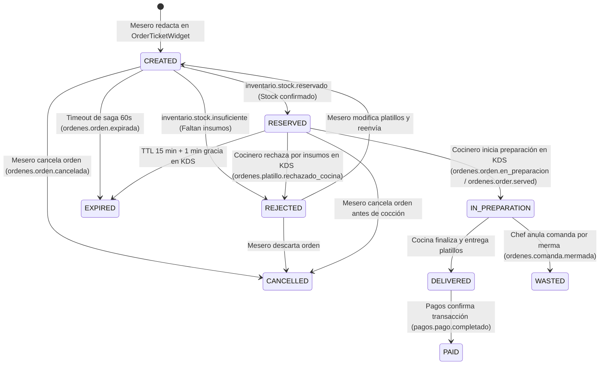

# Contratos y Mensajes de Integración: Órdenes & KDS con Inventario y Menú

> **Versión:** 1.0.0  
> **Fecha:** 12 de Noviembre de 2026  
> **Estado:** Aprobado y Consensuado en Reunión de Líderes de Equipo  
> **Microservicios involucrados:**
> - **Órdenes & KDS** (`orders-backend`, `orders-frontend`)
> - **Inventario** (`Inventory-Backend`, `inventory-frontend`)
> - **Menú** (`menu-backend`, `menu-frontend`)

---

## 1. Resumen Ejecutivo y Resoluciones de la Reunión

Tras la reunión sostenida entre los líderes de equipo de **Menú (Tony)**, **Inventario (Hector)** y **Órdenes & KDS**, se formalizaron las siguientes directrices arquitectónicas obligatorias:

1. **Resolución de Identificadores (`sourceId` vs `offerId` vs `plateId`):**
   - **Menú** emite y administra dos identificadores clave:
     - `offerId`: Identificador comercial de la oferta/platillo en el catálogo de menú (precio, presentación).
     - `sourceId`: Identificador de la receta base o plato físico (`plateId`), que corresponde al modelo de recetas de inventario.
   - **Inventario** indexa sus recetas internamente bajo `recipeModel.findOne({ plateId })`, donde dicho `plateId` corresponde exactamente al `sourceId` generado por Menú en el evento `menu.source.created`.
   - **Órdenes & KDS** recibe ambos (`sourceId` y `offerId`) desde el frontend de Menú y la API, mapeando internamente `dishId = sourceId` para todas las reservas y consumos de inventario, mientras conserva `offerId` para trazabilidad de ventas y menú.
2. **Merma Granular por Platillo (`KitchenDishRejectedEvent`):**
   - El rechazo por falta de insumos físicos en cocina o merma de producción ya no se reporta únicamente a nivel de comanda completa.
   - Se emite un evento granular a nivel platillo: incluye `itemId` (línea afectada), `plateId` / `sourceId` (receta a mermar), `offerId`, `quantity` y `reason` / `motivo`.
   - La comanda (`orderId`) se envía como metadato de referencia para trazabilidad.
3. **Manejo de TTL de Comanda y Expiración:**
   - Si una orden en estado `RESERVED` no es iniciada por cocina dentro del tiempo límite (TTL = 15 minutos):
     - En **KDS**: Permanece visible durante 1 minuto de gracia adicional (`KDS_EXPIRED_GRACE_MS = 60s`) con el botón *"Iniciar preparación"* bloqueado y una alerta visual clara de tiempo vencido. Pasado ese minuto, se elimina de la pantalla.
     - En **Mesero (`OrderTicketWidget`)**: Se notifica al mesero que cocina no confirmó a tiempo, permitiéndole: (a) reintentar confirmación, (b) modificar platillos (permitiendo eliminar hasta 0 platillos para sustitución completa), o (c) cancelar y crear una nueva orden limpiamente.
4. **Nomenclatura Microfrontend:**
   - La vista del mesero integrada en Menú utiliza el término **"Orden"** (en lugar de *"Comanda"* reservado para el KDS de cocina), soportando eventos DOM bilingües (`fmat:orden:*` y `fmat:comanda:*`).
5. **Estrategia de Routing Keys Duales (Bilingües):**
   - Para garantizar interoperabilidad absoluta y prevenir desajustes entre consumidores en inglés y español, Órdenes emite eventos a RabbitMQ con soporte para ambas routing keys (`ordenes.orden.*` y `ordenes.order.*`).

---

## 2. Mapa de Relación de Identificadores

| Concepto | En Microservicio Menú | En Microservicio Inventario | En Microservicio Órdenes & KDS |
| :--- | :--- | :--- | :--- |
| **Plato Físico / Receta** | `sourceId` | `plateId` | `dishId` / `sourceId` / `plateId` |
| **Oferta Comercial de Menú** | `offerId` | N/A (o metadato informativo) | `offerId` |
| **Línea de Comanda** | N/A | `itemId` | `itemId` / `publicId` |
| **Comanda / Orden** | N/A | `orderId` | `orderId` / `publicId` |

---

## 3. Catálogo de Mensajes Emitidos por Órdenes & KDS (Outbound)

Todos los eventos se publican en el Exchange principal de RabbitMQ: `restaurant.events` (o `amq.topic` como fallback standard).

### 3.1. `OrderCreatedEvent` (Orden Creada para Reserva de Stock)

- **Acción desencadenante en UI:** El mesero presiona el botón **"Confirmar orden"** (o *"Enviar a cocina"*) en `OrderTicketWidget` tras agregar platillos desde el menú.
- **Routing Keys emitidas:**
  - `ordenes.orden.creada`
  - `ordenes.order.created`
- **Destinatarios principales:** **Inventario** (`Inventory-Backend`).
- **Propósito:** Solicitar el bloqueo/reserva atómica de los ingredientes necesarios para cada platillo de la orden antes de permitir la cocción.

#### Schema JSON del Payload:
```json
{
  "$schema": "http://json-schema.org/draft-07/schema#",
  "title": "OrderCreatedEvent",
  "type": "object",
  "required": ["eventId", "orderId", "items"],
  "properties": {
    "eventId": { "type": "string", "format": "uuid" },
    "orderId": { "type": "string", "format": "uuid" },
    "correlationId": { "type": ["string", "null"] },
    "items": {
      "type": "array",
      "items": {
        "type": "object",
        "required": ["offerId", "quantity"],
        "properties": {
          "offerId": { "type": "string", "description": "ID comercial o identificador del platillo" },
          "plateId": { "type": "string", "description": "ID de receta de inventario (sourceId)" },
          "sourceId": { "type": "string", "description": "ID de receta de menú" },
          "itemId": { "type": "string", "description": "ID único de línea de orden" },
          "quantity": { "type": "integer", "minimum": 1 }
        }
      }
    }
  }
}
```

#### Ejemplo de Mensaje Real:
```json
{
  "eventId": "a1b2c3d4-0001-5000-8000-111122223333",
  "orderId": "9b1deb4d-3b7d-4bad-9bdd-2b0d7b3dcb6d",
  "correlationId": "f0e9d8c7-b6a5-4321-fedc-ba9876543210",
  "items": [
    {
      "offerId": "offer-hamburguesa-doble-01",
      "plateId": "source-hamburguesa-receta-01",
      "sourceId": "source-hamburguesa-receta-01",
      "quantity": 2
    },
    {
      "offerId": "offer-papas-francesas-01",
      "plateId": "source-papas-receta-01",
      "sourceId": "source-papas-receta-01",
      "quantity": 1
    }
  ]
}
```

---

### 3.2. `OrderConfirmedEvent` (Reserva Confirmada en Cocina)

- **Acción desencadenante en UI / Sistema:** Recibido `inventario.stock.reservado`, la orden pasa a estado `RESERVED`.
- **Routing Keys emitidas:**
  - `ordenes.orden.confirmada`
  - `ordenes.order.confirmed`
- **Destinatarios:** Menú, KDS Realtime WebSocket, Dashboard.
- **Propósito:** Notificar a la cocina que los insumos están físicamente garantizados y la orden está lista para cocinarse.

#### Ejemplo de Mensaje:
```json
{
  "eventId": "b2c3d4e5-0002-5000-8000-222233334444",
  "orderId": "9b1deb4d-3b7d-4bad-9bdd-2b0d7b3dcb6d",
  "correlationId": "f0e9d8c7-b6a5-4321-fedc-ba9876543210"
}
```

---

### 3.3. `OrderInPreparationEvent` (Inicio de Preparación / Descuento FEFO)

- **Acción desencadenante en UI:** El cocinero presiona el botón **"Iniciar preparación"** en una tarjeta `OrderCard` del tablero KDS.
- **Routing Keys emitidas:**
  - `ordenes.orden.en_preparacion`
  - `ordenes.order.served` *(Routing key esperada por Inventory-Backend para ejecutar `consumeServedOrder` con descuento FEFO de lotes)*
- **Destinatarios:** **Inventario** (`consumeServedOrder`), **Menú/Mesero** (actualización en tiempo real).
- **Propósito:** Deducción definitiva de los insumos en el inventario aplicando consumo FIFO/FEFO sobre los lotes reservados.

#### Schema JSON del Payload:
```json
{
  "$schema": "http://json-schema.org/draft-07/schema#",
  "title": "OrderInPreparationEvent",
  "type": "object",
  "required": ["eventId", "orderId", "items"],
  "properties": {
    "eventId": { "type": "string", "format": "uuid" },
    "orderId": { "type": "string", "format": "uuid" },
    "correlationId": { "type": ["string", "null"] },
    "items": {
      "type": "array",
      "items": {
        "type": "object",
        "required": ["offerId", "quantity"],
        "properties": {
          "offerId": { "type": "string" },
          "plateId": { "type": "string" },
          "sourceId": { "type": "string" },
          "quantity": { "type": "integer", "minimum": 1 }
        }
      }
    }
  }
}
```

#### Ejemplo de Mensaje Real:
```json
{
  "eventId": "c3d4e5f6-0003-5000-8000-333344445555",
  "orderId": "9b1deb4d-3b7d-4bad-9bdd-2b0d7b3dcb6d",
  "correlationId": "f0e9d8c7-b6a5-4321-fedc-ba9876543210",
  "items": [
    {
      "offerId": "offer-hamburguesa-doble-01",
      "plateId": "source-hamburguesa-receta-01",
      "sourceId": "source-hamburguesa-receta-01",
      "quantity": 2
    }
  ]
}
```

---

### 3.4. `KitchenDishRejectedEvent` (Rechazo Granular por Falta de Insumo / Merma de Platillo)

- **Acción desencadenante en UI:** En el tablero KDS, el cocinero hace clic en **"Rechazar por falta de insumo"** sobre un platillo específico de una orden en estado `RESERVED` y confirma el modal `ConfirmRejectDialog`.
- **Routing Keys emitidas:**
  - `ordenes.platillo.rechazado_cocina`
  - `ordenes.dish.rejected`
- **Destinatarios principales:**
  - **Inventario:** Para registrar merma de insumos o faltante crítico del platillo.
  - **Menú:** Para marcar automáticamente el platillo/receta como no disponible (`available: false`) y evitar que otros meseros sigan pidiéndolo.
  - **Mesero:** Para desplegar el desglose de rechazo en `OrderTicketWidget` y permitir sustituir el platillo.
- **Características clave:** Es un evento granular a nivel platillo (`itemId`, `plateId`, `sourceId`, `offerId`).

#### Schema JSON del Payload:
```json
{
  "$schema": "http://json-schema.org/draft-07/schema#",
  "title": "KitchenDishRejectedEvent",
  "type": "object",
  "required": ["eventId", "orderId", "itemId", "offerId", "quantity", "reason"],
  "properties": {
    "eventId": { "type": "string", "format": "uuid" },
    "orderId": { "type": "string", "format": "uuid" },
    "correlationId": { "type": ["string", "null"] },
    "itemId": { "type": "string", "description": "ID de la línea del platillo afectado" },
    "offerId": { "type": "string", "description": "ID de la oferta comercial en Menú" },
    "plateId": { "type": "string", "description": "ID de la receta en Inventario (sourceId)" },
    "sourceId": { "type": "string", "description": "ID de la receta en Menú" },
    "quantity": { "type": "integer", "minimum": 1 },
    "reason": { "type": "string", "minLength": 1 },
    "motivo": { "type": "string" }
  }
}
```

#### Ejemplo de Mensaje Real:
```json
{
  "eventId": "d4e5f6a7-0004-5000-8000-444455556666",
  "orderId": "9b1deb4d-3b7d-4bad-9bdd-2b0d7b3dcb6d",
  "correlationId": "f0e9d8c7-b6a5-4321-fedc-ba9876543210",
  "itemId": "item-uuid-1111-2222-3333-444455556666",
  "offerId": "offer-corte-ribeye-01",
  "plateId": "source-corte-ribeye-receta",
  "sourceId": "source-corte-ribeye-receta",
  "quantity": 1,
  "reason": "Carne en mal estado / lote agotado en refrigerador",
  "motivo": "Carne en mal estado / lote agotado en refrigerador"
}
```

---

### 3.5. `OrderWastedEvent` (Comanda Mermada por Error de Cocina / Administrativo)

- **Acción desencadenante en UI:** En KDS, el Chef o Administrador selecciona **"Anular comanda"** (`ChefVoidDialog` o `AdminVoidDialog`) para una orden que ya estaba en cocción o servida.
- **Routing Keys emitidas:**
  - `ordenes.comanda.mermada`
  - `ordenes.order.wasted`
- **Destinatarios:** **Inventario** (asienta merma de producción) y **Pagos** (solicita cobro o descargo contable).

#### Schema JSON del Payload:
```json
{
  "$schema": "http://json-schema.org/draft-07/schema#",
  "title": "OrderWastedEvent",
  "type": "object",
  "required": ["eventId", "orderId", "reason", "motivo", "itemsAfectados"],
  "properties": {
    "eventId": { "type": "string", "format": "uuid" },
    "orderId": { "type": "string", "format": "uuid" },
    "correlationId": { "type": ["string", "null"] },
    "reason": { "type": "string" },
    "motivo": { "type": "string" },
    "note": { "type": ["string", "null"] },
    "itemsAfectados": {
      "type": "array",
      "items": {
        "type": "object",
        "required": ["offerId", "quantity"],
        "properties": {
          "offerId": { "type": "string" },
          "quantity": { "type": "integer", "minimum": 1 }
        }
      }
    }
  }
}
```

---

### 3.6. `OrderCancelledEvent` (Orden Cancelada)

- **Acción desencadenante en UI:** El mesero o usuario presiona **"Cancelar orden"** en `OrderTicketWidget` para una orden en estado `CREATED` o `RESERVED`.
- **Routing Keys emitidas:**
  - `ordenes.orden.cancelada`
  - `ordenes.order.cancelled`
- **Destinatarios:** **Inventario** (libera inmediatamente la reserva de ingredientes en MongoDB/PostgreSQL).

#### Schema JSON del Payload:
```json
{
  "$schema": "http://json-schema.org/draft-07/schema#",
  "title": "OrderCancelledEvent",
  "type": "object",
  "required": ["eventId", "orderId", "reason", "itemsCancelados"],
  "properties": {
    "eventId": { "type": "string", "format": "uuid" },
    "orderId": { "type": "string", "format": "uuid" },
    "correlationId": { "type": ["string", "null"] },
    "reason": { "type": "string" },
    "itemsCancelados": {
      "type": "array",
      "items": {
        "type": "object",
        "required": ["offerId", "quantity"],
        "properties": {
          "offerId": { "type": "string" },
          "quantity": { "type": "integer", "minimum": 1 }
        }
      }
    }
  }
}
```

---

### 3.7. `OrderExpiredEvent` (Orden Expirada por Timeout de Saga o TTL en KDS)

- **Acción desencadenante:** El temporizador de saga backend detecta que Inventario no respondió en 60 segundos, o en KDS transcurre el tiempo límite de espera sin inicio de preparación.
- **Routing Keys emitidas:**
  - `ordenes.orden.expirada`
  - `ordenes.order.expired`
- **Destinatarios:** **Inventario** (garantiza liberación de reservas huérfanas), **Mesero** (habilita botón *"Crear nueva orden"*).

#### Ejemplo de Mensaje:
```json
{
  "eventId": "e5f6a7b8-0005-5000-8000-555566667777",
  "orderId": "9b1deb4d-3b7d-4bad-9bdd-2b0d7b3dcb6d",
  "correlationId": "f0e9d8c7-b6a5-4321-fedc-ba9876543210",
  "elapsedSeconds": 60,
  "reason": "timeout",
  "motivo": "timeout",
  "items": [
    {
      "offerId": "offer-hamburguesa-doble-01",
      "quantity": 2
    }
  ]
}
```

---

## 4. Catálogo de Mensajes Esperados por Órdenes & KDS (Inbound)

### 4.1. `StockReservedMessage` (Reserva Confirmada por Inventario)

- **Emisor:** **Inventario** (`Inventory-Backend`).
- **Routing Keys escuchadas:**
  - `inventario.stock.reservado`
  - `inventory.stock.reserved`
- **Efecto en Órdenes:**
  - Transiciona la orden de `CREATED` a `RESERVED`.
  - Registra `stock_reserved_at = now()`.
  - Notifica a KDS para mostrar la comanda en la pestaña de preparación/pendientes.

#### Schema JSON del Mensaje Esperado:
```json
{
  "$schema": "http://json-schema.org/draft-07/schema#",
  "title": "StockReservedMessage",
  "type": "object",
  "required": ["orderId"],
  "properties": {
    "eventId": { "type": "string" },
    "orderId": { "type": "string", "format": "uuid" },
    "correlationId": { "type": ["string", "null"] },
    "reservations": {
      "type": "array",
      "description": "Detalle opcional de lotes o ingredientes reservados",
      "items": { "type": ["object", "string"] }
    }
  }
}
```

#### Ejemplo Real:
```json
{
  "eventId": "inv-res-uuid-99887766-5544",
  "orderId": "9b1deb4d-3b7d-4bad-9bdd-2b0d7b3dcb6d",
  "correlationId": "f0e9d8c7-b6a5-4321-fedc-ba9876543210",
  "reservations": [
    { "ingredientId": "ing-pan-brioche", "reservedQuantity": 2 },
    { "ingredientId": "ing-carne-angus", "reservedQuantity": 4 }
  ]
}
```

---

### 4.2. `StockInsufficientMessage` (Reserva Rechazada por Falta de Stock)

- **Emisor:** **Inventario** (`Inventory-Backend`).
- **Routing Keys escuchadas:**
  - `inventario.stock.insuficiente`
  - `inventory.stock.insufficient`
- **Efecto en Órdenes:**
  - Transiciona la orden a `REJECTED`.
  - Almacena `rejectionDetails` con los ingredientes faltantes (`faltantes` / `missingIngredients`) y los platillos afectados (`rejectedItems`).
  - Notifica en tiempo real por WebSocket a `OrderTicketWidget` para que el mesero visualice el modal de ingredientes faltantes y ajuste o elimine platillos.

#### Schema JSON del Mensaje Esperado:
```json
{
  "$schema": "http://json-schema.org/draft-07/schema#",
  "title": "StockInsufficientMessage",
  "type": "object",
  "required": ["orderId"],
  "properties": {
    "eventId": { "type": "string" },
    "orderId": { "type": "string", "format": "uuid" },
    "correlationId": { "type": ["string", "null"] },
    "reason": { "type": "string" },
    "missingIngredients": {
      "type": "array",
      "items": { "type": "string" }
    },
    "rejectedItems": {
      "type": "array",
      "items": {
        "type": "object",
        "required": ["offerId"],
        "properties": {
          "offerId": { "type": "string" },
          "itemName": { "type": "string" },
          "requestedQuantity": { "type": "integer" },
          "availableQuantity": { "type": "integer" }
        }
      }
    },
    "reservedItems": {
      "type": "array",
      "items": {
        "type": "object",
        "properties": {
          "offerId": { "type": "string" },
          "quantity": { "type": "integer" }
        }
      }
    }
  }
}
```

#### Ejemplo Real:
```json
{
  "eventId": "inv-rej-uuid-11223344-5566",
  "orderId": "9b1deb4d-3b7d-4bad-9bdd-2b0d7b3dcb6d",
  "correlationId": "f0e9d8c7-b6a5-4321-fedc-ba9876543210",
  "reason": "Stock insuficiente de carne para hamburguesas",
  "missingIngredients": ["carne_angus", "queso_cheddar"],
  "rejectedItems": [
    {
      "offerId": "offer-hamburguesa-doble-01",
      "itemName": "Hamburguesa Doble Angus",
      "requestedQuantity": 2,
      "availableQuantity": 0
    }
  ],
  "reservedItems": [
    {
      "offerId": "offer-papas-francesas-01",
      "quantity": 1
    }
  ]
}
```

---

### 4.3. `CatalogUpdatedMessage` (Actualización de Disponibilidad y Menú)

- **Emisor:** **Menú** (`menu-backend`).
- **Routing Keys escuchadas:**
  - `menu.catalog.updated`
  - `menu.catalogo.actualizado`
- **Efecto en Órdenes:**
  - Actualiza el repositorio local en caché (Redis) de platillos activos y precios para validación rápida en tiempo de redacción de comandas.

#### Ejemplo de Mensaje:
```json
{
  "eventId": "menu-cat-uuid-00112233-4455",
  "version": 12,
  "timestamp": "2026-11-12T14:30:00Z",
  "dishes": [
    {
      "offerId": "offer-hamburguesa-doble-01",
      "sourceId": "source-hamburguesa-receta-01",
      "name": "Hamburguesa Doble Angus",
      "price": 185.00,
      "isAvailable": true,
      "station": "plancha"
    }
  ]
}
```

---

## 5. Contratos Frontend Microfrontends (DOM Custom Events)

Para la integración en el frontend dentro del Shell o la pantalla de Menú, el componente `OrderTicketWidget` escucha los siguientes eventos DOM estándar:

### 5.1. Agregar Platillo a la Orden
- **Nombres soportados:**
  - `fmat:orden:add-item` (Recomendado para Menú)
  - `fmat:comanda:add-item` (Legacy / KDS)
- **Firma del `event.detail`:**
```typescript
interface AddItemEventDetail {
  readonly dishId?: string;      // ID base o sourceId
  readonly sourceId?: string;    // ID de receta física (Menú sourceId)
  readonly offerId?: string;     // ID comercial de menú (Menú offerId)
  readonly name: string;         // Nombre legible del platillo
  readonly quantity: number;     // Cantidad a agregar (por defecto 1)
  readonly unitPrice: number;    // Precio unitario
  readonly notes?: string;       // Instrucciones especiales
  readonly modifiers?: string[]; // Modificadores (e.g. ['sin cebolla', 'término medio'])
  readonly station?: string;     // Estación de cocina sugerida (e.g. 'plancha')
}
```

#### Ejemplo de Despacho desde el Frontend de Menú:
```javascript
window.dispatchEvent(
  new CustomEvent('fmat:orden:add-item', {
    detail: {
      offerId: 'offer-tacos-pastor-01',
      sourceId: 'source-tacos-pastor-receta',
      name: 'Orden de Tacos al Pastor',
      quantity: 1,
      unitPrice: 120.00,
      modifiers: ['con piña', 'sin cilantro'],
      station: 'trompo'
    }
  })
);
```

### 5.2. Apertura del Diálogo de Selección de Platillo
- **Nombres soportados:**
  - `fmat:orden:open-add-dialog`
  - `fmat:comanda:open-add-dialog`
- **Firma del `event.detail`:**
```typescript
interface OpenDialogDetail {
  readonly dishId?: string;
  readonly sourceId?: string;
  readonly offerId?: string;
  readonly name?: string;
  readonly unitPrice?: number;
}
```

---

## 6. Matriz de Estados de la Orden en el Ciclo de Vida



---

## 7. Verificación de Cumplimiento Técnico

- **Tolerancia a Fallos:** Idempotencia garantizada vía `eventId` determinístico en cada transición de estado; mensajes duplicados son descartados sin efectos colaterales.
- **Sin Bloqueos:** El mesero puede vaciar completamente los platillos (reducir a 0) en modo modificación para permitir que un cliente cambie de platillo sin tener que empezar una comanda desde cero.
- **Trazabilidad Total:** Todo mensaje conserva `orderId` y `correlationId` para correlación en logs distribuidos (Jaeger / OpenTelemetry / Kibana).
