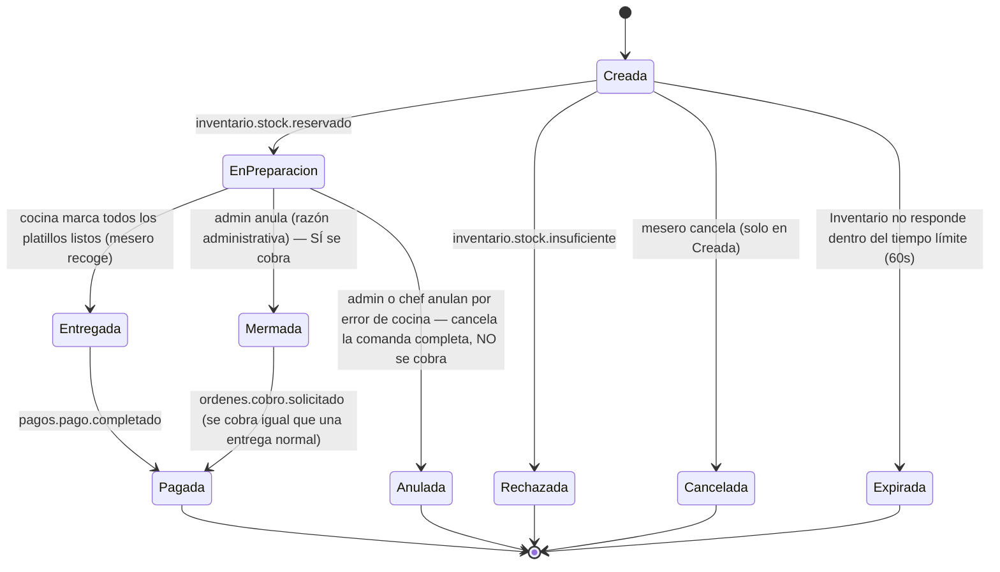

# Especificación de Requisitos de Software (ERS)
## Microservicio 4: Órdenes y Cocina (Orders & KDS Service)

**Versión:** v4 — actualización sobre `Requisitos_MS4_Ordenes_Final_v3`
**Alcance de esta versión:** (1) redefinición del ciclo de vida de estados de la orden, (2) nuevo requisito de cancelación por error de cocina sin cobro al cliente, (3) requisito opcional de preparación de platillos intermedios con previsión de fase futura (ADR-0011), (4) correcciones puntuales sobre disponibilidad de platillos y visibilidad de la comanda en el KDS, (5) resolución de dudas pendientes (autorización, alcance y cobro de las anulaciones; propiedad y vista de platillos intermedios), (6) nuevo estado "Expirada", (7) renombrado de los estados a identificadores cortos, (8) homologación de eventos con Pagos (`orders.bill.requested`, `orders.charge.requested`, `payments.payment.completed`).

---

## 0. Historial de cambios respecto a v3

| # | Cambio | Tipo |
|---|---|---|
| 1 | Se redefine el ciclo de vida principal de la orden a 4 estados: **Creada → En preparación → Entregada → Pagada** (antes: Pendiente, En preparación, Listo, Entregado, Cerrada/Pagada, usados de forma inconsistente) | Modificado |
| 2 | Se aclara la regla de cancelación: solo se cancela libremente en estado "Creada"; la anulación en "En preparación" es exclusiva de administrador y **no exime del cobro** | Modificado (aclaración, la regla de fondo ya existía) |
| 3 | Se agrega el estado y requisito de **"Anulada por Error de Cocina"** (renombrado a **"Anulada"** / `VOIDED`): cuando la anulación en "En preparación" se debe a una falla imputable a cocina, el cliente **no** paga esa comanda/platillo | **Nuevo** |
| 4 | Se clarifica que la preparación de **platillos intermedios/pre-elaborados** queda declarada como NO-GO para el horizonte de 7 sprints (ADR-0011 / `INTERMEDIATE_DISHES_ENABLED=false`), pero **formalmente abierta a implementación en una fase futura o posterior release** sin rediseño arquitectónico | **Aclaración / Fase Futura** |
| 5 | Se aclara que la disponibilidad de un platillo (si el mesero puede o no pedirlo) la determina Catálogo y Menú a través de la vista local ya existente; el mesero nunca puede seleccionar un platillo no disponible. Se acota "Rechazada" a la condición de carrera por stock exacto entre pedidos casi simultáneos | Modificado (aclaración) |
| 6 | Se agrega que la comanda debe desaparecer de la pantalla del KDS en cuanto pasa a estado "Pagada" | **Nuevo** |
| 7 | Se resuelven dudas pendientes: la anulación por error de cocina la confirma un administrador **o el chef** (rol validado contra Auth); esa anulación **cancela la comanda completa**, no solo el platillo; "Mermada" se cobra **exactamente igual que una comanda entregada correctamente**; el stock de platillos intermedios es propiedad de **Inventario** (no de Catálogo); los platillos intermedios requieren una **vista nueva** para el chef | Modificado (aclaración) |
| 8 | Se agrega el estado **"Expirada"**, para cuando Inventario no responde dentro de un tiempo límite tras `ordenes.orden.creada` | **Nuevo** |
| 9 | Se renombran los estados a identificadores cortos por motivos de implementación: `Creada`, `EnPreparacion`, `Entregada`, `Pagada`, `Cancelada`, `Rechazada`, `Mermada`, `Anulada`, `Expirada` | Modificado (renombrado) |

---

## 1. Ciclo de vida y estados de la orden (sección de referencia)

Antes de listar los requisitos funcionales, se fija aquí el vocabulario de estados que el resto del documento usa, ya que en la v3 los mismos conceptos aparecían nombrados de forma distinta en distintas secciones (`Pendiente`/`Creada`, `Listo`/`Entregado`, `Cerrada`/`Pagada`).

### 1.1 Estados principales (ciclo de vida feliz)

> **Convención de nombres:** los estados se identifican con nombres cortos, sin espacios ni tildes (`Creada`, `EnPreparacion`, etc.), pensados para usarse directamente como identificadores en el código. En el texto corrido del documento se sigue usando el español natural ("en preparación") cuando se describe el concepto y no el identificador formal.

| Estado | Se alcanza cuando... | Evento asociado |
|---|---|---|
| **Creada** | El mesero crea la comanda (vinculada a mesa o para llevar) y agrega/edita platillos. La confirmación fija `confirmed_at`; `Creada` incluye "borrador" y "confirmada esperando stock". | — (confirmación dispara `ordenes.orden.creada` y fija `confirmed_at`) |
| **EnPreparacion** | Inventario confirmó la reserva de insumos; la comanda entra a la cola del KDS y cocina la está elaborando. | consume `inventario.stock.reservado` |
| **Entregada** | Cocina marcó todos los platillos como listos; el mesero la recoge y la lleva a la mesa (el sistema no registra ese paso). | — |
| **Pagada** *(fin del ciclo de vida)* | Se confirma el pago de la cuenta. | consume `pagos.pago.completado` (`payments.payment.completed`) |

### 1.2 Estados alternativos

| Estado | Se alcanza cuando... | Evento asociado | ¿Se cobra al cliente? |
|---|---|---|---|
| **Cancelada** | El mesero cancela la comanda mientras está en **"Creada"**. | publica `ordenes.orden.cancelada` (`orders.order.cancelled`) | No — nunca hubo consumo real de insumos, solo se libera la reserva |
| **Rechazada** | Inventario responde con stock insuficiente tras la confirmación — en la práctica, esto ocurre por una condición de carrera entre pedidos casi simultáneos del mismo platillo, ya que el platillo en sí ya pasó el filtro de disponibilidad de Catálogo y Menú (ver nota abajo). Es el paso extra de verificar si el stock exacto sigue disponible al momento de confirmar. | consume `inventario.stock.insuficiente` (`inventory.stock.insufficient`) | No |
| **Mermada** | Un **administrador** anula una comanda completa o platillos individuales ya en **EnPreparacion**, por una razón administrativa o de negocio ajena a la cocina (p. ej., el cliente cambia de opinión). | publica `ordenes.comanda.mermada` (`orders.kitchen.wasted`) + `ordenes.cobro.solicitado` (`orders.charge.requested`) | **Sí** — se trata y se cobra exactamente igual que una comanda entregada correctamente; los insumos se consumen de forma normal |
| **Anulada** *(antes "Anulada por Error de Cocina")* | Un **administrador o el chef** anulan un platillo ya en **EnPreparacion** por una falla atribuible a cocina (platillo mal preparado, error de elaboración, etc.). A diferencia de "Mermada", esta anulación cancela **la comanda completa de inmediato**, no solo el platillo afectado. | publica `ordenes.comanda.mermada` (los insumos ya consumidos no se liberan) — **no** publica ningún evento de cobro | **No** — el error es responsabilidad del restaurante |
| **Expirada** | La comanda permanece en **Creada** 60 s contados desde `confirmed_at` sin que Inventario responda ni con `inventario.stock.reservado` ni con `inventario.stock.insuficiente`. Previene que una falla de Inventario la deje bloqueada indefinidamente (OP-01 / ADR-0001). | — (vencimiento de temporizador interno de 60 s desde `confirmed_at`) | No |

> **Nota — dos capas de validación de disponibilidad, y por qué "Rechazada" sigue siendo necesaria:** el mesero **nunca** puede llegar a intentar pedir un platillo marcado como no disponible, porque la vista local de disponibilidad (alimentada por los eventos `menu.catalogo.actualizado`/`menu.platillo.precio_actualizado` de Catálogo y Menú — ver `API_COMUNICACIONES.md`, sección 2.2) es la que filtra qué platillos puede siquiera seleccionar en la interfaz. Sin embargo, esa disponibilidad indica "el platillo existe y está activo en el menú", no una garantía de cantidad exacta en tiempo real. Si 3 meseros piden casi al mismo tiempo el mismo platillo y el insumo solo alcanza para uno, las otras dos comandas deben terminar en "Rechazada" aunque el platillo se veía disponible al momento de pedir. Este caso ya queda resuelto por el flujo existente de la sección 8, sin necesidad de un mecanismo adicional en Órdenes: Inventario es la única fuente de verdad sobre la cantidad exacta, y debe procesar cada `ordenes.orden.creada` de forma atómica al reservar stock, de modo que solo una de las solicitudes concurrentes reciba `inventario.stock.reservado` y las demás reciban `inventario.stock.insuficiente`.

> **Nota de estados por ítem:** el ciclo de vida por ítem es `PENDING → READY → DELIVERED` (transición automática a `DELIVERED` en la misma transacción en que la orden pasa a `Entregada`) `→ PENDING` (rehacer). Al rehacer un platillo, la orden conserva `DELIVERED` (OP-12), mientras que únicamente el ítem afectado pasa a `PENDING` para su reelaboración en cocina.

### 1.3 Diagrama de estados (orden)

---

## 2. Visualización de comandas en tiempo real

- El sistema deberá agrupar las comandas entrantes en la pantalla de cocina según su estado actual de elaboración.
- El sistema deberá ordenar las comandas en la pantalla de cocina según mayor tiempo en cocina primero (OP-11; medido desde `in_preparation_at`), en lugar de prioridad por tiempo de preparación.
- El sistema deberá ordenar cronológicamente por la hora de ingreso (y por identificador de orden) aquellas comandas que compartan el mismo tiempo en cocina.
- En la pantalla de cocina (KDS), el sistema deberá remover de la **vista principal activa** toda comanda cuyos platillos hayan transitado en su totalidad al estado **"Entregada"** (o marcada lista por cocina) para evitar saturar el flujo de preparación, trasladándola a un **apartado secundario de comandas entregadas / historial reciente**. Si una comanda entregada tiene un platillo que se solicite rehacer (retornando a pendiente), dicha comanda deberá reaparecer automáticamente en la vista principal activa. La comanda se removerá de forma **definitiva** de ambos apartados del KDS únicamente en cuanto su estado transite a **"Pagada"** — información que llega de forma asíncrona desde el microservicio de Pagos y Facturación (ver sección 6).

## 3. Validación y cola KDS

- El sistema debe mostrar los detalles de los platillos, los modificadores aplicados y las notas especiales en cada tarjeta de comanda activa en la cocina, presentando la estación y el tiempo de preparación como texto de referencia (OP-09).
- El sistema deberá mostrar el identificador de la mesa asignada de forma visible en cada tarjeta de comanda.
- El sistema deberá mostrar un contador de tiempo (cronómetro desde la creación del pedido).
- El sistema deberá filtrar los platillos visibles en la pantalla de cocina basándose en la estación definida en el catálogo (estación y tiempo de preparación como texto de referencia, OP-09) para direccionar los pedidos a sus estaciones de preparación correspondientes (`GET /kds/queue?station=`).

## 4. Control del estado de una comanda en su flujo de vida

- El sistema deberá permitir al personal de cocina marcar el estado de la preparación por ítem (platillo) como "Listo" (`PATCH /orders/{orderId}/items/{itemId}/ready`).
- El sistema deberá publicar un evento `ordenes.platillo.preparado` (`orders.item.prepared`) al broker de mensajería cada vez que un platillo transite al estado "Listo", para que el microservicio de Inventario aplique el consumo definitivo de los insumos.
- El sistema deberá permitir al personal de cocina marcar el estado de la preparación por comanda como "Listo" (`PATCH /orders/{orderId}/ready`).

## 5. Gestión de comandas y apertura/cierre de pedidos

- El sistema deberá permitir al mesero crear una nueva comanda vinculándola a una mesa específica.
- El sistema deberá permitir al mesero crear una nueva comanda designándola explícitamente como un pedido para llevar.
- El sistema deberá permitir al mesero agregar platillos, seleccionar modificadores e ingresar notas especiales a una comanda activa.
- El sistema deberá registrar el identificador del usuario autenticado que crea o modifica una comanda para asegurar la trazabilidad de las acciones según los roles y permisos del personal (extraído del token JWT, RF-15 / ADR-0011).
- El sistema deberá permitir al mesero transferir una comanda activa de una mesa a otra.
- El sistema deberá impedir que el mesero seleccione o agregue a la comanda un platillo marcado como no disponible, validando contra la vista local de disponibilidad que el microservicio mantiene sincronizada mediante eventos del microservicio de Catálogo y Menú.

## 6. Sincronización y transición del ciclo de vida del estado de la comanda

- El sistema deberá actualizar visualmente la interfaz cada vez que la comanda transite por los estados de su ciclo de vida principal (**Creada, EnPreparacion, Entregada, Pagada**), así como por los estados alternativos aplicables (**Cancelada, Rechazada, Mermada, Anulada, Expirada**).
- El sistema deberá emitir notificaciones de cambio de estado para actualizar a los módulos externos y a los clientes conectados por WebSocket (`/ws/waiter` y `/ws/kds`, ADR-0002).
- El sistema deberá publicar un evento asíncrono en el broker de mensajería que contenga la información íntegra del pedido (Detalle_Orden, incluyendo precios congelados fijados al confirmar, modificadores e identificadores duales: `orderId` y `sessionId`) para que el microservicio de Pagos lo consuma y procese el cobro: `ordenes.cuenta.solicitada` (`orders.bill.requested`) a solicitud de cuenta por el mesero en comanda regular, u `ordenes.cobro.solicitado` (`orders.charge.requested`) ante una orden administrativamente mermada.
- El sistema deberá actualizar el estado final de la comanda a **"Pagada"** únicamente al consumir el evento asíncrono `pagos.pago.completado` (`payments.payment.completed`) proveniente del módulo externo de Pagos.
- El sistema deberá permitir al mesero retornar un platillo de estado "Entregado" (a nivel de ítem) al estado "Pendiente" (`PATCH /orders/{orderId}/items/{itemId}/redo`), ingresando obligatoriamente una nota de texto que justifique la necesidad de rehacer la preparación en cocina.

## 7. Cancelación y modificación de comandas activas

- El sistema deberá permitir al mesero modificar los platillos de una comanda únicamente si esta se encuentra en estado **"Creada"**.
- El sistema deberá permitir al mesero cancelar una comanda completa únicamente si esta se encuentra en estado **"Creada"** (`PATCH /orders/{orderId}/cancel`).
- El sistema deberá publicar el evento `ordenes.orden.cancelada` (`orders.order.cancelled`) y transicionar la comanda al estado **"Cancelada"** al anular un pedido en estado "Creada", permitiendo al microservicio de Inventario consumir el evento para liberar las reservas de stock asociadas. En este caso no se genera ningún cobro al cliente, ya que no hubo consumo real de insumos.
- El sistema deberá permitir **únicamente a un usuario de rol administrador** anular una comanda completa o platillos individuales que ya hayan transitado al estado **"EnPreparacion"** por una razón administrativa o de negocio no imputable a cocina (p. ej., el cliente cambia de opinión), transicionando la comanda/platillo al estado **"Mermada"** (`PATCH /orders/{orderId}/void`).
- El sistema deberá emitir el evento `ordenes.comanda.mermada` (`orders.kitchen.wasted`) y publicar el evento `ordenes.cobro.solicitado` (`orders.charge.requested`, incluyendo el Detalle_Orden con precios congelados) al mermar una comanda o platillo, tratando y cobrando dicha comanda **exactamente igual que una comanda entregada correctamente**: el cliente paga el total normal y los insumos se consumen de forma normal.

### 7.1 Anulación por error de cocina (estado "Anulada", sin cobro al cliente)

- El sistema deberá permitir anular una comanda ya en estado **"EnPreparacion"** cuando la causa sea **un error atribuible al personal de cocina** (platillo mal preparado, error de elaboración, incidente en cocina), invocando `PATCH /orders/{orderId}/void-kitchen-error`.
- El sistema deberá permitir confirmar esta anulación **únicamente a un usuario con rol administrador o con rol chef** (rol consumido y validado contra el token de Auth).
- El sistema deberá cancelar **la comanda completa de inmediato** al confirmarse una anulación por error de cocina, aunque el error se origine en un solo platillo — esta causa no admite anulación parcial; la comanda transiciona al estado **"Anulada"** (`VOIDED`).
- El sistema deberá exigir el registro de una nota de texto obligatoria (`note`) que justifique la causa del error de cocina para mantener la trazabilidad de las acciones.
- El sistema deberá publicar el evento `ordenes.comanda.mermada` (`orders.kitchen.wasted` con `reason="KITCHEN_ERROR"`) al transicionar una comanda a **"Anulada"**, permitiendo a Inventario registrar la pérdida de los insumos consumidos — dichos insumos **no** se liberan ni se recuperan.
- El sistema **no deberá** publicar ningún evento de cobro para una comanda en estado "Anulada". A diferencia de "Mermada", este flujo **no genera cobro al cliente**, dado que la responsabilidad del error corresponde al restaurante.

## 8. Interacción inicial y validación por eventos (Saga)

- El sistema deberá publicar el evento `ordenes.orden.creada` (`orders.order.created`) en el broker de mensajería inmediatamente después de que el mesero confirme la orden en la interfaz (comanda en estado "Creada"), para solicitar la reserva de los ingredientes.
- El sistema deberá enviar la comanda a la cola de la pantalla de cocina (KDS) y transicionarla a **"EnPreparacion"** únicamente tras consumir el evento asíncrono `inventario.stock.reservado` (`inventory.stock.reserved`) proveniente del microservicio de Inventario.
- El sistema deberá actualizar el estado de la comanda a **"Rechazada"** y emitir una alerta visual en la interfaz del mesero si consume el evento asíncrono `inventario.stock.insuficiente` (`inventory.stock.insufficient`).
- El sistema deberá transicionar la comanda al estado **"Expirada"** si, transcurridos 60 s contados desde `confirmed_at` (OP-01 / ADR-0001), Inventario no ha respondido a `ordenes.orden.creada` ni con stock reservado ni con insuficiente, emitiendo el evento `ordenes.orden.expirada` (`orders.order.expired`).

---

## 9. [Opcional / Fase Futura] Preparación de platillos intermedios (pre-elaborados)

> **Estado actual post-ADR-0011 (TASK-27 NO-GO):** Excluido del horizonte de los 7 sprints del curso escolar (`INTERMEDIATE_DISHES_ENABLED=false`).
> **Garantía de extensibilidad futura:** Si bien la funcionalidad fue descartada para la iteración actual para concentrar esfuerzos en la estabilidad de las transacciones principales, la saga transaccional y la cola KDS, **queda formal y explícitamente abierta la posibilidad de que se implemente en una fase futura o posterior release**. El diseño arquitectónico (Transactional Outbox), la ruta REST (`POST /intermediate-dishes`), el evento asíncrono (`ordenes.platillo_intermedio.preparado` / `INTERMEDIATE_DISH_PREPARED`) y el feature toggle `INTERMEDIATE_DISHES_ENABLED` ya están pre-concebidos para incorporarse directamente sin requerir rediseño del sistema ni modificaciones estructurales al modelo de base de datos.

**Contexto:** Inventario administra existencia no solo de insumos crudos, sino también de **platillos pre-elaborados/intermedios** (por ejemplo, una olla de salsa o caldo preparado antes del inicio del servicio). Esta existencia es propiedad exclusiva del microservicio de **Inventario** — un platillo intermedio no es un platillo comercial de menú (si lo fuera, pertenecería a Catálogo y Menú). Órdenes y Cocina únicamente **informa** su preparación para que Inventario mueva sus propios inventarios: descuenta los insumos crudos usados y aumenta la existencia del platillo pre-preparado resultante. Esto habilita, en la fase futura en que se decida reactivar la funcionalidad, que el chef registre la elaboración de estos lotes **por adelantado y fuera del flujo de una comanda de cliente**.

- **[Fase futura]** El sistema deberá permitir, mediante la activación de `INTERMEDIATE_DISHES_ENABLED=true`, que el usuario con rol **chef** registre la creación de un lote de un **platillo intermedio** a través del endpoint `POST /intermediate-dishes` de forma independiente a cualquier comanda de cliente, indicando el platillo intermedio producido, la cantidad resultante y los insumos crudos utilizados en su elaboración.
- **[Fase futura]** El sistema deberá publicar un evento asíncrono al broker de mensajería (`ordenes.platillo_intermedio.preparado` / `INTERMEDIATE_DISH_PREPARED`, routing key EN/ES en `events.py`) que contenga los insumos crudos consumidos y el platillo intermedio resultante junto con la cantidad producida.
- **[Fase futura]** El sistema deberá diseñarse de forma que, al consumir este evento, **Inventario** descuente los insumos crudos utilizados y, en la misma operación, incremente su propio stock del platillo intermedio resultante, tratándolo como un ítem de inventario propiedad de Inventario (no de Catálogo y Menú).
- **[Fase futura]** El frontend proveerá una **vista nueva**, dirigida específicamente al rol de **chef**, en la que se registre la preparación de platillos intermedios gobernada por el feature toggle.
- **[Fase futura]** Esta funcionalidad seguirá estrictamente el patrón arquitectónico del microservicio (Transactional Outbox + evento asíncrono, sin llamadas síncronas hacia Inventario), por lo que no representa una excepción a los principios de arquitectura del proyecto (ver `API_COMUNICACIONES.md`, sección 0).

---

## 10. Puntos abiertos a validar con el equipo

1. ~~**Autorización de la anulación por error de cocina (sección 7.1)**~~ — **[RESUELTO]** la confirma un administrador o el chef (rol validado contra Auth).
2. ~~**Caso borde — comanda con mezcla de estados**~~ — **[RESUELTO]** ya no aplica: una anulación por error de cocina siempre cancela la comanda completa (sección 7.1), por lo que no puede quedar una mezcla de platillos "Mermados" y "Anulados" dentro de la misma comanda.
3. ~~**Timeout de Saga**~~ — **[RESUELTO]**: fijado en 60 s como máximo desde `confirmed_at` con un intervalo del watcher de 5 s (OP-01 / ADR-0001).
4. ~~**Contrato del evento `ordenes.platillo_intermedio.preparado` (sección 9):**~~ — **[DIFERIDO A FASE FUTURA / ADR-0011]** La propiedad de la entidad "platillo intermedio" queda confirmada para Inventario. Dado que la funcionalidad fue descartada para el alcance de los 7 sprints (ADR-0011), la homologación fina del esquema JSON queda diferida para el momento en que se reactive el feature flag en una iteración posterior.
5. ~~**Interfaz para platillos intermedios (sección 9)**~~ — **[RESUELTO]** sí requiere una vista nueva, dirigida al rol chef (fase futura).
6. **Atomicidad de la reserva de stock en Inventario (sección 1.2):** confirmar con el equipo de Inventario que su reserva de stock ante `ordenes.orden.creada` sea atómica, para garantizar que ante pedidos casi simultáneos del mismo platillo solo uno reciba `inventario.stock.reservado` y el resto `inventario.stock.insuficiente`. Es responsabilidad de Inventario, no de Órdenes, pero condiciona si "Rechazada" cubre correctamente este caso.
7. ~~**[NUEVO] Duración del tiempo límite para "Expirada":**~~ — **[RESUELTO]** El tiempo límite de la saga se acordó en 60 s contados desde `confirmed_at` (OP-01 / ADR-0001).
8. ~~**[NUEVO] Estado "Expirada" fuera del listado final de esta corrección:**~~ — **[RESUELTO]** El estado Expirada queda confirmado como estado final del ciclo alternativo (OP-01 / ADR-0001).
